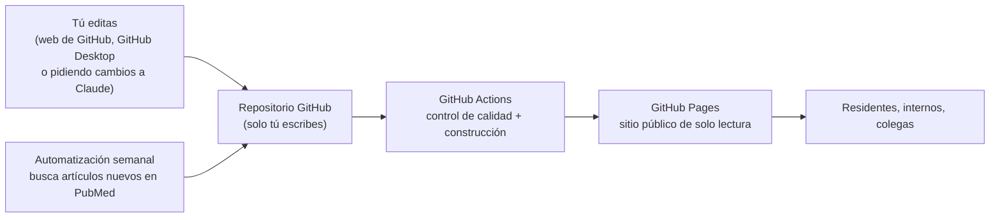
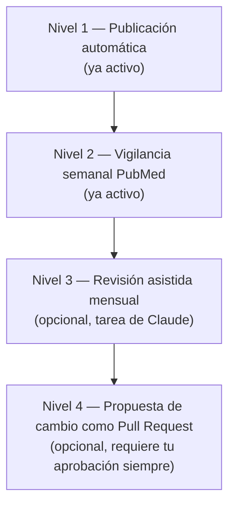

# Alojamiento y publicación

!!! info "Ficha de la página"
    **Última revisión:** 2026-11-14 · Guía paso a paso para publicar la wiki de modo que **solo tú puedas editar** y **otras personas puedan leer**, para que **viva en un lugar que no dependa de tu computador**, y para que se **actualice sola** (publicación, vigilancia semanal de PubMed y, opcionalmente, propuestas de incorporación revisadas por ti). Los pasos están escritos para Mac.

## 1. Recomendación

| Necesidad | Solución | Costo |
|---|---|---|
| Guardar la wiki con historial de cambios; solo tú editas | **Repositorio en GitHub** (cuenta personal gratuita) | Gratis |
| Que otros la lean en un navegador | **GitHub Pages**, publicado automáticamente con GitHub Actions | Gratis |
| Convertir el Markdown en sitio web | **Zensical** (lee el `mkdocs.yml` actual) | Gratis |
| Que se actualice sola | Automatización incluida en `.github/workflows/publicar.yml` | Gratis |

**Por qué esta combinación:** es una sola cuenta, no requiere usar la Terminal, y el control de edición viene dado por diseño: en un repositorio de GitHub **solo escribe el dueño** (y a quien él invite); el resto del mundo solo lee.

!!! warning "Lo que debes saber antes de elegir"
    - Con la cuenta gratuita, GitHub Pages exige que el **repositorio sea público** [d]. Eso significa que el sitio **y** los archivos Markdown quedan visibles para cualquiera que tenga el enlace (nadie más puede modificarlos).
    - Si prefieres que **solo lectores autorizados** (por ejemplo, residentes e internos con su correo) puedan entrar, usa la alternativa de la [sección 7](#7-alternativa-lectura-restringida-a-personas-autorizadas).
    - En ambos casos: **no incluir datos de pacientes** ni pegar texto íntegro de guías con derechos de autor.

### Comparación de opciones

| Opción | ¿Quién edita? | ¿Quién lee? | Costo | Esfuerzo inicial |
|---|---|---|---|---|
| **GitHub Pages (repositorio público)** — recomendada | Solo tú | Cualquiera con el enlace | Gratis | Bajo |
| **Cloudflare Pages + Access** | Solo tú | Solo correos autorizados (hasta 50 usuarios gratis) [a] | Gratis | Medio |
| **Render (sitio estático) + PageCrypt** | Solo tú | Quien tenga una contraseña única compartida | Gratis | Medio (una vez) |
| **VPS pequeño + Caddy con contraseñas** | Solo tú | Cada persona con su propio usuario/clave | ≈US\$5-6/mes | Medio-alto |
| GitHub Pages con repositorio privado | Solo tú | Cualquiera (el sitio sigue siendo público); requiere plan Pro. Sitio realmente privado exige Enterprise Cloud [d] | De pago | Medio |
| Netlify con protección por contraseña | Solo tú | Quien tenga la contraseña (o inicie sesión en tu equipo Netlify) | US\$19/mes (plan Pro) [g] | Bajo |
| Wikis "clásicas" (Notion, Confluence, Wiki.js, MediaWiki) | Configurable | Configurable | Variable | Alto: habría que **migrar** el contenido y se pierden los controles de citas y los diagramas tal como están |
| Obsidian local (abrir la carpeta `docs/`) | Solo tú | Nadie más | Gratis | Muy bajo (solo estudio personal) |

!!! tip "¿Cuál elegir entre las cuatro con acceso restringido?"
    - **Cloudflare Access**: la más "profesional" — cada persona entra con su propio correo, se puede quitar acceso a alguien puntual sin cambiar nada más. Más pasos de configuración.
    - **Render + PageCrypt**: la más simple de las gratuitas con candado — una sola contraseña compartida, sin cuentas individuales. Buena si te basta con "le paso la clave a los residentes del semestre".
    - **VPS + Caddy**: pequeño pago mensual, pero control total — tú decides cada usuario/clave, puedes alojar ahí también otras cosas a futuro. Requiere más comodidad con la Terminal.
    - **Netlify Pro**: la más cara, pero la de menos pasos de configuración (un interruptor en el panel).

## 2. ¿Dónde viven los archivos? (que no dependa de este computador)

Hoy la wiki existe en dos lugares temporales: esta sesión de Claude (que se cierra) y las copias en `.zip` que te he enviado al chat. Ninguno de los dos es un lugar permanente. El primer `git push` (sección 4) la mueve a un lugar que **no depende de tu Mac, ni de que esta conversación siga abierta, ni de ningún otro computador en particular**.

| Dónde vive el código | ¿Depende de un computador? | Versionado e historial | Dispara la automatización | Costo |
|---|---|---|---|---|
| **GitHub** (recomendado) | No — vive en los servidores de GitHub | Sí, completo (quién cambió qué y cuándo) | Sí: push → GitHub Actions | Gratis |
| GitLab (alternativa equivalente) | No | Sí | Sí (GitLab CI, funciona igual) | Gratis |
| Google Drive / iCloud Drive / Dropbox | No, pero cada dispositivo necesita sincronizar | No (o muy básico) | No — nada reacciona automáticamente a un archivo nuevo ahí | Gratis/ya lo tienes |
| Solo en tu Mac (sin subir a ningún lado) | **Sí, totalmente** | No | No | Gratis |

**Recomendación:** usa **GitHub** como el único lugar "oficial" (la *fuente de verdad*). Tu Mac deja de ser necesario en cuanto haces el primer `git push`: después puedes editar, revisar y hasta publicar desde cualquier otro equipo o solo desde el navegador.

### Cómo editar sin depender de tu Mac, una vez que el repositorio existe en GitHub

| Herramienta | Qué necesitas instalar | Cuándo conviene |
|---|---|---|
| **Editor web de GitHub** (ícono de lápiz en cualquier archivo) | Nada, solo un navegador | Correcciones puntuales desde cualquier computador o tablet |
| **GitHub Codespaces / github.dev** | Nada — se abre en el navegador agregando `.dev` a la URL del repo (`github.dev/TU-USUARIO/wiki-hematologia`) o con el botón **Code → Codespaces** | Editar varios archivos a la vez, con vista previa, sin instalar nada en ningún equipo |
| **App GitHub Mobile** | App gratuita en el teléfono | Revisar cambios, aprobar o leer el estado de la publicación desde el celular |
| **Otro Mac/PC con GitHub Desktop** | Instalar GitHub Desktop e iniciar sesión con la misma cuenta | Si cambias de computador habitual |
| **Claude conectado al repositorio** | Nada de tu parte | Pedir cambios por chat; Claude los sube con tu aprobación |

Es decir: el único momento en que el contenido depende de "este computador" es **antes** del primer `git push`. Después, el repositorio en GitHub es la copia permanente, y tu Mac es solo uno más de los lugares desde donde puedes editarlo.

!!! tip "Respaldo adicional (opcional, no reemplaza a GitHub)"
    Si quieres además una copia legible sin internet, puedes sincronizar la misma carpeta con iCloud Drive o Google Drive y abrirla con Obsidian para leerla o estudiar sin conexión. Eso es un respaldo de lectura; la edición, el historial y la automatización deben seguir pasando por GitHub.

## 3. Cómo funciona



## 4. Subir la wiki por primera vez (unos 20-30 minutos)

!!! tip "Dos caminos posibles"
    **Camino A** (abajo): con GitHub Desktop — más visual, recomendado si vas a seguir editando archivos grandes o páginas nuevas seguido. **Camino B** (al final de esta sección): subir por el navegador, sin instalar nada — más simple si solo quieres dejarlo funcionando una vez y luego editar siempre desde la web.

### Paso 1 — Crear la cuenta

1. Entra a <https://github.com> → **Sign up**. Usa un correo que controles tú (no el del hospital, para no depender de esa cuenta institucional).
2. Elige un nombre de usuario que te sirva a largo plazo (aparecerá en la URL pública de la wiki: `TU-USUARIO.github.io`).
3. Activa la verificación en dos pasos: **Settings → Password and authentication → Two-factor authentication**. Esa cuenta es la "llave" de edición de toda la wiki, conviene protegerla bien.

### Paso 2 — Instalar GitHub Desktop (Camino A)

1. Descarga **GitHub Desktop** para Mac desde <https://desktop.github.com> e instálalo como cualquier aplicación.
2. Ábrelo → **Sign in to GitHub.com** → inicia sesión con la cuenta del paso 1 (se abre el navegador para autorizar y vuelve a la app).
3. En las preferencias de GitHub Desktop (menú superior → Settings/Preferences → Git), confirma que tu nombre y correo quedaron configurados; así cada cambio queda firmado con tu nombre en el historial.

### Paso 3 — Preparar la carpeta

1. Descarga el archivo `wiki-hematologia-v10.zip` (el más reciente que te envié) y descomprímelo con doble clic. Obtendrás la carpeta `wiki-hematologia`.
2. Muévela a un lugar estable, por ejemplo `Documentos/wiki-hematologia`. Esa carpeta será tu copia de trabajo mientras usas GitHub Desktop.
3. Confirma que dentro ves, entre otras, las carpetas `docs/`, `scripts/` y `.github/` (esta última puede aparecer oculta; en Finder usa ⌘+Mayús+. para verla — no es obligatorio verla, solo confirma que el zip se descomprimió completo).

### Paso 4 — Convertir la carpeta en repositorio y subirla

1. En GitHub Desktop: menú **File → Add Local Repository…** → **Choose…** → selecciona la carpeta `wiki-hematologia` → **Add Repository**.
2. GitHub Desktop avisará que la carpeta no es todavía un repositorio Git: haz clic en **create a repository** → en la ventana que se abre, deja el nombre tal cual y pulsa **Create Repository**. Esto no sube nada aún, solo prepara la carpeta localmente.
3. Verás en la pestaña **Changes** (izquierda) la lista completa de archivos nuevos — son todos los de la wiki, es normal y esperado la primera vez.
4. Haz clic en **Publish repository** (botón arriba a la derecha). En la ventana:
    - **Name**: `wiki-hematologia` (o el nombre que prefieras; quedará en la URL).
    - **Description**: opcional, por ejemplo "Wiki de hematología para docencia".
    - **Desmarca** la casilla **"Keep this code private"** — importante: con ella marcada, GitHub Pages gratuito no puede publicar el sitio [d].
    - Pulsa **Publish Repository** y espera a que la barra de progreso termine (unos segundos).
5. Verifica en el navegador que funcionó: entra a `https://github.com/TU-USUARIO/wiki-hematologia` y deberías ver todos los archivos.

### Paso 5 — Activar la publicación automática

1. En esa misma página del repositorio, ve a **Settings** (pestaña superior) → **Pages** (menú izquierdo).
2. Bajo **Build and deployment → Source**, cambia el menú desplegable de "Deploy from a branch" a **GitHub Actions** [c]. No hace falta elegir ningún flujo ahí; ya viene definido en `.github/workflows/publicar.yml`.
3. Ve a la pestaña **Actions** (arriba). Verás a la izquierda el flujo **"Publicar wiki"**.
4. Haz clic en **Publicar wiki** → botón **Run workflow** (derecha) → de nuevo **Run workflow** (confirmar). Esto dispara la primera publicación manualmente; de ahí en adelante se dispara sola con cada cambio y cada lunes (sección 6).
5. Espera 1–2 minutos: aparecerá un círculo amarillo (en curso) y luego un ✅ verde (éxito) o una ✗ roja (falló — ver el recuadro de abajo). Haz clic en la ejecución para ver el detalle de cada paso.
6. Con el ✅ verde, la wiki ya está publicada en:

    `https://TU-USUARIO.github.io/wiki-hematologia/`

7. Ábrela en una ventana privada/de incógnito del navegador (sin tu sesión) para comprobar que cualquiera la ve. Ese es el enlace que compartes con residentes e internos.

!!! tip "Si el flujo falla (✗ roja)"
    Haz clic en la ejecución fallida → en el paso marcado en rojo verás el motivo exacto. El más probable es **"Control de calidad de la wiki"**: alguna página tiene una cita `[n]` sin referencia, un enlace a un `.md` que no existe, o le falta la línea "Última revisión". Mientras no se corrija, **el sitio publicado no cambia** — queda la última versión buena, nunca se "rompe" para quien lo esté leyendo. Corrige el archivo señalado, vuelve a subir el cambio y el flujo corre de nuevo solo.

### Camino B — Subir por el navegador, sin instalar nada

Si prefieres no instalar GitHub Desktop (por ejemplo, para hacerlo desde un computador que no es el tuyo):

1. Haz los pasos 1 y 5 igual que arriba (crear cuenta y, después, activar Pages).
2. En vez del paso 2-4: en <https://github.com/new>, crea un repositorio vacío llamado `wiki-hematologia`, **sin** marcarlo privado, sin README.
3. Descomprime el zip en tu computador. Entra al repositorio recién creado → **Add file → Upload files** → arrastra **todo el contenido** de la carpeta `wiki-hematologia` (incluida la carpeta `.github`, que en Finder puede estar oculta — usa ⌘+Mayús+. para verla antes de arrastrar) → **Commit changes**.
4. Continúa con el paso 5 (activar Pages y correr el flujo). Después de esto, toda edición futura puede seguir siendo por la web, sin volver a instalar nada (sección 5).

!!! tip "Si el flujo falla (cruz roja)"
    Haz clic en la ejecución fallida para ver en qué paso se detuvo. El más probable es **"Control de calidad de la wiki"**: significa que alguna página tiene una cita sin referencia, un enlace roto o le falta "Última revisión". Mientras no se corrija, el sitio publicado **no cambia** (queda la última versión buena).

## 5. Cómo editar después (solo tú)

| Vía | Cuándo usarla | Pasos |
|---|---|---|
| **A. Desde la web de GitHub** | Correcciones pequeñas (una dosis, una errata) | Abrir el archivo en `docs/…` → ícono de lápiz → editar → **Commit changes**. Se publica solo en 1–2 min |
| **B. GitHub Desktop** | Páginas nuevas o cambios grandes (por ejemplo, un zip nuevo generado con Claude) | Reemplazar/agregar archivos en tu carpeta → GitHub Desktop muestra los cambios → escribir un resumen → **Commit to main** → **Push origin** |
| **C. Claude conectado al repositorio** | Flujo habitual de esta wiki | Una vez creado el repositorio, se puede conectar a la sesión de Claude para que los cambios se suban directamente, con tu aprobación |

En todos los casos, cada cambio queda registrado con fecha y se puede deshacer (pestaña **History** en GitHub Desktop).

**Quién puede editar:** solo tu cuenta. Para dar permiso de edición a otra persona algún día: **Settings → Collaborators → Add people**. Si nunca agregas a nadie, nadie más puede cambiar nada.

**Agregar una página nueva:** crear el archivo `.md` en la carpeta correspondiente de `docs/` (usa la [plantilla](plantilla-pagina.md)) y añadir su línea en la sección `nav` de `mkdocs.yml`.

## 6. Actualización automática, paso a paso

Hay cuatro niveles, de menor a mayor automatización. Los dos primeros **ya vienen funcionando** en cuanto completas la sección 4 — no hay que configurar nada más. Los dos últimos son opcionales y se arman cuando quieras.



### 6.1 Nivel 1 — Publicación automática (ya incluida, no requiere nada de ti)

Cada vez que subes un cambio (`git push`, editar en la web, o Claude subiendo por ti), el flujo `.github/workflows/publicar.yml` hace, en orden, sin que intervengas:

1. **Descarga** la versión más reciente del repositorio.
2. **Control de calidad** (`python3 scripts/check_wiki.py`): revisa que toda cita `[n]` tenga su referencia en `referencias.md`, que los enlaces internos no estén rotos y que cada página clínica tenga "Última revisión". Si algo falla, el flujo se detiene **aquí** y el sitio publicado no cambia.
3. **Construcción** del sitio con Zensical (`zensical build --clean`), que lee `mkdocs.yml` y genera HTML en la carpeta `site/`.
4. **Publicación** en GitHub Pages con esos archivos.

Todo esto corre en servidores de GitHub, no en tu computador — por eso funciona igual si tu Mac está apagado.

### 6.2 Nivel 2 — Vigilancia semanal de la literatura (ya incluida), explicada paso a paso

Qué pasa automáticamente cada **lunes** (y se puede adelantar manualmente):

1. GitHub despierta el flujo por el horario configurado (`cron: "0 10 * * 1"`, 10:00 UTC del lunes).
2. Ejecuta `scripts/novedades_pubmed.py`, que lee `scripts/vigilancia.json` (tus 17 temas vigilados) y por cada uno consulta la **API pública de PubMed (E-utilities)**: busca artículos de los últimos 90 días filtrados a guías, consensos, ensayos aleatorizados y metaanálisis, en inglés o español.
3. Regenera por completo la página [Novedades de la literatura](novedades.md), con hasta 12 artículos por tema, autor, revista, fecha y enlace al PMID.
4. El propio flujo **hace commit y push** de ese archivo actualizado (usando el permiso `contents: write` ya configurado — no necesitas crear ninguna clave ni token para esto).
5. Ese push dispara automáticamente el Nivel 1: control de calidad, construcción y publicación del sitio con la página de novedades al día.

**Para ejecutarla fuera de su horario** (por ejemplo, para probarla ahora): pestaña **Actions → Publicar wiki → Run workflow**. Nota: ese botón corre *todo* el flujo (incluida la vigilancia), así que también sirve como prueba general.

**Para ajustarla:**

- **Agregar un tema nuevo:** edita `scripts/vigilancia.json` y agrega una línea con `titulo`, `pagina` (archivo `.md` de destino) y `consulta` (términos de búsqueda en sintaxis de PubMed, por ejemplo `"polycythemia vera[ti]"`).
- **Cambiar la ventana de tiempo o el máximo por tema:** los campos `dias` (90 por defecto) y `max_por_tema` (12 por defecto) del mismo archivo.
- **Cambiar el día/hora:** edita la línea `cron:` en `.github/workflows/publicar.yml` (usa un generador de expresiones cron si no es tu lenguaje habitual, por ejemplo buscando "crontab guru").

!!! warning "Límite deliberado"
    La automatización **lista** artículos nuevos; **no reescribe** las páginas clínicas. Cambiar una dosis o un algoritmo sin que alguien lea el artículo rompería la regla central de la wiki (nada sin fuente revisada). La página de novedades es la bandeja de entrada; la incorporación al contenido es siempre una decisión tuya.

    El guion se probó con respuestas simuladas de PubMed; la primera ejecución real ocurrirá en GitHub, el primer lunes tras la publicación. Si esa parte fallara por cualquier motivo, la publicación del resto del sitio continúa igual (el paso de PubMed tiene `continue-on-error: true`).

### 6.3 Incorporación asistida al contenido: tarea programada de Claude (paso a paso)

Esto cierra el ciclo — que lo que aparece en "Novedades" termine, cuando corresponda, incorporado a una página clínica — sin que tengas que acordarte de revisarlo tú mismo cada vez.

**Paso 1 — Conectar el repositorio a esta conversación (una sola vez).**
Una vez que el repositorio exista en GitHub (sección 4), dime su nombre (`TU-USUARIO/wiki-hematologia`) y lo conecto a esta sesión.

**Paso 2 — Crear la tarea programada.**
Te pido que confirmes la frecuencia (mensual es razonable, dado que la vigilancia semanal ya alimenta "Novedades") y creo una tarea con una instrucción como:

> "Abre el repositorio wiki-hematologia, lee `docs/novedades.md`, verifica en PubMed los artículos que allí aparecen y que aún no estén citados en `docs/referencias.md`, y para cada uno que sea relevante y de calidad suficiente (guía, consenso, ensayo aleatorizado o metaanálisis), redacta una propuesta de cambio a la página clínica correspondiente con las marcas [V-TF]/[V-RS]/[PV] y la referencia numerada. No publiques nada: deja los cambios en una rama nueva y abre un Pull Request para que Pablo lo revise."

**Paso 3 — Revisar y aprobar (siempre tu decisión).**
Cada ejecución de esa tarea te deja un **Pull Request** (una propuesta de cambio, no un cambio ya hecho) en la pestaña **Pull requests** del repositorio. Tú lo lees, pides ajustes si algo no cuadra, y solo si estás de acuerdo pulsas **Merge** — ahí sí se publica.

**Paso 4 — Cambiar o pausar la tarea.**
Puedo ajustar la frecuencia, pausarla o eliminarla cuando quieras; dímelo en cualquier momento.

!!! note "Por qué un Pull Request y no un cambio directo"
    Mantiene intacta la regla "solo tú editas" (sección 1): la tarea programada propone, pero el repositorio no acepta el cambio hasta que tú lo apruebes con un clic. Es el mismo mecanismo de control que usarías si un colega te mandara una corrección por revisar.

Complemento simple e independiente de todo lo anterior: en PubMed, con una cuenta gratuita **My NCBI**, cada búsqueda se puede guardar con **Create alert** para recibirla por correo — útil como respaldo si alguna semana la automatización de GitHub no corriera.

## 7. Alternativa: lectura restringida a personas autorizadas

Si no quieres que la wiki sea visible para cualquiera con el enlace:

1. Sigue los pasos 1 a 4, pero **deja marcado** "Keep this code private".
2. Crea una cuenta en Cloudflare → **Workers & Pages → Conectar a Git** → elige el repositorio (Cloudflare puede construir desde un repositorio privado [f]).
3. Configuración de construcción: comando `pip install zensical && zensical build` · directorio de salida `site`.
4. **Zero Trust → Access → Aplicación autohospedada** sobre el dominio `*.pages.dev` del proyecto, con una política que permita solo los correos autorizados (hasta 50 usuarios en el plan gratuito [a]).
5. Incluye en la política las URL de vista previa que Cloudflare genera en cada despliegue [e].
6. Prueba con un correo no autorizado: debe bloquearse.

En esta variante la publicación la hace Cloudflare; la vigilancia semanal de PubMed sigue funcionando en GitHub, pero hay que quitar del archivo `publicar.yml` los últimos pasos de GitHub Pages (pídelo y se ajusta).

## 8. Otras dos opciones con acceso restringido (gratis o pago pequeño)

### 8.1 Gratis: Render + PageCrypt (una contraseña compartida)

**Render** ofrece sitios estáticos gratis e ilimitados, pero no tiene un candado de contraseña propio todavía [h]; el repositorio sí puede quedar privado en Render sin costo adicional. Para agregar la contraseña se usa **PageCrypt**, una herramienta gratuita de código abierto que cifra el HTML en el momento de construir el sitio; sin la clave correcta, el visitante solo ve una pantalla pidiendo la contraseña [i].

1. Sigue los pasos de la [sección 4](#4-subir-la-wiki-por-primera-vez-unos-20-30-minutos), pero **deja marcado** "Keep this code private" al publicar en GitHub.
2. Crea una cuenta gratuita en <https://render.com> → **New → Static Site** → conecta tu repositorio de GitHub (Render puede leer repositorios privados).
3. Build Command: `pip install zensical && zensical build --clean`. Publish directory: `site`.
4. En **Environment → Add Environment Variable**, agrega una variable, por ejemplo `WIKI_PASSWORD`, con la clave que vas a compartir con residentes e internos.
5. Antes del paso de construcción, agrega el cifrado con PageCrypt sobre el archivo generado (`site/index.html` y cada página), usando esa variable de entorno como contraseña [i]. Pídemelo cuando tengas la cuenta creada: ajusto `publicar.yml`/el build command exacto para que esto quede automático en cada publicación.
6. Cada `git push` dispara un nuevo build en Render automáticamente — no hace falta GitHub Pages en este caso.
7. Para cambiar la contraseña más adelante: cambia la variable de entorno en Render y vuelve a construir (**Manual Deploy**).

!!! warning "Límite de esta opción"
    Es **una sola clave para todos**: no hay manera de distinguir usuarios ni de quitarle el acceso a una sola persona sin cambiar la clave para todo el grupo. Si eso te importa, usa Cloudflare Access (sección 6) o la opción 7.2.

### 8.2 Pago pequeño (~US\$5-6/mes): un servidor propio con contraseñas individuales

Un servidor virtual pequeño (DigitalOcean, Hetzner u otro proveedor similar) con el servidor web **Caddy** da control total: tú decides cada usuario y contraseña, y puedes revocar acceso a una sola persona sin afectar al resto.

1. Crea el servidor más pequeño del proveedor que elijas (típicamente 1 vCPU/1 GB, ≈US\$5-6/mes) con Ubuntu.
2. Instala Caddy (incluye HTTPS automático) y configura autenticación básica por usuario en su archivo de configuración, con un usuario distinto por persona.
3. En el servidor, clona tu repositorio (privado) y agrega un paso automático (GitHub Actions conectado por SSH, o una tarea programada que haga `git pull` cada hora) que ejecute `zensical build` y copie `site/` a la carpeta que sirve Caddy.
4. La vigilancia semanal de PubMed sigue corriendo igual en GitHub Actions; solo cambia el destino final de la publicación.
5. Para agregar o quitar a alguien: editas el archivo de usuarios/claves de Caddy y recargas el servicio — sin tocar GitHub ni Render.

Esta opción requiere más comodidad con la Terminal que las anteriores. Si quieres seguirla, dime qué proveedor prefieres y te doy los comandos exactos paso a paso.

## 9. Prueba local (opcional)

En la Terminal del Mac, dentro de la carpeta de la wiki:

```bash
pip3 install zensical
zensical serve        # abre http://localhost:8000
python3 scripts/check_wiki.py
```

!!! note "Sobre el generador"
    Material for MkDocs entró en modo de mantenimiento en noviembre de 2025, con soporte comprometido hasta el 5-nov-2026 [b]. Por eso la wiki se construye con **Zensical**, del mismo equipo, que lee el `mkdocs.yml` existente [c]. El contenido es Markdown puro y puede migrarse a otra herramienta sin reescribirlo.

## Fuentes de esta página

- [a] Cloudflare Zero Trust, plan gratuito hasta 50 usuarios — <https://www.cloudflare.com/teams-access/>
- [b] Modo de mantenimiento y fin de soporte de Material for MkDocs — <https://squidfunk.github.io/mkdocs-material/blog/2025/11/11/insiders-now-free-for-everyone/> y <https://github.com/squidfunk/mkdocs-material/issues/8523>
- [c] Zensical, publicación en GitHub Pages con GitHub Actions — <https://zensical.org/docs/publish-your-site/>
- [d] GitHub Pages: repositorio público en el plan gratuito; sitio privado solo con Enterprise Cloud — <https://docs.github.com/en/get-started/learning-about-github/githubs-plans> y <https://hostsmith.net/blog/github-pages-private/>
- [e] Vistas previas de Cloudflare Pages protegidas con Access — <https://israynotarray.com/en/misc/2026/05/13/cloudflare-pages-preview-urls-stay-forever-lock-with-access/>
- [f] Cloudflare Pages desde repositorio privado — <https://homelab-docs-cwy.pages.dev/guides/private-docs-access-2026-04-07/>
- [g] Netlify, protección por contraseña disponible desde el plan Pro (US\$19-20/usuario/mes) — <https://docs.netlify.com/manage/security/secure-access-to-sites/password-protection/> y <https://www.capterra.com/p/154989/Netlify/pricing/>
- [h] Render no ofrece protección por contraseña nativa para sitios estáticos (solicitud de función abierta) — <https://community.render.com/t/static-htaccess-htpasswd/383>
- [i] PageCrypt: cifrado de sitios estáticos con contraseña compartida, ejemplo de despliegue en Render — <https://render.com/blog/static-site-auth-pagecrypt>

*Los precios, menús y condiciones de terceros cambian: confírmalos en el sitio del proveedor al momento de configurar.*
