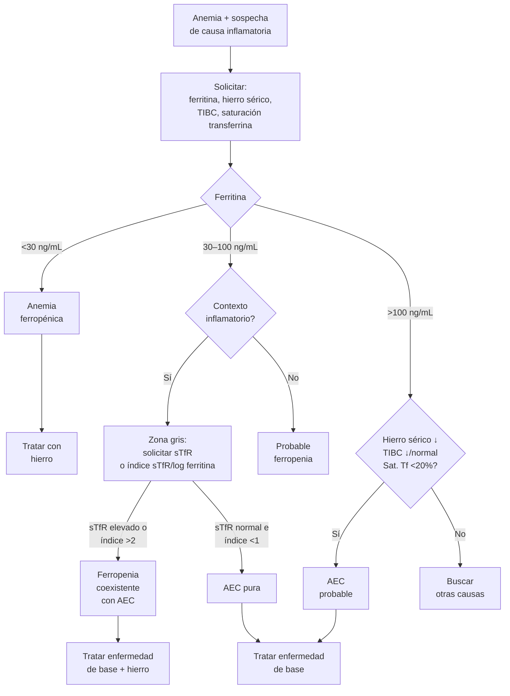
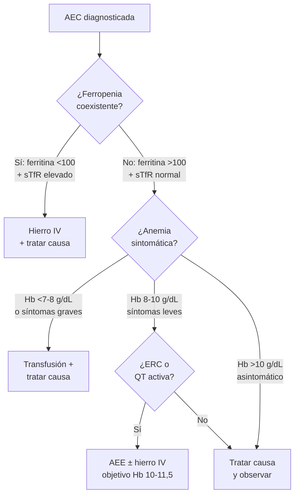

# Anemia de enfermedad crónica (anemia de la inflamación)

!!! info "Ficha de la página"
    **Última revisión:** 2026-11-11 · **Fuentes base:** Nemeth & Ganz — Anemia of Inflammation (Hematol Oncol Clin North Am, 2014) [43] **[V-RS]**; Weiss et al. — Anemia of chronic disease / iron deficiency (Blood, 2019) [44] **[V-RS]**; Camaschella — Iron-Deficiency Anemia (NEJM, 2015); Cappellini et al. — Iron deficiency across chronic inflammatory conditions (Am J Hematol, 2020); algoritmo diagnóstico ARUP Consult 2024. **Alcance:** adultos; fisiopatología, diagnóstico diferencial con ferropenia y tratamiento.

## 1. Resumen rápido

- La **anemia de enfermedad crónica** (AEC), también llamada **anemia de la inflamación** (AI), es la **segunda causa más frecuente de anemia** después de la ferropenia [43] **[V-RS]**.
- Es la causa más frecuente de anemia en pacientes hospitalizados [43] **[V-RS]**.
- **Mecanismo central:** la inflamación crónica induce producción hepática de **hepcidina**, que bloquea la exportación de hierro desde enterocitos y macrófagos → **hipoferremia funcional** a pesar de depósitos normales o aumentados [43][44] **[V-RS]**.
- Generalmente **leve a moderada** (Hb raramente <8 g/dL), **normocítica normocrómica**, aunque puede ser microcítica en ~20-30 % de los casos [43] **[V-RS]**.
- El **diagnóstico diferencial con anemia ferropénica** (AF) es el desafío clínico principal; frecuentemente coexisten [44] **[V-RS]**.
- **Tratamiento fundamental:** tratar la enfermedad de base [43][44] **[V-RS]**.

## 2. Fisiopatología

### 2a. Rol de la hepcidina

La **hepcidina** es el regulador central del metabolismo del hierro. Es un péptido de 25 aminoácidos producido por los hepatocitos en respuesta a señales inflamatorias (principalmente IL-6 vía JAK2/STAT3) [43][44] **[V-RS]**.

**Mecanismo de acción:** la hepcidina se une a la **ferroportina** (único exportador celular de hierro) y causa su internalización y degradación → se bloquea:

1. La absorción intestinal de hierro (enterocitos)
2. La liberación de hierro reciclado desde macrófagos (sistema reticuloendotelial)
3. La movilización de depósitos hepáticos

**Resultado:** hipoferremia funcional con retención de hierro intracelular [43] **[V-RS]**.

### 2b. Otros mecanismos

| Mecanismo | Mediadores | Efecto | Verificación |
|---|---|---|---|
| **Supresión de eritropoyesis** | TNF-α, IFN-γ, IL-1 | Inhiben proliferación de progenitores eritroides y producción de EPO | [43] **[V-RS]** |
| **Respuesta inadecuada a EPO** | Citoquinas proinflamatorias | Niveles de EPO inapropiadamente bajos para el grado de anemia | [43] **[V-RS]** |
| **Acortamiento de vida eritrocitaria** | Activación de macrófagos | Eritrofagocitosis acelerada; vida media del GR ↓ a 60-90 días (normal 120) | [43] **[V-RS]** |
| **Secuestro de hierro** | Hepcidina, lactoferrina | Hierro atrapado en macrófagos y hepatocitos, no disponible para eritropoyesis | [43][44] **[V-RS]** |

### 2c. Enfermedades asociadas

| Categoría | Ejemplos | Verificación |
|---|---|---|
| **Infecciones crónicas** | TBC, endocarditis, osteomielitis, VIH, hepatitis, abscesos | [43] **[V-RS]** |
| **Enfermedades autoinmunes** | Artritis reumatoide, LES, vasculitis, EII | [43] **[V-RS]** |
| **Neoplasias** | Tumores sólidos, linfomas, mieloma múltiple | [43] **[V-RS]** |
| **Enfermedad renal crónica** | Componente inflamatorio + déficit relativo de EPO | [43] **[V-RS]** |
| **Insuficiencia cardíaca** | Inflamación crónica de bajo grado | [44] **[V-RS]** |
| **Obesidad** | Inflamación crónica → hepcidina elevada | [44] **[V-RS]** |
| **Envejecimiento** | "Inflammaging"; contribuye a anemia del anciano | [44] **[V-RS]** |

## 3. Diagnóstico

### 3a. Algoritmo diagnóstico: AEC vs. ferropenia

### 3b. Perfil de laboratorio comparativo

| Parámetro | Anemia ferropénica | AEC pura | AEC + ferropenia | Verificación |
|---|---|---|---|---|
| **Ferritina** | ↓↓ (<30 ng/mL) | Normal o ↑ (>100) | 30–100 ng/mL (zona gris) | [43][44] **[V-RS]** |
| **Hierro sérico** | ↓ | ↓ | ↓ | [43] **[V-RS]** |
| **TIBC** | ↑ | ↓ o normal | Variable | [43][44] **[V-RS]** |
| **Saturación de Tf** | ↓↓ (<16 %) | ↓ (<20 %) | ↓ | [43] **[V-RS]** |
| **sTfR** | ↑↑ | Normal | ↑ | [44] **[V-RS]** |
| **Índice sTfR/log ferritina** | >2 | <1 | 1–2 (sugiere componente ferropénico) | [44] **[V-RS]** |
| **Hepcidina** | ↓↓ | ↑↑ | Variable | [43][44] **[V-RS]** |
| **PCR / VHS** | Normal | Elevada | Elevada | [43] **[V-RS]** |
| **Reticulocitos** | Variable | Inapropiadamente bajos | Bajos | [43] **[V-RS]** |
| **VCM** | ↓ (microcítico) | Normal (o levemente ↓) | Variable | [43] **[V-RS]** |

!!! tip "Claves diagnósticas"
    - **Ferritina es reactante de fase aguda:** en contexto inflamatorio, ferritina <100 ng/mL puede representar déficit de hierro real [44] **[V-RS]**.
    - **sTfR (receptor soluble de transferrina):** no se eleva con la inflamación, por lo que es útil para detectar ferropenia oculta en pacientes con inflamación [44] **[V-RS]**.
    - **Índice sTfR/log ferritina:** el marcador más útil para distinguir AEC pura de AEC + ferropenia; >2 sugiere componente ferropénico significativo [44] **[V-RS]**.
    - **Biopsia de médula ósea** (tinción de Perls): gold standard para evaluar depósitos de hierro, pero rara vez necesaria en la práctica clínica [43] **[V-RS]**.

## 4. Tratamiento

### 4a. Principios generales

El tratamiento más importante es **resolver o controlar la enfermedad de base**. La anemia mejora cuando la inflamación se controla [43][44] **[V-RS]**.

### 4b. Opciones terapéuticas

| Estrategia | Indicación | Consideraciones | Verificación |
|---|---|---|---|
| **Tratar enfermedad de base** | Siempre; primera línea | Antibióticos, inmunosupresores, quimioterapia según la causa | [43][44] **[V-RS]** |
| **Hierro IV** | AEC con ferropenia coexistente documentada (ferritina <100 + sTfR elevado) | Preferir IV sobre oral: la hepcidina elevada bloquea la absorción intestinal de hierro; el hierro oral es ineficaz en inflamación activa | [44] **[V-RS]** |
| **Hierro oral** | Solo si inflamación leve/controlada y ferropenia documentada | Generalmente ineficaz si PCR elevada / inflamación activa | [44] **[V-RS]** |
| **Agentes estimulantes de eritropoyesis (AEE)** | ERC con anemia sintomática (Hb <10 g/dL); cáncer en quimioterapia activa | EPO o darbepoyetina; objetivo Hb 10–11,5 g/dL, no normalizar; riesgo tromboembólico si Hb >12 | [43] **[V-RS]** |
| **Transfusión de GR** | Anemia sintomática grave; inestabilidad hemodinámica | Restrictiva: Hb <7 g/dL en general, <8 si cardiopatía; evaluar riesgo-beneficio | [43] **[V-RS]** |

!!! warning "No dar hierro indiscriminadamente"
    En la AEC pura (sin ferropenia coexistente), la administración de hierro es **ineficaz y potencialmente perjudicial**: el hierro puede alimentar patógenos, generar estrés oxidativo y empeorar la inflamación. Solo administrar hierro cuando hay evidencia de déficit funcional o absoluto de hierro [43][44] **[V-RS]**.

### 4c. Terapias emergentes

| Agente | Mecanismo | Estado | Verificación |
|---|---|---|---|
| **Anti-hepcidina** (anticuerpos, siRNA) | Bloquea la acción de hepcidina → restaura flujo de hierro | Ensayos clínicos tempranos | [43] **[V-RS]** |
| **Inhibidores de HIF-PHD** (roxadustat, daprodustat) | Estabilizan HIF → ↑ EPO endógena, ↓ hepcidina, ↑ absorción de hierro | Aprobados para ERC en varios países; en estudio para AEC | [44] **[V-RS]** |
| **Anti-IL-6** (tocilizumab) | ↓ IL-6 → ↓ hepcidina; corrige anemia en AR y Castleman | Aprobado para AR; efecto sobre anemia es secundario | [43] **[V-RS]** |

## 5. Seguimiento

| Parámetro | Frecuencia | Objetivo | Verificación |
|---|---|---|---|
| **Hemograma** | Según evolución de enfermedad de base; cada 1-3 meses | Documentar mejoría de Hb con control de la inflamación | [43] **[V-RS]** |
| **Perfil de hierro** | Si se administra hierro IV; antes y 4-8 semanas después | Verificar repleción; ferritina objetivo 100-300 ng/mL si AEE | [44] **[V-RS]** |
| **PCR / VHS** | Junto con hemograma | Correlacionar actividad inflamatoria con grado de anemia | [43] **[V-RS]** |
| **Reticulocitos** | Si se inicia AEE | Respuesta esperada en 1-2 semanas; ↑ Hb en 4-8 semanas | [43] **[V-RS]** |
| **EPO sérica** | Al diagnóstico si se considera AEE | Predice respuesta: EPO <200 mU/mL → mayor probabilidad de respuesta a AEE | [43] **[V-RS]** |

## 6. Puntos clave para residentes e internos

1. **Diagnóstico de exclusión:** siempre confirmar que la anemia se explica por la enfermedad inflamatoria subyacente y no por otra causa tratable.
2. **Ferritina engaña en inflamación:** una ferritina "normal" (30-100) en un paciente inflamado puede representar ferropenia real. Usar sTfR o índice sTfR/log ferritina.
3. **TIBC diferencia:** en ferropenia pura la TIBC está alta (el cuerpo intenta captar más hierro); en AEC está baja o normal (la producción hepática de transferrina se suprime).
4. **Hierro oral es inútil con inflamación activa:** la hepcidina bloquea la absorción intestinal. Usar hierro IV si hay ferropenia demostrada.
5. **No normalizar Hb con AEE:** objetivo 10-11,5 g/dL; valores mayores aumentan riesgo tromboembólico.
6. **El tratamiento es la causa, no la anemia:** la anemia mejora cuando la inflamación se controla.
7. **Coexistencia frecuente:** AEC + ferropenia es muy común (ej.: AR, EII, cáncer). Buscar activamente ambos componentes.

## 7. Autoevaluación

1. Paciente con artritis reumatoide activa: Hb 95 g/L, VCM 82 fL, ferritina 180 ng/mL, hierro sérico bajo, TIBC baja, saturación de Tf 12 %. ¿Cuál es el diagnóstico más probable? ¿Indicaría suplemento de hierro?
2. ¿Por qué la ferritina no es un buen indicador de depósitos de hierro en un paciente con infección activa?
3. Un paciente con ERC y Hb 82 g/L tiene EPO sérica de 45 mU/mL. ¿Es apropiado el nivel de EPO? ¿Qué tratamiento consideraría?
4. ¿Cuál es la utilidad del índice sTfR/log ferritina y cuándo lo solicitaría?

## 8. Referencias de esta página

**[43]** Nemeth & Ganz 2014, **[44]** Weiss et al. 2019 (ver [lista completa](../referencias.md)).
