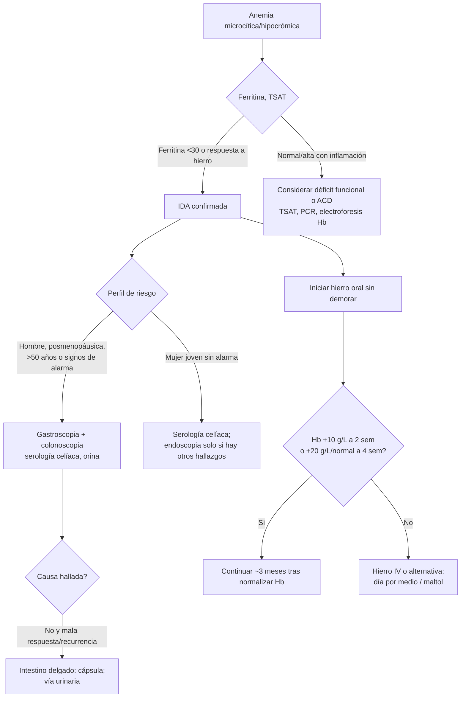

# Anemia ferropénica del adulto

!!! info "Ficha de la página"
    **Última revisión:** 2026-11-11 · **Fuente base:** guía de la British Society of Gastroenterology 2021 sobre anemia ferropénica (IDA) en adultos [23] (texto completo leído). **Alcance:** adultos; diagnóstico, estudio de la causa y tratamiento con hierro. Embarazo, ERC e insuficiencia cardíaca se remiten a guías específicas. Las dosis son las de la guía británica; confirma presentaciones y disponibilidad locales.

## 1. Resumen rápido

- La **ferritina** es el mejor marcador aislado; **<15 µg/L** es altamente específica (especificidad 0,99) y **<30 µg/L** indica depósitos bajos. Con inflamación puede estar falsamente normal; **>150 µg/L** hace improbable déficit absoluto [23] **[V-TF]**.
- Una **respuesta a hierro con aumento de Hb ≥10 g/L en 2 semanas** sugiere fuertemente déficit absoluto de hierro [23] **[V-TF]**.
- En **hombres y mujeres posmenopáusicas** con IDA nueva, la investigación del tubo digestivo (gastroscopia + colonoscopia) es la primera línea; ~1/3 tiene una lesión relevante y se encuentra cáncer en 8–10 % [23] **[V-TF]**.
- **Tratamiento oral de inicio:** una tableta al día de sulfato, fumarato o gluconato ferroso (50–100 mg de hierro elemental), en ayunas [23] **[V-TF]**.
- **No retrasar** el hierro mientras se estudia (salvo colonoscopia inminente) [23] **[V-TF]**.

## 2. Diagnóstico

| Elemento | Contenido | Verificación |
|---|---|---|
| Anemia | Hb bajo el límite inferior normal; OMS: <130 g/L hombres, <120 g/L mujeres no embarazadas, <110 g/L embarazo (2.º–3.er trimestre) | [23] **[V-TF]** |
| Hipocromía/microcitosis | HCM más fiable que VCM; pierden sensibilidad en enfermedad crónica, talasemia o déficit de B12/folato | [23] **[V-TF]** |
| Ferritina | <15 µg/L: depósitos ausentes; <30 µg/L: bajos; corte 45 µg/L: especificidad 0,92 | [23] **[V-TF]** |
| Saturación de transferrina | <20 % sugiere restricción de hierro; útil si se sospecha ferritina falsamente normal | [23] **[V-TF]** |
| Microcitosis con estudio de hierro normal | Electroforesis de Hb (descartar talasemia) | [23] **[V-TF]** |
| Déficit funcional | Inflamación crónica (ERC, IC, AR, EII): hepcidina elevada, hierro "secuestrado"; ferritina hasta 100 µg/L puede reflejar déficit con inflamación | [23] **[V-TF]** |

## 3. Algoritmo de estudio y tratamiento

## 4. Tratamiento

| Opción | Pauta | Notas | Verificación |
|---|---|---|---|
| **Hierro oral estándar** | 1 tableta/día (p. ej., sulfato ferroso 200 mg ≈ 65 mg de hierro elemental), en ayunas | La comida reduce la absorción hasta 75 %; no se recomienda vitamina C ni formulaciones de liberación modificada | [23] **[V-TF]** |
| Si no tolera | Dosis cada **día por medio**, cambiar a otra sal ferrosa no tiene respaldo; **maltol férrico** 30 mg c/12 h; o hierro IV | La alternancia diaria mejora la absorción fraccional y la tolerancia | [23] **[V-TF]** |
| **Monitorización** | Hb a las 2–4 semanas; luego cada 4 semanas hasta normalizar; continuar **~3 meses** más | Falta de aumento ≥10 g/L a 2 semanas predice fracaso (sens. 90,1 %, esp. 79,3 %) | [23] **[V-TF]** |
| **Hierro IV** | Considerar si hay intolerancia/falla del oral, sangrado activo, malabsorción, inflamación, urgencia de corrección | Carboximaltosa férrica o derisomaltosa: dosis total en 1–2 infusiones (máx. 20 mg/kg por dosis; carboximaltosa máx. 1000 mg); sacarato: 200 mg por dosis, varias infusiones; dosis total por fórmula de Ganzoni | [23] **[V-TF]** |
| **Transfusión** | Solo anemia sintomática grave o compromiso circulatorio; meta Hb 70–90 g/L (80–100 si coronariopatía inestable) | Después, reponer hierro | [23] **[V-TF]** |

!!! warning "Seguridad del hierro IV"
    Reacciones de hipersensibilidad/infusión ~0,5 %. **Hipofosfatemia** con carboximaltosa férrica 58 % (derisomaltosa 4 %, sacarato 1 %), habitualmente asintomática; vigilar fosfato en riesgo o en uso repetido de dosis altas. No administrar con bacteriemia activa [23] **[V-TF]**.

## 5. Situaciones especiales

- **Mujer joven:** causa habitual menstrual/embarazo/dieta; celiaquía en hasta 4 %. Endoscopia si >50 años, sin menstruación, signos de alarma, riesgo familiar de CCR o IDA desproporcionada [23] **[V-TF]**.
- **Anciano:** causa multifactorial; sopesar riesgo-beneficio de endoscopia según comorbilidad; alternativa: colonografía por TC [23] **[V-TF]**.
- **ERC:** déficit absoluto TSAT ≤20 % y ferritina ≤100 µg/L (≤200 en hemodiálisis); manejo con nefrología [23] **[V-TF]**.
- **Insuficiencia cardíaca:** ferritina <100 µg/L y/o TSAT <20 %; hierro IV considerado; evitar oral [23] **[V-TF]**.
- **EII:** oral ≤100 mg/día de hierro elemental; IV si intolerancia y Hb <100 g/L [23] **[V-TF]**.
- **Cirugía bariátrica/gastrectomía:** IDA frecuente (~25 % a 2 años tras bypass); no atribuirla sin descartar otras causas [23] **[V-TF]**.
- **Seguimiento:** hemograma cada 3 meses por 12 meses y luego cada 6 meses por 2–3 años; ferritina de rutina no recomendada por datos insuficientes [23] **[V-TF]**.

## 6. Puntos clave para residentes e internos

1. IDA en adulto mayor o varón = **buscar sangrado digestivo** hasta demostrar lo contrario.
2. Pedir **ferritina y TSAT**; interpretar con PCR.
3. Empezar hierro **sin esperar** los estudios.
4. Hierro oral **una vez al día o día por medio**, en ayunas, sin vitamina C.
5. Evaluar respuesta a **2–4 semanas**; si falla, hierro IV.
6. Continuar ~**3 meses** tras normalizar Hb.

## 7. Autoevaluación

1. Hombre de 68 años con Hb 90 g/L, VCM 70 fL y ferritina 8 µg/L: ¿qué estudios solicitas y cuándo inicias hierro?
2. ¿Por qué una ferritina de 90 µg/L no descarta déficit de hierro en una artritis reumatoide activa?
3. ¿Qué respuesta de Hb a las 2 semanas orienta a déficit absoluto?

## 8. Referencias de esta página

**[23]** BSG 2021 (ver [lista completa](../referencias.md)).

## 9. Pendientes

- [ ] Guías ASH/ESH sobre IDA y hierro IV; dosis en gestación.
- [ ] Anemia megaloblástica, anemia de enfermedad crónica (páginas separadas).
- [ ] Contrastar presentaciones y dosis con el vademécum/ficha ISP Chile **[PV]**.
