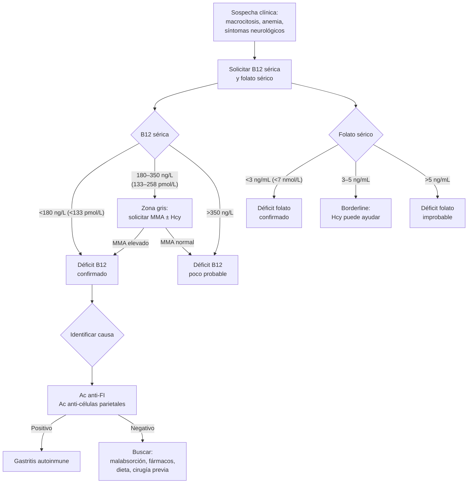

# Anemia megaloblástica (déficit de vitamina B12 y folato)

!!! info "Ficha de la página"
    **Última revisión:** 2026-11-11 · **Fuentes base:** guía NICE NG239 (2024) sobre déficit de vitamina B12 [40] **[V-RS]**; guías BSH sobre cobalamina y folato (Devalia et al., 2014) [41] **[V-RS]**; Delphi Expert Consensus on B12 deficiency (Obeid et al., 2024) [42] **[V-RS]**; Nemeth & Ganz — Anemia of Inflammation (Hematol Oncol Clin North Am, 2014) [43] **[V-RS]**; BMJ Best Practice B12 deficiency y Folate deficiency (2024–2025). **Alcance:** adultos ≥16 años; diagnóstico, causas y tratamiento del déficit de B12 y de folato. Embarazo y pediatría: solo notas breves.

## 1. Resumen rápido

- La **anemia megaloblástica** se caracteriza por eritropoyesis ineficaz con macrocitosis (VCM >100 fL) y **neutrófilos hipersegmentados** (>5 % con ≥5 lóbulos) [41] **[V-RS]**.
- **Déficit de B12** puede causar **daño neurológico irreversible** (degeneración combinada subaguda) incluso sin anemia [40][42] **[V-RS]**.
- **Déficit de folato** causa anemia megaloblástica **sin** afectación neurológica directa; su causa principal es dietética [41] **[V-RS]**.
- **Siempre** medir B12 y folato juntos: las vías metabólicas están interconectadas y el déficit de folato puede enmascarar el de B12 [41] **[V-RS]**.
- **No retrasar** el tratamiento si la clínica es sugerente, aun con resultados borderline [40][41] **[V-RS]**.

## 2. Definiciones y fisiopatología

### 2a. Vitamina B12 (cobalamina)

- **Requerimiento diario:** ~2,4 µg; depósitos hepáticos cubren 2–5 años [42] **[V-RS]**.
- **Absorción:** alimentos → proteasas gástricas liberan B12 → se une a haptocorrina salival → en duodeno: proteasas pancreáticas liberan B12 → se une a factor intrínseco (FI) → complejo FI-B12 se absorbe en íleon terminal mediante receptor cubilina [42] **[V-RS]**.
- **Rol metabólico:** cofactor de metionina sintasa (homocisteína → metionina; regenera THF) y de metilmalonil-CoA mutasa (metilmalonil-CoA → succinil-CoA). El déficit produce acumulación de homocisteína y ácido metilmalónico (MMA) [41][42] **[V-RS]**.
- **Mielinización:** la acumulación de metilmalonil-CoA y la alteración de la metilación afectan la síntesis de mielina → neuropatía periférica, degeneración combinada subaguda [42] **[V-RS]**.

### 2b. Folato (vitamina B9)

- **Requerimiento diario:** 400 µg (600 µg embarazo); depósitos hepáticos cubren ~4 meses [41] **[V-RS]**.
- **Fuentes:** verduras de hoja verde, legumbres, frutas; destruido parcialmente por cocción prolongada [41] **[V-RS]**.
- **Rol metabólico:** coenzima en la síntesis de purinas y pirimidinas (síntesis de ADN). El folato, como tetrahidrofolato (THF), participa en la transferencia de grupos de un carbono [41] **[V-RS]**.

### 2c. Megaloblastosis

- La alteración de la síntesis de ADN (por déficit de B12 o folato) produce **asincronía núcleo-citoplasma**: el citoplasma madura normalmente pero el núcleo se divide lentamente → células grandes (megaloblastos) con muerte intramedular (eritropoyesis ineficaz) [41] **[V-RS]**.

## 3. Causas

### Déficit de vitamina B12

| Causa | Mecanismo | Verificación |
|---|---|---|
| **Gastritis autoinmune** (ex-anemia perniciosa) | Anticuerpos anti-células parietales y/o anti-FI → destrucción de mucosa gástrica → malabsorción de B12 | [40][42] **[V-RS]** |
| Gastrectomía / cirugía bariátrica | Pérdida de células parietales y/o FI | [42] **[V-RS]** |
| Enfermedades del íleon terminal | Crohn, resección ileal, síndrome de asa ciega, sobrecrecimiento bacteriano | [42] **[V-RS]** |
| Fármacos | Metformina (↓absorción), IBP/anti-H2 (uso prolongado >2 años), óxido nitroso (inactiva B12) | [40][42] **[V-RS]** |
| Dieta insuficiente | Veganos estrictos, desnutrición grave (raro como causa aislada en Occidente) | [42] **[V-RS]** |
| Insuficiencia pancreática | No libera B12 de la haptocorrina → malabsorción | [42] **[V-RS]** |

### Déficit de folato

| Causa | Mecanismo | Verificación |
|---|---|---|
| **Ingesta inadecuada** | Dieta pobre en vegetales, alcoholismo | [41] **[V-RS]** |
| Malabsorción | Enfermedad celíaca, enfermedad de Crohn, resección yeyunal | [41] **[V-RS]** |
| Aumento de requerimientos | Embarazo, lactancia, hemólisis crónica, dermatitis exfoliativa, diálisis | [41] **[V-RS]** |
| Fármacos antifolatos | Metotrexato, trimetoprima, fenitoína, sulfasalazina, pirimetamina | [41] **[V-RS]** |

## 4. Manifestaciones clínicas

### 4a. Hematológicas (comunes a B12 y folato)

- Anemia de instalación insidiosa (puede ser muy severa: Hb <50 g/L)
- Macrocitosis (VCM >100 fL), ovalocitos, neutrófilos hipersegmentados
- Pancitopenia en casos graves (por eritropoyesis ineficaz y alteración de mielopoyesis/megacariopoyesis)
- LDH y bilirrubina indirecta elevadas (hemólisis intramedular) [41] **[V-RS]**

### 4b. Neurológicas (B12, no folato)

- **Neuropatía periférica:** parestesias en manos y pies (distribución en guante y calcetín)
- **Degeneración combinada subaguda de la médula espinal:** alteración de la sensibilidad vibratoria y propioceptiva, ataxia sensitiva, Romberg positivo, hiperreflexia → espasticidad
- **Deterioro cognitivo, cambios de personalidad, depresión**
- ⚠️ Los síntomas neurológicos pueden ocurrir **sin anemia** y pueden ser **irreversibles** si el tratamiento se retrasa [40][42] **[V-RS]**

### 4c. Otras

- Glositis (lengua depapilada, dolorosa), queilitis angular
- Infertilidad, defectos del tubo neural (folato)
- Hiperpigmentación cutánea (B12) [42] **[V-RS]**

## 5. Diagnóstico

### 5a. Algoritmo diagnóstico

### 5b. Pruebas de laboratorio

| Prueba | Interpretación | Verificación |
|---|---|---|
| **B12 sérica (cobalamina total)** | <180 ng/L: deficiencia; 180–350: zona gris; >350: normal. Primera línea según BSH y NICE | [40][41] **[V-RS]** |
| **B12 activa (holotranscobalamina)** | <25 pmol/L: deficiencia. Alternativa aceptada como primera línea; preferida en embarazo (NICE 2024) | [40] **[V-RS]** |
| **Ácido metilmalónico (MMA)** | Elevado en déficit de B12, no en déficit de folato. Segunda línea para casos borderline. Falsamente elevado en insuficiencia renal | [40][41] **[V-RS]** |
| **Homocisteína plasmática** | Elevada en déficit de B12 y de folato. Menos específica que MMA (↑ en IRC, hipotiroidismo, déficit de B6). Segunda línea | [41][42] **[V-RS]** |
| **Folato sérico** | <3 ng/mL (<7 nmol/L): deficiencia. Primera línea; equivalente al folato eritrocitario según BSH | [41] **[V-RS]** |
| **Anticuerpos anti-FI** | Específicos de gastritis autoinmune (~50 % sensibilidad, ~99 % especificidad) | [40] **[V-RS]** |
| **Anticuerpos anti-células parietales** | Más sensibles pero menos específicos (~80 % sensibilidad); pueden ser positivos en gastritis atrófica de cualquier etiología | [40] **[V-RS]** |
| **Hemograma/frotis** | VCM >100 fL, ovalocitos, hipersegmentación neutrofílica (≥5 lóbulos en >5 % de los neutrófilos), pancitopenia en casos graves | [41] **[V-RS]** |
| **LDH y bilirrubina indirecta** | Elevadas por eritropoyesis ineficaz (hemólisis intramedular); LDH puede ser muy alta | [41] **[V-RS]** |
| **Reticulocitos** | Bajos en la fase activa; aumento (crisis reticulocitaria día 5–7) confirma respuesta al tratamiento | [41] **[V-RS]** |

!!! warning "Muestras antes de tratar"
    Según NICE 2024: **obtener muestras de sangre para B12, folato y hemograma antes de iniciar el reemplazo**, ya que el tratamiento normaliza rápidamente los niveles y dificulta el diagnóstico retrospectivo [40] **[V-RS]**.

!!! tip "Diagnóstico diferencial de macrocitosis"
    No toda macrocitosis es megaloblástica. Considerar: alcohol, hepatopatía, hipotiroidismo, fármacos (hidroxiurea, AZT, metotrexato), mielodisplasia, reticulocitosis, embarazo. El frotis con neutrófilos hipersegmentados y megaloblastos orienta a déficit de B12/folato [41] **[V-RS]**.

## 6. Tratamiento

### 6a. Déficit de vitamina B12

| Situación | Pauta | Notas | Verificación |
|---|---|---|---|
| **Con síntomas neurológicos** | Hidroxocobalamina 1000 µg IM **día por medio** × 2–3 semanas (hasta que no haya mejoría); luego **cada 2 meses** de por vida | No esperar resultados de laboratorio si la clínica es clara. Respuesta neurológica puede tardar meses | [40][41] **[V-RS]** |
| **Sin síntomas neurológicos** | Hidroxocobalamina 1000 µg IM 3 veces/semana × 2 semanas; luego **cada 3 meses** de por vida (si malabsorción) | La frecuencia de mantenimiento varía según causa | [40][41] **[V-RS]** |
| **Causa dietética** (sin neurológico) | Hidroxocobalamina IM como arriba, o **cianocobalamina oral 1000–2000 µg/día** si hay buena adherencia | B12 oral en altas dosis se absorbe parcialmente por difusión pasiva (~1 %) independiente del FI; evidencia creciente de eficacia | [40][42] **[V-RS]** |
| **Metformina (prevención)** | Monitorizar B12 periódicamente; suplementar si <180 ng/L | No es necesario retirar metformina; suplemento oral generalmente suficiente | [40] **[V-RS]** |
| **Óxido nitroso** | Hidroxocobalamina IM; NICE recomienda MMA u homocisteína como test inicial (B12 sérica puede ser normal) | Cesación del uso es fundamental | [40] **[V-RS]** |

!!! note "Cianocobalamina vs. hidroxocobalamina"
    La **hidroxocobalamina** tiene mayor unión a proteínas y mayor duración de acción que la cianocobalamina; es la forma preferida para inyección IM en la mayoría de las guías europeas. La **cianocobalamina** es la forma más disponible para uso oral y es la forma habitual en formulaciones IM en EE. UU. y Latinoamérica [41][42] **[V-RS]**.

### 6b. Déficit de folato

| Situación | Pauta | Notas | Verificación |
|---|---|---|---|
| **Tratamiento** | **Ácido fólico 5 mg/día VO** × 4 meses (o hasta resolver la causa) | Verificar que no haya déficit concomitante de B12 antes de tratar con folato solo → puede precipitar/empeorar daño neurológico | [41] **[V-RS]** |
| **Profilaxis en embarazo** | Ácido fólico 400 µg/día desde preconcepción hasta semana 12 | 5 mg/día si alto riesgo de defectos del tubo neural (epilepsia, antecedente, diabetes) | [41] **[V-RS]** |
| **Hemólisis crónica** | Ácido fólico 5 mg/día de por vida | Consumo acelerado de folato por eritropoyesis aumentada | [41] **[V-RS]** |
| **Causada por fármacos** | Ácido folínico (leucovorina) si el fármaco inhibe dihidrofolato reductasa (MTX); ácido fólico si el fármaco afecta absorción (fenitoína) | El ácido fólico no es eficaz si la enzima diana está bloqueada | [41] **[V-RS]** |

!!! danger "No dar folato sin descartar déficit de B12"
    El ácido fólico puede corregir la anemia megaloblástica por déficit de B12 pero **no previene ni trata el daño neurológico**, que puede progresar de forma silente. Siempre confirmar niveles de B12 antes de iniciar folato [41] **[V-RS]**.

### 6c. Monitorización de respuesta

| Parámetro | Cronología esperada | Verificación |
|---|---|---|
| Mejoría subjetiva | 24–48 horas | [41] **[V-RS]** |
| **Crisis reticulocitaria** | Día 5–7 (pico reticulocitos) | [41] **[V-RS]** |
| Hemoglobina | Aumento progresivo en 2–4 semanas; normalización en 6–8 semanas | [41] **[V-RS]** |
| VCM | Normalización gradual en 8–12 semanas | [41] **[V-RS]** |
| LDH | Descenso rápido en los primeros días | [41] **[V-RS]** |
| Hipopotasemia | Posible en las primeras 48 h por captación celular de K⁺ (anemia grave); **monitorizar K⁺** | [41] **[V-RS]** |
| Respuesta neurológica (B12) | Variable: mejoría en semanas a meses; puede ser incompleta si el diagnóstico fue tardío | [40][42] **[V-RS]** |

## 7. Gastritis autoinmune y riesgo de neoplasia

- La gastritis autoinmune (GA) es una **enfermedad crónica**: la destrucción de células parietales causa atrofia gástrica, déficit de B12 y aclorhidria [40] **[V-RS]**.
- **Riesgo aumentado** de carcinoma gástrico (2–3 × población general) y tumores neuroendocrinos (carcinoides) gástricos [40] **[V-RS]**.
- NICE 2024 recomienda **gastroscopia con biopsia** al diagnosticar GA para estadificar y luego seguimiento endoscópico según hallazgos (protocolo MAPS-II o local) [40] **[V-RS]**.

## 8. Puntos clave para residentes e internos

1. **B12 y folato siempre juntos**: pedir ambos marcadores simultáneamente en toda macrocitosis.
2. **Neurológico sin anemia es posible**: parestesias, ataxia o deterioro cognitivo pueden ser la primera manifestación del déficit de B12.
3. **No retrasar el tratamiento**: tomar muestras primero, pero iniciar B12 IM si hay síntomas neurológicos.
4. **MMA es el marcador de segunda línea** más útil para B12 (específico); homocisteína es sensible pero inespecífica.
5. **Folato solo nunca antes de descartar B12**: puede corregir la anemia pero enmascarar y empeorar la neuropatía.
6. **Gastritis autoinmune = seguimiento de por vida**: B12 IM permanente y vigilancia endoscópica por riesgo de cáncer gástrico.
7. **Respuesta: crisis reticulocitaria día 5–7**, aumento de Hb a las 2–4 semanas.

## 9. Autoevaluación

1. Mujer de 72 años con Hb 85 g/L, VCM 118 fL, parestesias en pies y Romberg positivo. B12 sérica 95 ng/L. ¿Cuál es el diagnóstico más probable y el tratamiento urgente?
2. ¿Por qué no se debe iniciar ácido fólico sin antes confirmar niveles adecuados de B12?
3. Un paciente con B12 de 220 ng/L (zona gris) y neuropatía periférica: ¿qué prueba de segunda línea solicitas y qué resultado esperarías?
4. ¿Cuándo se prefiere B12 oral sobre IM?

## 10. Referencias de esta página

**[40]** NICE NG239 2024, **[41]** BSH Devalia 2014, **[42]** Delphi B12 Consensus 2024 (ver [lista completa](../referencias.md)).
