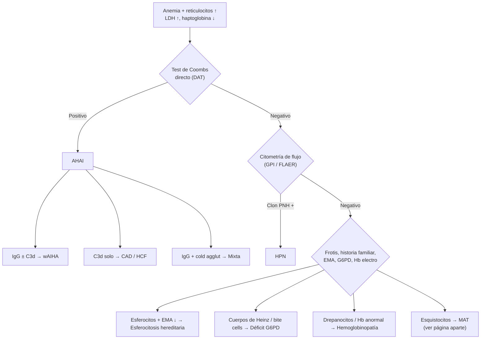
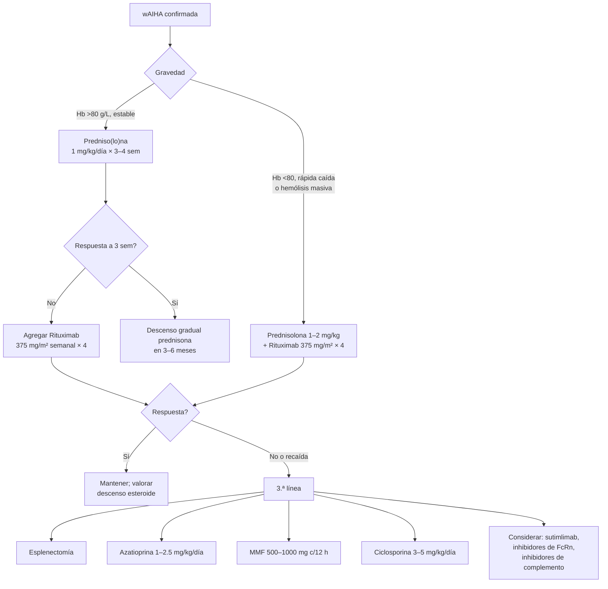

# Anemias hemolíticas

!!! info "Ficha de la página"
    **Última revisión:** 2026-11-12 · **Fuentes base:** Consenso Internacional AHAI (Jäger et al. 2020) [45], Barcellini & Fattizzo Blood 2021 [46], Berentsen et al. Front Immunol 2023 [47], BSH primary AIHA (Hill et al. 2017) [48], BSH esferocitosis hereditaria 2011 [49], Röth et al. NEJM 2021 (CARDINAL) [50], Hillmen et al. NEJM 2006 [51], Peffault de Latour et al. NEJM 2024 (iptacopan) [52]. **Alcance:** adultos; diagnóstico y tratamiento de las principales anemias hemolíticas autoinmunes (caliente, fría, mixta, HCF), HPN, esferocitosis hereditaria, déficit de G6PD y hemoglobinopatías (resumen). No incluye anemias hemolíticas microangiopáticas (ver MAT).

---

## 1. Resumen rápido

- Ante anemia con **reticulocitos elevados, LDH alta, haptoglobina baja y bilirrubina indirecta alta**, pensar en hemólisis; el **test de Coombs directo (DAT)** es la primera bifurcación [45] **[V-RS]**.
- La **AHAI por anticuerpos calientes (wAIHA)** es la más frecuente (~70 %); primera línea: **predniso(lo)na 1–2 mg/kg/día** (tasa de respuesta 80–90 %); en formas graves, añadir **rituximab** de inicio [46][47] **[V-RS]**.
- La **enfermedad por crioaglutininas (CAD)** es un trastorno clonal B; los corticoides y la esplenectomía **no** son eficaces; primera línea: **rituximab ± bendamustina**; **sutimlimab** (anti-C1s) aprobado por FDA 2022 [47][50] **[V-RS]**.
- La **HPN** se diagnostica por citometría de flujo (FLAER); tratamiento estándar: **eculizumab** o **ravulizumab** (anti-C5); inhibidores proximales (pegcetacoplan, iptacopan) amplían el arsenal [51][52] **[V-RS]**.
- La **esferocitosis hereditaria** se confirma con test de unión a **EMA** (eosina-5-maleimida); la esplenectomía es el tratamiento definitivo, idealmente **después de los 6 años** [49] **[V-RS]**.

---

## 2. Clasificación general



---

## 3. Anemia hemolítica autoinmune (AHAI)

### 3.1 Definición y epidemiología

La AHAI se define por un aumento de la destrucción eritrocitaria mediado por autoanticuerpos dirigidos contra antígenos de la membrana del glóbulo rojo. Incidencia: 1–3 por 100.000 habitantes/año. Se clasifica según el tipo de anticuerpo y la temperatura óptima de reacción [45][47] **[V-RS]**.

| Subtipo | Frecuencia | Anticuerpo | DAT típico | Hemólisis predominante |
|---|---|---|---|---|
| **wAIHA (caliente)** | ~70 % | IgG (37 °C) | IgG ± C3d | Extravascular (bazo) |
| **CAD (fría)** | 20–25 % | IgM monoclonal (4 °C) | C3d (IgG neg) | Intravascular (complemento) |
| **Mixta** | ~5 % | IgG caliente + crioaglutininas | IgG + C3d | Combinada |
| **HCF (Donath-Landsteiner)** | <2 % | IgG bifásica anti-P | C3d | Intravascular |
| **DAT negativa** | 5–10 % | Títulos bajos o IgA | DAT neg | Variable |

**Etiología:** ~50 % primaria (idiopática); ~50 % secundaria a síndromes linfoproliferativos (LLC, linfoma), enfermedades autoinmunes (LES, AR), infecciones o fármacos [46][47] **[V-RS]**.

### 3.2 Fisiopatología

- **wAIHA:** IgG recubre el eritrocito → fagocitosis por macrófagos esplénicos (Fc y C3b); cuando hay fijación de complemento (C3d positivo), la hemólisis es más intensa [46] **[V-RS]**.
- **CAD:** IgM se une al eritrocito a temperatura baja → activa la vía clásica del complemento (C1–C3); la hemólisis depende de la amplificación del complemento y de la fagocitosis hepática mediada por C3b. Es un trastorno linfoproliferativo clonal B de bajo grado (OMS) [47] **[V-RS]**.
- **Mixta:** coexisten ambos mecanismos; curso clínico más agresivo [45] **[V-RS]**.
- **HCF:** anticuerpo bifásico Donath-Landsteiner (IgG anti-P) que fija complemento en frío y provoca lisis al calentarse a 37 °C; más frecuente en niños posinfecciosos [45] **[V-RS]**.

### 3.3 Diagnóstico

| Paso | Estudio | Interpretación | Verificación |
|---|---|---|---|
| 1. Hemólisis | Reticulocitos, LDH, haptoglobina, bilirrubina indirecta | Retics ↑, LDH ↑, haptoglobina ↓, BI ↑ confirman hemólisis | [45] **[V-RS]** |
| 2. DAT (Coombs directo) | Mono-específico: anti-IgG, anti-C3d | IgG± → caliente; C3d solo → fría; ambos → mixta o caliente con complemento | [45][46] **[V-RS]** |
| 3. Título de crioaglutininas | Aglutininas frías a 4 °C | ≥64 significativo; en CAD suele ser ≥512 | [47] **[V-RS]** |
| 4. Etiología | Hemograma + frotis, LDH, inmunoglobulinas, SPEP, TC, citometría, ANA, complemento, serología viral | Descartar causa secundaria (LLC, linfoma, LES) | [45][46] **[V-RS]** |
| 5. Especiales | Donath-Landsteiner (si sospecha HCF); DAT ampliado / eluido (si DAT neg con alta sospecha) | IgG bifásica anti-P confirma HCF; eluido detecta autoanticuerpos de baja afinidad | [45] **[V-RS]** |

### 3.4 Algoritmo de tratamiento de wAIHA



### 3.5 Tratamiento — wAIHA: fármacos y dosis

| Línea | Fármaco | Dosis | Notas | Verificación |
|---|---|---|---|---|
| **1.ª** | Predniso(lo)na | 1–2 mg/kg/día × 3–4 sem, luego descenso gradual en 3–6 meses | Tasa de respuesta ~80–90 %; recaída al reducir en ~50 % | [46][48] **[V-RS]** |
| **1.ª (grave)** | Prednisolona + rituximab | Prednisolona 1–1.5 mg/kg + rituximab 375 mg/m²/sem × 4 | Evidencia de superioridad en primera línea en wAIHA grave | [47] **[V-RS]** |
| **2.ª** | Rituximab | 375 mg/m² IV semanal × 4 dosis | Respuesta global ~80 %; mediana de duración de respuesta >2 años | [46][47] **[V-RS]** |
| **2.ª** | Esplenectomía | Laparoscópica preferida | Respuesta ~65–70 %; vacunar antes (neumococo, Hib, meningococo) | [46][48] **[V-RS]** |
| **3.ª** | Azatioprina | 1–2.5 mg/kg/día | Inicio lento (4–6 sem); medir TPMT antes | [46] **[V-RS]** |
| **3.ª** | Micofenolato mofetilo | 500–1000 mg c/12 h | Alternativa a azatioprina | [46] **[V-RS]** |
| **3.ª** | Ciclosporina | 3–5 mg/kg/día (dividir c/12 h) | Monitorizar niveles y función renal | [46] **[V-RS]** |
| **Emergencia** | Sutimlimab (anti-C1s) | Si componente de complemento significativo; aprobado para CAD; ensayos en wAIHA | [47][50] **[V-RS]** |

### 3.6 Tratamiento — CAD (enfermedad por crioaglutininas)

!!! warning "Corticoides y esplenectomía NO son eficaces en CAD"
    A diferencia de la wAIHA, los corticoides tienen escasa actividad en CAD y la esplenectomía es ineficaz porque la hemólisis es mediada por complemento y fagocitosis hepática [47] **[V-RS]**.

| Línea | Fármaco | Dosis | Notas | Verificación |
|---|---|---|---|---|
| **1.ª** | Rituximab | 375 mg/m² IV semanal × 4 | Respuesta ~50 %; mediana de duración ~1 año | [47] **[V-RS]** |
| **1.ª** | Rituximab + bendamustina | R 375 mg/m² d1 + Benda 90 mg/m² d1–2, c/28 d × 4 ciclos | Respuesta global 71 %, RC 40 %; mediana >88 meses. Reservar para pacientes que toleren quimioterapia | [47] **[V-RS]** |
| **2.ª** | Sutimlimab (anti-C1s) | 6.5 g IV (<75 kg) o 7.5 g IV (≥75 kg) el día 0, día 7 y luego c/2 sem | Aprobado FDA 2022. Estudio CARDINAL: aumento medio de Hb 2.6 g/dL a 26 sem; respuesta rápida (1–3 sem). No erradica el clon | [50] **[V-RS]** |
| **Soporte** | Evitar exposición al frío | — | Medida básica; mantener extremidades y tronco calientes; precalentar hemoderivados | [47] **[V-RS]** |
| **Soporte** | Ácido fólico | 1–5 mg/día | Prevenir déficit por hiperregeneración | [47] **[V-RS]** |

!!! tip "Vacunación con sutimlimab"
    Sutimlimab inhibe C1s (vía clásica). Vacunar contra bacterias capsuladas (neumococo, Hib, meningococo) antes de iniciar, similar a otros inhibidores del complemento [50] **[V-RS]**.

### 3.7 AHAI mixta y HCF

- **Mixta (wAIHA + crioaglutininas significativas):** curso más agresivo; tratar como wAIHA grave (prednisolona + rituximab); evitar frío [45] **[V-RS]**.
- **Hemoglobinuria paroxística a frígore (HCF):** habitualmente autolimitada (niños posinfección); soporte con transfusión y calentamiento; si persiste, rituximab [45] **[V-RS]**.

### 3.8 AHAI con DAT negativo

Representa 5–10 % de AHAI. Causas: autoanticuerpos IgA, IgG de baja afinidad, o títulos por debajo del umbral de detección. Abordaje: repetir DAT con técnicas más sensibles (gel, columna de afinidad, eluido); si la sospecha clínica es alta y responde a esteroides, tratar como wAIHA [45][46] **[V-RS]**.

---

## 4. Hemoglobinuria paroxística nocturna (HPN)

### 4.1 Definición

La HPN es un trastorno hematológico adquirido causado por mutaciones somáticas del gen **PIGA** en células madre hematopoyéticas, que pierde la síntesis del anclaje GPI (glicosilfosfatidilinositol). Las proteínas reguladoras del complemento CD55 y CD59 se pierden de la superficie celular, dejando los eritrocitos vulnerables a la lisis mediada por el complemento [51] **[V-RS]**.

### 4.2 Tríada clínica

1. **Hemólisis intravascular crónica** mediada por complemento (hemoglobinuria, LDH elevada, anemia).
2. **Trombofilia severa** — trombosis venosas en sitios inusuales (Budd-Chiari, cerebral, mesentérica); principal causa de morbimortalidad.
3. **Fallo medular** — relación bidireccional con anemia aplásica; ~50 % de AA tiene clon PNH detectable [51] **[V-RS]**.

### 4.3 Diagnóstico

| Elemento | Detalle | Verificación |
|---|---|---|
| **Citometría de flujo** | FLAER (fluorescent aerolysin) + anti-CD59/CD24 en granulocitos y monocitos; identifica clones PNH ≥0.01 % | [51] **[V-RS]** |
| **Cuándo solicitar** | Hemólisis Coombs-negativa inexplicada; trombosis en sitios inusuales; citopenias (AA, SMD); hemoglobinuria | [51] **[V-RS]** |
| **Tamaño del clon** | Clon >10 % en granulocitos generalmente asociado a hemólisis clínica; >50 % con mayor riesgo de trombosis | [51] **[V-RS]** |

### 4.4 Algoritmo de tratamiento de HPN

```mermaid
flowchart TD
    A["HPN confirmada por citometría"] --> B{"Fenotipo clínico"}
    B -->|HPN hemolítica<br/>LDH ≥1.5× LSN + síntomas| C["Inhibidor de C5"]
    B -->|HPN subclínica<br/>(clon pequeño, asintomático)| D["Observación +<br/>citometría c/6–12 m"]
    B -->|HPN + fallo medular<br/>(AA/SMD)| E["Tratar la AA;<br/>anti-C5 si hemólisis"]
    C --> F["Eculizumab o Ravulizumab"]
    F --> G{"Respuesta subóptima?<br/>(Hb baja, transfusiones)"}
    G -->|Hemólisis extravascular<br/>persistente| H["Switch a inhibidor proximal:<br/>Pegcetacoplan (anti-C3) o<br/>Iptacopan (anti-Factor B)"]
    G -->|Hemólisis breakthrough| I["Optimizar dosis/intervalo;<br/>considerar switch"]
    F --> J["Vacunar: neumococo,<br/>meningococo, Hib<br/>ANTES de iniciar"]
    E --> K["TPH alogénico si<br/>AA grave refractaria"]
```

### 4.5 Fármacos y dosis en HPN

| Fármaco | Mecanismo | Dosis | Notas | Verificación |
|---|---|---|---|---|
| **Eculizumab** | Anti-C5 (terminal) | Inducción: 600 mg IV semanal × 4; mantenimiento: 900 mg c/2 sem desde sem 5 | Primer anti-complemento aprobado; reduce hemólisis intravascular y trombosis; no elimina hemólisis extravascular por C3b | [51] **[V-RS]** |
| **Ravulizumab** | Anti-C5 (larga duración) | Según peso: 2400–3600 mg IV d1 y d15; luego mantenimiento c/8 sem | Vida media prolongada; eficacia no inferior a eculizumab con menor carga de infusiones | [52] **[V-RS]** |
| **Pegcetacoplan** | Anti-C3 (proximal) | 1080 mg SC c/3 días o 1080 mg SC semanal | Actúa sobre hemólisis intra y extravascular; superior a eculizumab en aumento de Hb (PEGASUS) | [52] **[V-RS]** |
| **Iptacopan** | Inhibidor oral de Factor B | 200 mg VO c/12 h | NEJM 2024: monoterapia no inferior a anti-C5; oral, cómodo. Primer inhibidor oral aprobado | [52] **[V-RS]** |
| **Danicopan** | Inhibidor de Factor D | 150 mg VO c/8 h (add-on) | Aprobado como add-on a anti-C5 en pacientes con respuesta subóptima; ensayo ALPHA (Lancet Haematol) | [52] **[V-RS]** |

!!! danger "Riesgo de infección meningocócica"
    Todos los inhibidores del complemento (C5, C3, Factor B/D) aumentan el riesgo de infección por *Neisseria meningitidis*. **Vacunar** (ACWY + B) al menos 2 semanas antes del inicio; si urgencia, vacunar y dar antibiótico profiláctico (penicilina V o ciprofloxacino) hasta 2 semanas postvacuna [51] **[V-RS]**.

### 4.6 Anticoagulación y TPH

- **Anticoagulación:** trombosis es la principal causa de muerte en HPN; con anti-C5 eficaz, el riesgo trombótico disminuye significativamente. No hay consenso firme sobre anticoagulación primaria profiláctica; individualizar según tamaño del clon y factores de riesgo [51] **[V-RS]**.
- **TPH alogénico:** curativo; reservado para HPN con fallo medular grave o citopenia refractaria, especialmente en pacientes jóvenes con donante compatible [51] **[V-RS]**.

---

## 5. Esferocitosis hereditaria (EH)

### 5.1 Definición y genética

La EH es la anemia hemolítica congénita más frecuente en poblaciones de Europa del Norte (incidencia ~1:2000). Es causada por defectos en proteínas de la membrana eritrocitaria (espectrina, anquirina, banda 3, proteína 4.2) que provocan pérdida de la superficie de membrana y formación de esferocitos rígidos, atrapados y destruidos en el bazo [49] **[V-RS]**.

- **Herencia:** autosómica dominante ~75 %; autosómica recesiva ~25 %; casos de novo ~25 % de los AD [49] **[V-RS]**.

### 5.2 Clasificación (BSH 2011)

| Gravedad | Hb (g/L) | Reticulocitos (%) | Bilirrubina (µmol/L) | Esplenectomía |
|---|---|---|---|---|
| **Rasgo** | Normal | Normal (<3) | Normal | No |
| **Leve** | 110–150 | 3–6 | 17–34 | Generalmente no |
| **Moderada** | 80–110 | >6 | 34–51 | Valorar (según síntomas) |
| **Grave** | 60–80 | >10 | >51 | Indicada |
| **Muy grave** | <60, transfusión-dependiente | >10 | >51 | Indicada |

Referencia: [49] **[V-RS]**

### 5.3 Diagnóstico

| Test | Sensibilidad | Especificidad | Nota | Verificación |
|---|---|---|---|---|
| **Test EMA** (eosina-5-maleimida por citometría) | ~93 % | ~99 % | Recomendado como test de cribado; rápido y reproducible | [49] **[V-RS]** |
| **Test de criohelisis** | ~90 % | ~95 % | Alternativa donde EMA no esté disponible | [49] **[V-RS]** |
| **Fragilidad osmótica** | ~70 % | Variable | Menos sensible; falsos negativos en anemia ferropénica concomitante; incluida en criohelisis incubada | [49] **[V-RS]** |
| **Coombs directo** | — | — | Negativo (excluye AHAI) | [49] **[V-RS]** |
| **Electroforesis de proteínas de membrana** | Específica | Muy alta | Método de referencia para casos atípicos | [49] **[V-RS]** |

### 5.4 Tratamiento

| Intervención | Indicación | Detalles | Verificación |
|---|---|---|---|
| **Ácido fólico** | Todos (formas moderadas-graves) | 1–5 mg/día; previene crisis megaloblástica | [49] **[V-RS]** |
| **Esplenectomía** | Moderada sintomática, grave y muy grave | Laparoscópica preferida; idealmente **>6 años** de edad; respuesta clínica excelente (no cura el defecto, pero elimina el sitio de destrucción) | [49] **[V-RS]** |
| **Vacunación pre-esplenectomía** | Obligatoria | Neumococo (PCV13/PCV20 + PPSV23), *H. influenzae* tipo B, meningococo (ACWY + B); al menos 2 semanas antes | [49] **[V-RS]** |
| **Profilaxis post-esplenectomía** | Niños, considerar en adultos | Penicilina V profiláctica; educación sobre fiebre y consulta urgente | [49] **[V-RS]** |
| **Colecistectomía** | Si colelitiasis sintomática | Valorar simultánea con esplenectomía. No esplenectomía solo por colelitiasis en EH leve | [49] **[V-RS]** |
| **Transfusión** | Crisis aplásica (parvovirus B19), crisis hemolítica, embarazo | Soporte temporal | [49] **[V-RS]** |

---

## 6. Déficit de glucosa-6-fosfato deshidrogenasa (G6PD)

### 6.1 Definición

El déficit de G6PD es la enzimopatía eritrocitaria más frecuente a nivel mundial (prevalencia ~4.9 % global). Es un trastorno ligado al X que produce vulnerabilidad del eritrocito al estrés oxidativo, causando hemólisis episódica ante desencadenantes específicos **[V-RS]**.

### 6.2 Desencadenantes principales

| Categoría | Ejemplos |
|---|---|
| **Infecciones** | Infecciones virales y bacterianas (causa más frecuente) |
| **Fármacos oxidantes** | Primaquina, dapsona, sulfonamidas, nitrofurantoína, rasburicasa, azul de metileno |
| **Alimentos** | Habas (favismo) |
| **Metabólicos** | Cetoacidosis diabética |

### 6.3 Diagnóstico

- **Sospecha:** hemólisis aguda Coombs-negativa, especialmente en varones, tras exposición a desencadenante.
- **Frotis:** células mordidas (*bite cells*), células ampolla (*blister cells*), cuerpos de Heinz (tinción supravital).
- **Ensayo cuantitativo de G6PD:** confirma el diagnóstico. **Precaución:** puede ser falso negativo durante la hemólisis aguda (reticulocitos ricos en G6PD); repetir 2–3 meses después **[V-RS]**.

### 6.4 Tratamiento

- **Evitar desencadenantes** (lista de fármacos contraindicados).
- **Soporte:** la hemólisis es autolimitada en la mayoría de casos.
- **Transfusión** solo si anemia grave.
- **Rasburicasa contraindicada** en déficit de G6PD conocido (riesgo de hemólisis grave y metahemoglobinemia) **[V-RS]**.

---

## 7. Hemoglobinopatías (resumen orientativo)

!!! note "Sección resumida"
    Las hemoglobinopatías (drepanocitosis, talasemias) son entidades extensas con manejo especializado. Esta sección ofrece una orientación diagnóstica y terapéutica básica; se desarrollarán en páginas separadas si se requiere.

### 7.1 Enfermedad de células falciformes (drepanocitosis)

- **Genética:** mutación p.Glu6Val en gen *HBB*; homocigoto HbSS = anemia falciforme; variantes: HbSC, HbS/β-talasemia **[V-RS]**.
- **Fisiopatología:** HbS polimeriza en desoxigenación → eritrocitos falciformes → vasooclusión + hemólisis crónica **[V-RS]**.
- **Diagnóstico:** hemoglobina electroforesis/HPLC; cribado neonatal en poblaciones de riesgo **[V-RS]**.
- **Tratamiento clave:**
    - **Hidroxiurea:** estándar; aumenta HbF, reduce crisis vasooclusivas, síndrome torácico agudo, transfusiones y mortalidad **[V-RS]**.
    - **L-glutamina, voxelotor, crizanlizumab:** terapias modificadoras adicionales aprobadas **[V-RS]**.
    - **TPH alogénico y terapia génica:** opciones curativas **[V-RS]**.

### 7.2 Talasemias

- **β-talasemia mayor:** déficit grave de cadenas β; anemia transfusión-dependiente desde la infancia; quelación de hierro (deferasirox, deferoxamina, deferiprona); TPH curativo **[PV]**.
- **β-talasemia intermedia:** fenotipo variable; hidroxiurea puede ser útil; luspatercept (anti-activina) aprobado para reducir transfusiones **[PV]**.
- **α-talasemia:** portadores y enfermedad de HbH; electroforesis + estudios genéticos confirman **[PV]**.

---

## 8. Seguimiento general de anemias hemolíticas

| Parámetro | Frecuencia sugerida | Nota |
|---|---|---|
| Hemograma, reticulocitos | c/1–4 sem en fase activa; c/3–6 meses estable | Ajustar según respuesta |
| LDH, haptoglobina, bilirrubina | Junto con hemograma | Marcadores de hemólisis |
| DAT | En recaída o cambio de patrón | Seguir subtipo |
| Citometría PNH | c/6–12 meses si clon conocido; anual en AA | Monitorizar tamaño del clon |
| Ferritina | En hemólisis crónica con transfusiones | Sobrecarga de hierro |
| Ecografía abdominal | Anual en EH (colelitiasis); según indicación en otras | — |

---

## 9. Puntos clave para residentes e internos

1. Ante anemia con **reticulocitosis y LDH alta**, buscar hemólisis; el **DAT** es la primera bifurcación.
2. En wAIHA, **no demorar corticoides**; en formas graves, agregar **rituximab de inicio**.
3. En CAD, los **corticoides y esplenectomía no funcionan**; primera línea es **rituximab ± bendamustina**; sutimlimab es la opción dirigida.
4. Solicitar **citometría de flujo (FLAER)** ante hemólisis Coombs-negativa, citopenias o trombosis inusual → descartar HPN.
5. **Vacunar** antes de cualquier inhibidor del complemento o esplenectomía.
6. En esferocitosis hereditaria, el test de **EMA** es el estándar de cribado; esplenectomía solo en formas moderadas-graves y **después de los 6 años**.
7. En déficit de G6PD, el ensayo puede ser **falso negativo** durante la crisis; repetir a las 8–12 semanas.

---

## 10. Autoevaluación

1. Mujer de 55 años con Hb 65 g/L, reticulocitos 18 %, LDH 980, haptoglobina indetectable, DAT IgG+ C3d+. ¿Diagnóstico más probable y tratamiento de primera línea?
2. Varón de 40 años con hemólisis crónica, trombosis de vena hepática y pancitopenia leve. ¿Qué estudio solicitas y qué tratamiento consideras?
3. ¿Por qué los corticoides son ineficaces en la enfermedad por crioaglutininas?
4. Niño con anemia hemolítica familiar, Coombs negativo, esferocitos en frotis. ¿Qué test de confirmación pides y cuál es el tratamiento definitivo?
5. Paciente con hemólisis aguda tras primaquina; frotis con cuerpos de Heinz. El ensayo de G6PD sale normal. ¿Confías en el resultado?

---

## 11. Referencias de esta página

**[45]** Jäger et al. 2020, **[46]** Barcellini & Fattizzo 2021, **[47]** Berentsen et al. 2023, **[48]** Hill et al. 2017, **[49]** Bolton-Maggs et al. 2011 (BSH EH), **[50]** Röth et al. 2021, **[51]** Hillmen et al. 2006, **[52]** Peffault de Latour et al. 2024 (ver [lista completa](../referencias.md)).

---

## 12. Pendientes

- [ ] Profundizar hemoglobinopatías (drepanocitosis y talasemias) en páginas separadas.
- [ ] Verificar disponibilidad de sutimlimab, pegcetacoplan e iptacopan en Chile (ISP/CENABAST) **[PV]**.
- [ ] Agregar PTT/SHU como referencia cruzada con futuras páginas de MAT.
- [ ] Leer textos completos de [45]–[52] para elevar marcas a [V-TF].
