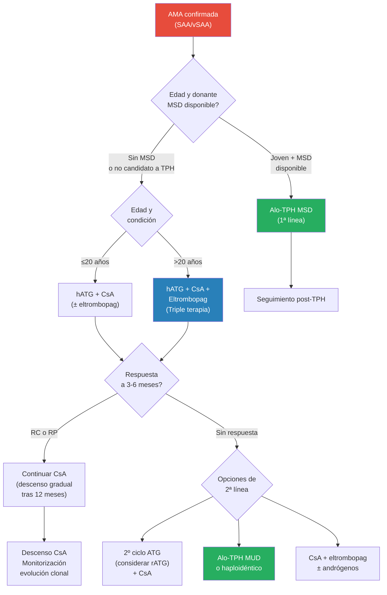

# Aplasia medular adquirida

!!! info "Ficha de la página"
    **Última revisión:** 2026-11-12 · **Fuente base:** BSH 2024 [53], RACE trial (NEJM 2022) [54], Consenso Blood Adv 2024 [55], ASTCT 2024 [57] · **Alcance:** diagnóstico, clasificación, tratamiento de primera y segunda línea, trasplante, seguimiento y evolución clonal.

## 1. Resumen rápido

- La aplasia medular adquirida (AMA) es una insuficiencia medular inmunomediada que produce pancitopenia con médula ósea hipocelular; el diagnóstico exige excluir SMD hipoplásico y síndromes de fallo medular hereditario (SFMH) [53]. **[V-RS]**
- La gravedad se clasifica por criterios de Camitta modificados: **SAA** (celularidad MO <25 % + ≥2 de: RAN <500, plaquetas <20 000, reticulocitos <60 000) y **vSAA** (SAA + RAN <200) [53]. **[V-RS]**
- **Primera línea con donante familiar compatible (MSD):** alo-TPH para pacientes jóvenes y aptos [53,57]. **[V-RS]**
- **Primera línea sin donante MSD:** terapia triple — hATG + ciclosporina A + eltrombopag — es el nuevo estándar tras el ensayo RACE [54,55]. **[V-RS]**
- La evolución clonal a SMD/LMA es la complicación tardía más relevante; requiere monitorización con NGS y citogenética seriada [53]. **[V-RS]**

---

## 2. Definición y epidemiología

La aplasia medular adquirida (AMA) es un trastorno de insuficiencia medular caracterizado por **pancitopenia periférica** y **médula ósea hipocelular** en la biopsia, causado predominantemente por destrucción autoinmune de células madre hematopoyéticas (CMH) mediada por linfocitos T citotóxicos [53,58]. **[V-RS]**

- **Incidencia:** 2–3 por millón/año en Europa y Norteamérica; 2–3 veces mayor en el este asiático [53]. **[V-RS]**
- **Distribución etaria:** dos picos: adultos jóvenes (15–25 años) y >60 años [53]. **[V-RS]**
- **Etiología:** idiopática en ~70 % de los casos; causas secundarias incluyen fármacos, tóxicos, virus (hepatitis seronegativa, VEB, VIH), embarazo y asociación con enfermedades autoinmunes [53]. **[V-RS]**

---

## 3. Fisiopatología

La AMA adquirida es un trastorno autoinmune dirigido contra las CMH:

1. **Activación de linfocitos T citotóxicos (CD8+):** reconocimiento de antígenos desconocidos en las CMH → liberación de IFN-γ y TNF-α → apoptosis de progenitores hematopoyéticos [53,58]. **[V-RS]**
2. **Microambiente inflamatorio:** expansión oligoclonal de linfocitos T; los niveles elevados de Th1/Tc1 suprimen la hematopoyesis residual [58]. **[V-RS]**
3. **Defecto cuantitativo de CMH:** reducción del compartimento stem que limita la recuperación, incluso tras inmunosupresión efectiva [56]. **[V-RS]**
4. **Acortamiento telomérico:** los telómeros de las CMH residuales están acortados, reflejando estrés replicativo; se asocia a peor respuesta a IST y mayor riesgo de evolución clonal [53]. **[V-RS]**
5. **Hematopoyesis clonal:** en ~30–50 % de pacientes al diagnóstico se detectan mutaciones somáticas (PIGA, BCOR, ASXL1, DNMT3A); los clones con mutaciones «favorables» (PIGA, BCOR) se asocian a mejor respuesta a IST, mientras que las «desfavorables» (ASXL1, RUNX1, TP53) predicen evolución a SMD/LMA [53]. **[V-RS]**

---

## 4. Presentación clínica

| Manifestación | Citopenias responsables |
|---|---|
| **Síndrome anémico** (fatiga, disnea, palidez) | Anemia |
| **Infecciones** (bacterianas, fúngicas invasivas) | Neutropenia |
| **Hemorragias** (petequias, equimosis, epistaxis, gingivorragia, hemorragia digestiva) | Trombocitopenia |

- La esplenomegalia **no** es característica; su presencia obliga a considerar diagnósticos alternativos [53]. **[V-RS]**
- Evaluar signos de SFMH: anomalías ungueales, leucoplasia oral, pigmentación reticular (disqueratosis congénita), anomalías esqueléticas (anemia de Fanconi), talla baja [53]. **[V-RS]**

---

## 5. Diagnóstico

### 5.1 Criterios diagnósticos

El diagnóstico requiere **las dos condiciones** [53]:

1. **Pancitopenia en sangre periférica** (≥2 citopenias)
2. **Médula ósea hipocelular** en biopsia (celularidad <25 % para la edad, o <50 % con <30 % de precursores hematopoyéticos)

### 5.2 Estudio diagnóstico inicial

| Prueba | Objetivo |
|---|---|
| Hemograma completo con reticulocitos | Confirmar pancitopenia; reticulocitos absolutos bajos |
| Frotis de sangre periférica | Excluir displasia, blastos, células atípicas |
| Biopsia de médula ósea (BMO) con cilindro ≥1,5 cm | Celularidad, exclusión de infiltración, fibrosis, displasia |
| Aspirado de MO con mielograma | Morfología, porcentaje de blastos |
| Citogenética convencional (cariotipo, FISH) | Excluir SMD (del(5q), monosomía 7, etc.) |
| Panel NGS de genes mieloides | Detectar mutaciones somáticas; diferenciar de SMD hipoplásico |
| Citometría de flujo: clon HPN | Presente en ~50 % de AMA; apoya origen inmune |
| Longitud telomérica (flow-FISH) | Screening de telomeropatías |
| Test de fragilidad cromosómica (DEB/MMC) | Excluir anemia de Fanconi (obligatorio en <40 años) |
| Serología viral | VHB, VHC, VIH, CMV, VEB, parvovirus B19 |
| Bioquímica: LDH, haptoglobina, bilirrubina, vitamina B12, folato, ferritina, función hepática y renal | Excluir hemólisis y carencias |
| Autoinmunidad: ANA, anti-DNA, complemento | Asociación con enfermedades autoinmunes |

!!! warning "Diagnóstico diferencial clave: SMD hipoplásico"
    La distinción entre AMA y SMD hipoplásico es clínicamente crucial. Elementos que favorecen SMD: displasia significativa en ≥2 líneas, blastos >5 %, citogenética anómala típica de SMD (monosomía 7, del(5q), trisomía 8), mutaciones en TP53, RUNX1, SETBP1, EZH2 con VAF alta. Elementos que favorecen AMA: clon HPN presente, mutaciones en PIGA/BCOR, ausencia de displasia prominente [53]. **[V-RS]**

### 5.3 Exclusión de síndromes de fallo medular hereditario (SFMH)

La BSH 2024 recomienda descartar SFMH en **todos los pacientes**, especialmente <40 años [53]:

| SFMH | Prueba de screening | Prueba confirmatoria |
|---|---|---|
| Anemia de Fanconi | Test de fragilidad cromosómica (DEB/MMC) | Panel genético de genes FA |
| Telomeropatías (disqueratosis congénita) | Longitud telomérica por flow-FISH (<percentil 1 para edad) | Panel genético (TERT, TERC, DKC1, RTEL1, etc.) |
| Shwachman-Diamond | Elastasa fecal, niveles de isoamilasa | Genética (SBDS, EFL1) |
| Predisposición mieloide germinal | — | Panel germinal (GATA2, SAMD9/9L, RUNX1, DDX41, etc.) |

---

## 6. Clasificación de gravedad (Camitta modificada)

| Categoría | Criterios |
|---|---|
| **Aplasia medular severa (SAA)** | Celularidad MO <25 % (o <50 % con <30 % de precursores) **+** ≥2 de: RAN <500/μL, plaquetas <20 000/μL, reticulocitos <60 000/μL (o <20 000/μL corregidos) |
| **Aplasia medular muy severa (vSAA)** | Criterios de SAA **+** RAN <200/μL |
| **Aplasia medular no severa (NSAA)** | No cumple criterios de SAA pero tiene MO hipocelular con citopenias |

---

## 7. ¿Cuándo tratar?

- **SAA y vSAA:** tratamiento **inmediato** (mortalidad temprana elevada sin tratamiento) [53]. **[V-RS]**
- **NSAA:** observación activa si paciente estable, sin dependencia transfusional significativa y sin neutropenia severa; tratar si citopenias empeoran o se vuelven sintomáticas [53]. **[V-RS]**

---

## 8. Algoritmo de tratamiento

---

## 9. Tratamiento de primera línea

### 9.1 Alo-TPH de donante familiar compatible (MSD)

El alo-TPH con MSD es el **único tratamiento curativo** y la primera línea para pacientes jóvenes y aptos con donante disponible [53,57]. **[V-RS]**

| Parámetro | Recomendación |
|---|---|
| **Indicación** | SAA/vSAA con MSD, paciente apto |
| **Límite de edad** | Sin punto de corte fijo; la ASTCT 2024 ya no recomienda el corte histórico de 40 años [57]. **[V-RS]** |
| **Fuente de progenitores** | Médula ósea (preferida sobre sangre periférica) [57]. **[V-RS]** |
| **Acondicionamiento** | Ciclofosfamida + ATG (estándar); fludarabina + ciclofosfamida ± ATG en pacientes con riesgo de fallo de injerto [57]. **[V-RS]** |
| **Profilaxis EICH** | CNI (ciclosporina o tacrolimus) + metotrexato, o esquema basado en PTCy [57]. **[V-RS]** |
| **Resultados** | SG a 5 años >90 % en pacientes jóvenes con MSD [53]. **[V-RS]** |

### 9.2 Terapia inmunosupresora (IST) — Triple terapia

Para pacientes sin donante MSD o no candidatos a TPH inmediato.

#### Esquema estándar: hATG + CsA + eltrombopag (triple terapia) [54,55]

| Fármaco | Dosis | Vía | Duración | Verificación |
|---|---|---|---|---|
| **hATG (ATGAM®)** | 40 mg/kg/día × 4 días | IV (infusión 4–6 h, premedicar con corticoides + antihistamínicos) | Días 1–4 | **[V-RS]** [54] |
| **Metilprednisolona** | 1–2 mg/kg/día | IV | Días 1–5 (prevención enfermedad del suero), luego descenso en 2–4 semanas | **[V-RS]** [53] |
| **Ciclosporina A (CsA)** | 5 mg/kg/día (dividido en 2 tomas) | VO | Desde día 1; ajustar a niveles diana 150–250 ng/mL. Mínimo 12 meses, luego descenso gradual (10–15 % cada 2–3 meses) | **[V-RS]** [54] |
| **Eltrombopag** | 150 mg/día (adultos) | VO | Desde día 14. Mantener hasta 6 meses (o 3 meses si RC precoz) | **[V-RS]** [54] |

!!! tip "Nota sobre eltrombopag en <20 años"
    En pacientes ≤20 años, algunas guías reservan la adición de eltrombopag por incertidumbre sobre evolución clonal a largo plazo; el consenso Blood Adv 2024 sugiere considerar triple terapia también en este grupo, con monitorización estrecha [55]. **[V-RS]**

!!! warning "hATG vs rATG"
    El ATG de origen equino (hATG, ATGAM®) es **superior** al ATG de conejo (rATG, Thymoglobulin®) como primera línea en AMA. rATG se reserva para segunda línea o si hATG no está disponible [53]. **[V-RS]**

### 9.3 Alo-TPH de donante no emparentado (MUD) en primera línea

La ASTCT 2024 propone considerar alo-TPH con donante no emparentado (MUD) o haploidéntico como **alternativa a IST** (no solo tras fallo de IST), especialmente en [57]:

- Niños y adultos jóvenes sin MSD con MUD 10/10 disponible
- Pacientes con infecciones severas que requieren recuperación rápida
- Casos con vSAA y factores de mal pronóstico para IST

| Parámetro | MUD-TPH |
|---|---|
| **Acondicionamiento** | Fludarabina + ciclofosfamida ± ATG (rATG para GVHD prophylaxis) [57] |
| **Fuente** | Médula ósea preferida [57] |
| **SG a 5 años** | 80–90 % en centros con experiencia [57] |

---

## 10. Evidencia clave

| Ensayo / Estudio | Diseño | Población | Resultado principal | Verificación |
|---|---|---|---|---|
| **RACE (EBMT)** [54] | Fase III, abierto, 1:1 | 197 pacientes con SAA/vSAA sin tratamiento previo | **RC a 3 meses:** 22 % vs 10 % (OR 3,2; p=0,012). **SRG a 6 meses:** 68 % vs 41 % (OR 3,8; p<0,0001). **SRG a 24 meses:** 76 % vs 49 % (HR 2,19). **SG a 2 años:** 90 % vs 85 %. Evolución clonal sin diferencias significativas. | **[V-RS]** |
| **NIH Fase I/II** (Townsley 2017) [56] | Fase I/II prospectivo, 3 cohortes | 92 pacientes con SAA sin tratamiento previo | **RC a 6 meses:** 58 % (cohorte 3, eltrombopag desde día 1); SRG global 80–94 %. Supervivencia 97 % a 2 años (mediana seguimiento). | **[V-RS]** |
| **ASTCT 2024** [57] | Consenso de expertos (GRADE) | Pacientes con SAA candidatos a TPH (pediátricos y adultos) | Se elimina el corte de 40 años; se prioriza MUD/haplo sobre IST en pacientes sin MSD. | **[V-RS]** |
| **Consenso Blood Adv 2024** [55] | Delphi modificado, panel de expertos | SAA/vSAA adultos | Triple terapia (hATG + CsA + eltrombopag) como estándar de 1ª línea para no candidatos a TPH con MSD. | **[V-RS]** |

---

## 11. Tratamiento de segunda línea

### 11.1 Tras fallo de IST (sin respuesta a 6 meses)

| Opción | Indicación | Detalle |
|---|---|---|
| **Alo-TPH (MUD o haploidéntico)** | Preferida si donante disponible y paciente apto | Acondicionamiento con fludarabina + ciclofosfamida ± ATG. PTCy como profilaxis EICH en haplo-TPH [53,57]. |
| **2.º ciclo de ATG + CsA** | Paciente no candidato a TPH | Considerar rATG si primera línea fue hATG; respuesta ~30–40 % [53]. |
| **CsA + eltrombopag** | Paciente frágil o sin donante y sin opción de 2.º ATG | Respuesta limitada pero puede mejorar citopenias [53]. |
| **Andrógenos (danazol 200–600 mg/día u oximetolona)** | Adyuvante o paciente sin otras opciones | Efecto modesto; monitorizar función hepática [53]. |

### 11.2 Recaída tras respuesta a IST

- La recaída afecta al 20–40 % de pacientes que responden a IST [53]. **[V-RS]**
- **Tratamiento recomendado:** reiniciar ATG + CsA (alta intensidad); en recaídas leves, aumentar CsA puede ser suficiente [53]. **[V-RS]**
- Considerar alo-TPH en recaídas refractarias [53,57]. **[V-RS]**

---

## 12. Soporte y profilaxis

| Medida | Detalle | Verificación |
|---|---|---|
| **Transfusiones** | CGR leucodepletados e irradiados (si candidato a TPH). Plaquetas si hemorragia o PLT <10 000. Evitar familiares como donantes si posible TPH futuro | **[V-RS]** [53] |
| **Profilaxis antifúngica** | Azol con actividad anti-moho (posaconazol, voriconazol) mientras RAN <500 | **[V-RS]** [53] |
| **Profilaxis antibacteriana** | Quinolona (levofloxacino) si RAN <200 (según centro). Profilaxis PJP (TMP-SMX o pentamidina) durante IST | **[V-RS]** [53] |
| **Profilaxis antiviral** | Aciclovir/valaciclovir (VHS/VVZ) durante IST y hasta CD4 >200 y RAN ≥500 | **[V-RS]** [53] |
| **Quelación de hierro** | Considerar si ferritina >1000 ng/mL con politransfusión | **[V-RS]** [53] |
| **G-CSF** | No recomendado de rutina; considerar en infecciones invasivas con neutropenia profunda | **[V-RS]** [53] |
| **Vacunación** | Vacunas inactivadas según calendario; evitar vacunas vivas durante IST | **[V-RS]** [53] |

---

## 13. Seguimiento y evolución clonal

### 13.1 Calendario de seguimiento

| Período | Frecuencia | Evaluaciones |
|---|---|---|
| Primeros 6 meses post-IST | Cada 2–4 semanas | Hemograma, función renal/hepática, niveles de CsA, clon HPN |
| 6–24 meses | Cada 1–3 meses | Hemograma, CsA, clon HPN por citometría de flujo |
| >24 meses | Cada 3–6 meses (de por vida) | Hemograma, citometría HPN anual, citogenética si citopenias nuevas |

### 13.2 Criterios de respuesta (BSH 2024)

| Respuesta | Definición |
|---|---|
| **Respuesta completa (RC)** | Hb ≥10 g/dL, RAN ≥1000/μL, plaquetas ≥100 000/μL — sin requerimiento transfusional |
| **Respuesta parcial (RP)** | Ya no cumple criterios de SAA y al menos una línea mejorada — puede seguir con citopenias leves |
| **Sin respuesta** | Persisten criterios de SAA/vSAA a los 6 meses |

### 13.3 Evolución clonal: vigilancia molecular

La evolución a SMD/LMA ocurre en ~10–15 % de sobrevivientes a largo plazo [53]. **[V-RS]**

**Panel NGS y citogenética seriada** — la BSH 2024 recomienda [53]:

- Panel de genes mieloides (NGS) al diagnóstico y en el seguimiento si citopenias nuevas o persistentes
- Citogenética convencional si sospecha de evolución
- **Mutaciones de alto riesgo para evolución clonal:** ASXL1, RUNX1, TP53, SETBP1, EZH2, U2AF1 (especialmente si VAF en aumento o múltiples hits)
- **Mutaciones de bajo riesgo / favorables:** PIGA, BCOR/BCORL1, HLA loss of heterozygosity (asociadas a respuesta inmune, no a progresión maligna per se)
- El clon HPN debe monitorizarse seriado por citometría de flujo de alta sensibilidad

!!! danger "Señales de alarma de evolución clonal"
    - Citopenia(s) progresiva(s) en paciente previamente respondedor
    - Aparición de displasia en aspirado/biopsia medular
    - Nuevas anomalías citogenéticas (especialmente monosomía 7, del(7q))
    - Aumento progresivo de VAF de mutaciones «desfavorables» en NGS
    - → **Repetir biopsia MO + citogenética + NGS; considerar alo-TPH si confirmado**

---

## 14. Situaciones especiales

### 14.1 NSAA (aplasia no severa)

- Observación activa si citopenias leves y estables sin dependencia transfusional [53]. **[V-RS]**
- Tratar con CsA ± eltrombopag si citopenias progresivas o sintomáticas [53]. **[V-RS]**
- Considerar IST completa (ATG + CsA) si evoluciona a SAA [53]. **[V-RS]**

### 14.2 AMA en el embarazo

- Soporte transfusional intensivo; evitar IST durante el embarazo si es posible [53]. **[V-RS]**
- CsA es categoría C pero puede considerarse si la aplasia es severa y no controlable con soporte [53]. **[V-RS]**

### 14.3 AMA asociada a hepatitis

- Hepatitis seronegativa → AMA puede aparecer semanas después; perfil clínico frecuente en varones jóvenes [53]. **[V-RS]**
- Tratamiento estándar con IST (puede tener buena respuesta) [53]. **[V-RS]**

---

## 15. Puntos clave para residentes e internos

!!! success "Lo esencial"
    1. **Diagnóstico:** pancitopenia + MO hipocelular → excluir SMD hipoplásico y SFMH (Fanconi, telomeropatías). Test de fragilidad cromosómica y longitud telomérica son obligatorios en el estudio diagnóstico.
    2. **Clasificación:** Camitta modificada define SAA, vSAA y NSAA — determina la urgencia terapéutica.
    3. **Primera línea con MSD:** alo-TPH (curativo). No hay un punto de corte de edad absoluto (ASTCT 2024).
    4. **Primera línea sin MSD:** triple terapia (hATG + CsA + eltrombopag) es el nuevo estándar (RACE trial, 2022).
    5. **hATG >> rATG** en primera línea; rATG se reserva para segunda línea.
    6. **La CsA se mantiene ≥12 meses** y se reduce gradualmente; la suspensión brusca causa recaídas.
    7. **Evolución clonal a SMD/LMA** es la complicación tardía más temida; vigilar con NGS seriado y citogenética.
    8. **Soporte:** profilaxis antimicrobiana agresiva (antibacteriana, antifúngica con anti-moho, antiviral) es esencial mientras dure la neutropenia.
    9. **Recaída post-IST:** repetir IST de alta intensidad; considerar alo-TPH si refractaria.
    10. **El diagnóstico diferencial con SMD hipoplásico** es un reto constante; el clon HPN y las mutaciones PIGA/BCOR apoyan AMA.

---

## 16. Autoevaluación

??? question "1. ¿Cuál es el criterio de Camitta que distingue vSAA de SAA?"
    La vSAA cumple todos los criterios de SAA **más** RAN <200/μL (vs <500/μL para SAA) [53]. **[V-RS]**

??? question "2. ¿Cuál es la primera línea de tratamiento en un paciente de 50 años con SAA sin donante MSD?"
    Triple terapia: **hATG** (40 mg/kg/día × 4 días) + **ciclosporina A** (5 mg/kg/día) + **eltrombopag** (150 mg/día desde día 14). Basado en el ensayo RACE [54,55]. **[V-RS]**

??? question "3. ¿Por qué se prefiere hATG sobre rATG en primera línea?"
    Ensayos comparativos mostraron superioridad del hATG (ATGAM®) sobre rATG (Thymoglobulin®) en tasas de respuesta hematológica para AMA en primera línea. El rATG produce una inmunosupresión más profunda y prolongada, útil en TPH pero no superior como IST [53]. **[V-RS]**

??? question "4. ¿Qué mutaciones somáticas al diagnóstico de AMA sugieren mayor riesgo de evolución a SMD/LMA?"
    Mutaciones en ASXL1, RUNX1, TP53, SETBP1, EZH2 y U2AF1, especialmente con VAF en aumento, se asocian a mayor riesgo de evolución clonal maligna. En contraste, mutaciones en PIGA y BCOR se consideran de bajo riesgo [53]. **[V-RS]**

??? question "5. ¿Cuándo se debe sospechar un SFMH en un paciente diagnosticado con aplasia medular?"
    Se debe sospechar en **todos los pacientes** (especialmente <40 años), ante: antecedentes familiares de citopenias o neoplasias mieloides, anomalías físicas (cutáneas, esqueléticas, ungueales), telómeros muy cortos (< percentil 1), monosomía 7 en citogenética, o falta de respuesta a IST. El estudio incluye test de fragilidad cromosómica (Fanconi), longitud telomérica (telomeropatías) y panel genético germinal [53]. **[V-RS]**

---

## 17. Referencias de esta página

| Cita | Referencia |
|---|---|
| [53] | Kulasekararaj A, Peffault de Latour R, Iacobelli S, et al. BSH guideline for the diagnosis and management of adult aplastic anaemia. *Br J Haematol* 2024;204(3):784-804. |
| [54] | Peffault de Latour R, Kulasekararaj A, Iacobelli S, et al. Eltrombopag added to immunosuppression in severe aplastic anemia. *N Engl J Med* 2022;386(1):11-23. |
| [55] | Boddu PC, Kadia TM, et al. Consensus recommendations for the diagnosis and management of severe aplastic anemia in adults. *Blood Adv* 2024;8(21):5719. |
| [56] | Townsley DM, Scheinberg P, Winkler T, et al. Eltrombopag added to standard immunosuppression for aplastic anemia. *N Engl J Med* 2017;376(16):1540-1550. |
| [57] | Iftikhar R, DeFilipp Z, DeZern AE, et al. Allogeneic hematopoietic cell transplantation for the treatment of severe aplastic anemia: evidence-based guidelines from ASTCT. *Transplant Cell Ther* 2024;30(12):1155-1170. |
| [58] | Piekarska A, Pawelec K, Szmigielska-Kapłon A, Ussowicz M. The state of the art in the treatment of severe aplastic anemia: immunotherapy and hematopoietic cell transplantation. *Front Immunol* 2024;15:1378432. |

---

## 18. Pendientes

- [ ] Acceso a texto completo de la BSH 2024 para verificar datos específicos (actualmente basado en resumen/abstracto y fuentes secundarias)
- [ ] Verificar disponibilidad de hATG (ATGAM®) en Chile y protocolos ANACAN/GES específicos para aplasia medular
- [ ] Agregar datos maduros del seguimiento a 5 años del ensayo RACE cuando se publiquen
- [ ] Completar evidencia sobre TPH haploidéntico con PTCy en AMA (datos prospectivos emergentes)
- [ ] Revisar guías ASH 2025 para AMA cuando se publiquen en versión final (actualmente en fase de comentario público)
