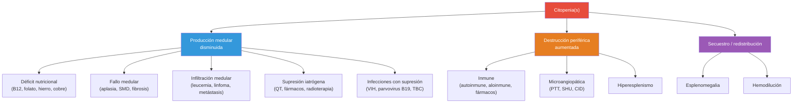
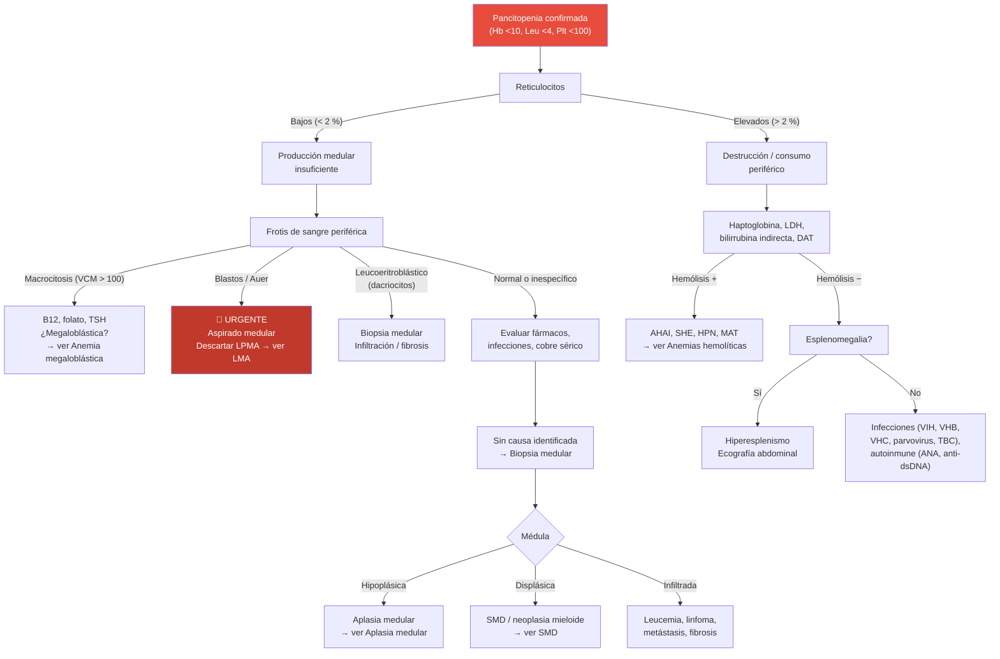
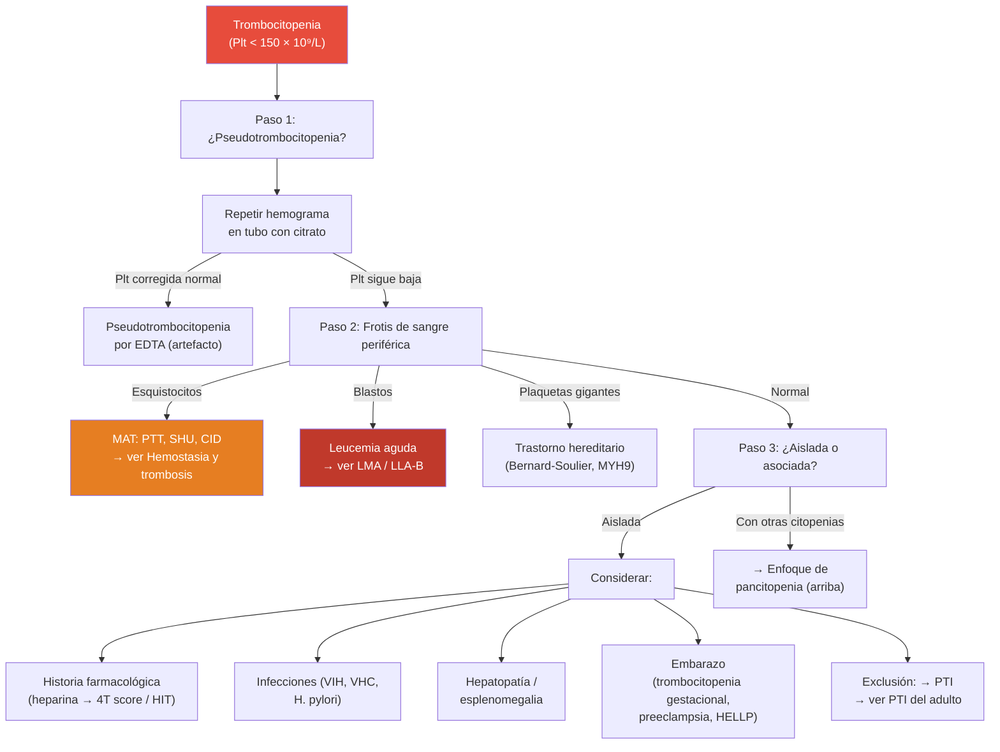
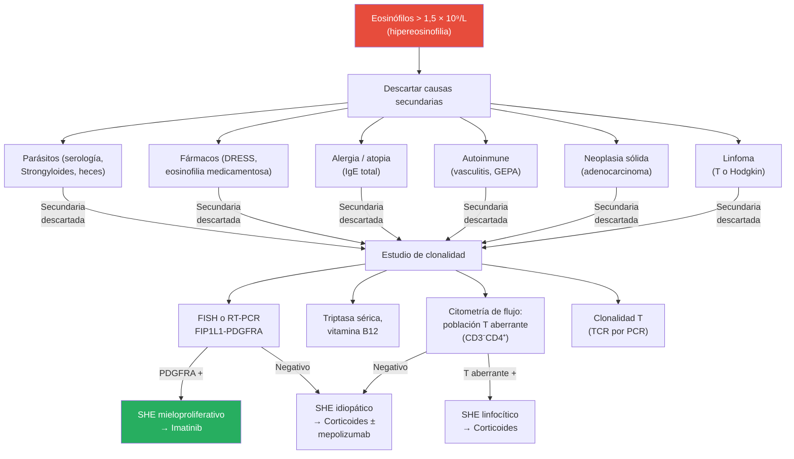
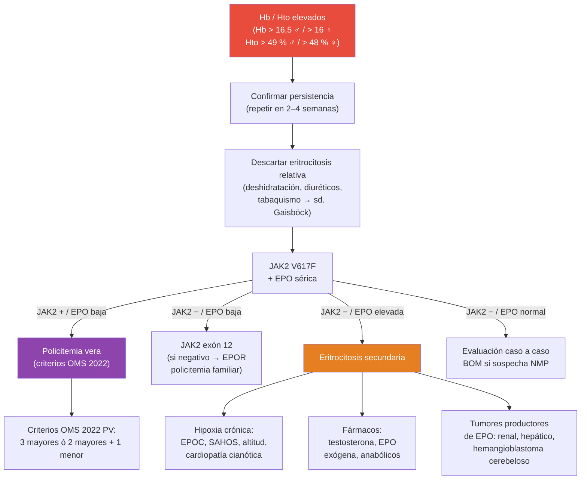
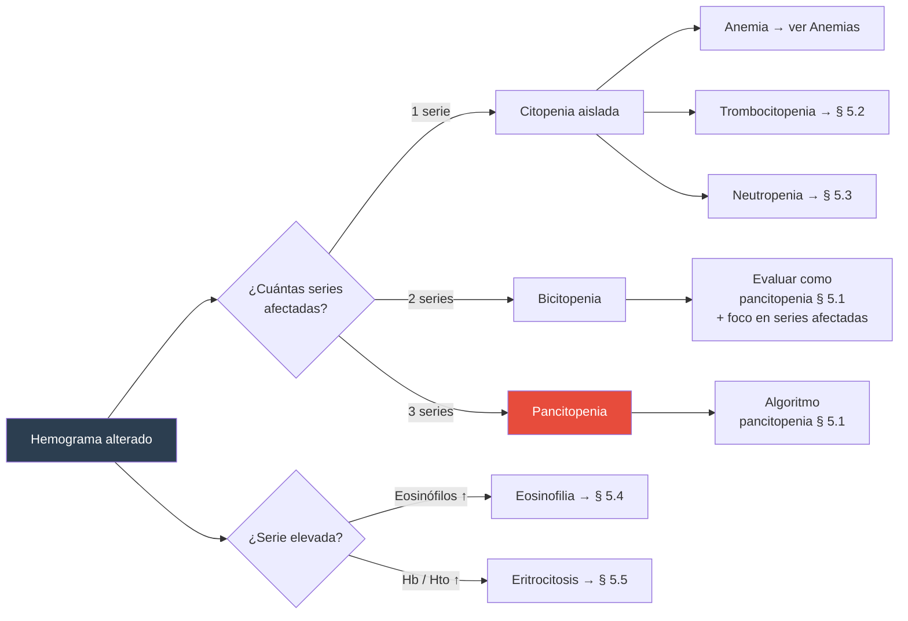

# Citopenias y estudio inicial

!!! info "Ficha de la página"
    **Última revisión:** 2026-11-12 · **Fuentes base:** Chew & Kamangar, Clin Med 2024 [87]; Gnanaraj et al. Blood Rev 2018 [88]; Swain & Bird, Platelets 2020 [89]; EHA/EuNet-INNOCHRON 2023 (diagnóstico neutropenia) [90]; EHA/EuNet-INNOCHRON 2025 (tratamiento neutropenia) [91]; Kim et al. AAFP 2025 [92]; Klion, Hematology ASH 2022 [93]; Shomali & Gotlib, Am J Hematol 2022 [94]; Valent et al. Allergy 2023 [95]; OMS 5.ª ed. 2022 [59]; Alberta PV guideline 2025 [96]. · **Alcance:** enfoque diagnóstico de pancitopenia, trombocitopenia, neutropenia, eosinofilia y eritrocitosis/poliglobulia en el adulto. Las enfermedades específicas (PTI, anemias, aplasia medular, SMD, etc.) se desarrollan en sus páginas dedicadas.

---

## 1 · Resumen rápido

| Citopenia | Paso 1 clave | Estudio urgente que no olvidar |
|---|---|---|
| **Pancitopenia** | Reticulocitos + frotis | Descartar LPMA (blastos/Auer), CID (ISTH), HLH (ferritina ≥ 2 000) |
| **Trombocitopenia** | Descartar pseudo-trombocitopenia (repetir en tubo citrato) | Esquistocitos → MAT; blastos → leucemia aguda |
| **Neutropenia** | ANC < 1,5 × 10⁹/L (adulto caucásico); < 1,0 en etnia Duffy-null | Fiebre + neutropenia severa → emergencia |
| **Eosinofilia** | Eosinófilos > 0,5 × 10⁹/L; hipereosinofilia > 1,5 × 10⁹/L | Troponina + ecocardiograma (daño cardíaco) |
| **Eritrocitosis** | Confirmar persistencia → JAK2 V617F + EPO sérica | Hto > 49 % (♂) / > 48 % (♀) → evaluar PV |

---

## 2 · Definiciones y epidemiología

### 2.1 Pancitopenia

Se define como la reducción simultánea de las tres series hematológicas: **Hb < 10 g/dL, leucocitos < 4 × 10⁹/L (RAN < 1,5 × 10⁹/L) y plaquetas < 100 × 10⁹/L** [87]. No es un diagnóstico, sino un hallazgo de laboratorio que obliga a investigar su causa. La prevalencia es difícil de estimar porque agrupa múltiples etiologías; en series hospitalarias, las causas más frecuentes son megaloblástica, aplasia medular y síndromes mielodisplásicos [88].

### 2.2 Trombocitopenia

Recuento plaquetario **< 150 × 10⁹/L** (o < 100 × 10⁹/L según algunos autores para definir trombocitopenia clínicamente significativa) [89]. Es el hallazgo hematológico anormal más frecuente en pacientes hospitalizados (hasta 25–40 % en UCI). Puede ser aislada o acompañar a otras citopenias.

### 2.3 Neutropenia

Recuento absoluto de neutrófilos (RAN) **< 1,5 × 10⁹/L** en adultos caucásicos mayores de 1 año; umbral OMS 1,8 × 10⁹/L [90]. En personas con fenotipo **Duffy-null** (frecuente en ascendencia africana, medio-oriental y sefardí), el límite inferior normal es **< 1,0 × 10⁹/L** ("neutropenia étnica benigna") [92]. **Neutropenia crónica**: RAN reducido persistente por > 3 meses [90].

**Gravedad** [90]:

| Grado | RAN (× 10⁹/L) |
|---|---|
| Leve | 1,0 – 1,5 |
| Moderada | 0,5 – 1,0 |
| Severa | < 0,5 |
| Muy severa | < 0,2 |

### 2.4 Eosinofilia

- **Eosinofilia**: eosinófilos > 0,5 × 10⁹/L [93].
- **Hipereosinofilia (HE)**: eosinófilos > 1,5 × 10⁹/L en dos determinaciones separadas por ≥ 1 mes, o evidencia de daño tisular asociado a eosinófilos [95].
- **Síndrome hipereosinofílico (SHE)**: HE + daño orgánico mediado por eosinófilos + exclusión de causa secundaria identificable (definición clásica; el consenso 2023 amplía los criterios) [93][95].

### 2.5 Eritrocitosis / poliglobulia

Elevación persistente de Hb o Hto por encima de los límites normales. Los criterios OMS 2022 para policitemia vera (PV) usan: **Hb > 16,5 g/dL (♂) / > 16,0 g/dL (♀) ó Hto > 49 % (♂) / > 48 % (♀)** [59]. La eritrocitosis puede ser **absoluta** (aumento real de la masa eritrocitaria) o **relativa** (hemoconcentración).

---

## 3 · Fisiopatología

### Mecanismos generales de citopenia

**Pancitopenia** [87][88]: la causa determina si el mecanismo predominante es central (producción insuficiente: médula hipoplásica, infiltrada o displásica) o periférico (destrucción/consumo: hiperesplenismo, infecciones, autoinmunidad, MAT). El reticulocito es la clave inicial: bajo sugiere fallo de producción; elevado, destrucción periférica.

**Eosinofilia** [93]: la producción de eosinófilos depende de IL-5 (principalmente de linfocitos Th2 y células linfoides innatas tipo 2). En el SHE mieloproliferativo, la causa es clonal (p. ej., fusión FIP1L1-PDGFRA). En el SHE linfocítico, una población T aberrante (CD3⁻CD4⁺) produce IL-5 en exceso.

**Eritrocitosis** [59][96]: en la PV, la mutación JAK2 V617F (≈ 95 %) o JAK2 exón 12 provoca señalización constitutiva del receptor de EPO, produciendo eritrocitosis independiente de EPO. Las eritrocitosis secundarias son EPO-dependientes (hipoxia crónica, tumores productores de EPO).

---

## 4 · Presentación clínica

### Cuándo sospechar citopenias

| Citopenia | Síntomas / signos sugestivos |
|---|---|
| Anemia (dentro de pancitopenia) | Fatiga, disnea, palidez, taquicardia |
| Trombocitopenia | Petequias, equimosis, epistaxis, gingivorragia, menorragia |
| Neutropenia | Infecciones recurrentes, úlceras orales, fiebre sin foco claro |
| Eosinofilia | Rash cutáneo, tos/disnea, diarrea, mialgias, síntomas cardíacos |
| Eritrocitosis | Cefalea, visión borrosa, prurito acuagénico, plétora facial, esplenomegalia, trombosis |

**Banderas rojas en pancitopenia** [87]:

- Blastos o bastones de Auer en frotis → **LPMA: emergencia hematológica**
- Esquistocitos → MAT (PTT/SHU/CID)
- Ferritina ≥ 2 000 µg/L → considerar **linfohistiocitosis hemofagocítica** (H-score ≥ 169)
- Cuadro leucoeritroblástico (dacriocitos + eritroblastos + promielocitos circulantes) → infiltración medular

---

## 5 · Diagnóstico

### 5.1 Algoritmo de pancitopenia

**Indicaciones de biopsia/aspirado medular en pancitopenia** [87][88]:

- Blastos circulantes o bastones de Auer
- Cuadro leucoeritroblástico (dacriocitos, eritroblastos)
- Macrocitosis sin déficit de B12/folato que la explique
- Pancitopenia persistente sin causa periférica identificada
- Sospecha de aplasia medular, SMD o neoplasia

### 5.2 Algoritmo de trombocitopenia

**Claves del enfoque** [89]:

1. **Siempre descartar pseudotrombocitopenia** antes de iniciar estudio invasivo.
2. **Frotis**: los esquistocitos son urgentes (MAT); las plaquetas gigantes sugieren trastornos congénitos.
3. **VPM (volumen plaquetario medio)**: plaquetas grandes sugieren destrucción periférica (PTI); plaquetas pequeñas sugieren fallo de producción.
4. **PTI es diagnóstico de exclusión** → página dedicada: [PTI del adulto](pti-adulto.md).
5. **HIT (trombocitopenia inducida por heparina)**: aplicar score 4T en todo paciente con heparina y caída de plaquetas → ver [Hemostasia y trombosis](hemostasia-trombosis.md).

### 5.3 Enfoque de neutropenia

**Clasificación etiológica** [90][92]:

=== "Congénita"

    - Neutropenia congénita severa (Kostmann): mutaciones ELANE, HAX1
    - Neutropenia cíclica: mutaciones ELANE (ciclos de 21 días)
    - Shwachman-Diamond: mutación SBDS (insuficiencia pancreática + neutropenia)
    - Otras: síndrome de Barth, Chédiak-Higashi, disqueratosis congénita

=== "Adquirida"

    - **Autoinmune**: anticuerpos anti-neutrófilo (más frecuente en niños; también en adultos)
    - **Fármacos**: metamizol, clozapina, antitiroideos, quimioterapia, metotrexato, TMP-SMX
    - **Infecciones**: VIH, VHB, VHC, EBV, CMV, parvovirus B19, TBC, brucelosis
    - **Nutricional**: déficit B12, folato, cobre
    - **Leucemia de linfocitos granulares grandes (LGL)**: sospecha ante neutropenia crónica + esplenomegalia + artritis reumatoide
    - **Idiopática**: diagnóstico de exclusión tras reevaluación periódica

=== "Duffy-null (étnica)"

    - No es patológica; no requiere estudio exhaustivo si paciente asintomático con RAN estable 1,0–1,5 × 10⁹/L [92]
    - Frecuente en ascendencia africana, medio-oriental, sefardí
    - Término preferido: "neutropenia benigna asociada a Duffy-null"

**Estudio inicial de neutropenia** [90][92]:

1. Confirmar persistencia (repetir hemograma en 2–4 semanas)
2. Historia farmacológica detallada
3. Frotis de sangre periférica
4. Serologías: VIH, VHB, VHC
5. B12, folato, cobre (si hay otras citopenias)
6. ANA, factor reumatoide (sospecha autoinmune o LGL)
7. Anticuerpos anti-neutrófilo (disponibilidad limitada; sensibilidad moderada)
8. Inmunoglobulinas séricas (descartar inmunodeficiencia)

!!! warning "Neutropenia febril"
    Fiebre (≥ 38,3 °C única o ≥ 38,0 °C sostenida por 1 h) con RAN < 0,5 × 10⁹/L es una **emergencia médica**: hemocultivos + antibióticos empíricos de amplio espectro en < 1 hora [92].

### 5.4 Enfoque de eosinofilia

**Evaluación de daño orgánico (obligatoria con HE persistente)** [93][95]:

| Órgano | Estudio |
|---|---|
| Corazón | Troponina, BNP, ecocardiograma (fibrosis endomiocárdica) |
| Pulmón | TC tórax, función pulmonar |
| Piel | Biopsia si lesiones cutáneas |
| GI | Endoscopia si síntomas |
| Neurológico | RM cerebral si síntomas neurológicos |

**Clasificación OMS 2022 de neoplasias eosinofílicas** [59][94]:

- Neoplasias mieloides/linfoides con eosinofilia y reordenamientos de **PDGFRA**, **PDGFRB**, **FGFR1**, **JAK2**, **FLT3**, **ETV6::ABL1**
- Leucemia eosinofílica crónica, NOS (CEL-NOS)
- SHE idiopático (sin clonalidad demostrada)

### 5.5 Algoritmo de eritrocitosis / poliglobulia

**Criterios diagnósticos OMS 2022 para policitemia vera** [59]:

| Criterios mayores | |
|---|---|
| 1 | Hb > 16,5 g/dL (♂) / > 16,0 g/dL (♀) **ó** Hto > 49 % (♂) / > 48 % (♀) |
| 2 | Biopsia medular: proliferación trilineal (panmielosis) con megacariocitos pleomorfos maduros |
| 3 | Mutación JAK2 V617F o JAK2 exón 12 |

| Criterio menor | |
|---|---|
| 1 | EPO sérica subnormal |

**Diagnóstico**: 3 criterios mayores, **ó** los 2 primeros mayores + el criterio menor [59].

!!! tip "PV enmascarada"
    La ferropenia coexistente puede normalizar la Hb/Hto pero el recuento eritrocitario suele estar elevado con VCM bajo. Sospechar PV enmascarada en pacientes con eritrocitosis microcítica + trombocitosis + JAK2 V617F positivo [96].

---

## 6 · Estratificación de riesgo

La estratificación de riesgo en las citopenias se aplica principalmente a las **enfermedades de base**:

- **Pancitopenia por aplasia medular**: clasificación de gravedad (SAA, vSAA, no-SAA) → ver [Aplasia medular](aplasia-medular.md)
- **Trombocitopenia por PTI**: estratificación según respuesta a primera línea → ver [PTI del adulto](pti-adulto.md)
- **Neutropenia febril**: MASCC score para estratificación de riesgo (ambulatorio vs. hospitalario)
- **Eosinofilia**: la presencia de daño orgánico y el subtipo clonal determinan urgencia y tratamiento
- **Policitemia vera**: IPSS-PV para riesgo trombótico; factores: edad > 60, historia de trombosis, leucocitosis, JAK2 con alta carga alélica

---

## 7 · ¿Cuándo derivar a hematología?

| Situación | Urgencia |
|---|---|
| Blastos o Auer en frotis | 🚨 **Inmediata** (mismo día) |
| Pancitopenia severa sin causa obvia | **Urgente** (< 48 h) |
| Esquistocitos + trombocitopenia → MAT | 🚨 **Inmediata** |
| Neutropenia febril (RAN < 0,5 + fiebre) | 🚨 **Emergencia** (ATB en < 1 h) |
| HE persistente > 1,5 × 10⁹/L con daño orgánico | **Urgente** (< 1 semana) |
| Eritrocitosis con JAK2 positivo | **Preferente** (< 2 semanas) |
| Trombocitopenia aislada, estable, Plt > 50 | Derivación electiva |
| Neutropenia leve crónica, asintomática, Duffy-null | No requiere derivación a hematología [92] |

---

## 8 · Algoritmo general de estudio de citopenias

El siguiente esquema resume la aproximación global:

---

## 9 · Fármacos y dosis clave

Esta página de enfoque diagnóstico no aborda tratamientos específicos, que se desarrollan en las páginas de cada patología. Sin embargo, se resumen las intervenciones inmediatas:

| Situación | Intervención inmediata | Referencia |
|---|---|---|
| Neutropenia febril | Cefepime 2 g IV c/8 h ó piperacilina-tazobactam 4,5 g IV c/6 h (iniciar en < 1 h) | [92] |
| Sospecha de LPMA | ATRA 45 mg/m²/día (iniciar ante sospecha, sin esperar confirmación molecular) | [32] → ver [LMA](../hemato-onco/lma.md) |
| SHE con daño orgánico | Prednisona 1 mg/kg/día; si PDGFRA+: imatinib 100 mg/día (respuesta esperable > 95 %) | [93][94] |
| PV con Hto > 45 % | Flebotomía (450 mL) para Hto objetivo < 45 % + AAS 100 mg/día | [96] |

---

## 10 · Evidencia clave

| Estudio / Guía | Aporte principal | Ref |
|---|---|---|
| Chew & Kamangar, Clin Med 2024 | Algoritmo estructurado de pancitopenia: reticulocitos como pivote, indicaciones de BMO, alertas de emergencia (LPMA, CID, HLH) | [87] |
| Gnanaraj et al. Blood Rev 2018 | Revisión sistemática con algoritmo diagnóstico de pancitopenia; causas en países en desarrollo vs. desarrollados | [88] |
| Swain & Bird, Platelets 2020 | Enfoque práctico de trombocitopenia de novo: pseudo-trombocitopenia, frotis, VPM, diagnóstico de exclusión | [89] |
| EHA/EuNet-INNOCHRON 2023 | Primera guía europea de diagnóstico/clasificación de neutropenia crónica en adultos y niños | [90] |
| Kim et al. AAFP 2025 | Revisión de neutropenia en atención primaria: cuándo estudiar, cuándo derivar, neutropenia Duffy-null | [92] |
| Klion, Hematology ASH 2022 | Enfoque del paciente con sospecha de SHE: algoritmo de causas secundarias → clonalidad → tratamiento | [93] |
| Shomali & Gotlib, Am J Hematol 2022 | Actualización de clasificación OMS 2022 de trastornos eosinofílicos | [94] |
| Valent et al. Allergy 2023 | Criterios refinados de HE y SHE (consenso multidisciplinario) | [95] |
| OMS 5.ª ed. 2022 | Criterios diagnósticos de PV y clasificación de neoplasias eosinofílicas | [59] |

---

## 11 · Seguridad y soporte

- **Pancitopenia severa**: soporte transfusional según umbrales habituales (GR si Hb < 7 g/dL sintomática; plaquetas si < 10 × 10⁹/L o < 20 con fiebre/infección).
- **Neutropenia severa prolongada**: considerar G-CSF (filgrastim 5 µg/kg/día SC) en infecciones graves o neutropenia farmacológica severa [91].
- **Eosinofilia con daño cardíaco**: la fibrosis endomiocárdica puede requerir anticoagulación y manejo cardiológico.
- **PV**: la flebotomía puede provocar ferropenia sintomática; no suplementar hierro (riesgo de rebote de Hto).

---

## 12 · Seguimiento

| Citopenia | Seguimiento sugerido |
|---|---|
| Pancitopenia en estudio | Hemograma semanal hasta diagnóstico |
| Trombocitopenia leve estable | Hemograma cada 3–6 meses |
| Neutropenia crónica leve/moderada | Hemograma cada 3 meses el primer año, luego cada 6 meses si estable [90] |
| Eosinofilia leve (< 1,5 × 10⁹/L) sin daño orgánico | Hemograma cada 3–6 meses |
| HE en seguimiento post-tratamiento | Hemograma mensual los primeros 6 meses, luego cada 3 meses [93] |
| PV | Hemograma cada 3 meses, Hto objetivo < 45 %; vigilar transformación a MF/LMA |

---

## 13 · Puntos clave para el residente

!!! success "Lo esencial"

    1. **Pancitopenia**: el reticulocito es el primer paso — bajo = problema de producción, elevado = destrucción periférica [87].
    2. **Trombocitopenia**: siempre descartar pseudotrombocitopenia antes de estudiar — repetir en citrato [89].
    3. **Neutropenia**: no estudiar exhaustivamente la neutropenia leve crónica en pacientes asintomáticos con fenotipo Duffy-null [92].
    4. **Neutropenia febril**: es una emergencia — antibióticos empíricos en < 1 hora.
    5. **Eosinofilia**: buscar PDGFRA (FISH) — la respuesta a imatinib es espectacular (> 95 %) [93].
    6. **Eritrocitosis**: JAK2 V617F + EPO sérica son los dos exámenes clave; JAK2 positivo = PV hasta demostrar lo contrario [59].
    7. **Frotis siempre**: blastos, esquistocitos, dacriocitos y plaquetas gigantes cambian completamente el enfoque.
    8. **No duplicar**: PTI → [PTI del adulto](pti-adulto.md), anemias → páginas dedicadas, aplasia → [Aplasia medular](aplasia-medular.md), MAT/CID → [Hemostasia y trombosis](hemostasia-trombosis.md).

---

## 14 · Autoevaluación

??? question "Caso 1 — Pancitopenia en mujer de 35 años"
    Mujer de 35 años consulta por fatiga progresiva. Hemograma: Hb 8,2, leucocitos 2,8 (RAN 0,9), plaquetas 45. Reticulocitos 0,3 %. Frotis: macrocitosis, neutrófilos hipersegmentados. ¿Cuál es el diagnóstico más probable y qué examen solicitas primero?

    **Respuesta**: Anemia megaloblástica (probablemente déficit de B12). Solicitar **B12 sérica y folato**. Los neutrófilos hipersegmentados son muy sugestivos. Si B12 baja → estudio de causa (anti-FI, anti-células parietales). No requiere biopsia medular si responde a sustitución [87].

??? question "Caso 2 — Trombocitopenia de hallazgo"
    Hombre de 50 años, hemograma preoperatorio: plaquetas 85 × 10⁹/L (previo normal hace 2 años). Asintomático. ¿Cuál es tu primer paso?

    **Respuesta**: **Repetir hemograma en tubo con citrato** para descartar pseudotrombocitopenia por EDTA [89]. Si se confirma, solicitar frotis (buscar esquistocitos, plaquetas gigantes), hepatograma, ecografía abdominal (esplenomegalia), serologías VIH/VHC, y función hepática. Si todo negativo y trombocitopenia aislada → considerar PTI (diagnóstico de exclusión).

??? question "Caso 3 — Eosinofilia severa"
    Hombre de 40 años con eosinófilos 8,0 × 10⁹/L, disnea y troponina elevada. Sin viajes recientes, sin fármacos nuevos. ¿Qué examen es prioritario y por qué?

    **Respuesta**: **FISH para FIP1L1-PDGFRA** es prioritario porque si es positivo, el imatinib 100 mg/día produce respuesta completa en > 95 % de los casos y puede ser la diferencia entre recuperación cardíaca y fibrosis endomiocárdica irreversible [93]. Mientras se espera, iniciar **prednisona 1 mg/kg** y **ecocardiograma urgente**.

??? question "Caso 4 — Eritrocitosis en hombre joven"
    Hombre de 30 años, Hb 18,5 g/dL, Hto 54 %. No fuma, sin uso de testosterona. ¿Cómo enfocas el estudio?

    **Respuesta**: Confirmar persistencia, luego solicitar **JAK2 V617F + EPO sérica** [59]. Si JAK2 positivo y/o EPO baja → PV (criterios OMS 2022). Si JAK2 negativo y EPO elevada → eritrocitosis secundaria: evaluar SAHOS (polisomnografía), hemoglobinas con alta afinidad por O₂, cardiopatía. Si JAK2 negativo y EPO baja → solicitar JAK2 exón 12 y considerar policitemia familiar (mutación EPOR).

---

## 15 · Referencias

Las referencias [87]–[96] se encuentran en la [lista de referencias](../referencias.md) de la wiki.

| Cita | Descripción breve |
|---|---|
| [87] | Chew & Kamangar — algoritmo de pancitopenia (Clin Med 2024) |
| [88] | Gnanaraj et al. — revisión sistemática de pancitopenia (Blood Rev 2018) |
| [89] | Swain & Bird — enfoque de trombocitopenia nueva (Platelets 2020) |
| [90] | EHA/EuNet-INNOCHRON — diagnóstico de neutropenia crónica (HemaSphere 2023) |
| [91] | EHA/EuNet-INNOCHRON — tratamiento de neutropenia crónica (HemaSphere 2025) |
| [92] | Kim et al. — neutropenia en atención primaria (Am Fam Physician 2025) |
| [93] | Klion — enfoque del SHE (Hematology ASH 2022) |
| [94] | Shomali & Gotlib — eosinofilia OMS 2022 (Am J Hematol 2022) |
| [95] | Valent et al. — criterios refinados HE/SHE (Allergy 2023) |
| [96] | Alberta Health Services — PV guideline 2025 |
| [59] | OMS 5.ª ed. 2022 — clasificación tumores hematolinfoides (Leukemia 2022) |
| [32] | ELN 2022 — diagnóstico y manejo de LMA (Blood 2022) |

---

## 16 · Pendientes

- [ ] Agregar tabla de fármacos causantes de neutropenia (con frecuencias y mecanismo)
- [ ] Desarrollar sección de trombocitopatías congénitas (Bernard-Soulier, Glanzmann, trastornos MYH9)
- [ ] Incluir score MASCC para neutropenia febril (ambulatorio vs. hospitalario)
- [ ] Ampliar enfoque de linfocitosis y monocitosis (no cubiertos en esta versión)
- [ ] Agregar enfoque de trombocitosis reactiva vs. clonal (diagnóstico diferencial con TE)
