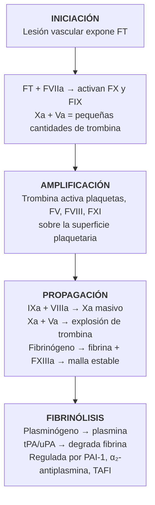
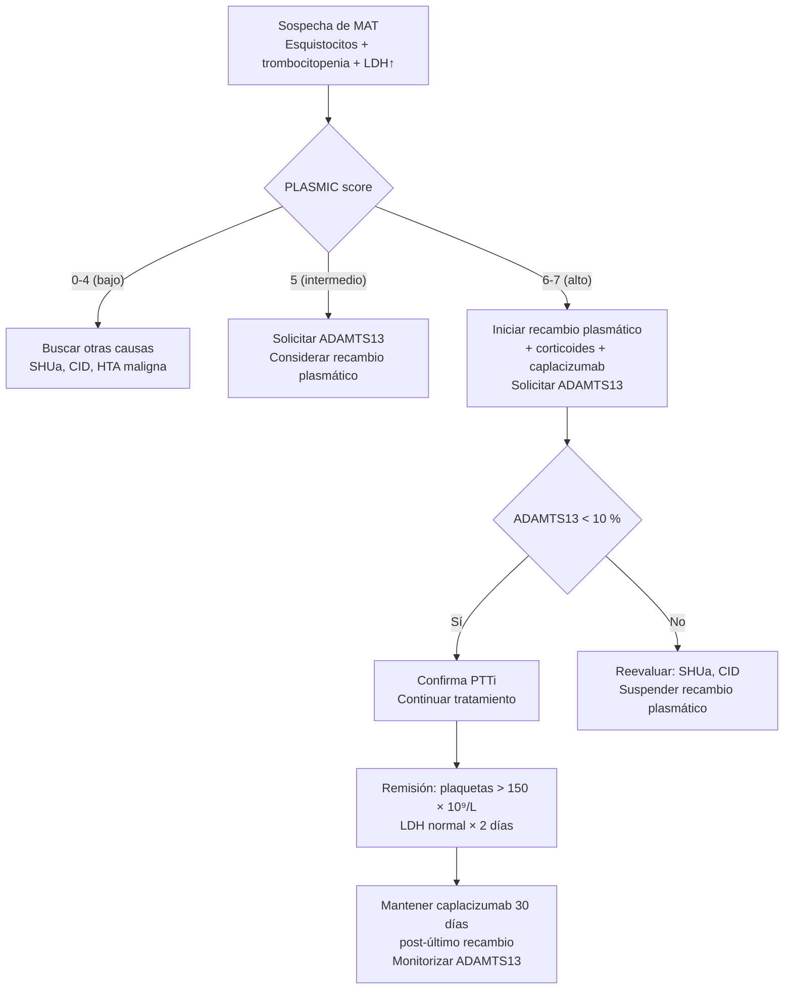
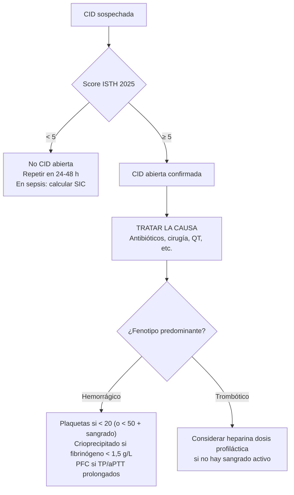
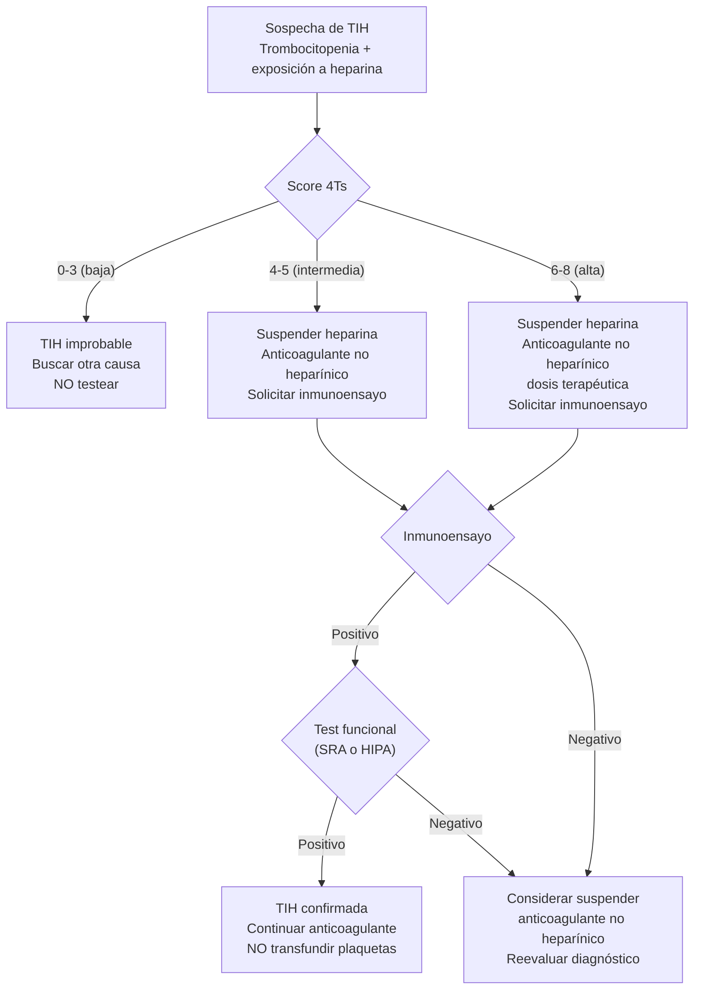

# Hemostasia y trombosis

!!! info "Ficha de la página"
    **Última revisión:** 2026-11-12 · **Fuentes base:** ASH 2018 (TIH) [73], ASH 2023 (trombofilias) [74], ASH/ISTH/NHF/WFH 2021 (VWD) [75][76], ISTH 2020/2025 (PTT) [77][78], ISTH 2025 (CID) [79], ACR/EULAR 2023 (SAF) [80], ISTH 2024 (hemofilia congénita) [81], consenso AHA 2020 [82] · **Alcance:** fisiología de la hemostasia, coagulopatías congénitas y adquiridas, TIH, trombofilias, SAF; **no cubre** TEV y anticoagulación (ver [página propia](tev-anticoagulacion.md)).

---

## 1. Resumen rápido

- La hemostasia se entiende mejor con el **modelo celular** (iniciación → amplificación → propagación) que con la cascada clásica; el factor tisular y las plaquetas activadas son las plataformas clave [V-RS] [83].
- La **enfermedad de von Willebrand (EVW)** es la coagulopatía hereditaria más frecuente; el diagnóstico requiere VWF:Ag, VWF:RCo y FVIII:C, y el tratamiento incluye desmopresina (tipos 1 y 2A) y concentrados de VWF [V-RS] [75][76].
- La **PTT inmune** exige sospecha urgente (PLASMIC ≥ 6), recambio plasmático inmediato y caplacizumab; la actividad de ADAMTS13 < 10 % es diagnóstica [V-RS] [77][78].
- El **score de CID abierta ISTH 2025** (≥ 5 puntos) incorpora umbrales revisados de dímero D (> 3× y > 7× LSN) y clasifica la CID en pre-CID, fase temprana y abierta [V-RS] [79].
- La **TIH** se diagnostica con el **score 4Ts** (≤ 3 descarta; ≥ 6 alta probabilidad) y se trata suspendiendo heparina + anticoagulante no heparínico [V-RS] [73].

---

## 2. Definición y epidemiología

La hemostasia es el conjunto de procesos que detienen el sangrado tras la lesión vascular y limitan la coagulación al sitio de daño. Su desregulación produce **sangrado** (defectos cuantitativos o funcionales de plaquetas o factores) o **trombosis** (activación excesiva o pérdida de anticoagulantes naturales) [V-RS] [83].

| Entidad | Prevalencia/incidencia aproximada |
|---|---|
| Enfermedad de von Willebrand | ~1 % (formas sintomáticas ~1:1 000) [V-RS] [75] |
| Hemofilia A | 1:5 000 varones nacidos vivos [V-RS] [81] |
| Hemofilia B | 1:30 000 varones nacidos vivos [V-RS] [81] |
| Hemofilia adquirida A (AHA) | 1–2 por millón/año [V-RS] [82] |
| PTT inmune | ~3 por millón/año [V-RS] [77] |
| SHUa (mediado por complemento) | ~0,5 por millón/año [V-RS] [84] |
| TIH | 0,1–7 % de expuestos a heparina según tipo y duración [V-RS] [73] |
| SAF | 40–50 por 100 000 [V-RS] [80] |

---

## 3. Fisiopatología

### 3.1 Modelo celular de la hemostasia

El modelo celular (Hoffman y Monroe, 2001) reemplaza la cascada clásica al integrar la función de las superficies celulares [V-RS] [83]:

**Anticoagulantes naturales:** antitrombina (inhibe trombina, Xa), proteína C/proteína S (inactivan Va y VIIIa), TFPI (inhibe complejo FT–VIIa) [V-RS] [83].

### 3.2 Hemostasia primaria

La adhesión plaquetaria requiere VWF (puente entre colágeno subendotelial y GPIb plaquetaria), seguida de activación (TxA₂, ADP, trombina) y agregación (GPIIb/IIIa–fibrinógeno). Defectos en este nivel causan sangrado mucocutáneo [V-RS] [83].

### 3.3 Microangiopatías trombóticas (MAT)

Las MAT comparten anemia hemolítica microangiopática (esquistocitos), trombocitopenia y daño orgánico; difieren en mecanismo:

- **PTT:** deficiencia de ADAMTS13 → multímeros ultra-grandes de VWF → trombos plaquetarios [V-RS] [77].
- **SHUa:** desregulación del complemento alternativo → daño endotelial → TMA mediada por complemento [V-RS] [84].
- **CID:** activación sistémica de la coagulación → microtrombosis + consumo de factores → hemorragia y/o falla orgánica [V-RS] [79].

---

## 4. Presentación clínica

| Patrón | Entidades típicas | Manifestaciones |
|---|---|---|
| **Sangrado mucocutáneo** | EVW, trastornos plaquetarios, AHA | Epistaxis, gingivorragia, menorragia, equimosis, sangrado posquirúrgico |
| **Sangrado profundo** (articulaciones, músculos) | Hemofilias A y B, AHA severa | Hemartrosis, hematomas musculares, sangrado del SNC |
| **Trombosis + trombocitopenia** | PTT, TIH, SHUa, CID trombótica | Isquemia cerebral, renal, cutánea; trombosis venosa/arterial |
| **Sangrado + trombosis** | CID hemorrágica, SAF catastrófico | Sangrado difuso + falla multiorgánica |
| **Trombosis recurrente** | SAF, trombofilias | TEV recurrente, trombosis arterial, morbilidad obstétrica |

---

## 5. Diagnóstico

### 5.1 Enfermedad de von Willebrand (EVW)

Guías **ASH/ISTH/NHF/WFH 2021** [75][76]:

- **Sospecha:** sangrado mucocutáneo; usar **BAT** (herramienta de evaluación de sangrado) en pacientes de baja probabilidad [V-RS] [75].
- **Panel inicial:** VWF:Ag, VWF:RCo (o VWF:GPIbM), FVIII:C, hemograma.
- **Clasificación:**

| Tipo | Mecanismo | Hallazgo clave |
|---|---|---|
| 1 | Déficit cuantitativo parcial | VWF:Ag y VWF:RCo disminuidos proporcionalmente |
| 2A | Déficit cualitativo (pérdida de multímeros grandes) | Ratio VWF:RCo/VWF:Ag < 0,7 |
| 2B | Ganancia de función (unión aumentada a GPIb) | RIPA aumentada a dosis bajas; **estudio genético recomendado** [V-RS] [75] |
| 2M | Déficit cualitativo (función disminuida, multímeros normales) | Ratio VWF:RCo/VWF:Ag < 0,7, multímeros normales |
| 2N | Déficit de unión a FVIII | FVIII:C desproporcionadamente bajo; diagnóstico diferencial con hemofilia A leve |
| 3 | Déficit cuantitativo severo | VWF:Ag < 5 UI/dL, FVIII:C muy bajo |

### 5.2 Púrpura trombocitopénica trombótica (PTT)

**Score PLASMIC** (predicción de deficiencia severa de ADAMTS13 < 10 %) [V-RS] [77][85]:

| Parámetro | 1 punto si cumple |
|---|---|
| **P**laquetas < 30 × 10⁹/L | Sí |
| Hemo**L**ysis (reticulocitos > 2,5 %, haptoglobina indetectable o LDH > 2× LSN) | Sí |
| Sin c**A**ncer activo | Sí |
| Sin tra**S**plante de órgano o CPH | Sí |
| VC**M** < 90 fL | Sí |
| **I**NR < 1,5 | Sí |
| **C**reatinina < 2 mg/dL | Sí |

- **0–4:** riesgo bajo (4 %) → buscar diagnóstico alternativo.
- **5:** riesgo intermedio (57 %) → solicitar ADAMTS13, considerar recambio plasmático.
- **6–7:** riesgo alto (> 90 %) → iniciar recambio plasmático y solicitar ADAMTS13.

Sensibilidad 85–92 %, especificidad 89–92 %, c-estadístico 0,88–0,94 en validaciones externas [V-RS] [85].

**Diagnóstico definitivo:** actividad de ADAMTS13 < 10 % ± inhibidor de ADAMTS13 positivo [V-RS] [77].

### 5.3 Coagulación intravascular diseminada (CID)

**Score ISTH de CID abierta (actualización 2025)** [79]:

| Parámetro | 0 puntos | 1 punto | 2 puntos | 3 puntos |
|---|---|---|---|---|
| Plaquetas (× 10⁹/L) | > 100 | 50–100 | < 50 | — |
| Dímero D | Normal | — | > 3× LSN | > 7× LSN |
| Prolongación del TP | < 3 s | 3–6 s | > 6 s | — |
| Fibrinógeno (g/L) | > 1,0 | — | ≤ 1,0 | — |

**≥ 5 puntos = compatible con CID abierta** → repetir diariamente [V-RS] [79].

Definición ISTH 2025: "trastorno intravascular adquirido, potencialmente mortal, caracterizado por activación sistémica de la coagulación, fibrinólisis desregulada y daño endotelial, que resulta en microtrombosis" [V-RS] [79].

**Clasificación por fases:** pre-CID → CID fase temprana (subclínica/compensada) → CID abierta. Para sepsis, el **score SIC** (≥ 4 puntos) detecta la fase temprana [V-RS] [79].

### 5.4 Hemofilia adquirida A (AHA)

Sospecha: sangrado espontáneo en paciente previamente sano (generalmente > 60 años) con aPTT prolongado aislado [V-RS] [82].

**Algoritmo diagnóstico:**
1. aPTT prolongado → **estudio de mezcla** (no corrige, y puede empeorar con incubación 1–2 h a 37 °C).
2. FVIII:C disminuido (< 1 % en ~50 %, < 5 % en ~75 % de los casos).
3. **Título de inhibidor** (ensayo Bethesda/Nijmegen) [V-RS] [82].

~50 % idiopáticos; causas secundarias: neoplasias, autoinmunidad, embarazo/posparto [V-RS] [82].

### 5.5 Trombocitopenia inducida por heparina (TIH)

**Score 4Ts** (ASH 2018, recomendación fuerte) [73]:

| Categoría | 2 puntos | 1 punto | 0 puntos |
|---|---|---|---|
| **T**rombocitopenia | Caída > 50 % y nadir ≥ 20 | Caída 30–50 % o nadir 10–19 | Caída < 30 % o nadir < 10 |
| **T**iming | Días 5–10 o ≤ 1 día (exposición 30 d previos) | Compatible pero no claro | < 4 días sin exposición reciente |
| **T**rombosis | Trombosis nueva, necrosis cutánea, reacción sistémica | Trombosis progresiva, recurrente o sospechosa | Ninguna |
| O**T**ras causas | Ninguna evidente | Posible | Definitiva |

- **0–3 (baja):** VPN 99,8 % → **no testear ni tratar** [V-RS] [73].
- **4–5 (intermedia):** VPP 14 % → suspender heparina, iniciar anticoagulante no heparínico, solicitar inmunoensayo [V-RS] [73].
- **6–8 (alta):** VPP 64 % → suspender heparina, anticoagulante no heparínico a dosis terapéutica (recomendación fuerte, certeza moderada) [V-RS] [73].

### 5.6 Síndrome antifosfolípido (SAF)

**Criterios de clasificación ACR/EULAR 2023** [80]:

- **Criterio de entrada:** ≥ 1 test de aPL positivo dentro de 3 años de un criterio clínico asociado.
- **Dominios clínicos** (6): trombosis venosa macrovascular, trombosis arterial, microvascular, obstétrico, valvular cardíaco, hematológico.
- **Dominios de laboratorio** (2): anticoagulante lúpico; ensayos de fase sólida (aCL IgG/IgM, anti-β₂GPI IgG/IgM).
- **Clasificación:** ≥ 3 puntos clínicos **Y** ≥ 3 puntos de laboratorio [V-RS] [80].

Especificidad 99 % (vs 86 % de Sapporo 2006); sensibilidad 84 % [V-RS] [80].

### 5.7 Estudio de trombofilias

**Guías ASH 2023** — 23 recomendaciones, casi todas basadas en evidencia de muy baja certeza [74]:

| Situación | Recomendación |
|---|---|
| Población general antes de anticonceptivos orales | **No testear** (recomendación fuerte) [V-RS] [74] |
| TEV con factor transitorio no quirúrgico/hormonal | Condicional **a favor** de testear |
| Trombosis cerebral/esplácnica cuando se suspendería anticoagulación | Condicional **a favor** |
| Familiar de primer grado con déficit conocido de AT/PC/PS | Condicional **a favor** (para guiar tromboprofilaxis) |
| Embarazada con familiar con trombofilia de alto riesgo | Condicional **a favor** |
| TEV no provocado, primera vez | Condicional **en contra** |
| Cáncer + riesgo trombótico bajo/intermedio con antecedente familiar TEV | Condicional **a favor** |

**Panel completo:** antitrombina, proteína C, proteína S, factor V Leiden, mutación G20210A de protrombina, anticoagulante lúpico, aCL, anti-β₂GPI [V-RS] [74].

---

## 6. Estratificación de riesgo

| Entidad | Herramienta | Estratos |
|---|---|---|
| PTT | PLASMIC | Bajo (0–4), intermedio (5), alto (6–7) [V-RS] [85] |
| CID | Score ISTH 2025 | < 5 no CID abierta; ≥ 5 compatible [V-RS] [79] |
| TIH | 4Ts | Baja (0–3), intermedia (4–5), alta (6–8) [V-RS] [73] |
| AHA | Título de inhibidor | Bajo título (< 5 UB) vs alto título (≥ 5 UB) [V-RS] [82] |
| SAF | ACR/EULAR 2023 | Clasificación si ≥ 3 puntos clínicos + ≥ 3 laboratorio [V-RS] [80] |

---

## 7. ¿Cuándo tratar?

- **EVW:** profilaxis preoperatoria, sangrado activo, menorragia severa; profilaxis a largo plazo si sangrados frecuentes (condicional, ASH/ISTH 2021) [V-RS] [76].
- **PTT:** **emergencia hematológica** → tratamiento inmediato ante sospecha clínica, sin esperar ADAMTS13 [V-RS] [77].
- **CID:** tratar la causa subyacente siempre; soporte hemostático si sangrado activo o procedimiento invasivo; anticoagulación en CID trombótica [V-RS] [79].
- **TIH:** suspender heparina e iniciar anticoagulante no heparínico en toda TIH confirmada o probable (4Ts ≥ 4) [V-RS] [73].
- **AHA:** tratamiento hemostático si sangrado + inmunosupresor para erradicar el inhibidor en todos los casos [V-RS] [82].
- **SAF:** anticoagulación indefinida tras trombosis; en SAF obstétrico: heparina + AAS [V-RS] [80].
- **Trombofilias:** el estudio por sí solo rara vez cambia la duración de la anticoagulación; decisión individualizada [V-RS] [74].

---

## 8. Algoritmo de tratamiento

### 8.1 PTT inmune: manejo urgente

### 8.2 CID: enfoque por fase

### 8.3 TIH: algoritmo ASH 2018

---

## 9. Fármacos y dosis

### 9.1 Enfermedad de von Willebrand

| Fármaco | Dosis | Notas | Verif. |
|---|---|---|---|
| **Desmopresina (DDAVP)** | 0,3 µg/kg IV en 30 min (o intranasal 300 µg) | Tipos 1 y 2A; **contraindicada en tipo 2B** (agrava trombocitopenia); prueba terapéutica previa recomendada | [V-RS] [76] |
| **Concentrado VWF/FVIII** (Humate-P, Wilate) | 40–80 UI VWF:RCo/kg carga, luego 20–40 UI/kg c/12–24 h | Tipos 2B, 2M, 2N, 3 y cuando DDAVP es ineficaz; objetivo VWF:RCo > 50 UI/dL | [V-RS] [76] |
| **Ácido tranexámico** | 1 g VO c/8 h o 10 mg/kg IV | Adyuvante en sangrado mucocutáneo y procedimientos dentales | [V-RS] [76] |

### 9.2 PTT inmune

| Fármaco | Dosis | Notas | Verif. |
|---|---|---|---|
| **Recambio plasmático terapéutico** | 1–1,5 volúmenes plasmáticos/día | Pilar del tratamiento; inicio urgente ante sospecha alta | [V-RS] [77] |
| **Corticoides** | Metilprednisolona 1 mg/kg/día o equivalente | Inmunosupresión de primera línea | [V-RS] [77] |
| **Caplacizumab** | 11 mg IV previo al primer recambio, luego 11 mg SC/día × 30 días post-último recambio | Anti-VWF (nanobody); HERCULES: redujo recurrencias y tiempo de normalización plaquetaria; **riesgo de sangrado 11 % vs 1 %** (condicional, certeza moderada, ISTH 2020/2025) | [V-RS] [78] |
| **Rituximab** | 375 mg/m² semanal × 4 | Refractarios o recidivantes; también considerado precozmente en algunos centros | [V-RS] [77] |

**PTT congénita:** ADAMTS13 recombinante (recomendación fuerte sobre PFC, certeza moderada, ISTH 2025) [V-RS] [78].

### 9.3 Hemofilia congénita (ISTH 2024)

| Fármaco | Indicación | Recomendación ISTH | Verif. |
|---|---|---|---|
| **Profilaxis FVIII** (estándar o vida media extendida) | Hemofilia A severa/moderada-severa sin inhibidor | Fuerte a favor de profilaxis sobre tratamiento episódico | [V-RS] [81] |
| **Emicizumab** SC (semanal, bisemanal o c/4 sem) | Hemofilia A ± inhibidor | Condicional: profilaxis con emicizumab **o** con FVIII (sin inhibidor); **sugerida sobre agentes bypaseantes** en inhibidor (condicional) | [V-RS] [81] |
| **Profilaxis FIX** (pd-FIX o rFIX estándar/EHL) | Hemofilia B severa/moderada-severa sin inhibidor | Fuerte a favor de profilaxis | [V-RS] [81] |

### 9.4 Hemofilia adquirida A

| Fármaco | Dosis | Notas | Verif. |
|---|---|---|---|
| **rFVIIa (NovoSeven)** | 90 µg/kg c/2–3 h | Primera línea hemostática; no requiere monitorización de niveles | [V-RS] [82] |
| **CCPa (FEIBA)** | 50–100 UI/kg c/8–12 h (máx 200 UI/kg/día) | Alternativa hemostática; monitorizar con TEG/ROTEM | [V-RS] [82] |
| **Emicizumab** | 3 mg/kg SC semanal × 4, luego 1,5 mg/kg semanal | Uso creciente como puente hemostático; **NO usar CCPa concomitante** (riesgo trombótico) | [V-RS] [86] |
| **Prednisona ± ciclofosfamida** | PDN 1 mg/kg/día + CFM 1,5–2 mg/kg/día | Erradicación del inhibidor: primera línea si inhibidor bajo; agregar CFM si alto título | [V-RS] [82] |
| **Rituximab** | 375 mg/m² semanal × 4 | Segunda línea si falla PDN ± CFM | [V-RS] [82] |

### 9.5 TIH: anticoagulantes no heparínicos

| Fármaco | Dosis | Notas | Verif. |
|---|---|---|---|
| **Argatrobán** | 2 µg/kg/min IV (ajustar a aPTT 1,5–3× basal) | Metabolismo hepático; reducir dosis en insuficiencia hepática | [V-RS] [73] |
| **Fondaparinux** | 5–10 mg SC/día (según peso) | Sin monitorización; no atraviesa placenta | [V-RS] [73] |
| **DOACs** (rivaroxabán, apixabán) | Dosis estándar de TEV | Datos limitados (81 pacientes al momento de las guías); uso creciente en fase subaguda/crónica | [V-RS] [73] |
| **Bivalirudina** | 0,15–0,2 mg/kg/h IV | Preferida en intervención coronaria; vida media corta | [V-RS] [73] |

---

## 10. Evidencia clave

| Estudio/Guía | Población | Resultado principal | Certeza |
|---|---|---|---|
| **ISTH 2025 CID** (Iba et al.) [79] | Sepsis, trauma, malignidad | Score revisado con fases; D-dímero > 7× = 3 puntos; validado para mortalidad en sepsis | Consenso experto |
| **ISTH 2020/2025 PTT** (Zheng et al.) [77][78] | PTTi y PTTc | Caplacizumab sugerido en PTTi aguda; ADAMTS13 recombinante recomendado en PTTc | Moderada |
| **HERCULES** (Scully et al., 2019) | PTTi aguda (n = 145) | Caplacizumab: menor recurrencia (12 % vs 38 %), menor tiempo a normalización plaquetaria, menor estancia | Moderada [V-RS] [78] |
| **ASH 2018 TIH** (Cuker et al.) [73] | Expuestos a heparina | 4Ts score: VPN 99,8 % si ≤ 3; DOACs como opción emergente | Moderada (4Ts) / Muy baja (DOACs) |
| **ASH/ISTH/NHF/WFH 2021 VWD** [75][76] | Diagnóstico y manejo EVW | BATs para screening; prueba de desmopresina; profilaxis si sangrados frecuentes | Baja–moderada |
| **ISTH 2024 Hemofilia** (Rezende et al.) [81] | Hemofilia A y B congénita | Profilaxis fuerte sobre episódico; emicizumab o FVIII como opciones en hemofilia A | Moderada (profilaxis) / Muy baja (resto) |
| **ACR/EULAR 2023 SAF** (Barbhaiya et al.) [80] | Clasificación SAF | Criterios ponderados aditivos; especificidad 99 %, sensibilidad 84 % | Consenso experto |
| **ASH 2023 Trombofilias** (Middeldorp et al.) [74] | Estudio de trombofilias | No testear población general pre-ACO (fuerte); testeo selectivo en situaciones específicas | Muy baja |

---

## 11. Seguridad y soporte

- **Caplacizumab:** riesgo de sangrado (11 % serio vs 1 % placebo en HERCULES); precaución en pacientes con alto riesgo hemorrágico [V-RS] [78].
- **Recambio plasmático:** reacciones alérgicas, hipotensión, hipocalcemia por citrato, infecciones de catéter [PV].
- **Emicizumab en AHA:** no usar CCPa concomitante (riesgo de MAT/trombosis); se puede usar rFVIIa con precaución [V-RS] [86].
- **Anticoagulantes no heparínicos en TIH:** argatrobán requiere ajuste hepático; transición a warfarina solo cuando plaquetas > 150 × 10⁹/L (no iniciar durante TIH aguda) [V-RS] [73].
- **Desmopresina:** hiponatremia (monitorizar Na⁺); taquifilaxia tras dosis repetidas; no usar en tipo 2B de EVW [V-RS] [76].
- **SHUa:** vacunación antimeningocócica obligatoria antes de eculizumab/ravulizumab; profilaxis antibiótica [V-RS] [84].

---

## 12. Seguimiento y criterios de respuesta

| Entidad | Parámetro | Frecuencia |
|---|---|---|
| **PTT** | Plaquetas, LDH, ADAMTS13 | Diario en agudo; ADAMTS13 mensual post-remisión × 6 meses |
| **CID** | Score ISTH, fibrinógeno, dímero D | Diario durante CID abierta |
| **TIH** | Plaquetas | Cada 2–3 días hasta recuperación; control de anticoagulación |
| **EVW** | VWF:RCo, FVIII:C | Pre y postoperatorio; anual si profilaxis |
| **AHA** | FVIII:C, inhibidor Bethesda | Semanal durante inmunosupresión; mensual hasta remisión completa |
| **SAF** | aPL (AL, aCL, anti-β₂GPI) | Al diagnóstico y periódicamente; no modifica duración de anticoagulación |

**Criterios de remisión AHA:** FVIII:C > 50 % + inhibidor negativo (< 0,6 UB) [V-RS] [82].

---

## 13. Puntos clave para residentes e internos

1. Ante **trombocitopenia + esquistocitos + LDH elevada**, pensar en MAT: calcular PLASMIC y solicitar ADAMTS13 urgente.
2. La **PTT es una emergencia**: no esperar resultado de ADAMTS13 para iniciar recambio plasmático si PLASMIC ≥ 6.
3. El **score 4Ts** es obligatorio antes de solicitar estudios de TIH; si ≤ 3, la TIH está prácticamente descartada (VPN 99,8 %).
4. En la **CID**, tratar la causa es más importante que reponer factores; la reposición sin control de la causa perpetúa el ciclo.
5. La **EVW tipo 2B** es la excepción a la desmopresina: está contraindicada (empeora la trombocitopenia).
6. Un **aPTT prolongado aislado** con sangrado en un adulto mayor debe hacer sospechar hemofilia adquirida A.
7. Los **criterios ACR/EULAR 2023 de SAF** son más específicos (99 %) pero menos sensibles que Sapporo: un paciente puede tener SAF clínico sin cumplir criterios de clasificación.
8. **No testear trombofilias** de rutina: la población general antes de ACO no se beneficia (recomendación fuerte ASH 2023).
9. En TIH: **nunca transfundir plaquetas** (empeora trombosis) y no iniciar warfarina hasta plaquetas > 150 × 10⁹/L.

---

## 14. Autoevaluación

1. Mujer de 35 años con epistaxis recurrente, VWF:Ag 28 UI/dL, VWF:RCo 12 UI/dL, FVIII:C 35 %. ¿Qué tipo de EVW sospechas y qué estudio adicional solicitas?
2. Paciente con plaquetas de 12 × 10⁹/L, esquistocitos 3+, creatinina 1,1 mg/dL, LDH 1 200 UI/L: calcula el PLASMIC y describe tu conducta inmediata.
3. Paciente postoperado día 7, plaquetas cayeron de 180 a 65 × 10⁹/L bajo HNF. Calcula el 4Ts y decide si solicitas estudios de TIH.
4. ¿En qué situaciones clínicas las guías ASH 2023 recomiendan **a favor** de estudiar trombofilias?

---

## 15. Referencias de esta página

**[73]** ASH 2018 TIH · **[74]** ASH 2023 trombofilias · **[75]** ASH/ISTH/NHF/WFH 2021 VWD (diagnóstico) · **[76]** ASH/ISTH/NHF/WFH 2021 VWD (manejo) · **[77]** ISTH 2020 PTT (diagnóstico) · **[78]** ISTH 2025 PTT (actualización) · **[79]** ISTH 2025 CID · **[80]** ACR/EULAR 2023 SAF · **[81]** ISTH 2024 hemofilia congénita · **[82]** Consenso AHA (Tiede et al. 2020) · **[83]** Modelo celular hemostasia (Hoffman & Monroe / Smith 2009) · **[84]** SHUa/TMA complemento (KDIGO/revisiones) · **[85]** PLASMIC score (Bendapudi et al. 2017; Li et al. 2018) · **[86]** AHA en era emicizumab (JTH 2024) — ver [lista completa](../referencias.md).

---

## 16. Pendientes

- [ ] Texto completo de [73] (ASH TIH): detalles de manejo perioperatorio, CEC, TIH subaguda y remota.
- [ ] Texto completo de [75][76] (VWD ASH/ISTH 2021): 11 recomendaciones diagnósticas + 12 de manejo detalladas.
- [ ] Texto completo de [77] (ISTH 2020 PTT diagnóstico): criterios detallados, score francés.
- [ ] Trastornos plaquetarios hereditarios (trombastenia de Glanzmann, síndrome de Bernard-Soulier): ampliar.
- [ ] SHUa: ampliar manejo con eculizumab/ravulizumab y criterios de suspensión.
- [ ] Manejo del SAF: anticoagulación, SAF obstétrico, SAF catastrófico (protocolo CAPS).
- [ ] ISTH 2025: score SIC detallado para fase temprana de CID en sepsis.
- [ ] Contrastar disponibilidad de fármacos en Chile (caplacizumab, emicizumab, argatrobán).
