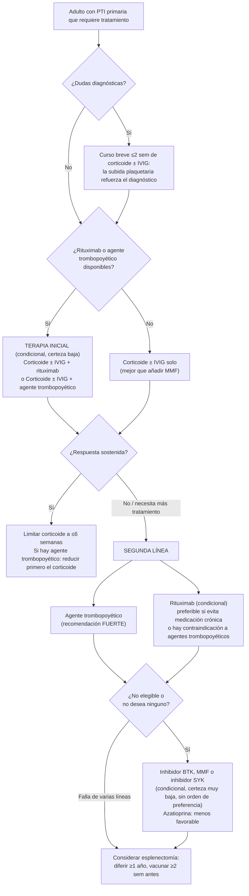

# Trombocitopenia inmune (PTI) primaria del adulto

!!! info "Ficha de la página"
    **Última revisión:** 2026-11-11 · **Fuente base:** guía ASH 2026 (actualización focalizada de la guía ASH 2019) [1] · **Alcance:** PTI primaria en adultos (≥18 años), tratamiento inicial y de segunda línea. Diagnóstico, embarazo, pediatría, PTI secundaria y PTI refractaria **no** están cubiertos por la guía ASH 2026 y se remiten al consenso internacional 2019 [2].

## 1. Resumen rápido

- La guía **ASH 2026 cambia el tratamiento inicial**: sugiere **corticoide + rituximab** o **corticoide + agente trombopoyético** en lugar de corticoide solo (recomendación **condicional**, certeza **baja**) [1] **[V-TF]**.
- En segunda línea, tras falla de corticoides: **agente trombopoyético** (recomendación **fuerte**, certeza moderada) o **rituximab** (condicional, certeza baja) [1] **[V-TF]**.
- Esplenectomía: si es posible, **diferirla ≥1 año** desde el diagnóstico [1] **[V-TF]**.
- Solo hay **una recomendación fuerte** en toda la guía: la evidencia comparativa entre estrategias activas sigue siendo escasa [1] **[V-TF]**.

## 2. Definición y epidemiología

| Elemento | Contenido | Verificación |
|---|---|---|
| Definición | Trastorno adquirido con trombocitopenia por **destrucción plaquetaria autoinmune** y **trombopoyesis alterada** | [1] **[V-TF]** |
| Umbral diagnóstico | Recuento plaquetario **<100 × 10⁹/L** | [4] **[V-RS]** |
| Primaria vs secundaria | Primaria: aislada. Secundaria: asociada a una condición predisponente | [1] **[V-TF]** |
| Incidencia en adultos | **1–6 por 100.000** | [1] **[V-TF]** |
| Edad | Picos en la infancia temprana y en la adultez mayor | [1] **[V-TF]** |
| Clínica | Sangrado, fatiga y menor calidad de vida; el **sangrado se correlaciona poco con el recuento** plaquetario | [1] **[V-TF]** |

## 3. Diagnóstico

La PTI es un diagnóstico de **exclusión**. La guía ASH 2026 no revisa el diagnóstico y remite a otros documentos [1]; el consenso internacional actualizado 2019 incluye recomendaciones diagnósticas en adultos, embarazo y niños [2] **[V-RS]**.

**Dato práctico de la guía 2026:** un ascenso demostrable del recuento plaquetario con corticoides y/o IVIG **aumenta la confianza en el diagnóstico**; ante duda diagnóstica es razonable un curso breve (**≤2 semanas**) de corticoides ± IVIG antes de iniciar terapia combinada [1] **[V-TF]**.

??? warning "Estudio inicial habitual — pendiente de verificación [PV]"
    Lo siguiente es práctica general **no verificada aún contra el texto del consenso 2019 [2]**; completar al revisar ese documento:

    - Hemograma con **frotis revisado** (descartar pseudotrombocitopenia por EDTA, esquistocitos, displasia).
    - Serologías **VIH, VHC, VHB** (esta última también por el riesgo de reactivación con rituximab).
    - Evaluación de PTI secundaria: fármacos, lupus/antifosfolípidos, inmunodeficiencia común variable, neoplasias linfoproliferativas (incl. LLC), *H. pylori*.
    - Indicación de mielograma según edad y atipias.

## 4. ¿Cuándo tratar?

!!! warning "[PV] Umbral y criterios de tratamiento"
    La guía ASH 2026 **no define** indicaciones de tratamiento [1]. Los umbrales habituales (p. ej., recuento bajo ~30 × 10⁹/L o sangrado/riesgo hemorrágico) deben tomarse del consenso internacional 2019 [2] tras revisar su texto completo. **No usar un número de esta wiki sin esa verificación.**

## 5. Algoritmo de tratamiento (ASH 2026)

*Fuente del algoritmo: recomendaciones 1, 2a, 2b y declaraciones de buena práctica de [1] **[V-TF]**. Elaboración gráfica propia con fines docentes.*

## 6. Fármacos y dosis

| Fármaco / estrategia | Dosis y pauta | Notas clave | Verificación |
|---|---|---|---|
| **Dexametasona** (componente de terapia combinada) | **40 mg/día × 4 días**, 1 a 3 ciclos separados 2–4 semanas | Es el esquema corticoide más estudiado en combinación | [1] **[V-TF]** |
| **Prednis(ol)ona** | Inicio **0,5–2 mg/kg/día** | Limitar el corticoide a **≤6 semanas** | [1] **[V-TF]** |
| **IVIG** | Dosis habitual 1 g/kg (1–2 días) | Opcional junto al corticoide en terapia inicial | Existencia del uso: [1] **[V-TF]** · dosis: **[PV]** |
| **Rituximab** | **375 mg/m² semanal × 4** | Régimen más estudiado; otras dosis son aceptables según práctica local; **biosimilares** válidos | [1] **[V-TF]** |
| **Agentes trombopoyéticos** (avatrombopag, eltrombopag, hetrombopag, romiplostim, TPO recombinante humana) | "**Dosis inicial estándar**" del fármaco usado | La guía los trata como **intercambiables**; la duración se guía por respuesta, toxicidad y estabilidad plaquetaria | [1] **[V-TF]** |
| **Eltrombopag** | Inicio **50 mg/día** (**25 mg/día** si ascendencia del Este/Sudeste asiático); ajustar en +25 mg si plaquetas <50 000/µl tras ≥2 semanas; **máx. 75 mg/día**; meta ≥50 000/µl, evitar >75 000/µl | Esperar 2 semanas para evaluar cada ajuste; suspender si no hay respuesta tras 4 semanas con 75 mg. Ajuste en insuficiencia hepática y restricciones con cationes: **[PV]** | [18] ficha técnica UE · confirmar con ficha ISP Chile |
| **Romiplostim** | Inicio **1 µg/kg SC semanal** (peso real); subir de a **1 µg/kg** hasta plaquetas ≥50 ×10⁹/l; **máx. 10 µg/kg/semana**; bajar 1 µg/kg si >150 ×10⁹/l por 2 semanas; no administrar si >250 ×10⁹/l | Suspender si tras 4 semanas con 10 µg/kg no hay respuesta | [19] ficha técnica UE · confirmar con ficha ISP Chile |
| **Avatrombopag** | Inicio **20 mg/día con alimentos**; titulación por niveles (20 mg 1/sem hasta 40 mg/día); **máx. 40 mg/día**; objetivo ≥50 ×10⁹/l | Suspender si no alcanza ≥50 ×10⁹/l tras 4 semanas con 40 mg/día; dosis inicial distinta con inhibidores/inductores de CYP2C9 y CYP3A4/5 | [20] ficha técnica UE · disponibilidad en Chile: **[PV]** |
| **Inhibidor de BTK** | — | Aprobado para PTI en 2025 según la guía; fármaco y dosis a consignar | Existencia: [1] **[V-TF]** · dosis: **[PV]** |
| **Inhibidor de SYK** (p. ej., fostamatinib) | — | Alternativa en segunda línea/refractarias | [1][4] **[V-TF/V-RS]** · dosis: **[PV]** |
| **Micofenolato (MMF)** | — | **Contraindicado en embarazo** | [1] **[V-TF]** · dosis: **[PV]** |
| **Azatioprina** | — | Menos favorable, pero barata, de amplia disponibilidad y **segura en embarazo** | [1] **[V-TF]** · dosis: **[PV]** |

!!! note "Sobre los **[PV]**"
    Las dosis marcadas **[PV]** son prácticas habituales que **no figuran** en las fuentes revisadas en esta sesión. Se completarán contrastando la ficha técnica local (ISP/Chile) o el texto de las guías correspondientes.

## 7. Evidencia que sustenta la guía

Resultados reportados en [1] (SoC = corticoide ± IVIG; SRoT = respuesta sostenida sin tratamiento). Todas las cifras **[V-TF]**.

### 7.1 Tratamiento inicial (comparado con corticoide solo)

| Estrategia | SRoT a 6 meses | SRoT a 12 meses | Daños destacados | Certeza |
|---|---|---|---|---|
| Agente trombopoyético + corticoide | 52 % vs 33 % (OR 2,33; IC95 % 1,48–3,37) | 46 % vs 31 % (OR 1,87; 1,05–3,36) | Trombosis 10 % vs 0 % (OR 11,49; IC amplio, incluye el 1) | Baja |
| Anti-CD20 (rituximab) + corticoide | 52 % vs 32 % (OR 2,33; 0,88–6,12) | 59 % vs 31 % (OR 4,23; 0,98–18,32) | Infección OR 2,50 (1,01–6,21); trombosis 14 % vs 0 % (OR 36,12; IC muy amplio) | Baja |
| MMF + corticoide | No reportado | No reportado (respuesta durable a 12 m: 78 % vs 56 %, OR 2,81; 1,27–6,23) | Menor calidad de vida; molestias GI | Muy baja |

**Lectura crítica:** la ventaja de la terapia combinada es **condicional y de baja certeza** y descansa en pocos ensayos; los intervalos de confianza de varios desenlaces incluyen el efecto nulo. El panel reconoce que muchos clínicos seguirán usando corticoide solo [1].

### 7.2 Segunda línea

| Estrategia | Resultados principales | Daños destacados | Certeza |
|---|---|---|---|
| Agente trombopoyético | Respuesta durable a 12 m 89 % vs 70 % (OR 3,29; 1,65–6,57); menos necesidad de rescate (OR 0,18; 0,07–0,47); ~**30 %** logra SRoT | Posible ↑ trombosis e infección (imprecisos) | Moderada |
| Rituximab | SRoT a 6 m 77 % vs 39 % (OR 5,43) y a 12 m 68 % vs 19 % (OR 8,75) — evidencia indirecta | Infección, atenuación de vacunas ≥6 meses, reactivación de VHB | Baja |
| Inhibidor BTK / SYK / MMF | Solo estudios de un brazo; no ordenables entre sí | Diarrea (SYK), infección y diarrea (BTK) | Muy baja |
| Azatioprina | Beneficio trivial; respuesta lenta (hasta 3 meses) | Toxicidad conocida | Muy baja |

## 8. Esplenectomía y cambio de agente trombopoyético

**Buenas prácticas (declaraciones de la guía, equivalen a recomendaciones fuertes) [1] [V-TF]:**

- **Diferir ≥1 año** desde el diagnóstico si es factible (posibilidad de remisión espontánea).
- **Inmunizar ≥2 semanas antes** cuando sea posible; asesoría sobre profilaxis antibiótica y riesgo de **sepsis y trombosis de por vida**; educar sobre fiebre y antibiótico precoz.
- Seguimiento **al menos anual** (recuento, asesoría, esquema de vacunas).
- Respuesta a esplenectomía según patrón de secuestro (escintigrafía con plaquetas marcadas con indio, disponible en pocos centros): **87,1 %** esplénico, **47,1 %** mixto, **25,5 %** hepático [1].
- La normalización plaquetaria tras esplenectomía **no evita** el paso transplacentario de anticuerpos maternos (trombocitopenia neonatal).
- **Cambiar de agente trombopoyético** puede considerarse por respuesta insuficiente, efectos adversos, comorbilidades, mala adherencia o preferencia; decisión compartida, documentar el motivo, **evitar interrupciones** y vigilar de cerca el período de cambio.

## 9. Seguridad: puntos que no hay que olvidar

- **Rituximab:** atenúa la respuesta a vacunas ≥6 meses; considerar reactivación de VHB, neutropenia, enfermedad del suero y reacciones infusionales; infecciones graves (p. ej., LMP) son muy raras en PTI [1] **[V-TF]**.
- **Agentes trombopoyéticos:** vigilar trombosis (más riesgo con factores protrombóticos; algunos estudios los excluyeron); eltrombopag con restricciones dietéticas y daño hepático; romiplostim con visitas semanales [1] **[V-TF]**.
- **Embarazo:** MMF contraindicado; seguridad de rituximab y agentes trombopoyéticos no bien establecida; la azatioprina es una opción segura [1] **[V-TF]**.
- **Corticoides:** limitar a ≤6 semanas; en combinación con agente trombopoyético, reducir primero el corticoide, a veces rápido para evitar trombocitosis [1] **[V-TF]**.

## 10. Qué cambió respecto a la guía 2019

| Tema | ASH 2019 y consenso 2019 | ASH 2026 |
|---|---|---|
| Terapia inicial | Corticoide solo | **Rituximab o agente trombopoyético + corticoide** (condicional) |
| Segunda línea | Opciones sin orden explícito | **Ranking:** 1) agente trombopoyético, 2) rituximab, 3) BTK/MMF/SYK, 4) azatioprina |
| Metodología | Comparaciones por pares | **GRADE de comparaciones múltiples** (primera vez en PTI) |
| BTK | No contemplados | Contemplados (aprobados 2025) |

Fuente: [1] **[V-TF]**. La guía ASH 2019 tuvo una revisión de vigencia que decidió una actualización focalizada de segunda línea en adultos [3] **[V-RS]**.

## 11. Puntos clave para residentes e internos

1. PTI = diagnóstico de exclusión; **el sangrado no sigue fielmente al recuento**.
2. Un **ascenso con corticoide ± IVIG** apoya el diagnóstico.
3. **No prolongar corticoides** más de ~6 semanas.
4. La combinación inicial (rituximab o agente trombopoyético) busca **respuesta sostenida sin tratamiento** y menos corticoide, pero su certeza de evidencia es baja.
5. Segunda línea: **agente trombopoyético primero** (único nivel fuerte); rituximab si se prioriza evitar tratamiento crónico.
6. **Esplenectomía tarde (≥1 año) y con vacunas previas.**
7. Antes de rituximab: **tamizar VHB** y considerar el impacto sobre vacunas.

??? question "Autoevaluación"
    **1.** ¿Qué dosis de dexametasona es la más estudiada en terapia inicial combinada?
    ??? success "Respuesta"
        40 mg/día durante 4 días, 1 a 3 ciclos separados por 2–4 semanas [1].

    **2.** Paciente con PTI que falla corticoides y no tiene contraindicaciones, ¿qué opción tiene recomendación fuerte?
    ??? success "Respuesta"
        Un agente trombopoyético [1].

    **3.** ¿Cuánto tiempo se sugiere esperar antes de esplenectomía?
    ??? success "Respuesta"
        Al menos 1 año desde el diagnóstico, si es posible; con inmunización ≥2 semanas antes [1].

## 12. Referencias de esta página

Numeración de la [lista completa](../referencias.md): **[1]** ASH 2026 · **[2]** Consenso internacional 2019 · **[3]** Revisión 2022 de las guías ASH 2019 · **[4]** Bussel et al. 2021.

## 13. Pendientes para completar la página

- [ ] Texto completo del consenso internacional 2019 [2]: estudio diagnóstico, umbrales de tratamiento, embarazo, urgencias.
- [ ] Dosis de IVIG, BTKi, SYK, MMF y azatioprina; contrastar dosis de TPO-RA con ficha ISP Chile.
- [ ] Guía local/Chile y disponibilidad de fármacos.
- [ ] Capítulo de PTI refractaria, PTI secundaria y síndrome de Evans [5].
