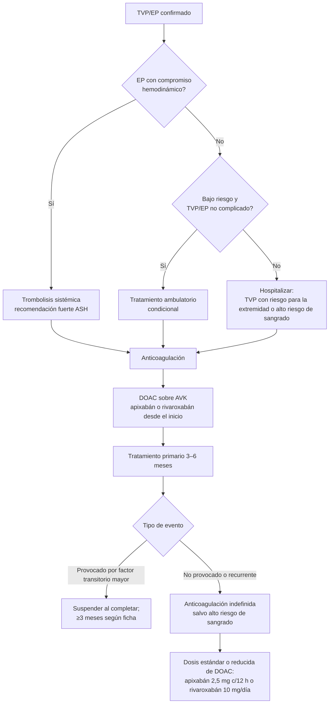

# Tromboembolismo venoso (TVP/EP): tratamiento y anticoagulación

!!! info "Ficha de la página"
    **Última revisión:** 2026-11-11 · **Fuente base:** guía ASH 2020 de tratamiento de TVP/EP [24] (en esta sesión solo se accedió al **resumen** de PubMed; las recomendaciones adicionales provienen del set de diapositivas oficial de ASH [25] y de resúmenes secundarios [26], marcados como tal) y **fichas técnicas** de apixabán y rivaroxabán [27][28]. **Alcance:** adultos con TVP/EP; no cubre cáncer, embarazo, pediatría, trombofilias, SAF ni TIH (páginas futuras). Diagnóstico, escalas de probabilidad, estratificación del TEP y dosis de heparinas/warfarina/trombolíticos quedan **[PV]**.

## 1. Resumen rápido

- Hay **28 recomendaciones** ASH 2020 para manejo inicial, tratamiento primario, prevención secundaria y recurrencias [24] **[V-RS]**.
- **Recomendaciones fuertes:** trombolisis en **TEP con compromiso hemodinámico**; **INR 2,0–3,0** (no menor) si se usa AVK en prevención secundaria; **anticoagulación indefinida** en **TEV recurrente no provocado** [24] **[V-RS]**.
- **Recomendaciones condicionales:** **tratamiento ambulatorio** en TVP/TEP no complicados de bajo riesgo; **DOAC sobre AVK** en tratamiento primario [24] **[V-RS]**; certeza moderada, con menos sangrado mayor (RR 0,63) y sin diferencia en mortalidad, TEP ni TVP recurrentes [25] **[V-RS]**.
- No se sugiere un DOAC sobre otro [25][26] **[V-RS]**. Para tratamiento inicial, solo **rivaroxabán y apixabán** pueden usarse sin heparina previa (según fichas, ver §4) [27][28].
- **Duración del tratamiento primario: 3 a 6 meses** [25][26] **[V-RS]**.

## 2. Algoritmo de tratamiento

## 3. Recomendaciones ASH 2020 (según fuentes revisadas)

| Tema | Recomendación | Fuerza / certeza | Fuente y verificación |
|---|---|---|---|
| EP con compromiso hemodinámico | Trombolisis | **Fuerte** | [24] **[V-RS]** |
| TVP proximal sin otras indicaciones | Anticoagulación sola sobre añadir trombolisis | Condicional | [26] resumen secundario |
| TVP/EP no complicado, bajo riesgo | Tratamiento ambulatorio sobre hospitalario | Condicional | [24] **[V-RS]**; el hospital puede beneficiar a TVP con riesgo para la extremidad o alto riesgo hemorrágico [25] |
| Tratamiento primario | DOAC sobre AVK; ningún DOAC preferido | Condicional, certeza moderada | [24][25] **[V-RS]** |
| Duración primaria | 3–6 meses sobre 6–12 meses | — | [25][26] resumen |
| Prevención secundaria, TEV no provocado | Anticoagulación **indefinida** tras tratamiento primario, salvo alto riesgo de sangrado | Sugerida | [26] resumen secundario |
| TEV recurrente no provocado | Anticoagulación indefinida | **Fuerte** | [24] **[V-RS]** |
| Prevención secundaria | Anticoagulante sobre aspirina | Sugerida | [26] resumen secundario |
| DOAC en prevención secundaria | Dosis estándar o reducida | Sugerida | [26] y síntesis [29]: rivaroxabán 10 mg/día o apixabán 2,5 mg c/12 h |
| AVK en prevención secundaria | INR 2,0–3,0 | **Fuerte** | [24] **[V-RS]** |
| TEV bajo AVK terapéutico | HBPM sobre DOAC | Sugerida | [26] resumen secundario |

!!! warning "Fuente incompleta"
    No se pudo leer el texto completo de [24] (PMC devuelve texto vacío y la página exige verificación). Las filas que citan [25] o [26] provienen del set docente oficial de ASH o de resúmenes de terceros; contrasta con el artículo antes de usarlas como cita formal. El resto de las 28 recomendaciones (filtro de VCI, medias de compresión, trombectomía, trombolisis catéter-dirigida, duración con trombosis residual) queda **[PV]**.

## 4. Dosis de DOAC según ficha técnica (UE)

| Fármaco | Fase inicial | Mantención | Extendida | Verificación |
|---|---|---|---|---|
| **Apixabán** | **10 mg c/12 h × 7 días** | **5 mg c/12 h** | **2,5 mg c/12 h** tras completar 6 meses de tratamiento | [27] ficha |
| **Rivaroxabán** | **15 mg c/12 h × 21 días** (con alimentos) | **20 mg/día** desde el día 22 | **10 mg/día** (o 20 mg/día en riesgo alto de recurrencia) tras ≥6 meses | [28] ficha |

**Ajustes y precauciones (fichas):**

- **Apixabán:** sin ajuste por edad ni peso en TVP/EP; **no recomendado con ClCr <15 ml/min o diálisis**; contraindicado en hepatopatía con coagulopatía y riesgo de sangrado relevante; precaución en insuficiencia hepática leve-moderada [27].
- **Rivaroxabán:** con **ClCr 15–49 ml/min** mantener 15 mg c/12 h las 3 primeras semanas; después considerar **15 mg/día** si el riesgo de sangrado supera el de recurrencia; **no recomendado con ClCr <15 ml/min** [28].
- **Duración mínima:** al menos **3 meses** si el evento tuvo un factor transitorio mayor (cirugía o trauma reciente); más prolongado si fue no provocado, provocado sin factor transitorio mayor o recurrente [28].
- **Cambio desde AVK:** apixabán cuando INR <2; rivaroxabán cuando INR ≤2,5 [27][28].
- Sobre DOAC con **ClCr <30 ml/min, hepatopatía moderada-grave o síndrome antifosfolípido**, un resumen secundario atribuye a ASH 2020 que el DOAC puede no ser preferible [29]; **verificar en el texto de la guía**.
- En cáncer con lesiones luminales gastrointestinales, el consenso ACCP 2021 (vía resumen secundario) asocia edoxabán y rivaroxabán a más sangrado mayor y sugiere apixabán o HBPM [29]; la página de TEV asociado a cáncer lo desarrollará **[PV]**.

## 5. Puntos clave para residentes e internos

1. **Trombolisis solo con inestabilidad hemodinámica** en EP.
2. En la mayoría: **DOAC desde el inicio**, tratamiento ambulatorio si es de bajo riesgo.
3. **Apixabán y rivaroxabán** tienen fase de carga (10 mg c/12 h × 7 d; 15 mg c/12 h × 21 d); **no** hay que superponer heparina.
4. **Primario 3–6 meses**; la decisión posterior depende de si fue provocado y del riesgo de sangrado.
5. En no provocado/recurrente: **extender**, valorando dosis reducida.
6. **Función renal y hepática** antes de elegir y dosificar el DOAC.

## 6. Autoevaluación

1. Hombre de 48 años con TVP proximal no provocada, estable: ¿qué anticoagulante, dosis de inicio y duración mínima planteas?
2. ¿Qué cambia si hay ClCr de 25 ml/min? Compara apixabán y rivaroxabán según ficha.
3. ¿En qué recomendación ASH hay **consenso fuerte** respecto del INR si usas warfarina?

## 7. Referencias de esta página

**[24]** ASH 2020 TVP/EP · **[25]** ASH, set de diapositivas · **[26]** ACP Internist (resumen) · **[27]** Ficha técnica apixabán · **[28]** Ficha técnica rivaroxabán · **[29]** Resumen secundario (Epocrates) — ver [lista](../referencias.md).

## 8. Pendientes

- [ ] Texto completo de [24]: filtro de VCI, trombolisis dirigida por catéter, trombosis residual, TVP distal y de miembro superior.
- [ ] Diagnóstico (probabilidad clínica, dímero D, imágenes) y estratificación del TEP.
- [ ] Heparina no fraccionada, HBPM y warfarina: dosis y monitorización **[PV]**.
- [ ] TEV y cáncer, embarazo, trombofilias, SAF, TIH.
- [ ] Contrastar con fichas ISP Chile.
