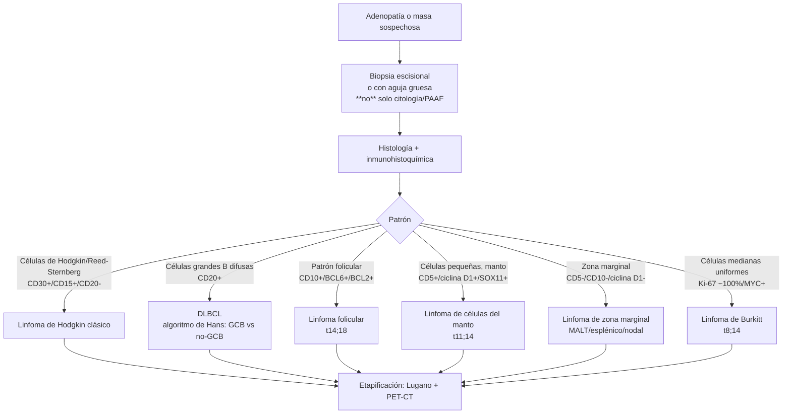

# Linfomas: diagnóstico y etapificación

!!! info "Ficha de la página"
    **Última revisión:** 2026-11-14 · **Fuentes base:** clasificación OMS-HEMA5 2022 [129] y ICC 2022 [130] para la taxonomía de entidades; clasificación de Lugano 2014 [131] para la etapificación; índices pronósticos clásicos de la etapificación — IPI [132], NCCN-IPI [133], FLIPI [134], MIPI [135] e IPS/Hasenclever [136]. Página centrada deliberadamente en **diagnóstico y etapificación**; el tratamiento queda **[PV]**/pendiente de desarrollo, ver sección de Pendientes.

!!! info "Alcance de esta página"
    Esta página cubre **solo diagnóstico y etapificación** de los linfomas no Hodgkin más frecuentes y del linfoma de Hodgkin. **No incluye tratamiento** (algoritmos de primera línea, esquemas de quimioterapia/inmunoterapia ni manejo de recaída/refractariedad): eso queda pendiente de desarrollo en una página aparte. La leucemia linfocítica crónica/linfoma linfocítico pequeño (LLC/LLP) y los linfomas T periféricos **no** están incluidos aquí — LLC ya se desarrolla en [Leucemia linfocítica crónica](llc.md).

## 1. Resumen rápido

| Entidad | Célula de origen | Alteración genética clave | Marcador distintivo | Patrón clínico típico |
|---|---|---|---|---|
| **Linfoma de Hodgkin clásico (cHL)** | Célula B del centro germinal (reprogramada) | Variable; vía NF-κB constitutiva | CD30+, CD15+ (~75-85 %), CD20− | Adenopatías cervicales/mediastínicas, diseminación contigua |
| **LH predominio linfocítico nodular (NLPHL)** | Célula B del centro germinal | — | CD20+, CD15−, CD30−, células LP ("palomitas de maíz") | Adenopatía periférica localizada, curso indolente |
| **DLBCL** | Célula B madura (GCB o no-GCB) | *MYC*, *BCL2*, *BCL6* (reordenamientos en subsets) | CD20+ difuso, Ki-67 alto | Adenopatía de crecimiento rápido, puede ser extranodal |
| **Linfoma folicular (LF)** | Célula B del centro germinal | t(14;18) *IGH::BCL2* (~85-90 %) | CD10+, BCL6+, BCL2+, patrón folicular | Adenopatías indoloras, curso indolente, recaídas múltiples |
| **Linfoma de células del manto (MCL)** | Célula B naïve (zona del manto) | t(11;14) *CCND1::IGH* | Ciclina D1+, SOX11+, CD5+, CD23− | Adenopatías generalizadas, frecuente afectación extranodal (médula, TGI) |
| **Linfoma de zona marginal (MZL)** | Célula B de memoria/zona marginal | Variable según subtipo (ver texto) | CD20+, CD5−, CD10−, ciclina D1− | MALT: extranodal, asociado a inflamación crónica; esplénico; nodal |
| **Linfoma de Burkitt (BL)** | Célula B del centro germinal | t(8;14) *MYC::IGH* (o variantes con *IGK*/*IGL*) | CD10+, BCL6+, BCL2−, Ki-67 ~100 % | Masas de crecimiento muy rápido, alto riesgo de lisis tumoral |

## 2. Clasificación: OMS 2022 (5.ª edición) e ICC 2022

Desde 2022 coexisten dos sistemas de clasificación de las neoplasias linfoides maduras, ambos basados en el reconocimiento de entidades biológicas definidas por morfología, inmunofenotipo, genética y contexto clínico, más que en un árbol jerárquico único:

- **OMS-HEMA5 (5.ª edición de la clasificación OMS de tumores hematolinfoides, 2022)**: reestructura la clasificación alrededor de familias de entidades definidas por su biología, incorporando marcadores genéticos y moleculares junto con la morfología clásica [129] **[V-RS]**.
- **ICC 2022 (International Consensus Classification)**: desarrollada en paralelo por un grupo distinto de expertos, mantiene gran concordancia con la OMS-HEMA5 pero difiere en detalles puntuales (p. ej., nomenclatura de algunas entidades de alto grado con reordenamiento de *MYC*, umbrales de ciertos "linfomas de células grandes B" de alto grado) [130] **[V-RS]**.

!!! tip "Para la práctica diaria"
    Las diferencias entre OMS-HEMA5 e ICC 2022 son relevantes sobre todo para hematopatólogos y para la inclusión en ensayos clínicos. Para el diagnóstico clínico habitual, ambos sistemas identifican las mismas entidades principales descritas en esta página; el informe de anatomía patológica debería indicar qué sistema utiliza.

## 3. Linfoma de Hodgkin

### 3.1 Subtipos

| | Linfoma de Hodgkin clásico (cHL, ~95 %) | LH predominio linfocítico nodular (NLPHL, ~4-5 %) |
|---|---|---|
| Subtipos | Esclerosis nodular (~70 %), celularidad mixta, rico en linfocitos, depleción linfocítica | Único (puede tener patrón variante) |
| Célula diagnóstica | Células de Hodgkin y Reed-Sternberg (HRS), binucleadas/multinucleadas, nucléolos prominentes ("ojo de lechuza") | Células LP ("palomitas de maíz"/*popcorn cells*), núcleo plegado |
| CD30 | Positivo | Negativo (típicamente) |
| CD15 | Positivo (~75-85 %) | Negativo |
| CD20 | Negativo o débil/parcheado | Positivo, intenso y uniforme |
| CD45 (LCA) | Negativo | Positivo |
| PAX5 | Positivo débil | Positivo fuerte |
| BCL6 / MUM1 | — | BCL6 frecuentemente positivo en células LP; MUM1 negativo en las células neoplásicas |
| Fondo celular | Infiltrado inflamatorio mixto reactivo (linfocitos T, eosinófilos, histiocitos, células plasmáticas); en esclerosis nodular, bandas de colágeno | Red nodular de células B pequeñas y células dendríticas foliculares, con rosetas de linfocitos T (CD57+/PD1+) alrededor de las células LP |

Ambas entidades representan una expansión clonal de células B del centro germinal que ha perdido la mayoría de los marcadores B habituales (en cHL) o los conserva (en NLPHL), con activación constitutiva de la vía NF-κB en cHL.

### 3.2 Estudio diagnóstico

- **Biopsia escisional de un ganglio completo** (preferible a biopsia con aguja gruesa cuando es posible, por la arquitectura necesaria para distinguir subtipos y descartar NLPHL).
- Panel de inmunohistoquímica mínimo: CD30, CD15, CD20, PAX5, CD45, CD3; si hay sospecha de NLPHL agregar CD57, PD1, IgD (patrón folicular tipo B de células dendríticas).
- El diagnóstico diferencial principal de cHL es con DLBCL rico en células T/histiocitos y con linfoma mediastínico de células B grandes primario; el de NLPHL es con linfoma folicular y con DLBCL rico en células T/histiocitos (con el que comparte espectro biológico en casos de transformación).

## 4. Linfoma difuso de células grandes B (DLBCL)

DLBCL es el linfoma no Hodgkin más frecuente en adultos. Es una categoría biológicamente heterogénea que agrupa variantes morfológicas y subgrupos moleculares.

### 4.1 Célula de origen (algoritmo de Hans)

La determinación inmunohistoquímica del origen celular clasifica el DLBCL en dos grupos con comportamiento e implicancias pronósticas distintas, usando el **algoritmo de Hans** (CD10, BCL6, MUM1):

| Marcador | Secuencia de interpretación |
|---|---|
| CD10+ | → **GCB** (centro germinal) |
| CD10−, BCL6+, MUM1− | → **GCB** |
| CD10−, BCL6−  | → **No-GCB** |
| CD10−, BCL6+, MUM1+ | → **No-GCB** |

- **GCB (germinal center B-cell)**: perfil génico similar al de células del centro germinal normal; en general, mejor pronóstico.
- **No-GCB / ABC (activated B-cell)**: perfil similar a células B activadas; con mayor frecuencia presenta activación de la vía NF-κB (mutaciones de *MYD88*, *CD79B*) y peor pronóstico relativo bajo R-CHOP.

El estándar de referencia para esta distinción es el perfil de expresión génica (GEP), pero en la práctica clínica habitual se usa el algoritmo inmunohistoquímico de Hans como aproximación.

### 4.2 Linfoma de células B grandes de alto grado con reordenamientos de *MYC*, *BCL2* y/o *BCL6* ("doble/triple hit")

- Definido por la coexistencia de un reordenamiento de ***MYC*** con un reordenamiento de ***BCL2*** y/o ***BCL6***, detectado por FISH.
- Comportamiento clínico más agresivo, mayor riesgo de afectación de sistema nervioso central, peor respuesta a esquemas estándar.
- El cribado con **FISH para *MYC*, *BCL2* y *BCL6*** se recomienda en todo DLBCL de novo, especialmente si hay morfología agresiva, alto índice proliferativo (Ki-67 muy elevado) o características intermedias entre DLBCL y linfoma de Burkitt.

### 4.3 Linfoma de células B grandes "doble expresor"

- Concepto **inmunohistoquímico** (no genético): sobreexpresión simultánea de **MYC** (≥40 % de células positivas) y **BCL2** (≥50 % de células positivas) por IHC, en ausencia de los reordenamientos genéticos que definen el doble/triple hit.
- Más frecuente que el doble/triple hit genético (hasta ~20-30 % de los DLBCL no-GCB) y se asocia a pronóstico intermedio, peor que el DLBCL sin esta sobreexpresión pero sin el riesgo extremo del doble/triple hit genético confirmado.

### 4.4 Estudio diagnóstico mínimo

- Biopsia con histología + inmunohistoquímica: CD20, CD10, BCL6, MUM1 (algoritmo de Hans), BCL2, MYC (IHC), Ki-67, CD3 (control T), CD30 (diagnóstico diferencial), **FISH para *MYC*/*BCL2*/*BCL6*** cuando esté disponible.
- Serologías: VIH (mayor incidencia de DLBCL asociado a inmunodeficiencia), VHB/VHC (riesgo de reactivación con inmunoterapia anti-CD20).
- LDH sérica (componente del IPI) y β2-microglobulina.

## 5. Linfoma folicular

- Neoplasia de células B del centro germinal, típicamente **CD10+, BCL6+, BCL2+**, con arquitectura folicular conservada (parcial o totalmente) en la biopsia.
- Alteración genética característica: **t(14;18)(q32;q21) *IGH::BCL2*** (~85-90 % de los casos), que lleva a sobreexpresión de BCL2 y resistencia a apoptosis — útil para distinguir folículos neoplásicos (BCL2+) de folículos reactivos normales (BCL2−).
- **Grading histológico de la OMS** según el recuento de centroblastos por campo de alto poder:
    - Grado 1 (0-5 centroblastos/CAP)
    - Grado 2 (6-15 centroblastos/CAP)
    - Grado 3A (>15 centroblastos/CAP, con centrocitos presentes)
    - Grado 3B (>15 centroblastos/CAP, láminas confluentes de centroblastos sin centrocitos — se comporta y se trata como linfoma agresivo, más cercano a DLBCL)
    - La OMS-HEMA5 hace el *grading* numérico **opcional**, aunque la ICC 2022 recomienda mantenerlo por su relevancia clínica, especialmente para distinguir el grado 3B.
- Variantes/entidades relacionadas a mencionar en el informe: linfoma folicular in situ, linfoma de células grandes B con reordenamiento de *IRF4* (más frecuente en pacientes jóvenes, cabeza y cuello), linfoma folicular duodenal (curso muy indolente, localizado).

## 6. Linfoma de células del manto (MCL)

- Célula B naïve de la zona del manto folicular, con alteración genética característica **t(11;14)(q13;q32) *CCND1::IGH***, que produce sobreexpresión de **ciclina D1**.
- Inmunofenotipo típico: **CD5+, CD23− (a diferencia de LLC/LLP que es CD23+), ciclina D1+, SOX11+**; CD10 y BCL6 habitualmente negativos.
- **SOX11** es especialmente útil para identificar la rara variante ciclina D1-negativa de MCL.
- Variantes morfológicas:
    - **Clásica**: células pequeñas-medianas con núcleo irregular.
    - **Blastoide**: células con aspecto de blastos, mayor índice mitótico.
    - **Pleomórfica**: células grandes, pleomórficas, puede confundirse con DLBCL.
    - Las variantes blastoide y pleomórfica se asocian a comportamiento más agresivo.
- Patrón clínico: adenopatías generalizadas con frecuente afectación extranodal — médula ósea, sangre periférica, tracto gastrointestinal (poliposis linfomatosa), anillo de Waldeyer.
- Existe una forma **leucémica no nodal** de curso indolente, con mutación de *IGHV*, SOX11 frecuentemente negativo, que puede seguirse sin tratamiento inmediato (comportamiento análogo a "vigilar y esperar").

## 7. Linfomas de zona marginal (MZL)

Grupo de tres entidades distintas que comparten inmunofenotipo de célula B de memoria/zona marginal (**CD20+, CD5−, CD10−, ciclina D1−**, lo que ayuda a diferenciarlos de LLC/LLP, MCL y linfoma folicular):

| Subtipo | Localización típica | Asociación etiológica | Comentario diagnóstico |
|---|---|---|---|
| **MZL extranodal (tipo MALT)** | Estómago (el más frecuente), glándulas salivales, anexos oculares, pulmón, piel, tiroides | *Helicobacter pylori* (MALT gástrico), enfermedades autoinmunes (Sjögren → glándulas salivales; Hashimoto → tiroides), infecciones crónicas | Investigar *H. pylori* en todo MALT gástrico (test de ureasa/histología/serología); puede regresar con erradicación bacteriana en estadios tempranos |
| **MZL esplénico** | Bazo, sangre periférica, médula ósea | Asociación descrita con VHC en algunas series | Linfocitos con proyecciones citoplasmáticas cortas ("linfocitos vellosos") en sangre periférica; esplenomegalia sin adenopatías significativas |
| **MZL nodal** | Ganglios linfáticos | Sin asociación etiológica específica bien establecida | Diagnóstico de exclusión tras descartar MALT y esplénico con compromiso ganglionar secundario |

## 8. Linfoma de Burkitt

- Neoplasia de células B del centro germinal, muy agresiva, con la **fracción de proliferación más alta conocida en oncología (Ki-67 cercano al 100 %)**.
- Alteración genética definitoria: reordenamiento de **MYC**, clásicamente **t(8;14)(q24;q32) *MYC::IGH*** (~80 %), con variantes menos frecuentes t(2;8) *IGK::MYC* y t(8;22) *MYC::IGL*.
- Inmunofenotipo: **CD10+, BCL6+, BCL2− (habitualmente negativo, a diferencia de linfoma folicular/DLBCL)**, con patrón histológico "en cielo estrellado" (*starry sky*) por macrófagos con cuerpos apoptóticos entremezclados.
- Tres variantes clínico-epidemiológicas:
    - **Endémica**: África ecuatorial, asociada a virus de Epstein-Barr (VEB) en >90 % de los casos, afectación característica de mandíbula/huesos faciales en niños.
    - **Esporádica**: distribución mundial, asociación a VEB más variable (~20-30 %), más frecuente afectación abdominal (íleon terminal, ciego).
    - **Asociada a inmunodeficiencia**: VIH y otros estados de inmunosupresión, asociación variable a VEB.
- El diagnóstico diferencial más relevante y de mayor consecuencia clínica es con el **linfoma de células B grandes de alto grado con reordenamientos de *MYC* y *BCL2*/*BCL6*** ("doble/triple hit"), que requiere FISH para diferenciarse adecuadamente, dado el distinto enfoque terapéutico (no desarrollado en esta página).
- Dato relevante para el manejo inicial (aunque el tratamiento esté fuera del alcance de esta página): **riesgo muy alto de síndrome de lisis tumoral** por la elevadísima tasa proliferativa — ver [Urgencias hematológicas](../transversal/urgencias-hematologicas.md).

## 9. Etapificación: clasificación de Lugano

La **clasificación de Lugano (2014)** [131] **[V-RS]** es el estándar actual de etapificación de linfomas Hodgkin y no Hodgkin, y reemplaza a la clasificación de Ann Arbor/Cotswolds para la mayoría de los propósitos clínicos y de ensayos clínicos.

### 9.1 Estadios anatómicos

| Estadio | Definición |
|---|---|
| **I** | Compromiso de una sola región ganglionar, o de un solo sitio/órgano extralinfático (IE) |
| **II** | Compromiso de ≥2 regiones ganglionares del mismo lado del diafragma; o estadio I/II con extensión extralinfática contigua limitada (IIE) |
| **III** | Compromiso de regiones ganglionares en ambos lados del diafragma |
| **IV** | Diseminación extranodal difusa o diseminada, con o sin compromiso ganglionar asociado |

### 9.2 Simplificación clínica: enfermedad limitada vs. extensa

| Categoría | Estadios | Uso práctico |
|---|---|---|
| **Limitada** | I, II (incluyendo IE y IIE contiguo) | Guía decisiones de campo/dosis de radioterapia y duración de tratamiento abreviado en varios linfomas |
| **Extensa (avanzada)** | III, IV | Guía uso de esquemas sistémicos de duración estándar/prolongada |

### 9.3 Rol del PET-CT

- Para los linfomas **FDG-ávidos** (la mayoría de los linfomas agresivos y el linfoma de Hodgkin), el **PET-CT con ¹⁸F-FDG se incorpora formalmente a la etapificación inicial** y a la evaluación de respuesta, usando la **escala de Deauville de 5 puntos** para estandarizar la interpretación.
- El PET-CT tiene mayor sensibilidad que la TC sola para detectar compromiso esplénico, hepático y de médula ósea en linfomas FDG-ávidos.

### 9.4 Biopsia de médula ósea

- En linfoma de Hodgkin y en la mayoría de los DLBCL, la **biopsia de médula ósea ya no es obligatoria** si se dispone de un PET-CT de buena calidad, porque este detecta de forma fiable el compromiso medular focal en linfomas FDG-ávidos.
- La biopsia de médula sigue siendo útil cuando el PET-CT no está disponible, en linfomas no o poco FDG-ávidos (p. ej., algunos linfomas de bajo grado), o cuando se requiere caracterizar un patrón de compromiso medular difuso de bajo grado que el PET-CT puede no distinguir bien de compromiso focal agresivo.

### 9.5 Designadores adicionales

- **A/B**: ausencia (A) o presencia (B) de síntomas sistémicos (fiebre, sudoración nocturna, pérdida de peso >10 % en 6 meses) — relevante principalmente en linfoma de Hodgkin.
- **E**: extensión extranodal contigua a un sitio ganglionar.
- **S**: compromiso esplénico (terminología histórica de Ann Arbor, aún referenciada en algunos informes).
- **X**: enfermedad voluminosa (*bulky*) — el umbral varía según la entidad y el protocolo (frecuentemente ≥10 cm o relación mediastino/tórax específica), y es relevante para decisiones de campo de radioterapia que no se desarrollan en esta página.

## 10. Índices pronósticos usados en la etapificación

Los siguientes índices integran variables clínicas y de laboratorio obtenidas en la etapificación inicial para estratificar el riesgo; se describen aquí como parte del proceso de etapificación/pronóstico, no como guía de tratamiento.

### 10.1 Índice Pronóstico Internacional (IPI) — linfomas agresivos

El **IPI original** (Shipp et al., 1993) [132] **[V-RS]** asigna 1 punto por cada uno de 5 factores adversos:

- Edad >60 años
- Estadio III o IV (Ann Arbor/Lugano)
- LDH elevada
- Estado funcional (ECOG) ≥2
- ≥2 sitios extranodales

| Grupo de riesgo | Puntaje | 
|---|---|
| Bajo | 0-1 |
| Bajo-intermedio | 2 |
| Alto-intermedio | 3 |
| Alto | 4-5 |

**NCCN-IPI** (Zhou et al., 2014) [133] **[V-RS]**: refinamiento desarrollado en la era del rituximab, que mejora la discriminación pronóstica al estratificar edad y LDH en más categorías (en vez de variables binarias) y precisar los sitios extranodales de alto riesgo (médula ósea, sistema nervioso central, hígado, tracto gastrointestinal, pulmón):

| Factor | Puntos |
|---|---|
| Edad 41-60 | 1 |
| Edad 61-75 | 2 |
| Edad >75 | 3 |
| LDH 1-3× límite superior normal | 1 |
| LDH >3× límite superior normal | 2 |
| Estadio III-IV | 1 |
| Sitio extranodal de alto riesgo (médula, SNC, hígado/TGI, pulmón) | 1 |
| ECOG ≥2 | 1 |

**R-IPI (IPI revisado)**: reagrupa a los pacientes tratados con rituximab en tres categorías (muy bueno 0 factores, bueno 1-2 factores, pobre 3-5 factores) usando los mismos 5 factores del IPI original, sin cambiar su definición.

### 10.2 FLIPI y FLIPI2 — linfoma folicular

**FLIPI** (Solal-Céligny et al., 2004) [134] **[V-RS]**, 5 factores (1 punto cada uno):

- Edad >60 años
- Estadio III-IV
- Hemoglobina <12 g/dL
- LDH elevada
- ≥5 áreas ganglionares afectadas

| Grupo de riesgo | Puntaje |
|---|---|
| Bajo | 0-1 |
| Intermedio | 2 |
| Alto | ≥3 |

**FLIPI2**: variante posterior que reemplaza algunas variables por β2-microglobulina elevada, compromiso de médula ósea, diámetro ganglionar máximo >6 cm y hemoglobina <12 g/dL, manteniendo edad >60 años y estadio avanzado; se usa con menor frecuencia que el FLIPI original en la práctica diaria.

### 10.3 MIPI — linfoma de células del manto

El **MIPI** (Hoster et al.) [135] **[PV]** combina 4 variables con ponderación distinta (no es un simple recuento de factores binarios):

- Edad
- Estado funcional (ECOG)
- LDH sérica
- Recuento de leucocitos

Estratifica a los pacientes en riesgo bajo, intermedio y alto, con impacto pronóstico independiente demostrado en cohortes de MCL avanzado. Existe también el **MIPI biológico (MIPI-b)**, que incorpora el índice de proliferación Ki-67, con mayor poder discriminativo cuando este dato está disponible.

### 10.4 Índice Pronóstico Internacional para Hodgkin avanzado (IPS/score de Hasenclever)

El **IPS** (Hasenclever & Diehl, 1998) [136] **[V-RS]**, desarrollado para linfoma de Hodgkin clásico en estadio avanzado, asigna 1 punto por cada uno de 7 factores adversos:

- Albúmina sérica <4 g/dL
- Hemoglobina <10.5 g/dL
- Sexo masculino
- Estadio IV
- Edad ≥45 años
- Leucocitosis ≥15.000/µL
- Linfopenia (<8 % del recuento leucocitario total, o <600/µL)

A mayor puntaje (0 a 7), mayor es el riesgo de progresión/recaída; es la escala de referencia histórica para estratificar linfoma de Hodgkin avanzado, aunque su capacidad discriminativa se ha atenuado con los esquemas de tratamiento modernos.

## 11. Puntos clave para residentes e internos

- Ante toda adenopatía sospechosa, priorizar **biopsia escisional** sobre PAAF/citología — la arquitectura ganglionar es esencial para clasificar correctamente el linfoma.
- CD30+/CD15+/CD20− en un fondo inflamatorio mixto apunta a **linfoma de Hodgkin clásico**; CD20+ intenso con células "en palomita de maíz" apunta a **NLPHL**.
- En todo DLBCL de novo, solicitar **algoritmo de Hans** (CD10/BCL6/MUM1) y **FISH para MYC/BCL2/BCL6** para descartar doble/triple hit, especialmente si hay Ki-67 muy elevado o morfología agresiva.
- La **t(14;18) *IGH::BCL2*** es el sello del linfoma folicular; la **t(11;14) *CCND1::IGH*** (ciclina D1+/SOX11+) es el sello del linfoma de células del manto.
- CD5+/CD23− con ciclina D1+ = **manto**; CD5+/CD23+ sin ciclina D1 = **LLC/LLP** (ver [LLC](llc.md)).
- Linfoma de Burkitt = Ki-67 ~100 %, BCL2 negativo, patrón "en cielo estrellado", **altísimo riesgo de lisis tumoral** desde el momento del diagnóstico.
- La **clasificación de Lugano** reemplazó a Ann Arbor/Cotswolds; el **PET-CT** es parte formal de la etapificación en linfomas FDG-ávidos y puede evitar la biopsia de médula ósea en Hodgkin y en la mayoría de los DLBCL.
- Los índices pronósticos (IPI/NCCN-IPI, FLIPI/FLIPI2, MIPI, IPS) se calculan con datos obtenidos durante la etapificación inicial y estratifican riesgo, pero esta página no desarrolla su uso para decisiones de tratamiento.

## 12. Referencias de esta página

Numeración continua con [`referencias.md`](../referencias.md): [129]-[136]. Ver la tabla completa en esa página para los enlaces a PubMed/DOI y el detalle de verificación.

## 13. Pendientes

- **Tratamiento**: algoritmos de primera línea, esquemas de referencia (p. ej., R-CHOP, ABVD/BEACOPP, esquemas intensivos para Burkitt) y manejo de recaída/refractariedad — excluidos deliberadamente de esta página por instrucción explícita; desarrollar como sección o página separada si se requiere.
- Linfomas T periféricos y linfomas cutáneos: no desarrollados en esta página.
- LLC/LLP: ya cubierto en [Leucemia linfocítica crónica](llc.md); no se duplica aquí.
- Confirmar PMID exacto de Hoster et al. (MIPI, marcado **[PV]**) y de la referencia [134] (FLIPI, Solal-Céligny et al.) en una revisión posterior específica de estas escalas.
- Considerar agregar una sección específica sobre linfoma linfoplasmocítico/macroglobulinemia de Waldenström con remisión cruzada desde [mieloma.md](mieloma.md) (actualmente mencionado solo en el índice del bloque).
