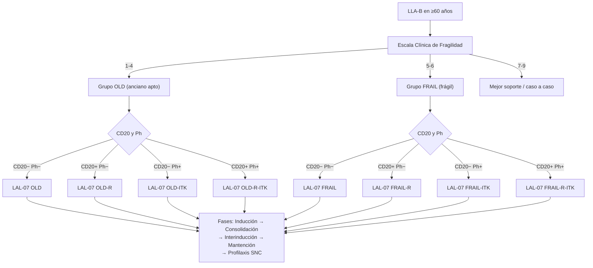

# Leucemia linfoblástica aguda de células B (LLA-B) en mayores de 60 años y pacientes frágiles

!!! info "Ficha de la página"
    **Última revisión:** 2026-11-11 · **Fuente base:** Protocolo Clínico «Leucemia Linfoblástica Aguda de Células B en Mayores de 60 Años y Frágiles», Programa de Cáncer del Adulto 2025, ANACAN/DIPRECE/Subsecretaría de Salud Pública, MINSAL Chile [39]. Incorporado a la canasta GES desde el 1 de diciembre de 2025 (D.S. N.º 29/2025). Basado en protocolos de la Universidad de Oxford (NSSG). **[V-TF]**

## 1. Resumen rápido

- La LLA-B representa el **~20-25 %** de las leucemias agudas del adulto.
- En Chile (2024): 1.028 leucemias en ≥15 años → 570 agudas (55 %) → **~140 LLA-B** estimadas.
- Los pacientes **>60 años y/o frágiles** tienen peor pronóstico por menor tolerancia a quimioterapia intensiva y mayor frecuencia de **cromosoma Philadelphia** (Ph+).
- El protocolo ANACAN 2025 estratifica en **8 escenarios para ancianos (OLD)** y **8 para frágiles (FRAIL)**, según estado de CD20 y Ph.
- El dasatinib (inhibidor de tirosina quinasa, ITK) para pacientes Ph+ se obtiene vía mecanismo **DAC** (Drogas de Alto Costo).

## 2. Clasificación del paciente

### Evaluación de fragilidad

Se utiliza la **Escala Clínica de Fragilidad** (1-9), validada en Chile (Browne et al. 2025):

| Puntuación | Estado | Clasificación protocolo |
|---|---|---|
| 1–4 | En buen estado hasta vulnerable | **OLD** (anciano apto) |
| 5–6 | Fragilidad leve a moderada | **FRAIL** (frágil) |
| 7–9 | Fragilidad severa a terminal | Evaluar caso a caso vs mejor soporte |

### Clasificación biológica

| Marcador | Impacto |
|---|---|
| **CD20** (+/−) | Define si se agrega **rituximab** al esquema |
| **Ph (cromosoma Philadelphia)** (+/−) | Define si se agrega **dasatinib** (ITK) al esquema |

Esto genera **4 combinaciones** para cada grupo (OLD y FRAIL):

| Combinación | CD20 | Ph | Esquema |
|---|---|---|---|
| Esquema base | − | − | LAL-07 OLD / FRAIL |
| + Rituximab | + | − | LAL-07 OLD-R / FRAIL-R |
| + Dasatinib | − | + | LAL-07 OLD-ITK / FRAIL-ITK |
| + Rituximab + Dasatinib | + | + | LAL-07 OLD-R-ITK / FRAIL-R-ITK |

## 3. Algoritmo de tratamiento

## 4. Escenarios terapéuticos — Grupo OLD (anciano apto, Fragilidad 1-4)

### Escenario 1: OLD — CD20(−) Ph(−)

**Esquema LAL-07 OLD**

| Fase | Fármacos clave | Duración |
|---|---|---|
| **Inducción fase 1** | Dexametasona, Vincristina, Asparaginasa | 4 semanas |
| **Inducción fase 2** | Ciclofosfamida, Citarabina, Mercaptopurina | 4 semanas |
| **Consolidación** | Metotrexato altas dosis, Asparaginasa | Ciclos alternados |
| **Interinducción** | Dexametasona, Vincristina, Asparaginasa, Metotrexato | — |
| **Mantención** | Mercaptopurina diaria + Metotrexato semanal | Hasta 2,5 años desde RC |
| **Profilaxis SNC** | MTX intratecal (6 dosis) | Durante inducción y consolidación |

### Escenario 2: OLD — CD20(+) Ph(−)

**Esquema LAL-07 OLD-R:** Idéntico al esquema OLD base, agregando **Rituximab 375 mg/m²** en inducción fase 1 (día 1 y 8) y durante la consolidación.

### Escenario 3: OLD — CD20(−) Ph(+)

**Esquema LAL-07 OLD-ITK:** Esquema OLD base, agregando **Dasatinib 140 mg/día VO** de forma continua desde el día 1 de la inducción. El dasatinib se mantiene durante todas las fases de tratamiento.

### Escenario 4: OLD — CD20(+) Ph(+)

**Esquema LAL-07 OLD-R-ITK:** Esquema OLD base con **Rituximab** y **Dasatinib** combinados según escenarios 2 y 3.

### Escenarios 5-8: Respuesta a la inducción

| Escenario | Situación | Conducta |
|---|---|---|
| 5 | RC tras inducción fase 1 | Continuar con inducción fase 2 y consolidación |
| 6 | RC tras inducción fase 2 | Continuar consolidación |
| 7 | Refractariedad post-inducción | Protocolo de rescate institucional o mejor soporte |
| 8 | Recaída post-RC | Re-inducción (si intervalo libre >6 meses) o rescate |

## 5. Escenarios terapéuticos — Grupo FRAIL (frágil, Fragilidad 5-6)

### Escenario 9: FRAIL — CD20(−) Ph(−)

**Esquema LAL-07 FRAIL**

Las dosis del grupo FRAIL son **reducidas** respecto al grupo OLD:

| Fase | Diferencias vs OLD |
|---|---|
| **Inducción fase 1** | Dexametasona a dosis reducida, Vincristina máximo 2 mg, sin Asparaginasa si contraindicada |
| **Inducción fase 2** | Ciclofosfamida y Citarabina a dosis reducidas |
| **Consolidación** | Metotrexato a dosis reducidas (1 g/m² vs 3 g/m²) |
| **Mantención** | Igual que OLD: Mercaptopurina + Metotrexato semanal |
| **Profilaxis SNC** | MTX intratecal (6 dosis) |

### Escenario 10: FRAIL — CD20(+) Ph(−)

**Esquema LAL-07 FRAIL-R:** Esquema FRAIL base + Rituximab 375 mg/m².

### Escenario 11: FRAIL — CD20(−) Ph(+)

**Esquema LAL-07 FRAIL-ITK:** Esquema FRAIL base + Dasatinib 140 mg/día VO continuo.

### Escenario 12: FRAIL — CD20(+) Ph(+)

**Esquema LAL-07 FRAIL-R-ITK:** Esquema FRAIL base + Rituximab + Dasatinib.

### Escenarios 13-16: Respuesta a la inducción (FRAIL)

Misma lógica que escenarios 5-8 del grupo OLD, con mayor umbral para indicar rescate agresivo en pacientes frágiles.

## 6. Detalle de fármacos — Esquema LAL-07 OLD (base)

### Inducción fase 1 (4 semanas)

| Orden | Medicamento | Dosis | Día | Vía | Observaciones |
|---|---|---|---|---|---|
| 1 | Dexametasona | 10 mg/m²/día | 1–5 y 15–19 | VO/EV | Reducir gradualmente |
| 2 | Vincristina | 2 mg (dosis fija) | 1, 8, 15, 22 | EV | No exceder 2 mg |
| 3 | Asparaginasa | 5.000 UI/m² | 5, 15 | IM/EV | Vigilar pancreatitis, coagulopatía, alergia |
| 4 | MTX intratecal | 12,5 mg | 1 y 15 | IT | Profilaxis SNC |

### Inducción fase 2 (4 semanas)

| Orden | Medicamento | Dosis | Día | Vía | Observaciones |
|---|---|---|---|---|---|
| 1 | Ciclofosfamida | 500 mg/m² | 1, 15 | EV | Con mesna (60 % de la dosis) |
| 2 | Citarabina | 75 mg/m²/día | 2–5 y 9–12 | SC | — |
| 3 | Mercaptopurina | 50 mg/m²/día | 1–28 | VO | Ajustar con alopurinol |

### Consolidación (ciclos alternados)

**Ciclo A — Metotrexato altas dosis:**

| Orden | Medicamento | Dosis | Día | Vía | Observaciones |
|---|---|---|---|---|---|
| 1 | Metotrexato | 3 g/m² | 1 | EV en 24 h | Con leucovorina de rescate a las 36 h |
| 2 | Asparaginasa | 5.000 UI/m² | 2 | IM | — |
| 3 | MTX intratecal | 12,5 mg | 1 | IT | — |

**Ciclo B — Reinducción:**

| Orden | Medicamento | Dosis | Día | Vía |
|---|---|---|---|---|
| 1 | Dexametasona | 10 mg/m²/día | 1–5 | VO |
| 2 | Vincristina | 2 mg | 1, 8 | EV |
| 3 | Asparaginasa | 5.000 UI/m² | 5 | IM |

### Mantención (hasta 2,5 años desde RC)

| Orden | Medicamento | Dosis | Frecuencia | Vía |
|---|---|---|---|---|
| 1 | Mercaptopurina | 75 mg/m²/día | Diaria | VO |
| 2 | Metotrexato | 20 mg/m²/semana | Semanal | VO |
| — | Pulsos de vincristina + dexametasona | Vincristina 2 mg + Dexa 10 mg/m² × 5 d | Mensual (primeros 12 meses) | EV/VO |

### Profilaxis del SNC

- **6 dosis de MTX intratecal** (12,5 mg): 2 en inducción fase 1, 2 en inducción fase 2 (si necesarias), 2 en consolidación.
- No se indica radioterapia craneal de rutina en >60 años.

## 7. Detalle de fármacos — Esquema LAL-07 FRAIL (base)

### Diferencias con esquema OLD

| Parámetro | OLD | FRAIL |
|---|---|---|
| Dexametasona (inducción) | 10 mg/m²/día | 6 mg/m²/día |
| Ciclofosfamida | 500 mg/m² | 300 mg/m² |
| Citarabina (fase 2) | 75 mg/m²/día | 50 mg/m²/día |
| Metotrexato alta dosis | 3 g/m² | 1 g/m² |
| Asparaginasa | 5.000 UI/m² | Evaluar caso a caso (riesgo aumentado) |

!!! note "Principio de ajuste"
    Las dosis del grupo FRAIL buscan mantener eficacia con menor toxicidad. El equipo debe ajustar individualmente según tolerancia, función hepática y renal, y respuesta precoz [39].

## 8. Dasatinib en LLA-B Ph+

### Indicaciones

- Todo paciente con LLA-B **Ph+** (t(9;22) / *BCR::ABL1*), tanto OLD como FRAIL.
- Se inicia desde el **día 1 de la inducción** y se mantiene de forma continua.

### Dosis y administración

| Parámetro | Detalle |
|---|---|
| Dosis | **140 mg/día** VO |
| Administración | Una vez al día, con o sin alimentos |
| Duración | Continuo durante todo el tratamiento, incluida la mantención |

### Precauciones

- **Derrame pleural:** complicación frecuente (~20 %). Monitorizar síntomas respiratorios. Manejo: diuréticos, corticoides, reducción de dosis o suspensión temporal.
- **Mielosupresión:** puede potenciar la citopenia de la quimioterapia. Suspender si RAN <500 o plaquetas <10.000.
- **Prolongación del QTc:** monitorizar ECG basal y periódico.
- **Sangrado:** vigilar en pacientes con trombocitopenia.
- **Interacciones CYP3A4:** evitar inhibidores potentes (azoles); inductores (rifampicina, fenitoína) reducen niveles de dasatinib.

### Obtención vía DAC

- El dasatinib se obtiene a través del mecanismo de **Drogas de Alto Costo (DAC)**.
- Requiere: confirmación de Ph+ por cariotipo, FISH o biología molecular; aprobación del Comité Oncológico local; solicitud a través de la plataforma DAC.

## 9. Rituximab en LLA-B CD20+

### Indicaciones

- LLA-B con **CD20 ≥20 %** por citometría de flujo, tanto OLD como FRAIL.

### Dosis y administración

| Ciclo | Dosis | Día | Premedicación |
|---|---|---|---|
| 1.ª administración | 375 mg/m² | Día 1 y 8 de inducción fase 1 | Paracetamol 1 g + Clorfenamina 10 mg + Hidrocortisona 100 mg EV |
| Administraciones siguientes | 500 mg/m² | Día 1 de consolidación | Misma premedicación |

### Precauciones

- Riesgo de **reactivación de VHB:** serología obligatoria (HBsAg, anti-HBc) antes de iniciar. Si positivo → profilaxis antiviral con entecavir.
- **Reacción infusional:** primera infusión lenta (1 mg/ml/min); premedicar siempre.

## 10. Profilaxis y medidas de soporte

| Medida | Detalle |
|---|---|
| **Profilaxis SNC** | MTX intratecal 12,5 mg × 6 dosis |
| **Profilaxis infecciosa** | Cotrimoxazol forte L/Mi/Vi; Aciclovir 400 mg c/12 h VO; Fluconazol 200 mg/día VO |
| **Profilaxis de SLT** | Alopurinol 300 mg/día VO; hidratación 2-3 L/día; monitorizar electrólitos, ácido úrico, función renal |
| **Soporte transfusional** | Según criterios institucionales (Hb <7, Plt <10.000 o <20.000 con fiebre) |
| **Factor estimulante** | Filgrastim 300 mcg/día SC si neutropenia febril o RAN <500 sostenido |

## 11. Criterios de respuesta

| Categoría | Definición |
|---|---|
| **RC (remisión completa)** | Blastos en MO <5 %, sin blastos circulantes, RAN ≥1.000, Plt ≥100.000, sin enfermedad extramedular |
| **RCi** | Blastos <5 % pero sin recuperación hematológica completa |
| **Refractariedad** | No RC tras 2 ciclos de inducción |
| **Recaída** | Reaparición de blastos ≥5 % en MO o enfermedad extramedular tras RC |
| **EMR no detectable** | <10⁻⁴ por citometría multiparamétrica o qPCR para *BCR::ABL1* |

## 12. Canasta GES 2025 — Fármacos cubiertos para LLA-B

Desde el 1 de diciembre de 2025, la canasta GES incluye:

- **Quimioterapias:** Dexametasona, Vincristina, Ciclofosfamida, Citarabina, Mercaptopurina, Metotrexato (sistémico e intratecal), Asparaginasa
- **Anticuerpo monoclonal:** Rituximab (para CD20+)
- **ITK:** Dasatinib (para Ph+, vía DAC)
- **Soporte:** Alopurinol, Aciclovir, Fluconazol, Cotrimoxazol, Filgrastim (G-CSF), Mesna, Leucovorina, Paracetamol, Clorfenamina, Hidrocortisona

!!! tip "Comité oncológico"
    Todo paciente con LLA-B debe ser presentado en el **Comité Oncológico** local para definir grupo (OLD vs FRAIL), estado de CD20 y Ph, y plan terapéutico correspondiente [39].

## 13. Puntos clave para residentes e internos

1. **Evaluar fragilidad** con la Escala Clínica de Fragilidad (1-9): determina si el paciente es OLD (1-4) o FRAIL (5-6).
2. **Solicitar siempre:** citometría de flujo con CD20, cariotipo, FISH y/o biología molecular para *BCR::ABL1* (Ph).
3. **4 combinaciones posibles** según CD20 y Ph: cada una modifica el esquema base con rituximab y/o dasatinib.
4. **Dasatinib 140 mg/día** continuo en Ph+; obtención vía DAC. Vigilar derrame pleural.
5. **Rituximab** si CD20 ≥20 %: serología de VHB obligatoria antes de iniciar.
6. **6 dosis de MTX intratecal** para profilaxis de SNC.
7. **Mantención prolongada** (hasta 2,5 años): mercaptopurina diaria + metotrexato semanal.
8. **Grupo FRAIL** usa dosis reducidas de todos los agentes; la asparaginasa se evalúa caso a caso.

## 14. Referencias de esta página

- **[39]** Protocolo Clínico «LLA-B en Mayores de 60 Años y Frágiles», Programa de Cáncer del Adulto 2025, ANACAN/MINSAL (ver [lista](../referencias.md)).

## 15. Pendientes

- [ ] Datos de respuesta y SG del protocolo Oxford original en >60 años **[PV]**.
- [ ] Inotuzumab ozogamicina y blinatumomab en LLA-B R/R: datos para futura incorporación **[PV]**.
- [ ] Esquema de rescate institucional para refractariedad **[PV]**.
- [ ] Seguimiento de EMR por qPCR para *BCR::ABL1* en Ph+: intervalos y umbrales **[PV]**.
