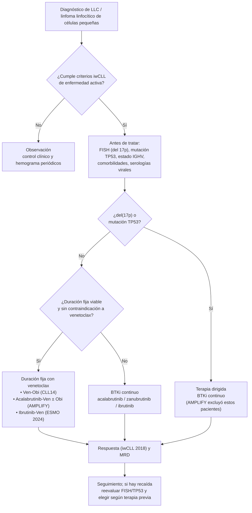
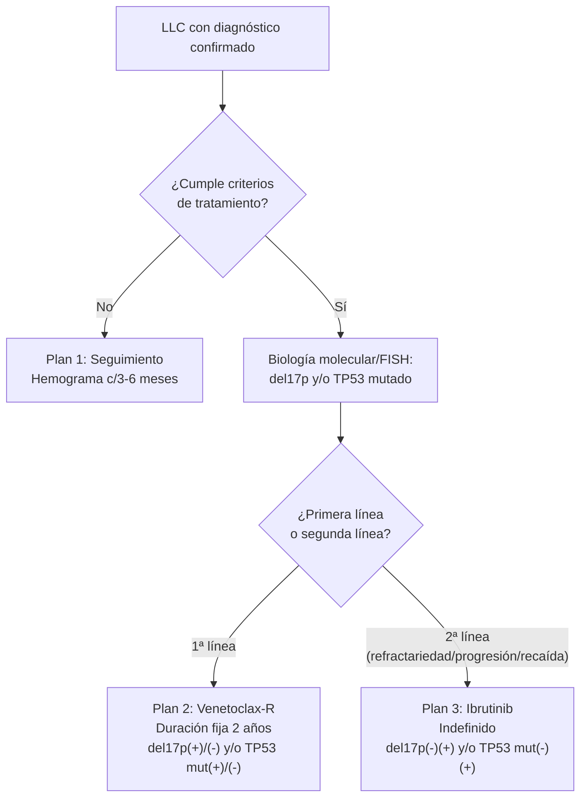

# Leucemia linfocítica crónica (LLC)

!!! info "Ficha de la página"
    **Última revisión:** 2026-11-11 · **Estado:** *borrador piloto* · **Fuentes base:** iwCLL 2018 [6], guía ESMO 2020 [7] y su actualización intermedia 2024 [8], ensayos AMPLIFY [9] y CLL14 [10][11].

!!! warning "Alcance de la verificación en esta versión"
    Se verificaron en PubMed los **resúmenes y metadatos** de las guías iwCLL 2018 y ESMO (2020 y actualización 2024) y los resultados de AMPLIFY y CLL14. **El texto completo de las guías no fue revisado**, por lo que el algoritmo es un **borrador docente** y los ítems **[PV]** deben validarse contra esos documentos antes de usar la página como referencia clínica.

## 1. Resumen rápido

- El tratamiento de primera línea se organiza hoy alrededor de **terapias dirigidas**: inhibidores de **BTK** (continuos) e **inhibidores de BCL2** (venetoclax) en esquemas de **duración fija** [8] **[V-RS]**.
- Con **venetoclax-obinutuzumab (CLL14)** se mantiene a 6 años una **PFS mediana de 76,2 vs 36,4 meses** frente a clorambucilo-obinutuzumab (HR 0,40) [10] **[V-RS]**.
- Con **acalabrutinib-venetoclax ± obinutuzumab (AMPLIFY)**, la PFS a 36 meses fue **76,5 % / 83,1 %** frente a **66,5 %** con quimioinmunoterapia, en pacientes **sin del(17p) ni mutación TP53** [9] **[V-RS]**.
- **del(17p)/TP53 y IGHV no mutado** son los marcadores que más condicionan la elección y el pronóstico [9][10] **[V-RS]**.

## 2. Diagnóstico y estudio basal

La guía iwCLL 2018 actualiza diagnóstico, indicaciones de tratamiento, criterios de respuesta y manejo de soporte, e incorpora pruebas genéticas pronósticas y MRD [6] **[V-RS]**.

| Componente | Contenido | Verificación |
|---|---|---|
| Inmunofenotipo y morfología | Linfocitosis B clonal con fenotipo característico | Existencia del criterio: [6] **[V-RS]** · valores precisos: **[PV]** |
| Estudio genético previo a tratar | **FISH (del 17p, del 11q, +12, del 13q)**, **mutación TP53**, **estado IGHV** | [6] **[V-RS]** (genética pronóstica) · detalle de la lista: **[PV]** |
| Estadificación clínica | Rai / Binet | **[PV]** |
| Comorbilidades y estado funcional | Determinan fitness y elección del esquema | **[PV]** |
| Serologías virales | VHB, VHC, VIH y otras; profilaxis según riesgo | [6] **[V-RS]** (recomendaciones de evaluación y profilaxis de infecciones virales) |

### Pronóstico: CLL-IPI

El **CLL-IPI** es un índice pronóstico internacional que integra los principales parámetros clínicos y biológicos, construido con datos individuales de ensayos [13] **[V-RS]**. La lista exacta de variables y los puntos de corte deben consignarse tras revisar su texto completo **[PV]**.

## 3. ¿Cuándo tratar? (criterios iwCLL)

!!! warning "[PV] Lista de indicaciones"
    Los criterios de enfermedad activa de iwCLL 2018 [6] se incluirán tras revisar el texto completo. En general incluyen insuficiencia medular progresiva, esplenomegalia o adenopatías masivas/progresivas, linfocitosis de aumento rápido, citopenias autoinmunes refractarias a corticoides y síntomas B. **No usar esta lista como criterio hasta verificarla.**

Sin criterios de enfermedad activa: **observación** (vigilar y esperar) **[PV]**.

## 4. Algoritmo de primera línea (borrador docente)

??? info "Estado de verificación de cada nodo"
    | Nodo | Respaldo | Estado |
    |---|---|---|
    | Terapias dirigidas y duración fija como eje de primera línea | ESMO 2024 (palabras clave: BCL2, BTK, ibrutinib-venetoclax, terapia dirigida de tiempo limitado) [8] | **[V-RS]** |
    | Ven-Obi duración fija | CLL14 [10][11] | **[V-RS]** |
    | Acalabrutinib-Ven ± Obi en pacientes sin del(17p)/TP53 | AMPLIFY [9] | **[V-RS]** |
    | BTKi continuo en del(17p)/TP53 | Práctica estándar; pendiente de contrastar con el texto de ESMO 2024 [8] | **[PV]** |
    | Elegibilidad para duración fija, riesgo de síndrome de lisis tumoral | Pendiente | **[PV]** |
    | Observación en enfermedad no activa | iwCLL 2018 [6] | **[PV]** (texto completo) |

## 5. Esquemas, calendario y dosis

| Esquema | Calendario / dosis | Verificación |
|---|---|---|
| **Venetoclax-obinutuzumab (CLL14)** | **6 ciclos** de obinutuzumab y **12 ciclos** de venetoclax (en total 12 meses de tratamiento) | [10] **[V-RS]** |
| — escalada de venetoclax (estándar, 5 semanas) | Semana 1: **20 mg**; 2: **50 mg**; 3: **100 mg**; 4: **200 mg**; 5: **400 mg**, luego **400 mg/día** (por la mañana, con alimentos según ficha) | [17] ficha técnica UE |
| — obinutuzumab (esquema con venetoclax) | Ciclo 1: **100 mg** día 1, **900 mg** día 1 o 2, **1.000 mg** días 8 y 15; luego **1.000 mg** día 1 de cada ciclo hasta 6 ciclos. Escalada de venetoclax del día 22 del ciclo 1 al día 28 del ciclo 2; **400 mg/día** desde el ciclo 3 hasta el ciclo 12 | [17] ficha técnica UE |
| **Ibrutinib-venetoclax** | Ibrutinib **420 mg/día** en monoterapia 3 ciclos; venetoclax desde el día 1 del ciclo 4 con escalada estándar; ambos hasta el último día del ciclo 15 | [17] ficha técnica UE · estudio primario (CLL13/GLOW/FLAIR): **[PV]** |
| **Acalabrutinib-venetoclax (AV) – AMPLIFY** | Acalabrutinib **ciclos 1–14**; venetoclax **ciclos 3–14** | [9] **[V-RS]** |
| **AV + obinutuzumab (AVO) – AMPLIFY** | Igual que AV + obinutuzumab **ciclos 2–7** | [9] **[V-RS]** |
| — acalabrutinib ± obinutuzumab + venetoclax (ficha de venetoclax) | Acalabrutinib **100 mg c/12 h** ciclos 1–14 (28 días); escalada de venetoclax desde el día 1 del ciclo 3, luego 400 mg/día hasta el final del ciclo 14 | [17] ficha técnica UE |
| — dosis en el estudio fase 2 previo | Acalabrutinib **100 mg c/12 h**; venetoclax con escalada acelerada **20 mg día 1 hasta 400 mg al día 22**, luego **400 mg/día**; obinutuzumab 100 mg (C2D1), 900 mg (C2D2), 1.000 mg (C2D8 y C2D15) y 1.000 mg día 1 de los ciclos 3–7; ciclos de 28 días | [12] **[V-RS]** (esquema de un estudio de fase 2 con escalada acelerada; **no** es la escalada estándar de ficha técnica) |
| **Quimioinmunoterapia** (FCR o BR) | Comparador en AMPLIFY (ciclos 1–6) | [9] **[V-RS]** · dosis: **[PV]** |
| **BTKi continuo** | Acalabrutinib 100 mg c/12 h (dosis del fase 2) · zanubrutinib e ibrutinib: dosis **[PV]** | Acalabrutinib: [12] **[V-RS]** |
| **Ibrutinib-rituximab (FLAIR)** | Ibrutinib hasta 6 años + rituximab, frente a FCR por 6 ciclos | [15] **[V-RS]** · dosis: **[PV]** |

!!! note "Ficha técnica"
    Toda dosis marcada **[PV]** debe confirmarse con la ficha técnica local vigente (ISP/Chile) y el protocolo institucional. La **escalada de venetoclax y la profilaxis del síndrome de lisis tumoral** requieren un protocolo explícito antes de usar la página como guía de prescripción.

## 6. Resultados de los ensayos principales

### AMPLIFY (primera línea, pacientes sin del(17p)/TP53)

| Indicador [9] **[V-RS]** | AV | AVO | Quimioinmunoterapia |
|---|---|---|---|
| Pacientes aleatorizados | 291 | 286 | 290 (143 FCR · 147 BR) |
| **PFS estimada a 36 meses** | **76,5 %** | **83,1 %** | **66,5 %** |
| HR de progresión o muerte vs QIT | **0,65** (IC95 % 0,49–0,87; p = 0,004) | p < 0,001 | — |
| Sobrevida global estimada a 36 m | 94,1 % | 87,7 % | 85,9 % |
| Neutropenia grado ≥3 | 32,3 % | 46,1 % | 43,2 % |
| Muertes por COVID-19 (n) | 10 | 25 | 21 |

Características: mediana de edad 61 años (26–86), 64,5 % hombres, 58,6 % con IGHV no mutado, seguimiento mediano 40,8 meses [9] **[V-RS]**.

**Lectura crítica:** el objetivo primario fue AV vs QIT; el beneficio de PFS es claro, pero la comparación de sobrevida global no es concluyente en el seguimiento disponible, y las muertes por COVID-19 pesan en los brazos con obinutuzumab. No hay datos en del(17p)/TP53 por exclusión de diseño [9].

### CLL14 (pacientes con comorbilidades)

| Indicador [10] **[V-RS]** | Ven-Obi (n = 216) | Clb-Obi (n = 216) |
|---|---|---|
| PFS mediana (seguimiento 76,4 meses) | **76,2 meses** | 36,4 meses |
| HR PFS | **0,40** (IC95 % 0,31–0,52) | — |
| TTNT a 6 años | 65,2 % | 37,1 % |
| Sobrevida global a 6 años | 78,7 % | 69,2 % (HR 0,69; IC95 % 0,48–1,01; p = 0,052) |
| Factores independientes de menor PFS con Ven-Obi | del(17p), IGHV no mutado, adenopatía ≥5 cm | — |

A 5 años (seguimiento 65,4 meses) el HR de PFS fue 0,35 (IC95 % 0,26–0,46) [11] **[V-RS]**.

## 7. Toxicidad y soporte

| Tema | Contenido | Verificación |
|---|---|---|
| Neutropenia | Frecuente con regímenes con venetoclax/obinutuzumab (grado ≥3 en 32–46 % en AMPLIFY) | [9] **[V-RS]** |
| Infecciones virales | Evaluar y planificar profilaxis viral durante el manejo | [6] **[V-RS]** |
| COVID-19 | Contribuyó a la mortalidad en AMPLIFY | [9] **[V-RS]** |
| BTKi de segunda generación | Zanubrutinib: menor fibrilación auricular y sangrado mayor que ibrutinib en estudios comparativos; SEQUOIA: mejor PFS que bendamustina-rituximab | [14] **[V-RS]** (revisión) |
| Síndrome de lisis tumoral con venetoclax | Ver subsección siguiente | [17] ficha técnica UE |
| Profilaxis antimicrobiana (VHB, *Pneumocystis*, herpes) | Según riesgo y esquema | **[PV]** |
| Interacciones de venetoclax | Inhibidores potentes de CYP3A: contraindicados al inicio y durante la escalada en LLC; después, reducir venetoclax a ≤100 mg. Inhibidores moderados: evitar en escalada, reducir ≥50 %. Evitar inductores de CYP3A (hierba de San Juan contraindicada), pomelo, naranja amarga y carambola | [17] ficha técnica UE |
| Interacciones de BTKi y anticoagulantes/antiagregantes | Revisar antes de iniciar | **[PV]** |
| Insuficiencia renal/hepática (venetoclax) | Renal: sin ajuste de dosis, pero ClCr <80 ml/min exige profilaxis y seguimiento más intensivos; ClCr 15–<30 o diálisis solo si el beneficio supera el riesgo. Hepática grave: reducir ≥50 % | [17] ficha técnica UE |

### Síndrome de lisis tumoral con venetoclax (ficha técnica UE) [17]

| Carga tumoral | Criterio | Medidas |
|---|---|---|
| **Baja** | Todos los ganglios <5 cm **y** RAL <25 ×10⁹/l | Hidratación oral 1,5–2 l, alopurinol, ambulatorio |
| **Media** | Algún ganglio 5–<10 cm **o** RAL ≥25 ×10⁹/l | Hidratación oral ± intravenosa, alopurinol; considerar hospitalizar la primera dosis de 20 y 50 mg si ClCr <80 ml/min |
| **Alta** | Algún ganglio ≥10 cm **o** RAL ≥25 ×10⁹/l con algún ganglio ≥5 cm | Hidratación oral e intravenosa (150–200 ml/h), alopurinol, considerar rasburicasa si ácido úrico elevado; **hospitalizar** para las dosis de 20 y 50 mg |

- Iniciar hidratación 2 días antes de la primera dosis y mantenerla en cada incremento; iniciar alopurinol/inhibidor de xantina oxidasa 2–3 días antes.
- Laboratorio (K, ácido úrico, P, Ca, creatinina): en alta carga hospitalizada, antes de la dosis y a las 4, 8, 12 y 24 h de las dosis de 20 y 50 mg; ambulatorio, antes, a las 6–8 h y a las 24 h; en incrementos posteriores, antes, 6–8 h y 24 h si persiste el riesgo.
- Fuente: ficha técnica europea; verificar contra la ficha ISP Chile y el protocolo institucional **[PV]** para su uso local.

## 8. Respuesta y enfermedad residual medible (MRD)

iwCLL 2018 incorporó criterios de respuesta revisados y uso de MRD en la evaluación clínica [6] **[V-RS]**. El significado clínico de RC/RP y el valor relativo de la MRD se discuten en [16] **[V-RS]**. En AMPLIFY y en el fase 2 de acalabrutinib-venetoclax-obinutuzumab la MRD se emplea como desenlace y para decidir la duración del tratamiento [9][12].

## 8b. GES Chile: problema de salud N.º 45 «Leucemia en personas de 15 años y más»

!!! warning "Información parcial"
    Lo siguiente proviene del decreto GES vigente desde el 1 de diciembre de 2025 (D.S. N.º 29/2025) y de documentos de aseguradoras [21]. **No** se pudo acceder al protocolo técnico de auge.minsal.cl ni al detalle de las «seis nuevas terapias para leucemia» anunciadas por Minsal, por lo que **los criterios clínicos de acceso y los fármacos exactos cubiertos para LLC están pendientes [PV]**. Antes de derivar o prescribir, confirma en el sitio del Minsal/Fonasa o con tu aseguradora.

- **Vigencia:** D.S. N.º 29/2025 (publicado en el Diario Oficial el 28-nov-2025; 90 problemas de salud GES) [21].
- **Garantías (según documentos revisados):** acceso a confirmación diagnóstica, tratamiento y seguimiento con plazos máximos (60/10/30 días en las garantías de oportunidad citadas por las aseguradoras); copago del 20 % con tope anual de 122 UF [21] — **[PV]** confirmar cada plazo en el texto del decreto.
- **Guía clínica nacional:** GPC Minsal «Leucemia Crónica» 2018 [22] (anterior a la terapia dirigida de duración fija; no refleja el estándar actual de esta página).
- **Glosa ambigua:** un documento de canasta menciona «apto/r venetoclax» sin definir la condición; no la interpretes sin el protocolo oficial **[PV]**.
- **Valores de canasta 2025/2026** (Resolución Exenta 403, Diario Oficial 25-mar-2026): no transcritos aún **[PV]**.

## 8c. Manejo en Chile — Protocolo ANACAN/MINSAL 2025

!!! info "Fuente"
    Protocolo Clínico «Leucemia Linfática Crónica Primera y Segunda Línea», Programa de Cáncer del Adulto 2025, ANACAN/DIPRECE/Subsecretaría de Salud Pública, MINSAL Chile [36]. Incorporado a la canasta GES desde el 1 de diciembre de 2025 (D.S. N.º 29/2025). **[V-TF]**

### Epidemiología Chile

En 2024 se diagnosticaron **1.028 leucemias** en personas ≥15 años, de las cuales 458 (45 %) correspondieron a leucemia crónica; el **50 % (~229 casos)** correspondería a LLC. Edad media de presentación: **65 años**; incidencia ajustada: **1,1 por 100.000 hab./año** [36].

### Criterios para inicio de tratamiento (protocolo ANACAN)

Los criterios de enfermedad activa o sintomática se basan en las guías iwCLL (ref. 12 del protocolo) y coinciden con los iwCLL 2018 listados en la sección 3 de esta página:

1. Falla medular con anemia y trombocitopenias progresivas (Hb <10 g/dl o Plt <100.000/mm³)
2. Esplenomegalia masiva (>7 cm BRC) o progresivamente sintomática
3. Adenopatías de gran tamaño (>10 cm) o progresivas/sintomáticas
4. Linfocitosis progresiva >50 % en 2 meses o duplicada en <6 meses
5. Citopenias autoinmunes (AHAI, PTI secundarios) refractarias a corticoides
6. Compromiso extranodal sintomático o de riesgo
7. Síntomas B (baja peso ≥10 kg en 6 meses, fatiga significativa PS ≤2, fiebre ≥38 °C por ≥2 semanas sin infección, sudoración nocturna ≥1 mes)

!!! note "No constituyen criterio"
    Recuento Plt <100.000 estables en el tiempo, hipogammaglobulinemia, paraproteína monoclonal, alteraciones citogenéticas de alto riesgo ni linfocitosis por sí sola [36].

### Planes terapéuticos

#### Plan 1 — LLC sin criterio para tratamiento

- Seguimiento clínico y hemograma cada **3 a 6 meses**.
- Un recuento de linfocitos elevado por sí solo **no** es indicación de inicio de tratamiento.
- El inicio indebido de tratamiento **no** mejora el pronóstico.

#### Plan 2 — Primera línea: Venetoclax-Rituximab (2 años, finito)

**Indicación:** LLC con criterios para tratamiento, paciente apto, primera línea, **independientemente** del estado de del17p/TP53.

| Paso | Indicación | Día/Plazo | Hospitalización |
|---|---|---|---|
| Criterio para tratamiento | Cumple criterios iwCLL | <1 mes antes | No |
| Evaluación funcionalidad | Escala Clínica de Fragilidad + Charlson | <1 mes antes | No |
| Definir riesgo de SLT | Clínica, TAC, hemograma <30 días | <1 mes antes | No |
| Esquema Venetoclax-R | Duración total | **24 meses** | Sí/No |
| 1.° ciclo Ven escalado | Escalada 5 semanas | Día 1 | Sí/No |
| 2.° al 7.° ciclo Ven-R | Cada 28 días | Día 28 | No |
| Evaluación mensual | Progresión o reacción adversa | Mes 1 al 3 | No |
| 8.° al 24.° ciclo Ven | Venetoclax solo, cada 28 días | Cada 28 días | No |
| Evaluación post término | 2 meses post fin de tratamiento | Post término | No |
| Respuesta | RC, RP y EE | — | No |
| Seguimiento | Clínico y hemograma | Cada 3-6 meses | No |

#### Plan 3 — Segunda línea: Ibrutinib (indefinido)

**Indicación:** LLC con criterios para tratamiento, apto, segunda línea, en **refractariedad, progresión o recaída**, independientemente del estado de del17p/TP53.

| Paso | Indicación | Día/Plazo | Hospitalización |
|---|---|---|---|
| Criterio para tratamiento | Cumple criterios iwCLL en 2ª línea | <1 mes antes | No |
| Esquema Ibrutinib | Tratamiento continuo | **Indefinido** | Sí/No |
| Evaluación | Respuesta máxima | — | No |
| Respuesta | RC, RP y EE | — | No |
| Seguimiento | Clínico y hemograma | Cada 3-6 meses | No |

### Esquema Venetoclax-Rituximab (detalle)

!!! danger "Riesgo de síndrome de lisis tumoral"
    El inicio de venetoclax en LLC se asocia a un elevado riesgo de SLT. Evaluar riesgo antes del inicio (TAC + hemograma <30 días). Los azoles (fluconazol, voriconazol, posaconazol, itraconazol) están **contraindicados** durante la fase de escalada por aumento del riesgo de SLT con riesgo vital.

**Medidas de soporte:**

- Cotrimoxazol forte, lunes, miércoles y viernes
- Aciclovir 400 mg cada 12 h VO
- Iniciar rituximab solo tras completar el escalamiento de venetoclax y con reducción tumoral adecuada (linfocitos reducidos y masa tumoral no masiva) para minimizar SLT

**Escalada de venetoclax (5 semanas):**

| Semana | Dosis | Días |
|---|---|---|
| 1 | 20 mg/día | 1–7 |
| 2 | 50 mg/día | 8–14 |
| 3 | 100 mg/día | 15–21 |
| 4 | 200 mg/día | 22–28 |

**Ciclo 1 (escalada) — detalle completo:**

| Orden | Medicamento | Dosis | Día de adm | Dilución | Vía | Observaciones |
|---|---|---|---|---|---|---|
| 1 | Alopurinol | 100 mg c/8 h VO | –3 al +30 | — | VO | — |
| 2 | Aciclovir | 400 mg c/12 h | Permanente | — | VO | — |
| 4 | Levofloxacina | 500 mg/día | –3 en adelante | — | VO | Con RAN <500 o inicio de ATB EV |
| 5 | Hidratación | 2000 cc/24 h | –3 al +30 | — | VO/EV | Subir dosis según tolerancia y riesgo |
| 6 | Hospitalización | Alto riesgo de SLT | –3 a resolución | — | — | Ajustar según función renal |
| — | Venetoclax (escalada) | 20→50→100→200 mg/día | Sem 1→4 | — | VO | En ayuno |

**Ciclo 2 — Venetoclax-Rituximab:**

| Orden | Medicamento | Dosis | Día de adm | Dilución | Vía | Observaciones |
|---|---|---|---|---|---|---|
| 1 | Venetoclax | 400 mg/día | 1 al 28 | — | VO | En ayuno |
| 3 | Paracetamol | 1 g | 1 | SF 100 ml | EV | 30 min antes de rituximab |
| 4 | Clorfenamina | 10 mg | 1 | SF 100 ml | EV | 30 min antes de rituximab |
| 5 | Hidrocortisona | 100 mg | 1 | SF 100 ml | EV | 30 min antes de rituximab |
| 6 | Rituximab | 375 mg/m² | 1 | SF 500–700 ml | EV | 1ª admin en 4 h lento; 1 mg/ml/min |

**Ciclos 3–7:** Venetoclax 400 mg/día + Rituximab 500 mg/m² día 1 + premedicación.

**Ciclos 8–12 y 13–24 (sin R):** Venetoclax 400 mg/día, 1 al 28, VO, en ayuno.

**Ajuste de dosis de venetoclax con azoles:**

| Azol | Dosis de venetoclax |
|---|---|
| Fluconazol o Isavuconazol | 200 mg/día |
| Voriconazol | 100 mg/día |
| Posaconazol | 70 mg/día |

**Criterios de exclusión del esquema:**

- Edad >80 años
- Clearance de creatinina <30 ml/min
- Insuficiencia cardíaca clínica
- Deficiencia de 6GPD
- Imposibilidad de adherencia a tratamientos y seguimiento

**Modificación de dosis por neutropenia:**

| Evento | Conducta |
|---|---|
| 1.° episodio RAN <1000 + fiebre/infección | Suspender venetoclax, filgrastim 300 mcg sc/día hasta RAN >1000, reiniciar a igual dosis |
| 1.° episodio RAN <500 + fiebre/infección | Suspender, filgrastim, reiniciar a igual dosis |
| 2.° y siguientes episodios RAN <1000 | Suspender, filgrastim, reiniciar con reducción de dosis |
| Primer episodio Plaquetas <25.000 | Suspender, reiniciar a igual dosis una vez resuelto |
| 2.° y siguientes Plaquetas <25.000 | Suspender, reiniciar con reducción de dosis |

**Ajuste renal:** ClCr <80 → considerar riesgo elevado de SLT, hospitalización al inicio. ClCr ≥30 → 100 %. ClCr <30 → decisión de equipo.

**Ajuste hepático:** Child Pugh A y B → 100 %. Child Pugh C → 50 %, monitorización frecuente.

**Olvido de dosis:** <8 h → tomar lo antes posible. >8 h → omitir y retomar. >2 semanas → reiniciar con dosis escaladas.

**Reinicio post SLT resuelto:**

| Dosis al suspender | Dosis de reinicio |
|---|---|
| 200 mg | 100 mg |
| 50 mg | 20 mg |
| 20 mg | 10 mg |

### Esquema Ibrutinib (segunda línea)

**Medidas de soporte:**

- Cotrimoxazol forte, lunes, miércoles y viernes
- Serología para Ag de superficie Virus B previo a tratamiento
- **No** requiere profilaxis de SLT

| Orden | Medicamento | Dosis | Día de adm | Dilución | Vía | Observaciones |
|---|---|---|---|---|---|---|
| 1 | Ibrutinib | 420 mg/día | 1, 2, 3, 4, 5, 6 y 7 | — | VO | A la misma hora cada día, con agua |

**Precauciones:**

- Con inhibidores potentes de CYP3A4 (ketoconazol, itraconazol, voriconazol, posaconazol, claritromicina, telitromicina): considerar interrupción o reducción a **140 mg** VO/día
- **No** administrar warfarina ni otros antagonistas de vitamina K ni inhibidores de la agregación plaquetaria junto a ibrutinib (riesgo de sangrado)
- Vigilar fibrilación auricular/taquiarritmias, hipertensión, sangrado

**Complicaciones cardiovasculares:**

| Condición | Intervención |
|---|---|
| Taquiarritmias ventriculares | **Contraindicación** para ibrutinib |
| Síntomas de IC, palpitaciones, arritmias, dolor retroesternal, disnea, mareos, desmayos | Suspensión temporal |
| Portación de VHB | Interconsulta a gastroenterología |

**Reinicio de ibrutinib posterior a toxicidad severa resuelta:**

| Dosis al suspender | Dosis de reinicio |
|---|---|
| 420 mg/día | 280 mg/día |
| 280 mg/día | 140 mg/día |
| 140 mg/día | **Suspender definitivamente** |

**Modificación por neutropenia/trombocitopenia:** Misma estructura que venetoclax (suspender, filgrastim, reiniciar con o sin reducción según número de episodios).

**Ajuste renal:** ClCr ≥30 → 100 %. ClCr <30 → sin información disponible.

**Ajuste hepático:** Child Pugh A → 280 mg/día. Child Pugh B → 140 mg/día. Child Pugh C → sin información disponible.

### Evaluación de respuesta en LLC (protocolo ANACAN)

| Criterio | RC | RP | Enfermedad progresiva | EE |
|---|---|---|---|---|
| Tamaño ganglionar | Ninguno >1,5 cm | Disminución ≥50 % | Aumento ≥50 % | Sin cambios objetivos |
| Tamaño hígado/bazo | Normal, bazo <13 cm | Disminución ≥50 % | Aumento ≥50 % | Sin cambios objetivos |
| Neutrófilos | >1.500 | >1.500 o elevación ≥50 % | Cualquiera | Cualquiera |
| Linfocitos | Normal | Disminución >50 % | Aumento >50 % | Sin cambios objetivos |
| Plaquetas | ≥100.000 | ≥100.000 o elevación ≥50 % | Descenso >50 % por LLC | Sin cambios objetivos |
| Hemoglobina | >11 g/dl | >11 o elevación ≥50 % | Descenso ≥2 g/dl sobre basal | Sin cambios objetivos |
| Linfocitosis medular | Normocelular, sin cél LLC | No realizada o presencia de cél LLC | Aumento 50 % | — |

**Definiciones:**

- **Recaída:** progresión en paciente que previamente había conseguido RC o RP durante 6 meses
- **Enfermedad refractaria:** toda respuesta que no sea RC o RP, o progresión dentro de los 6 primeros meses tras último tratamiento
- **EMR no detectable:** <1 célula de LLC por 10.000 leucocitos en sangre periférica

### Riesgo de SLT según protocolo ANACAN

| Riesgo | Hallazgos | Tipo de atención | Tratamiento |
|---|---|---|---|
| **Alto** | Ganglios ≥5 cm + linfocitos ≥25.000 ó ganglios ≥10 cm | Cerrada o abierta especializada | Alopurinol 100 mg c/8 h desde 48-72 h antes |
| **Intermedio** | Ganglios <5 cm + linfocitos ≥25.000 ó ganglios 5-10 cm + linfocitos <25.000 | Cerrada/abierta especializada o abierta no especializada | Alopurinol + decisión del equipo |
| **Bajo** | Ganglios <5 cm + linfocitos <25.000 | Abierta no especializada | Alopurinol 100 mg c/8 h por 7 días desde inicio |

### Canasta GES 2025 — Fármacos cubiertos para LLC

Desde el 1 de diciembre de 2025, la canasta GES incluye:

- **Quimioterapias:** Azacitidina, **Venetoclax**, Metotrexato intratecal (6 dosis)
- **Medicamentos de soporte:** Alopurinol, Aciclovir, Levofloxacina, Fluconazol, Ceftriaxona, Ceftazidima, Cloxacilina, Amikacina, Cotrimoxazol, Vancomicina, Paracetamol, Factor estimulante de colonias, Hidroxicarbamida, entre otros [36]
- **Ibrutinib y Venetoclax** incorporados como nuevas terapias en la canasta 2025

!!! tip "Medicamentos DAC"
    Ibrutinib se obtiene a través del mecanismo de **Drogas de Alto Costo (DAC)**. La solicitud debe ser validada por el Comité Oncológico local y realizada a través de la plataforma correspondiente [36].

## 9. Recaída

ESMO 2024 actualizó el tratamiento de primera línea **y de la recaída** con nuevas terapias dirigidas [8] **[V-RS]**. El algoritmo de recaída se desarrollará tras revisar el texto completo **[PV]**.

## 10. Puntos clave para residentes e internos

1. **No toda LLC se trata**: se trata la enfermedad activa según iwCLL.
2. **Antes de tratar**: FISH/TP53 e IGHV; condicionan la elección.
3. La primera línea es hoy **terapia dirigida**, continua (BTKi) o **de duración fija** con venetoclax.
4. AMPLIFY **no incluyó** del(17p)/TP53.
5. Con venetoclax: **riesgo de lisis tumoral** y **escalada gradual**.
6. Con BTKi: **fibrilación auricular, sangrado** e interacciones.
7. Vigilar **infecciones** (incluidas virales y COVID-19) y la **neutropenia**.

## 11. Referencias de esta página

Numeración de la [lista completa](../referencias.md): **[6]** iwCLL 2018 · **[7]** ESMO 2020 · **[8]** ESMO actualización 2024 · **[9]** AMPLIFY · **[10]** CLL14 a 6 años · **[11]** CLL14 a 5 años · **[12]** Fase 2 acalabrutinib-venetoclax-obinutuzumab · **[13]** CLL-IPI · **[14]** Zanubrutinib (revisión) · **[15]** FLAIR (calidad de vida) · **[16]** Respuesta y MRD · **[17]** Ficha técnica venetoclax · **[21]** D.S. 29/2025 GES · **[22]** GPC Minsal Leucemia Crónica 2018.

## 12. Pendientes para completar la página

- [ ] Texto completo de iwCLL 2018 [6]: diagnóstico, indicaciones, respuesta, soporte.
- [ ] Texto completo de ESMO 2020/2024 [7][8]: algoritmos por escenario, recaída.
- [ ] Publicaciones primarias de CLL13, FLAIR (ibrutinib-venetoclax), SEQUOIA, ALPINE, ELEVATE-TN.
- [x] Dosis y escalada de venetoclax desde ficha técnica UE [17] (falta ficha ISP Chile).
- [ ] GES: protocolo Minsal N.º 45, fármacos cubiertos para LLC, tabla de canastas.
- [ ] Variables y cortes del CLL-IPI [13].
- [ ] Transformación de Richter y citopenias autoinmunes asociadas (enlace a [PTI](../benigna/pti-adulto.md)).
