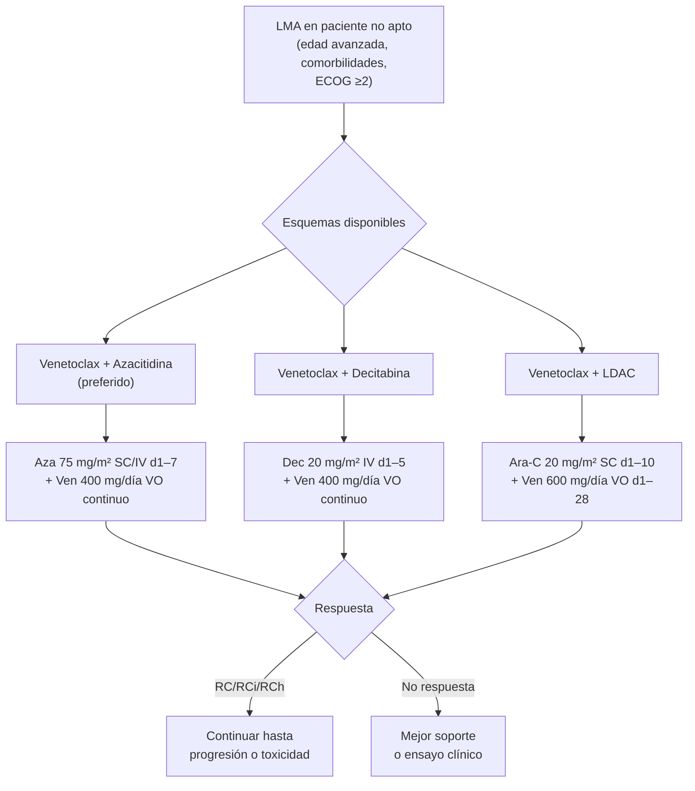
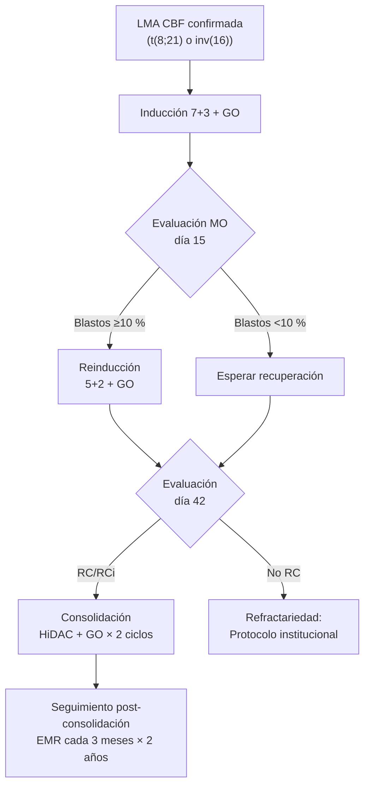
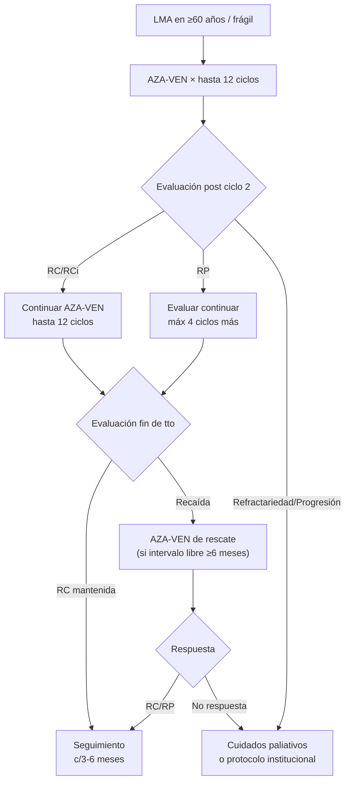

# Leucemia mieloide aguda (LMA)

!!! info "Ficha de la página"
    **Última revisión:** 2026-11-11 · **Fuentes base:** recomendaciones ELN 2022 (Döhner et al.) [32] **[V-RS]**, ensayos RATIFY [33] **[V-RS]** y QuANTUM-First [34] **[V-RS]**, datos de CPX-351 [35] **[V-RS]**, resúmenes de AML Hub y fichas técnicas. Las dosis marcadas **[PV]** requieren verificación con fichas técnicas locales antes de uso clínico.

## 1. Resumen rápido

- La LMA es la **leucemia aguda más frecuente del adulto** (incidencia ~4/100.000/año; mediana de edad al diagnóstico ~68 años).
- El diagnóstico requiere **≥20 % de blastos en médula ósea o sangre periférica**, o la presencia de **alteraciones citogenéticas/moleculares definitorias** (t(8;21), inv(16), t(15;17), etc.) independientemente del porcentaje de blastos [32] **[V-RS]**.
- El tratamiento depende de la **aptitud del paciente**: intensivo (7+3 ± agentes dirigidos) para aptos; venetoclax + azacitidina/decitabina para no aptos.
- La **estratificación de riesgo ELN 2022** guía la indicación de alo-TPH en primera remisión.

## 2. Estudio inicial

| Estudio | Obligatorio | Comentario |
|---|---|---|
| Hemograma con frotis | Sí | Blastos circulantes, citopenias |
| Aspirado/biopsia de médula ósea | Sí | Morfología, % blastos |
| Citometría de flujo | Sí | Inmunofenotipo (CD33, CD34, CD117, MPO, marcadores monocíticos) |
| Cariotipo convencional | Sí | Necesario para clasificación ELN |
| FISH | Sí si cariotipo fallido o sospecha específica | t(8;21), inv(16)/t(16;16), t(15;17), KMT2A, MECOM, del(5q), -7/del(7q) |
| Panel molecular (NGS) | Sí | FLT3-ITD y FLT3-TKD, NPM1, CEBPA, TP53, RUNX1, ASXL1, IDH1, IDH2, DNMT3A, KIT (en CBF) **[PV]** |
| Función renal y hepática, LDH, ácido úrico, coagulación | Sí | Evaluación pretratamiento y riesgo de SLT |
| Tipificación HLA | Sí, en candidatos a alo-TPH | Iniciar búsqueda precoz de donante |
| Punción lumbar | Solo si hay síntomas neurológicos o leucemia monocítica/hiperleucocitosis | LMA no tiene profilaxis intratecal de rutina **[PV]** |
| Ecocardiograma / FEVI | Sí | Antes de antraciclinas |

## 3. Clasificación de riesgo genético ELN 2022

La clasificación **ELN 2022** [32] **[V-RS]** actualizó las categorías de riesgo respecto a ELN 2017:

| Riesgo | Alteraciones genéticas |
|---|---|
| **Favorable** | t(8;21)(q22;q22.1) / *RUNX1::RUNX1T1*; inv(16)(p13.1q22) o t(16;16) / *CBFB::MYH11*; *NPM1* mutado **sin** *FLT3*-ITD; mutación bialélica de *CEBPA* (incluye mutación *in-frame* del bZIP) |
| **Intermedio** | *NPM1* mutado **con** *FLT3*-ITD; *FLT3*-ITD sin otras alteraciones de riesgo definido; cariotipo normal sin lesiones moleculares de riesgo; t(9;11)(p21.3;q23.3) / *MLLT3::KMT2A*; otras alteraciones no clasificadas como favorables ni adversas |
| **Adverso** | Cariotipo complejo (≥3 anomalías); cariotipo monosómico; del(5q), -5, -7, del(7q); *MECOM* reordenado (no incluye t(9;11)); t(6;9) / *DEK::NUP214*; reordenamiento de *KMT2A* (excepto t(9;11)); *TP53* mutado (VAF ≥10 %); *RUNX1* mutado **[PV]**; *ASXL1* mutado **[PV]**; *BCR::ABL1* |

!!! warning "Cambio clave ELN 2022"
    **FLT3-ITD ya no es automáticamente adverso.** La ratio alélica (alta/baja) dejó de ser criterio; FLT3-ITD con NPM1 mutado es **intermedio** (antes era desfavorable con ratio alta). FLT3-ITD sin NPM1 también es intermedio [32] **[V-RS]**.

## 4. Tratamiento de pacientes aptos (intensivo)

### 4.1 Algoritmo de primera línea — pacientes aptos

```mermaid
flowchart TD
    A[LMA diagnosticada] --> B{Paciente apto para<br/>quimioterapia intensiva?<br/>Edad, ECOG, comorbilidades}
    B -->|Sí| C{Tipo de LMA}
    C -->|LMA de novo| D["Inducción 7+3:<br/>Ara-C 200 mg/m² CI d1–7<br/>+ Daunorrubicina 60 mg/m² d1–3"]
    C -->|LMA secundaria o<br/>relacionada con terapia| E["CPX-351 (Vyxeos):<br/>44/100 mg/m² d1, 3, 5"]
    C -->|LPA t(15;17)| F["ATRA + ATO<br/>(ver sección LPA)"]
    D --> G{Mutaciones dirigibles?}
    G -->|FLT3 mutado| H["Agregar midostaurina<br/>50 mg c/12h VO d8–21"]
    G -->|CD33+ CBF-AML| I["Considerar GO<br/>3 mg/m² d1, 4, 7"]
    G -->|Sin diana molecular| J[7+3 estándar]
    H --> K{Respuesta d14–21}
    I --> K
    J --> K
    E --> K
    K -->|RC/RCi| L{Riesgo ELN}
    K -->|No RC| M[Reinducción o<br/>cambio de esquema]
    L -->|Favorable| N["Consolidación: HiDAC<br/>3 g/m² c/12h d1,3,5<br/>× 3–4 ciclos"]
    L -->|Intermedio| O{EMR negativa?}
    O -->|Sí| N
    O -->|No| P[Alo-TPH en RC1]
    L -->|Adverso| P
    N --> Q{FLT3 mutado?}
    Q -->|Sí| R["Mantención:<br/>midostaurina 12 ciclos"]
    Q -->|No, no candidato a alo-TPH| S["Considerar azacitidina oral<br/>de mantención"]
    P --> T[Alo-TPH]
```

### 4.2 Inducción 7+3 (estándar)

| Fármaco | Dosis | Vía | Días | Notas |
|---|---|---|---|---|
| **Citarabina** | 200 mg/m²/día | Infusión continua IV 24 h | 1–7 | Algunas instituciones usan 100 mg/m² **[PV]** |
| **Daunorrubicina** | 60 mg/m²/día | IV en 15–30 min | 1–3 | 90 mg/m² en menores de 60 años puede ser superior (ECOG-ACRIN E1900) **[PV]** |

- **Evaluación de respuesta:** aspirado de médula ósea **día 14–21**; si blastos ≥10 %, considerar reinducción precoz **[PV]**.
- **Alternativas:** idarrubicina 12 mg/m² d1–3 (equivalente o superior a daunorrubicina en algunos estudios) **[PV]**; FLAG-IDA en centros con experiencia **[PV]**.

### 4.3 Midostaurina en LMA con FLT3 mutado (RATIFY)

El ensayo **RATIFY** [33] **[V-RS]** demostró beneficio de SG al agregar midostaurina al 7+3 en pacientes con *FLT3* mutado (ITD o TKD):

| Fase | Dosis | Días |
|---|---|---|
| **Inducción** | 50 mg c/12 h VO | 8–21 de cada ciclo de inducción |
| **Consolidación** | 50 mg c/12 h VO | 8–21 de cada ciclo de HiDAC |
| **Mantención** | 50 mg c/12 h VO | Días 1–28 de ciclos de 28 días, hasta 12 ciclos |

- SG a 4 años: **51,4 % vs 44,3 %** (HR 0,78; p=0,009) [33] **[V-RS]**.
- Aprobado por FDA y EMA para LMA FLT3-mutada de nuevo diagnóstico.

### 4.4 Quizartinib en LMA con FLT3-ITD (QuANTUM-First)

El ensayo **QuANTUM-First** [34] **[V-RS]** evaluó quizartinib añadido al 7+3 **específicamente en FLT3-ITD**:

| Fase | Dosis | Días |
|---|---|---|
| **Inducción** | 35,4 mg/día VO | 8–21 |
| **Consolidación** | 35,4 mg/día VO | 6–19 |
| **Mantención** | 26,5 mg/día VO (ciclos 1–2), luego 53 mg/día | Días 1–14 de ciclos de 28 días, hasta 36 ciclos |

- SG mediana: **31,9 vs 15,1 meses** (HR 0,78; p=0,032) [34] **[V-RS]**.
- Aprobado por FDA (julio 2023). **No aprobado por EMA** a la fecha de esta revisión.
- Precaución: prolongación del QTc; monitorizar ECG **[PV]**.

### 4.5 CPX-351 (Vyxeos) para LMA secundaria / relacionada con terapia

CPX-351 es una formulación liposomal de citarabina:daunorrubicina (5:1 molar) [35] **[V-RS]**:

| Fase | Dosis (daunorrubicina/citarabina) | Días |
|---|---|---|
| **1.ª inducción** | 44/100 mg/m² | 1, 3, 5 |
| **2.ª inducción** (si necesaria) | 44/100 mg/m² | 1, 3 |
| **Consolidación** | 29/65 mg/m² | 1, 3 |

- SG mediana: **9,56 vs 5,95 meses** frente a 7+3 convencional en LMA secundaria (HR 0,69; p=0,003) [35] **[V-RS]**.
- Mayor tasa de RC y mejor transición a alo-TPH.

### 4.6 Gemtuzumab ozogamicina (GO)

- Anti-CD33 conjugado a calicheamicina; indicado en **LMA CD33+ de riesgo favorable** (especialmente CBF-AML) **[PV]**.
- Dosis fraccionada: **3 mg/m² IV días 1, 4, 7** de inducción (esquema ALFA-0701) **[PV]**.
- Riesgo de **enfermedad venooclusiva hepática (SOS)**; precaución si se planifica alo-TPH posterior **[PV]**.

### 4.7 Consolidación con HiDAC

| Parámetro | Detalle |
|---|---|
| **Dosis** | 3.000 mg/m² (3 g/m²) IV en 3 h, cada 12 h |
| **Días** | 1, 3, 5 (6 dosis por ciclo) |
| **Ciclos** | 3–4 ciclos |
| **Ajuste en >60 años** | 1.000–1.500 mg/m² (riesgo de toxicidad cerebelosa) **[PV]** |

- **Evaluar función cerebelosa** antes de cada dosis (especialmente en ≥60 años o insuficiencia renal).
- Las dosis de HiDAC provienen de estudios históricos CALGB y fuentes secundarias **[PV]**; verificar con protocolo institucional.

### 4.8 Mantención post-consolidación

| Escenario | Estrategia |
|---|---|
| LMA FLT3-mutada, tratada con midostaurina | Continuar midostaurina 50 mg c/12 h × 12 ciclos [33] |
| LMA FLT3-ITD, tratada con quizartinib | Continuar quizartinib hasta 36 ciclos [34] |
| RC/RCi, no candidato a alo-TPH | **Azacitidina oral (CC-486)** 300 mg/día VO, días 1–14 de ciclos de 28 días, como mantención (estudio QUAZAR AML-001) **[PV]** |

## 5. Tratamiento de pacientes no aptos (baja intensidad)

### 5.1 Algoritmo — pacientes no aptos



### 5.2 Venetoclax + azacitidina (esquema preferido)

| Fármaco | Dosis | Vía | Días | Notas |
|---|---|---|---|---|
| **Azacitidina** | 75 mg/m²/día | SC o IV | 1–7 de cada ciclo de 28 d | — |
| **Venetoclax** | Escalada: 100 mg d1 → 200 mg d2 → **400 mg d3 en adelante** | VO | Continuo | Con inhibidores CYP3A4 moderados (posaconazol): reducir a 100 mg **[PV]** |

- Tasa de RC/RCi: **~66 %** (estudio VIALE-A) **[PV]**.
- SG mediana: **14,7 vs 9,6 meses** frente a azacitidina sola (HR 0,66) **[PV]**.
- **Síndrome de lisis tumoral:** profilaxis obligatoria; escalada de dosis de venetoclax durante ciclo 1. Monitorizar electrólitos, ácido úrico, creatinina a las 6–8 h y 24 h de cada aumento de dosis **[PV]**.

### 5.3 Venetoclax + decitabina

| Fármaco | Dosis | Vía | Días |
|---|---|---|---|
| **Decitabina** | 20 mg/m²/día | IV | 1–5 |
| **Venetoclax** | Escalada hasta **400 mg/día** | VO | Continuo |

### 5.4 Venetoclax + citarabina a dosis baja (LDAC)

| Fármaco | Dosis | Vía | Días |
|---|---|---|---|
| **Citarabina** | 20 mg/m² c/12 h | SC | 1–10 |
| **Venetoclax** | Escalada hasta **600 mg/día** | VO | 1–28 |

- Nota: la dosis de venetoclax con LDAC es **600 mg** (mayor que con HMA, 400 mg) por ausencia de interacción CYP3A relevante con citarabina.

## 6. Inhibidores de IDH

| Fármaco | Diana | Dosis | Indicación | Notas |
|---|---|---|---|---|
| **Ivosidenib** | IDH1 mutado | 500 mg/día VO | Monoterapia o combinado con azacitidina en LMA IDH1-mutada no apta para quimioterapia intensiva **[PV]** | Riesgo de **síndrome de diferenciación** |
| **Enasidenib** | IDH2 mutado | 100 mg/día VO | LMA IDH2-mutada R/R **[PV]** | Riesgo de síndrome de diferenciación; mediana de respuesta ~4 meses |

!!! danger "Síndrome de diferenciación"
    Puede ocurrir con inhibidores de IDH, ATRA y ATO. Signos: fiebre, disnea, edema pulmonar, infiltrados, derrame pleural, hipotensión, ganancia de peso, insuficiencia renal. **Tratamiento:** dexametasona 10 mg IV c/12 h hasta resolución; no suspender el fármaco de entrada a menos que sea grave **[PV]**.

## 7. Trasplante alogénico de progenitores hematopoyéticos (alo-TPH)

### 7.1 Indicaciones en RC1

| Riesgo ELN 2022 | Indicación de alo-TPH |
|---|---|
| **Favorable** | No indicado en RC1 (reservar para recaída) |
| **Intermedio** | Indicado si **EMR positiva** tras consolidación, o presencia de factores adicionales de mal pronóstico |
| **Adverso** | **Indicado en RC1** para todos los candidatos |

- El umbral de riesgo de recaída para considerar alo-TPH es generalmente **>35–40 %** [32] **[V-RS]**.
- La **EMR (enfermedad mínima residual)** es un factor decisivo: pacientes de riesgo intermedio con EMR negativa pueden diferir el trasplante [32] **[V-RS]**.

### 7.2 Acondicionamiento

- **Mieloablativo (MAC):** busulfán/ciclofosfamida o busulfán/fludarabina; preferido en pacientes jóvenes **[PV]**.
- **Intensidad reducida (RIC):** fludarabina/busulfán a dosis reducida o fludarabina/melfalán; para pacientes de mayor edad o con comorbilidades **[PV]**.

## 8. Criterios de respuesta ELN 2022

| Categoría | Definición |
|---|---|
| **RC (remisión completa)** | Blastos en MO <5 %, RAN ≥1.000/µL, plaquetas ≥100.000/µL, sin bastones de Auer, sin enfermedad extramedular |
| **RCh (RC con recuperación hematológica parcial)** | Blastos <5 %, RAN ≥500/µL, plaquetas ≥50.000/µL |
| **RCi (RC con recuperación incompleta)** | Blastos <5 % pero RAN <1.000/µL o plaquetas <100.000/µL |
| **MLFS (estado libre de leucemia morfológico)** | Blastos <5 % sin requerimientos de recuentos; útil como criterio intermedio |
| **RC sin EMR** | RC + EMR negativa por citometría multiparamétrica (<10⁻⁴) o biología molecular (qPCR/NGS) |
| **Fallo de tratamiento** | No alcanza RC/RCh/RCi tras 2 ciclos de inducción; o enfermedad resistente |
| **Recaída** | Blastos ≥5 % en MO tras RC, o reaparición de blastos en sangre, o enfermedad extramedular nueva |

Fuente: [32] **[V-RS]**.

## 9. Enfermedad mínima residual (EMR)

- **Métodos:** citometría de flujo multiparamétrica (sensibilidad ~10⁻⁴), RT-qPCR para transcritos de fusión (10⁻⁴–10⁻⁶), NGS para mutaciones (10⁻²–10⁻³) [32] **[V-RS]**.
- **Momento:** evaluar tras inducción y tras consolidación; guía de decisión para alo-TPH.
- **Impacto pronóstico:** la EMR positiva tras consolidación se asocia a mayor riesgo de recaída, independientemente de la categoría ELN **[PV]**.
- **Transcritos de fusión en CBF-AML:** monitorización por qPCR de *RUNX1::RUNX1T1* o *CBFB::MYH11* cada 3 meses durante 2 años; aumento de ≥1 log confirmado indica recaída molecular **[PV]**.

## 10. Leucemia promielocítica aguda (LPA) — consideraciones especiales

!!! danger "Urgencia hematológica"
    La LPA (t(15;17) / *PML::RARA*) es una **urgencia médica** por la coagulopatía asociada (CID). **Iniciar ATRA inmediatamente** ante sospecha clínica, sin esperar confirmación molecular.

| Riesgo | Leucocitos | Tratamiento |
|---|---|---|
| **Bajo/intermedio** | ≤10.000/µL | **ATRA + ATO** (sin quimioterapia) **[PV]** |
| **Alto** | >10.000/µL | **ATRA + ATO + idarrubicina** (o ATRA + quimioterapia según protocolo) **[PV]** |

- **ATRA:** 45 mg/m²/día VO dividido en 2 dosis **[PV]**.
- **ATO (trióxido de arsénico):** 0,15 mg/kg/día IV **[PV]**.
- Monitorizar ECG (QTc) y electrólitos con ATO.
- Tasa de curación >90 % con ATRA+ATO en riesgo bajo/intermedio.
- Ver síndrome de diferenciación en sección 6.

## 10b. Manejo en Chile — Protocolos ANACAN/MINSAL 2025

!!! info "Fuente"
    Protocolos Clínicos del Programa de Cáncer del Adulto 2025, ANACAN/DIPRECE/Subsecretaría de Salud Pública, MINSAL Chile [37][38]. Incorporados a la canasta GES desde el 1 de diciembre de 2025 (D.S. N.º 29/2025). **[V-TF]**

### A. LMA CBF con Gemtuzumab Ozogamicina — Paciente apto (primera línea)

**Indicación:** LMA con core-binding factor (CBF) — t(8;21)(q22;q22) / *RUNX1::RUNX1T1* o inv(16)(p13.1q22) / *CBFB::MYH11* —, paciente **apto** para quimioterapia intensiva, primera línea [37].

#### Escenarios terapéuticos



#### Esquema de tratamiento

**Inducción 7+3 + GO (ciclo 1):**

| Orden | Medicamento | Dosis | Día | Vía | Observaciones |
|---|---|---|---|---|---|
| 1 | Citarabina | 200 mg/m²/día | 1–7 | Infusión continua EV 24 h | — |
| 2 | Daunorrubicina | 60 mg/m²/día | 1–3 | EV en 15–30 min | — |
| 3 | **Gemtuzumab ozogamicina** | **3 mg/m²** (máx. 5 mg) | 1, 4, 7 | EV en 2 h | Premedicar con paracetamol + clorfenamina + hidrocortisona |

**Reinducción 5+2 + GO (si blastos ≥10 % d15):**

| Orden | Medicamento | Dosis | Día | Vía |
|---|---|---|---|---|
| 1 | Citarabina | 200 mg/m²/día | 1–5 | Infusión continua EV 24 h |
| 2 | Daunorrubicina | 60 mg/m²/día | 1–2 | EV |
| 3 | GO | 3 mg/m² (máx. 5 mg) | 1 | EV en 2 h |

**Consolidación HiDAC + GO (2 ciclos, cada 28 días):**

| Orden | Medicamento | Dosis | Día | Vía |
|---|---|---|---|---|
| 1 | Citarabina | 3 g/m² c/12 h | 1, 3, 5 | EV en 3 h |
| 2 | GO | 3 mg/m² (máx. 5 mg) | 1 | EV en 2 h |

!!! warning "Precauciones con GO"
    - Riesgo de **enfermedad venooclusiva hepática (SOS/VOD)**: monitorizar bilirrubina, transaminasas, peso, perímetro abdominal.
    - Si se planifica alo-TPH posterior, evaluar riesgo/beneficio de GO con el equipo de trasplante.
    - Ajuste en **>60 años**: citarabina de consolidación se reduce a **1–1,5 g/m²** por riesgo de toxicidad cerebelosa [37].

#### Monitorización EMR post-consolidación

- RT-qPCR para *RUNX1::RUNX1T1* o *CBFB::MYH11* cada **3 meses** durante **2 años**.
- Aumento de ≥1 log confirmado indica **recaída molecular** → evaluar rescate o alo-TPH.

### B. LMA en mayores de 60 años y/o frágiles — Azacitidina-Venetoclax

**Indicación:** LMA en paciente ≥60 años **no apto** para quimioterapia intensiva, o paciente **frágil** según Escala Clínica de Fragilidad ≥5 (Browne 2025), primera línea [38].

#### Evaluación de fragilidad

Se utiliza la **Escala Clínica de Fragilidad** (1-9), validada en Chile (Browne et al. 2025):

| Puntuación | Estado | Aptitud para AZA-VEN |
|---|---|---|
| 1–4 | En buen estado hasta vulnerable | Evaluar quimioterapia intensiva vs AZA-VEN |
| 5–6 | Fragilidad leve a moderada | **Candidato a AZA-VEN** |
| 7–9 | Fragilidad severa a terminal | Considerar mejor soporte vs AZA-VEN con ajuste |

#### Escenarios terapéuticos



#### Esquema Azacitidina-Venetoclax (detalle)

!!! danger "Riesgo de síndrome de lisis tumoral"
    Escalar venetoclax en los primeros 4 días. Los azoles están **contraindicados** durante la escalada (ajustar dosis de venetoclax si es imprescindible usarlos).

**Profilaxis y soporte:**

- Cotrimoxazol forte, lunes/miércoles/viernes
- Aciclovir 400 mg c/12 h VO permanente
- Levofloxacina 500 mg/día VO (si RAN <500 → antibióticos EV)
- Alopurinol 300 mg/día VO desde 48-72 h antes del inicio
- Hidratación 2000 cc/24 h VO/EV

**Ciclo 1 con escalada de venetoclax:**

| Orden | Medicamento | Dosis | Día | Vía | Observaciones |
|---|---|---|---|---|---|
| 1 | Azacitidina | 75 mg/m²/día | 1–7 | SC/EV | — |
| 2 | Venetoclax escalada | 100 mg d1, 200 mg d2, 400 mg d3–28 | 1–28 | VO en ayuno | Monitorizar SLT a 6-8 h y 24 h de cada aumento |

**Ciclos 2–12:**

| Orden | Medicamento | Dosis | Día | Vía |
|---|---|---|---|---|
| 1 | Azacitidina | 75 mg/m²/día | 1–7 | SC/EV |
| 2 | Venetoclax | 400 mg/día | 1–28 | VO en ayuno |

**Duración total:** hasta **12 ciclos** (tratamiento finito, a diferencia de protocolos internacionales que son hasta progresión) [38].

**Ajuste de dosis de venetoclax con azoles:**

| Azol | Dosis de venetoclax |
|---|---|
| Fluconazol o Isavuconazol | 200 mg/día |
| Voriconazol | 100 mg/día |
| Posaconazol | 70 mg/día |

#### Modificación de dosis por toxicidad hematológica

**Neutropenia:**

| Evento | Conducta |
|---|---|
| 1.° episodio RAN <1000 + fiebre/infección | Suspender venetoclax, filgrastim 300 mcg sc/día hasta RAN >1000, reiniciar a igual dosis |
| 2.° y siguientes episodios | Suspender, filgrastim, reiniciar con reducción: 400→300→200→100 mg |

**Trombocitopenia:**

| Evento | Conducta |
|---|---|
| 1.° episodio Plaquetas <25.000 | Suspender, reiniciar a igual dosis una vez resuelto |
| 2.° y siguientes | Suspender, reiniciar con reducción de dosis |

**Ajuste renal:** ClCr <80 → considerar riesgo elevado de SLT. ClCr ≥30 → dosis completa. ClCr <30 → decisión de equipo.

**Ajuste hepático:** Child Pugh A/B → dosis completa con monitorización. Child Pugh C → venetoclax 50 %, monitorización frecuente.

### Canasta GES 2025 — Fármacos cubiertos para LMA

Desde el 1 de diciembre de 2025, la canasta GES incluye:

- **Quimioterapias:** Citarabina, Daunorrubicina, **Gemtuzumab Ozogamicina** (CBF-AML), Azacitidina, **Venetoclax**, Metotrexato intratecal
- **Medicamentos de soporte:** Alopurinol, Aciclovir, Levofloxacina, Fluconazol, Cotrimoxazol, Filgrastim (G-CSF), Paracetamol, Clorfenamina, Hidrocortisona, entre otros [37][38]
- **Incorporaciones 2025:** GO para LMA CBF primera línea y AZA-VEN para LMA ≥60/frágil primera línea

!!! tip "Comité oncológico"
    Todo paciente con diagnóstico de LMA debe ser presentado en el **Comité Oncológico** local para definir plan terapéutico, de acuerdo con los protocolos ANACAN vigentes [37][38].

## 11. Puntos clave para residentes e internos

1. **Todo paciente con sospecha de LMA:** hemograma urgente + frotis + derivar para aspirado/biopsia con citometría, cariotipo y panel molecular.
2. **Solicitar FLT3, NPM1, IDH1/2** siempre: condicionan el tratamiento.
3. **LPA es una urgencia:** iniciar ATRA de inmediato si hay sospecha (promielocitos, bastones de Auer en haces, CID).
4. **Clasificar riesgo ELN 2022** antes de decidir consolidación vs alo-TPH.
5. **EMR negativa** tras consolidación: mejor pronóstico; puede diferir alo-TPH en riesgo intermedio.
6. **Pacientes no aptos:** venetoclax + azacitidina es el estándar actual; la escalada de dosis de venetoclax requiere vigilancia de SLT.
7. **LMA secundaria/t-AML en paciente apto:** CPX-351 (Vyxeos) es superior al 7+3 convencional.
8. **Mantención:** midostaurina (FLT3+) o azacitidina oral (otros) en candidatos que no van a alo-TPH.

## 12. Referencias de esta página

- **[32]** Döhner H et al., ELN 2022 (ver [lista](../referencias.md)).
- **[33]** Stone RM et al., RATIFY (ver [lista](../referencias.md)).
- **[34]** Erba HP et al., QuANTUM-First (ver [lista](../referencias.md)).
- **[35]** Lancet JE et al., CPX-351 (ver [lista](../referencias.md)).

## 13. Pendientes

- [ ] Dosis exactas de HiDAC según fuente primaria (CALGB 8525/9222) **[PV]**.
- [ ] Esquema completo de ATRA+ATO con calendario y dosis de mantención (APL0406/AML17) **[PV]**.
- [ ] Inhibidores de IDH: dosis, ensayos pivotales (AG-120/AGILE, AG-221) y ficha técnica **[PV]**.
- [ ] GO: esquema ALFA-0701 detallado y ficha técnica **[PV]**.
- [ ] Gilteritinib en LMA FLT3+ R/R (ADMIRAL) **[PV]**.
- [ ] LMA R/R: algoritmo de rescate, ensayos con menin-inhibidores, anticuerpos biespecíficos **[PV]**.
- [ ] Azacitidina oral de mantención: datos de QUAZAR AML-001 y dosis **[PV]**.
- [ ] Acondicionamiento de alo-TPH: esquemas con dosis **[PV]**.
- [ ] Cobertura GES Chile para leucemia aguda **[PV]**.
