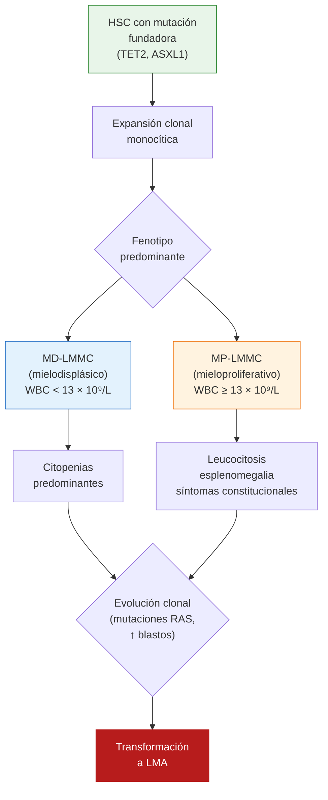
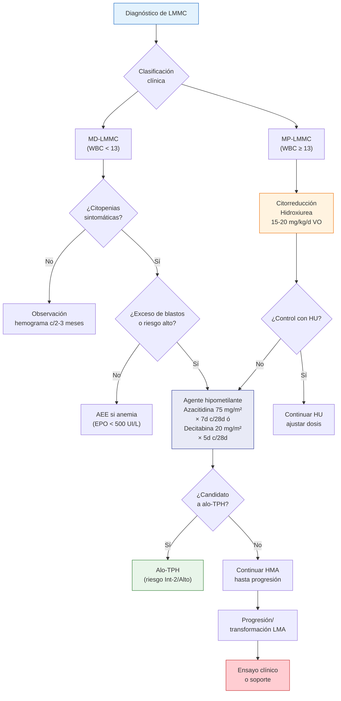

# Leucemia mielomonocítica crónica (LMMC)

!!! info "Ficha de la página"
    **Última revisión:** 2026-11-12 · **Fuente base:** OMS 2022 [59], CPSS-Mol (Elena et al. 2016) [69], Patnaik & Tefferi 2024 [70] · **Alcance:** adultos ≥ 18 años.

---

## 1. Resumen rápido

1. La LMMC es una **neoplasia mieloide clonal** con rasgos superpuestos de mielodisplasia y mieloproliferación. La OMS 2022 la reclasificó en la categoría **"MDS/MPN"** (mielodisplásico/mieloproliferativo) [V-RS] [59].
2. El criterio diagnóstico clave es **monocitosis persistente (≥ 3 meses) ≥ 0,5 × 10⁹/L con monocitos ≥ 10 %** en sangre periférica (umbral reducido en OMS 2022) [V-RS] [59].
3. Las mutaciones más frecuentes son *TET2* (~60 %), *SRSF2* (~50 %), *ASXL1* (~40-62 %) y *RAS* (KRAS/NRAS ~30 %); > 95 % de pacientes portan ≥ 1 mutación somática [V-RS] [70].
4. El **CPSS-Mol** (Molecular CMML-Specific Prognostic Score) integra citogenética, mutaciones (*ASXL1*, *NRAS*, *RUNX1*, *SETBP1*), dependencia transfusional, leucocitos y blastos en 4 grupos de riesgo [V-RS] [69].
5. El **alo-TPH** es la única terapia curativa; está indicado en pacientes de riesgo intermedio-2/alto con donante adecuado. La transformación a LMA ocurre en ~15-20 % a 3-5 años [V-RS] [70].

---

## 2. Definición y epidemiología

La **leucemia mielomonocítica crónica (LMMC)** es una neoplasia mieloide clonal clasificada dentro del grupo **MDS/MPN** (síndromes con superposición mielodisplásica/mieloproliferativa). Combina:

- **Monocitosis clonal persistente** en sangre periférica.
- **Displasia** en ≥ 1 línea mieloide.
- **Rasgos mieloproliferativos** variables (leucocitosis, esplenomegalia).

### Epidemiología

| Parámetro | Dato |
|---|---|
| Incidencia | ~0,4-1/100 000 habitantes/año |
| Mediana de edad al diagnóstico | 72-76 años |
| Relación hombre : mujer | ~2-3 : 1 |
| Transformación a LMA | ~15-20 % a 3-5 años |
| Mediana de supervivencia global | ~20-40 meses (variable por riesgo) |

---

## 3. Fisiopatología

### Paisaje mutacional

| Gen | Frecuencia | Vía | Significado |
|---|---|---|---|
| *TET2* | ~60 % | Metilación del ADN | Fundadora frecuente; buen pronóstico relativo |
| *SRSF2* | ~50 % | Splicing de ARN | Casi específica de LMMC (p.P95H/L/R) |
| *ASXL1* | ~40-62 % | Remodelación de cromatina | **Pronóstico adverso**; incluida en CPSS-Mol |
| *KRAS/NRAS* | ~30 % | Señalización RAS/MAPK | Fenotipo proliferativo; incluida en CPSS-Mol |
| *RUNX1* | ~15 % | Factor de transcripción | Pronóstico adverso; incluida en CPSS-Mol |
| *SETBP1* | ~10-15 % | Regulación de SET | Pronóstico adverso; incluida en CPSS-Mol |
| *CBL* | ~10-15 % | Ubiquitina ligasa | Mutación activadora RAS-like |
| *JAK2* V617F | ~5-10 % | Señalización JAK-STAT | Fenotipo mieloproliferativo |
| *DNMT3A* | ~5-10 % | Metilación del ADN | Hematopoyesis clonal |

!!! note "Diagnóstico molecular"
    > 95 % de los pacientes con LMMC portan al menos 1 mutación somática detectable por NGS. La mutación de *SRSF2* es altamente sugestiva de LMMC en el contexto de monocitosis [V-RS] [70].

---

## 4. Presentación clínica

### Formas clínicas

| Subtipo | Definición | Características |
|---|---|---|
| **MD-LMMC** (mielodisplásico) | WBC < 13 × 10⁹/L | Citopenias predominantes, menor esplenomegalia |
| **MP-LMMC** (mieloproliferativo) | WBC ≥ 13 × 10⁹/L | Leucocitosis, esplenomegalia, síntomas constitucionales |

### Síntomas

| Manifestación | Frecuencia |
|---|---|
| Astenia y síntomas de anemia | 60-80 % |
| Esplenomegalia | 30-50 % (más frecuente en MP-LMMC) |
| Hepatomegalia | 15-25 % |
| Infecciones recurrentes | 20-30 % |
| Sangrado/equimosis | 15-25 % |
| Síntomas constitucionales (sudoración, pérdida de peso) | 20-40 % |
| Manifestaciones autoinmunes | 10-20 % (vasculitis, artritis, serositis) |
| Infiltración cutánea | 5-10 % |

!!! tip "Sospecha clínica"
    Pensar en LMMC ante **monocitosis persistente > 0,5 × 10⁹/L** (> 3 meses) en paciente > 60 años, especialmente si se acompaña de citopenias, esplenomegalia o manifestaciones autoinmunes.

---

## 5. Diagnóstico

### 5.1 Criterios diagnósticos OMS 2022 [59]

Todos los criterios son requeridos:

| Criterio | Detalle |
|---|---|
| 1. Monocitosis persistente | ≥ 0,5 × 10⁹/L en SP (reducido desde ≥ 1 × 10⁹/L en OMS 2017) |
| 2. Proporción de monocitos | ≥ 10 % del recuento diferencial de leucocitos |
| 3. Persistencia | **≥ 3 meses** (confirmación temporal requerida) |
| 4. Blastos | < 20 % en SP y MO |
| 5. Displasia | Presente en ≥ 1 línea mieloide en MO |
| 6. Exclusión | No cumple criterios de BCR::ABL1+ (LMC), ni de otra neoplasia mieloide definida |

!!! warning "Cambio OMS 2022"
    El umbral de monocitos absolutos se **redujo de ≥ 1,0 a ≥ 0,5 × 10⁹/L**, permitiendo diagnosticar LMMC oligomonocítica. Sin embargo, los monocitos deben representar **≥ 10 %** del diferencial leucocitario.

### 5.2 Subclasificación por blastos (OMS 2022)

| Subtipo | Blastos en SP | Blastos en MO |
|---|---|---|
| **LMMC-0** | ≤ 2 % | ≤ 5 % |
| **LMMC-1** | 2-5 % (sin bastones de Auer) | 5-10 % |
| **LMMC-2** | 5-19 % (con bastones de Auer = LMMC-2) | 10-19 % |

### 5.3 Estudio diagnóstico

| Examen | Objetivo |
|---|---|
| Hemograma con frotis manual y recuento diferencial | Confirmar monocitosis y proporción; buscar displasia |
| **Citometría de flujo** de monocitos (partición) | Monocitos clásicos (CD14⁺/CD16⁻) > 94 % es altamente sugestivo de LMMC |
| Aspirado y biopsia de MO | Displasia, blastos, celularidad, fibrosis |
| **Cariotipo convencional** | Anomalías en ~30 % (+8, -7/del7q, anomalías 12p, i(17q)) |
| **NGS** (panel mieloide) | Mutaciones somáticas (confirma clonalidad; > 95 % tienen ≥ 1 mutación); necesario para CPSS-Mol |
| BCR::ABL1 (FISH o PCR) | **Excluir LMC** (obligatorio) |
| PDGFRA/PDGFRB reordenamientos | Excluir neoplasias mieloides con eosinofilia y reordenamientos |
| Ecografía abdominal | Esplenomegalia, hepatomegalia |
| Perfil bioquímico, LDH | Actividad de enfermedad |

### 5.4 Diagnóstico diferencial de monocitosis

| Causa | Clave para distinguir |
|---|---|
| Monocitosis reactiva (infecciones crónicas, autoinmunidad, neoplasias) | Transitoria, < 3 meses, sin clonalidad |
| CHIP/CCUS con monocitosis | Sin displasia medular significativa |
| LMC | BCR::ABL1 positiva |
| Leucemia mieloide aguda (monocítica) | ≥ 20 % blastos |
| Neoplasia mieloide con eosinofilia | Reordenamientos PDGFRA/B |

---

## 6. Estratificación de riesgo

### 6.1 CPSS-Mol (Molecular CMML-Specific Prognostic Score) [69]

El **CPSS-Mol** (Elena et al., *Blood* 2016) es el score molecular validado de referencia para LMMC:

| Variable | Puntuación |
|---|---|
| **Citogenética** | Bajo (0), Intermedio (1), Alto (2) |
| **Mutaciones** *ASXL1* | Presente = 1 punto |
| **Mutaciones** *NRAS* | Presente = 1 punto |
| **Mutaciones** *RUNX1* | Presente = 1 punto |
| **Mutaciones** *SETBP1* | Presente = 1 punto |
| **Dependencia transfusional de GR** | Sí = 1 punto |
| **WBC ≥ 13 × 10⁹/L** | Sí = 1 punto |
| **Blastos MO ≥ 5 %** | Sí = 1 punto |

| Grupo de riesgo CPSS-Mol | Puntuación | Mediana SG |
|---|---|---|
| **Bajo** | 0-1 | > 144 meses (~12+ años) |
| **Intermedio-1** | 2-3 | ~60 meses (~5 años) |
| **Intermedio-2** | 4-5 | ~27 meses (~2,3 años) |
| **Alto** | 6+ | ~18 meses (~1,5 años) |

### 6.2 iCPSS (JCO 2026) [71]

El **iCPSS** (integrated CPSS) es un nuevo sistema publicado en 2026 que utiliza:

- **43 genes** analizados con clustering no supervisado → 9 clases moleculares.
- **5 categorías de riesgo** (Very Low → Very High).
- Restratifica > 50 % de pacientes respecto al CPSS-Mol.
- Incorpora soporte de inteligencia artificial para la decisión de trasplante [V-RS].

!!! note "En la práctica actual"
    El **CPSS-Mol** sigue siendo el más usado y validado. El iCPSS es prometedor pero requiere mayor validación prospectiva antes de su uso rutinario [V-RS] [71].

---

## 7. ¿Cuándo tratar?

### Indicaciones de tratamiento

| Indicación | Contexto |
|---|---|
| **Síntomas constitucionales** | Sudoración nocturna, pérdida de peso, fatiga limitante |
| **Esplenomegalia sintomática** | Dolor, saciedad precoz, citopenias por secuestro |
| **Citopenias progresivas** | Dependencia transfusional, neutropenia con infecciones |
| **Leucocitosis significativa** | WBC en ascenso, organomegalia progresiva |
| **Exceso de blastos** | LMMC-1 o LMMC-2 (riesgo de transformación) |
| **Riesgo intermedio-2 o alto** | Evaluación de alo-TPH |

!!! info "Observación activa"
    Los pacientes con LMMC-0 de bajo riesgo, asintomáticos, sin citopenias significativas, pueden ser observados con hemograma cada 2-3 meses.

---

## 8. Algoritmo de tratamiento

---

## 9. Fármacos y dosis

| Fármaco | Dosis | Indicación | Notas | Verificación |
|---|---|---|---|---|
| **Hidroxiurea** | 15-20 mg/kg/d VO (ajustar por hemograma) | Citorreducción en MP-LMMC | Primera línea para control de leucocitosis/esplenomegalia; no altera historia natural | [V-RS] [70] |
| **Azacitidina** | 75 mg/m² SC × 7 días c/28 días | LMMC con exceso de blastos, citopenias o riesgo alto | ORR ~40-50 %; mediana de respuesta ~14-18 meses; no demostrado beneficio en SG vs. HU en estudios controlados | [V-RS] [72] |
| **Decitabina** | 20 mg/m² IV × 5 días c/28 días | Alternativa a azacitidina | Similar eficacia; puede ser preferida en pacientes con trombocitopenia grave | [V-RS] |
| **Decitabina/cedazuridina** | 35/100 mg VO × 5 días c/28 días | Alternativa oral | Biodisponibilidad equivalente a decitabina IV | [V-RS] |
| **Epoetina alfa** | 40 000-60 000 UI SC/semana | Anemia sintomática en MD-LMMC, EPO < 500 | Respuesta eritroide ~30-40 % | [V-RS] |
| **Ruxolitinib** | 10-20 mg VO c/12 h | Esplenomegalia refractaria, síntomas constitucionales (uso off-label) | Datos limitados en LMMC; puede mejorar esplenomegalia y síntomas | [PV] |

---

## 10. Evidencia clave

| Estudio | Población | Resultado principal | Resultado | Certeza |
|---|---|---|---|---|
| **CPSS-Mol** (Elena, Blood 2016) [69] | 214 pacientes LMMC | Score pronóstico molecular | 4 grupos de riesgo; mediana SG 18 a > 144 meses; C-index superior a CPSS clásico | Media (retrospectivo, validación interna) |
| **GFM-LMMC** (azacitidina en LMMC) [72] | ~40 pacientes LMMC | Respuesta (ORR) | ORR ~40-50 %, incluyendo ~17 % RC; mediana duración respuesta ~14-18 meses | Baja (fase 2, no controlado) |
| **Patnaik & Tefferi 2024** [70] | Revisión comprehensiva | Actualización diagnóstica y terapéutica | Mejor framework diagnóstico; SRSF2 como marcador casi-patognomónico; ASXL1 como adverso | Revisión (consenso experto) |
| **iCPSS** (JCO 2026) [71] | > 1 000 pacientes | Nuevo score 5 niveles | Restratifica > 50 % vs. CPSS-Mol; 9 clases moleculares; soporte AI | Media-Alta (validación multicéntrica) |

!!! warning "Evidencia limitada"
    A diferencia de los SMD de alto riesgo, **no existe un ensayo fase 3 que demuestre beneficio en supervivencia** de azacitidina vs. soporte en LMMC. La evidencia se basa en estudios fase 2 y series retrospectivas. La LMMC sigue siendo una enfermedad con necesidad de nuevos ensayos [V-RS] [70].

---

## 11. Seguridad y soporte

### Complicaciones y manejo

| Complicación | Manejo |
|---|---|
| **Anemia dependiente de transfusiones** | Soporte transfusional + quelación si ferritina > 1 000 ng/mL y expectativa de vida > 1 año |
| **Esplenomegalia masiva** | Hidroxiurea; radioterapia esplénica paliativa; esplenectomía excepcionalmente |
| **Infecciones recurrentes** | Profilaxis antibiótica en neutropenia grave; vacunación actualizada |
| **Manifestaciones autoinmunes** | Corticoides; azacitidina si componente hematológico |
| **Transformación a LMA** | Manejo como LMA secundaria (pronóstico pobre); considerar HMA → alo-TPH si elegible |

### Monitorización con hidroxiurea

| Parámetro | Frecuencia |
|---|---|
| Hemograma | Semanal al inicio → c/2-4 semanas cuando estable |
| Función renal | c/3 meses |
| Macrocitosis esperada | No es motivo de ajuste en sí misma |

---

## 12. Seguimiento y criterios de respuesta

### Criterios de respuesta MDS/MPN IWG 2015

| Respuesta | Definición |
|---|---|
| **RC** | Blastos MO ≤ 5 %, sin displasia, WBC < 10 × 10⁹/L, monocitos < 1 × 10⁹/L, sin esplenomegalia, recuperación hemograma |
| **RC medular** | Blastos MO ≤ 5 % sin recuperación periférica completa |
| **Respuesta clínica completa (cCR)** | Desaparición de todas las manifestaciones clínicas (esplenomegalia, síntomas) sin criterios de RC medular |
| **Respuesta parcial** | Mejoría ≥ 50 % en parámetros sin alcanzar RC |
| **Mejoría hematológica** | HI-E, HI-P, HI-N (criterios similares a IWG-MDS) |

### Calendario de seguimiento

| Período | Evaluación |
|---|---|
| Cada 1-3 meses (en tratamiento) | Hemograma con frotis (recuento diferencial con monocitos), bioquímica |
| Cada 3-6 meses (observación) | Hemograma, examen físico (bazo) |
| Cada 6-12 meses o según evolución | MO (aspirado ± biopsia) si cambios clínicos o progresión |
| Ante sospecha de transformación | MO urgente con citogenética y NGS |

---

## 13. Situaciones especiales

### 13.1 LMMC oligomonocítica (OMS 2022)

- Monocitos **0,5-0,99 × 10⁹/L** con ≥ 10 % del diferencial.
- Nueva categoría en OMS 2022; permite diagnóstico más precoz.
- Manejo similar según estratificación de riesgo, pero menos datos disponibles.

### 13.2 LMMC con eosinofilia

- Eosinófilos ≥ 1,5 × 10⁹/L en SP.
- **Excluir** reordenamientos PDGFRA/PDGFRB (responden a imatinib).
- Si no hay reordenamiento: manejo como LMMC estándar.

### 13.3 Decisión de alo-TPH

| Factor | Consideración |
|---|---|
| Riesgo CPSS-Mol intermedio-2 / alto | Indicación de TPH si elegible |
| Edad | Sin límite absoluto; evaluar fitness (HCT-CI) |
| Citorreducción pre-TPH | HMA preferidos sobre quimioterapia intensiva |
| Timing | Lo antes posible una vez indicado; no hay beneficio de esperar |
| Resultados | SG a 3 años post-TPH ~30-40 %; mortalidad relacionada con trasplante ~20-30 % |

---

## 14. Puntos clave para residentes e internos

!!! abstract "Para llevar"
    1. **Monocitosis persistente ≥ 0,5 × 10⁹/L (≥ 10 %) × ≥ 3 meses**: pensar en LMMC; siempre excluir BCR::ABL1.
    2. **OMS 2022 redujo el umbral** de monocitos de 1,0 a 0,5 × 10⁹/L → diagnosticar más precozmente.
    3. **Solicitar NGS siempre**: > 95 % tienen mutaciones; *SRSF2* es casi patognomónica.
    4. **CPSS-Mol** es el score molecular de referencia; integra 4 genes (*ASXL1*, *NRAS*, *RUNX1*, *SETBP1*) + variables clínicas.
    5. **MD-LMMC vs. MP-LMMC** (corte en WBC 13 × 10⁹/L): la forma proliferativa se trata con **hidroxiurea** como primera línea citorreductora.
    6. **Azacitidina/decitabina** para exceso de blastos o citopenias significativas, pero **sin evidencia fase 3 de beneficio en SG**.
    7. **Alo-TPH**: única opción curativa; indicado en riesgo intermedio-2/alto por CPSS-Mol.
    8. **GES Chile**: cubierto como "leucemia en ≥ 15 años" (problema 45) [21].
    9. Vigilar transformación a LMA (~15-20 % a 3-5 años).

---

## 15. Autoevaluación

??? question "1. ¿Cuál es el umbral de monocitos absolutos para el diagnóstico de LMMC según OMS 2022?"
    ≥ **0,5 × 10⁹/L** (reducido desde ≥ 1,0 × 10⁹/L en la edición 2017), con monocitos representando **≥ 10 %** del diferencial leucocitario, durante **≥ 3 meses** [59].

??? question "2. ¿Qué mutación es casi patognomónica de LMMC?"
    La mutación de **SRSF2** (especialmente p.P95H/L/R), presente en ~50 % de los casos. Aunque no es exclusiva, su presencia en contexto de monocitosis apoya fuertemente el diagnóstico [70].

??? question "3. ¿Qué genes incluye el CPSS-Mol?"
    Incluye **4 genes**: *ASXL1*, *NRAS*, *RUNX1* y *SETBP1*. Junto con citogenética, dependencia transfusional, recuento leucocitario y blastos en MO, define 4 grupos de riesgo [69].

??? question "4. Un paciente con LMMC y WBC 25 × 10⁹/L con esplenomegalia: ¿cuál es la primera línea?"
    **Hidroxiurea** 15-20 mg/kg/d VO para citorreducción (MP-LMMC con WBC ≥ 13 × 10⁹/L). Evaluar CPSS-Mol para definir si necesita HMA y/o referencia a alo-TPH [70].

??? question "5. ¿Por qué es obligatorio solicitar BCR::ABL1 ante monocitosis?"
    Para **excluir LMC**, que puede presentarse con monocitosis. La presencia de BCR::ABL1 clasifica como LMC (con manejo completamente distinto: inhibidores de tirosina quinasa). Es un criterio de exclusión obligatorio para LMMC [59].

---

## 16. Referencias de esta página

→ Ver numeración completa en [Referencias verificadas](../referencias.md).

| Ref. | Cita abreviada | Verificación |
|---|---|---|
| [59] | Khoury JD, et al. WHO 5th ed classification of haematolymphoid tumours: myeloid and histiocytic/dendritic neoplasms. *Leukemia* 2022. | [V-RS] |
| [69] | Elena C, et al. Integrating clinical features and genetic lesions in the risk assessment of patients with CMML. *Blood* 2016. | [V-RS] |
| [70] | Patnaik MM, Tefferi A. Chronic myelomonocytic leukemia: 2024 update. *Am J Hematol* 2024. | [V-RS] |
| [71] | iCPSS (integrated CPSS). Molecular classification and AI-assisted transplant decision in CMML. *JCO* 2026. | [V-RS] |
| [72] | Adès L, et al. (GFM). Azacitidine in CMML. *Leuk Res* / *Blood* (múltiples publicaciones GFM). | [V-RS] |
| [21] | Minsal Chile. GES problema N.° 45 "Leucemia en personas de 15 años y más". | Lectura parcial |

---

## 17. Pendientes

- [ ] Agregar datos del ensayo fase 3 de decitabina vs. hidroxiurea en LMMC (si se publica).
- [ ] Incorporar resultados de validación prospectiva del iCPSS.
- [ ] Confirmar disponibilidad de decitabina/cedazuridina oral en Chile.
- [ ] Agregar datos de ruxolitinib en LMMC cuando se publiquen ensayos controlados.
