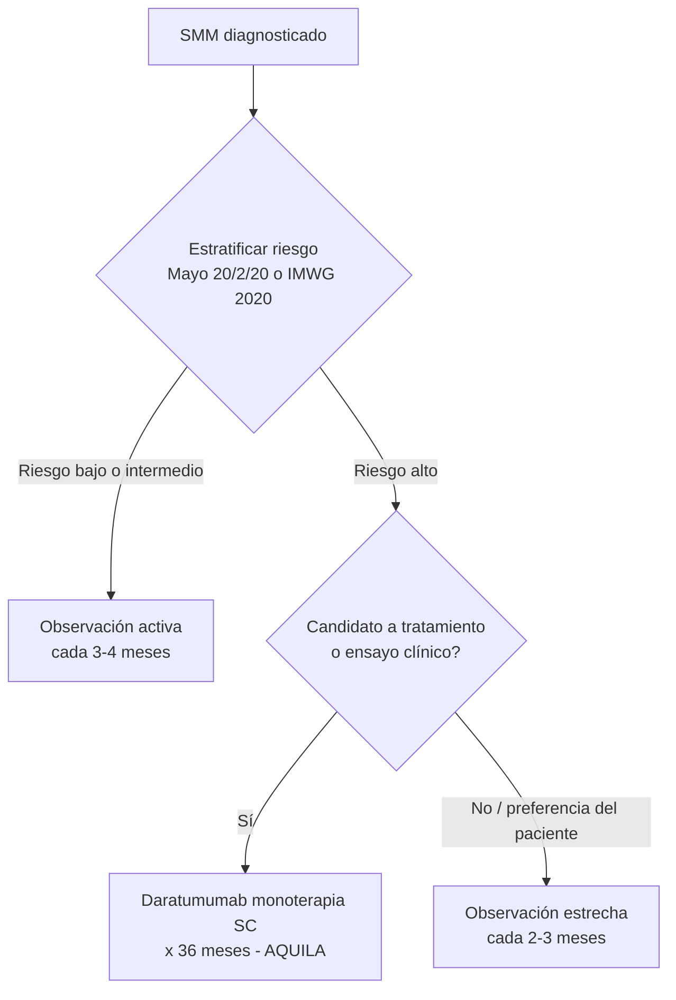
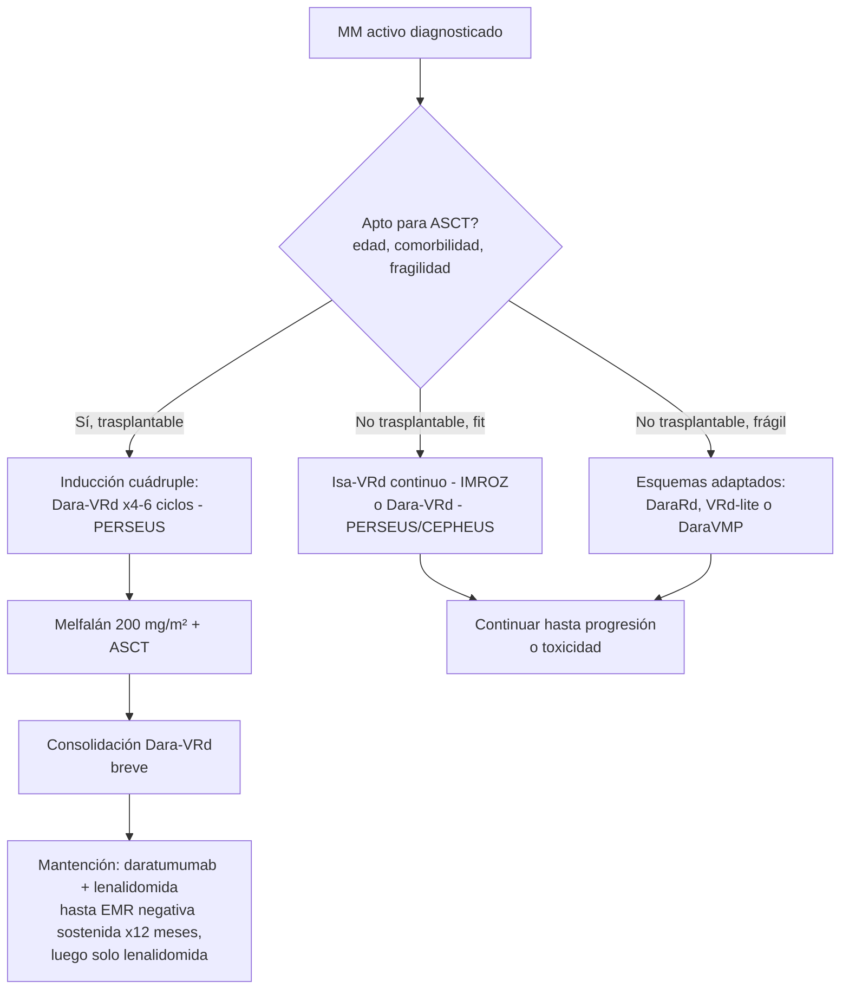
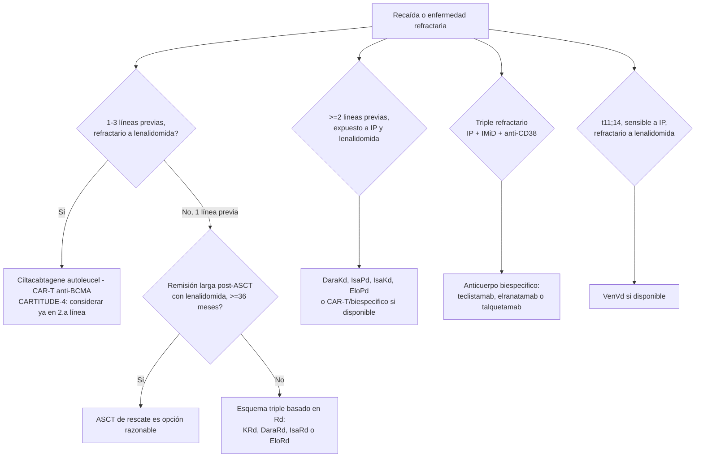
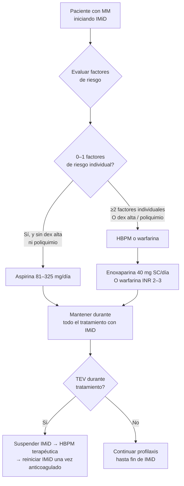

# Mieloma múltiple (MM) y gammapatías monoclonales

!!! info "Ficha de la página"
    **Última revisión:** 2026-11-14 · **Fuentes base:** guía EHA-ESMO 2021 [30] (texto completo leído, HemaSphere) para la estructura general del manejo, actualizada con ensayos pivotales 2023–2025 y criterios IMWG vigentes: PERSEUS [121], IMROZ [122], AQUILA [120], CARTITUDE-4 [124], anticuerpos biespecíficos [125]–[127], R2-ISS [123] y criterios diagnósticos IMWG 2014 [117]. Página ampliada para cubrir el **espectro completo de gammapatías monoclonales** (MGUS, SMM, MM, plasmocitoma). Las dosis exactas por ciclo y el soporte específico (enfermedad ósea, renal, infecciones) siguen **[PV]**; ver sección de Pendientes.

## 1. Resumen rápido

- Las gammapatías monoclonales forman un **espectro continuo**: MGUS → mieloma múltiple quiescente (SMM) → mieloma múltiple (MM) activo, con el plasmocitoma solitario como entidad aparte (clon localizado) [117] **[V-RS]**.
- MM es la **segunda neoplasia hematológica más frecuente** (1–1,8 % de los cánceres; incidencia europea 4,5–6,0/100.000/año) [30] **[V-TF]**.
- **Diagnóstico de MM:** ≥10 % células plasmáticas clonales en médula (o plasmocitoma confirmado por biopsia) **más** ≥1 evento CRAB o biomarcador SLiM [117] **[V-RS]**.
- **MGUS y SMM de riesgo estándar/bajo-intermedio: observar**, sin tratamiento [117,118] **[V-RS]**. **SMM de alto riesgo:** daratumumab monoterapia es ahora una opción validada (AQUILA) [120] **[V-RS]**.
- **Trasplantables (<70–75 años, sin comorbilidades mayores):** inducción cuádruple con anti-CD38 + VRd (**Dara-VRd**, PERSEUS) → melfalán 200 mg/m² + ASCT → mantención con daratumumab + lenalidomida (I, A) [121] **[V-RS]**.
- **No trasplantables aptos (fit):** cuádruplo con anti-CD38 + VRd (**Isa-VRd**, IMROZ; o Dara-VRd) es ahora el nuevo estándar, superando a los triplos clásicos (VRd, DaraRd) [122] **[V-RS]**.
- **Recaída temprana (1–3 líneas previas) refractaria a lenalidomida:** **CAR-T anti-BCMA (cilta-cel)** es superior a los esquemas estándar y se considera ya en 2.ª línea (CARTITUDE-4) [124] **[V-RS]**. Los **anticuerpos biespecíficos** (teclistamab, elranatamab, talquetamab) son el nuevo pilar en enfermedad triple-refractaria [125]–[127] **[V-RS]**.
- **Plasmocitoma solitario** (óseo o extramedular): radioterapia local sigue siendo el tratamiento preferido, pero el riesgo de progresión a MM difiere sustancialmente entre ambas formas (ver §12) **[V-RS]**.

## 2. Espectro de gammapatías monoclonales: clasificación general

Todas las gammapatías monoclonales derivan de un clon de células plasmáticas (o, en el caso de la gammapatía IgM, de un clon linfoplasmocítico). Es clínicamente útil clasificarlas por **tipo de inmunoglobulina** y **carga tumoral**, ya que ambos determinan el riesgo de progresión y el seguimiento [117,118] **[V-RS]**.

| Entidad | Proteína monoclonal | % células plasmáticas clonales en MO | CRAB / daño de órgano | Evolución típica |
|---|---|---|---|---|
| **MGUS no-IgM** (IgG o IgA) | <3 g/dL sérica | <10 % | Ausente | Precursora de MM (~80 % de los MM provienen de aquí) |
| **MGUS de cadena liviana** | FLC anormal, sin cadena pesada en inmunofijación | <10 %, proteinuria de Bence Jones <500 mg/24 h | Ausente | Precursora de mieloma de cadenas livianas |
| **MGUS IgM** | IgM <3 g/dL | Infiltración linfoplasmocítica <10 % | Ausente | Precursora de macroglobulinemia de Waldenström (rara vez MM) |
| **SMM (mieloma quiescente)** | ≥3 g/dL sérica (IgG/IgA) o ≥500 mg/24 h en orina, y/o 10–60 % células clonales en MO | 10–60 % | Ausente (y sin biomarcadores SLiM) | Riesgo de progresión a MM 10 %/año los primeros 5 años |
| **Mieloma múltiple** | Variable | ≥10 % (o plasmocitoma biopsiado) | Presente (CRAB) o biomarcador SLiM positivo | Enfermedad activa, requiere tratamiento |
| **Plasmocitoma solitario** | Ausente o mínima en suero | Médula ósea normal (<10 % clonal) | Ausente, lesión única confirmada por biopsia | ~1/3–2/3 progresan a MM según localización (ver §12) |

Otras entidades del espectro que **no** se desarrollan en profundidad en esta página (remitir a wiki específica si se crea): amiloidosis AL, enfermedad por depósito de cadenas livianas, síndrome POEMS, enfermedades de cadenas pesadas — todas comparten el origen en un clon de células plasmáticas pero tienen criterios diagnósticos y manejo propios [117] **[V-RS]**.

## 3. Gammapatía monoclonal de significado incierto (MGUS)

### 3.1 Definición y subtipos (IMWG 2014) [117] **[V-RS]**

| Subtipo | Criterios (deben cumplirse todos) |
|---|---|
| **MGUS no-IgM** | Proteína M sérica <3 g/dL · células plasmáticas clonales en MO <10 % · ausencia de CRAB o eventos definitorios de mieloma atribuibles |
| **MGUS de cadena liviana** | Razón de cadenas livianas libres (FLC) anormal (<0,26 o >1,65) · aumento de la cadena liviana implicada · sin expresión de cadena pesada en inmunofijación · proteinuria de Bence Jones <500 mg/24 h · sin CRAB |
| **MGUS IgM** | IgM monoclonal sérica <3 g/dL · infiltración linfoplasmocítica medular <10 % · sin anemia, síntomas constitucionales, hiperviscosidad, adenopatías ni hepatoesplenomegalia atribuibles |

### 3.2 Riesgo de progresión y estratificación

- Prevalencia: ~3–4 % en adultos ≥50 años; riesgo de progresión a MM u otra neoplasia de células plasmáticas de aproximadamente **1 % por año**, sin meseta a lo largo del seguimiento [118] **[V-RS]**.
- Modelo de riesgo de Mayo Clinic (factores de riesgo independientes): **proteína M ≥15 g/L**, **isotipo no-IgG**, y **razón de FLC anormal**. La presencia de 0, 1, 2 o 3 factores define riesgo bajo, bajo-intermedio, alto-intermedio y alto, respectivamente **[PV]** (modelo original de Mayo Clinic; cifras exactas de riesgo a 20 años pendientes de verificación directa en esta revisión).
- La **MGUS de cadena liviana** tiene un riesgo de progresión menor que la MGUS convencional (aproximadamente 0,3 % por año) [118] **[V-RS]**.

### 3.3 Seguimiento

- MGUS de bajo riesgo: control clínico y de laboratorio (hemograma, calcio, creatinina, proteína M) cada 6–12 meses; no se requiere biopsia de médula ósea de rutina salvo progresión clínica o de laboratorio [118] **[V-RS]**.
- MGUS de alto riesgo (2–3 factores): seguimiento más estrecho (cada 6 meses) y considerar estudio basal más completo (médula ósea, imagen) **[PV]**.
- No existe tratamiento indicado para MGUS en ningún escenario [118] **[V-RS]**.

## 4. Mieloma múltiple quiescente (smoldering, SMM)

### 4.1 Definición (IMWG 2014) [117] **[V-RS]**

Ambos criterios deben cumplirse:

- Proteína M sérica (IgG o IgA) ≥3 g/dL, y/o proteína M urinaria ≥500 mg/24 h, y/o células plasmáticas clonales en médula ósea 10–60 %.
- Ausencia de eventos definitorios de mieloma (CRAB o biomarcadores SLiM; ver §5).

### 4.2 Estratificación de riesgo

El manejo del SMM depende enteramente de su riesgo de progresión a MM activo, que varía mucho entre pacientes:

- **Modelo Mayo "20/2/20"** (3 factores: células plasmáticas clonales en MO >20 %, proteína M sérica >2 g/dL, razón de FLC >20): 0 factores = riesgo bajo, 1 factor = riesgo intermedio, 2–3 factores = riesgo alto, con tasas de progresión a 2 años crecientes según el número de factores presentes **[PV]** (modelo de Lakshman et al.; cifras exactas pendientes de verificación directa).
- **Modelo de riesgo IMWG 2020** (Mateos et al.): incorpora además alteraciones citogenéticas de alto riesgo por FISH (t(4;14), del17p, amp1q) y permite una estratificación más precisa, en particular para identificar el subgrupo de **"alto riesgo"** candidato a intervención temprana **[PV]** (cifras y ponderación exacta pendientes de verificación directa en esta revisión).
- El SMM de **alto riesgo** tiene una probabilidad de progresión a MM activo de hasta ~50 % a 2 años en algunas cohortes, lo que justifica la intervención temprana en este subgrupo [120] **[V-RS]**.

### 4.3 Manejo

- **Riesgo bajo/intermedio:** observación sin tratamiento; no hay evidencia de que iniciar terapia temprana mejore desenlaces en este subgrupo [120] **[V-RS]**.
- **Riesgo alto:** el ensayo **AQUILA** (fase 3, 390 pacientes) comparó **daratumumab subcutáneo en monoterapia durante 36 meses** frente a observación activa en SMM de alto riesgo. A 5 años, la SLP fue **63,1 % vs 40,8 %** y la SG **93,0 % vs 86,9 %**, con descontinuación por eventos adversos en solo 5,7 % del grupo daratumumab [120] **[V-RS]**. Este es el **primer tratamiento con beneficio demostrado en SMM**, aunque los autores señalan que los criterios de SMM han evolucionado desde el diseño del ensayo y varían entre estudios, lo que exige cautela al extrapolar [120] **[V-RS]**.
- No existe un estándar único sobre qué definición de "alto riesgo" usar en la práctica clínica (Mayo 20/2/20 vs IMWG 2020); la decisión de tratar debe individualizarse y, cuando sea posible, discutirse en el contexto de un centro con experiencia en mieloma **[PV]**.

## 5. Criterios diagnósticos de mieloma múltiple (IMWG 2014, SLiM-CRAB) [117] **[V-RS]**

El diagnóstico de MM requiere **ambos** criterios:

1. **Células plasmáticas clonales en médula ósea ≥10 %**, o plasmocitoma confirmado por biopsia.
2. **Al menos uno** de los siguientes eventos definitorios de mieloma:

**Criterios CRAB (daño de órgano establecido):**

| Sigla | Criterio |
|---|---|
| **C**alcio | Calcio sérico >0,25 mmol/L (>1 mg/dL) por encima del límite normal, o >2,75 mmol/L (>11 mg/dL) |
| **R**enal | Depuración de creatinina <40 mL/min, o creatinina sérica >177 µmol/L (>2 mg/dL) |
| **A**nemia | Hemoglobina >2 g/dL por debajo del límite normal, o <10 g/dL |
| **B**one (hueso) | ≥1 lesión osteolítica en radiografía, TC de cuerpo entero baja dosis o PET-CT |

**Biomarcadores SLiM (enfermedad activa sin daño de órgano aún manifiesto, "myeloma-defining events"):**

| Sigla | Criterio |
|---|---|
| **S**esenta | Células plasmáticas clonales en médula ósea ≥60 % |
| **Li**ght chain | Razón de cadenas livianas libres implicada:no implicada ≥100 (con la cadena implicada ≥100 mg/L) |
| **M**RI | >1 lesión focal ≥5 mm en resonancia magnética |

La introducción de los biomarcadores SLiM en 2014 permitió diagnosticar y tratar precozmente a pacientes que antes se clasificaban como SMM de "riesgo ultra-alto" pero que en la práctica evolucionan de forma indistinguible del MM activo, evitando el daño de órgano irreversible [117] **[V-RS]**.

## 6. Estadificación pronóstica: ISS, R-ISS y R2-ISS

| Sistema | Variables | Comentario |
|---|---|---|
| **ISS** (2005) | Albúmina y β2-microglobulina séricas | Sistema original, 3 estadios; no incorpora citogenética **[PV]** |
| **R-ISS** (2015) | ISS + LDH + citogenética de alto riesgo por FISH (del17p, t(4;14), t(14;16)) | Incorporó el valor pronóstico de la citogenética y LDH **[PV]** |
| **R2-ISS** (2022) | R-ISS + **ganancia/amplificación de 1q** (≥3 copias), con sistema de puntos aditivo | Mejora la discriminación pronóstica, especialmente en el grupo de riesgo intermedio del R-ISS, que es heterogéneo [123] **[V-RS]** |

El **R2-ISS** (D'Agostino et al., European Myeloma Network/HARMONY, 10.843 pacientes) define 4 grupos de riesgo aditivos (bajo, bajo-intermedio, intermedio-alto, alto) según puntos otorgados por estadio ISS, LDH elevada, del17p, t(4;14) y ganancia/amplificación de 1q. La SG mediana fue: grupo I no alcanzada, grupo II 109,2 meses, grupo III 68,5 meses, grupo IV 37,9 meses [123] **[V-RS]**. Es hoy el sistema de estadificación recomendado para la práctica clínica y la estratificación en ensayos clínicos, aunque el ISS/R-ISS siguen usándose ampliamente por su simplicidad **[PV]**.

## 7. Estudio inicial y seguimiento del MM activo

| Estudio | Diagnóstico | Respuesta | Seguimiento | Recaída |
|---|---|---|---|---|
| Hemograma y frotis | Obligatorio | Obligatorio | Obligatorio | Obligatorio |
| Electroforesis e inmunofijación sérica | Obligatorio | Obligatorio | Obligatorio | Obligatorio |
| Cadenas livianas libres séricas | Obligatorio | Para confirmar RC estricta | Obligatorio | Obligatorio |
| Inmunoglobulinas, función renal/hepática, calcio, LDH | Obligatorio | Obligatorio | Obligatorio | Obligatorio |
| Albúmina y β2-microglobulina | Obligatorio | No requerido | Opcional | Obligatorio |
| Orina de 24 h (proteinuria, cadenas livianas) y electroforesis/inmunofijación | Obligatorio | Obligatorio | Obligatorio | Obligatorio |
| Aspirado/biopsia de médula ósea | Obligatorio | Para confirmar RC o MM no secretor | No requerido | Opcional (obligatorio si no secretor) |
| NGF o NGS (EMR) | Obligatorio | Para EMR negativa en RC | Cada 12 meses si RC/EMR negativa | Opcional |
| Citogenética: cariotipo y FISH (del17p, t(4;14), t(14;16), amp/ganancia 1q, t(11;14)) | Obligatorio | No requerido | No requerido | Obligatorio para del17p, 1q, t(11;14) |
| TC de cuerpo entero baja dosis (WBLD-CT) | Obligatorio | No requerido | Si hay síntomas | Obligatorio |
| PET-CT | Opcional | Para EMR por imagen | Cada 12 meses si EMR en médula negativa | Opcional |
| RM de cuerpo entero | Obligatoria si WBLD-CT negativa y sin PET-CT | No requerido | Si hay síntomas | Opcional |

Fuente: [30] **[V-TF]**. Seguimiento: hemograma, electroforesis sérica y urinaria, cadenas livianas, creatinina y calcio **mensual o al menos cada 3 meses**; FISH para del17p y 1q en recaídas sin esas lesiones al diagnóstico [30] **[V-TF]**.

**Respuesta:** EMR negativa en médula (<1 célula plasmática clonal por 10⁶ células) predice mejor SLP y SG; el PET-CT es el mejor método de EMR por imagen hasta ahora [30] **[V-TF]**.

## 8. Algoritmo de primera línea (2026)

- **Transplant-eligible:** el ensayo **PERSEUS** (709 pacientes) comparó Dara-VRd (inducción + consolidación + mantención con daratumumab-lenalidomida) frente a VRd + mantención con lenalidomida sola. La tasa de RC fue **87,9 % vs 70,1 %**, la negatividad de EMR sostenida ≥12 meses **64,8 % vs 29,7 %**, y la SLP mostró un beneficio sin precedentes (HR 0,42). El 64 % de los pacientes en mantención con Dara-R discontinuaron el daratumumab tras alcanzar EMR negativa sostenida según protocolo [121] **[V-RS]**. Este esquema es ya el **nuevo estándar de cuidado** para pacientes trasplantables.
- **Transplant-ineligible fit:** el ensayo **IMROZ** (446 pacientes, edad mediana 72 años) comparó Isa-VRd frente a VRd en pacientes no candidatos a trasplante. La SLP a 60 meses fue **63,2 % vs 45,2 %**, con una reducción del riesgo de progresión o muerte del 40 % [122] **[V-RS]**. El ensayo **CEPHEUS** (daratumumab + VRd en no trasplantables o con trasplante diferido) mostró resultados consistentes **[PV]**. Ambos cuádruplos (Isa-VRd, Dara-VRd) son ahora el estándar preferido en pacientes no trasplantables **fit**, reemplazando a los triplos VRd/DaraRd de la guía 2021.
- **No trasplantables frágiles:** los esquemas adaptados (DaraRd, VRd-lite, DaraVMP) siguen siendo razonables; la evaluación de fragilidad (escala IMWG) debe guiar la elección del esquema e intensidad de dosis [30] **[V-TF]**, **[PV]** para el detalle de ajustes de dosis.
- Las guías NCCN (versión 2.2026) recomiendan de forma convergente los cuádruplos basados en anti-CD38 como terapia inicial preferida tanto en trasplantables como en no trasplantables fit, con derivación precoz a un centro de trasplante incluso si este se diferirá [128] **[V-RS]**.

## 9. Primera línea: evidencia clave

| Escenario | Datos principales | Fuente |
|---|---|---|
| **Dara-VRd vs VRd** (trasplantables, PERSEUS) | RC 87,9 % vs 70,1 %; EMR negativa sostenida ≥12m: 64,8 % vs 29,7 %; HR SLP 0,42 | [121] **[V-RS]** |
| **Isa-VRd vs VRd** (no trasplantables, IMROZ) | SLP a 60 meses 63,2 % vs 45,2 %; reducción de riesgo 40 % | [122] **[V-RS]** |
| ASCT frente a no ASCT (IFM, VRd) | SLP mediana 50 vs 36 meses (p<0,001); SG a 4 años sin diferencia | [30] **[V-TF]** |
| ASCT frente a VMP (EMN02/HO95) | SLP mediana 56,7 vs 41,9 meses (p=0,0001) | [30] **[V-TF]** |
| DaraVTD vs VTD (CASSIOPEIA) | SLP a 18 meses 93 % vs 85 % (p<0,0001) | [30] **[V-TF]** |
| Mantención con lenalidomida post-ASCT (metaanálisis) | SLP 52,8 vs 23,5 meses; beneficio de SG de 2,5 años | [30] **[V-TF]** |
| VRd vs Rd (no ASCT) | SLP mediana 41 vs 29 meses; SG mediana no alcanzada vs 69 meses | [30] **[V-TF]** |
| DaraVMP vs VMP (ALCYONE) | SLP mediana 36,4 vs 19,3 meses; SG a 36 meses 78 % vs 68 % (HR 0,60) | [30] **[V-TF]** |
| DaraRd vs Rd (MAIA) | SLP a 30 meses 70,6 % vs 55,6 % (HR 0,56) | [30] **[V-TF]** |

Consideraciones: melfalán 200 mg/m² sigue siendo el acondicionamiento estándar para ASCT; con los cuádruplos actuales, el rol del ASCT en primera remisión frente a su diferimiento está en debate activo, y el ASCT tándem/alo-TPH quedan reservados a casos de muy alto riesgo **[PV]**. Un tercio de los pacientes supera los 75 años al diagnóstico y ≥30 % son frágiles: el manejo específico de dosis en este grupo permanece **[PV]**.

## 10. Recaída o refractariedad

- **CAR-T anti-BCMA en 2.ª línea (CARTITUDE-4):** en pacientes refractarios a lenalidomida con 1–3 líneas previas, cilta-cel mostró SLP mediana no alcanzada vs 11,8 meses con el estándar (PVd/DPd) (HR 0,26), y posteriormente demostró también **beneficio de supervivencia global** (análisis de seguimiento 2024). Esto ha desplazado el uso de CAR-T de líneas tardías a la segunda línea en pacientes seleccionados [124] **[V-RS]**.
- **Anticuerpos biespecíficos BCMA×CD3:** **teclistamab** (MajesTEC-1) mostró actividad sustancial en mieloma triple-expuesto/refractario [125] **[V-RS]**. **Elranatamab** (MagnetisMM-3) mostró eficacia y seguridad comparables, con un esquema de step-up priming similar [126] **[V-RS]**. **Talquetamab** (MonumenTAL-1), dirigido contra GPRC5D en lugar de BCMA, ofrece una alternativa con un perfil de toxicidad distinto (más eventos cutáneos/orales, menos citopenias) y es útil en pacientes previamente expuestos a terapia anti-BCMA **[PV]** (cita exacta de la publicación pivotal pendiente de verificación directa).
- Las combinaciones de esquemas más antiguos (PomVd, DaraKd/CANDOR, IsaKd, IsaPd, SVd, KRd, EloRd) y venetoclax en t(11;14) (BELLINI) siguen siendo relevantes, especialmente donde CAR-T o biespecíficos no están disponibles [30] **[V-TF]**.
- La secuencia óptima entre CAR-T, biespecíficos y esquemas quimioinmunoterápicos clásicos continúa evolucionando rápidamente; la disponibilidad local (manufactura de CAR-T, programas de acceso a biespecíficos) es con frecuencia el factor limitante en la práctica **[PV]**.

## 11. Formas especiales

**Leucemia de células plasmáticas primaria:** ≥20 % o >2×10⁹/l de células plasmáticas circulantes; SG mediana ~1 año; tratamiento inmediato con bortezomib y/o lenalidomida, idealmente inducción + doble ASCT + consolidación + mantención (II, B); alo-TPH en casos seleccionados (III, C) [30] **[V-TF]**. El rol de CAR-T y biespecíficos en esta forma agresiva está en investigación activa **[PV]**.

## 12. Plasmocitoma solitario (óseo y extramedular)

El plasmocitoma solitario es una proliferación clonal **localizada** de células plasmáticas, sin evidencia de mieloma sistémico. Se distinguen dos formas con comportamiento biológico diferente:

### 12.1 Criterios diagnósticos

- Biopsia que confirma un tumor único de células plasmáticas clonales (óseo o en tejido blando).
- Médula ósea normal: **<10 %** de células plasmáticas clonales en el aspirado/biopsia realizada en un sitio distinto de la lesión.
- Ausencia de CRAB u otros eventos definitorios de mieloma atribuibles.
- Estudio de imagen de cuerpo entero (RM o PET-CT) **negativo** para lesiones adicionales — paso obligatorio para excluir MM oculto [117] **[V-RS]**.

### 12.2 Plasmocitoma óseo solitario (SBP) vs. extramedular (EMP)

| Característica | Plasmocitoma óseo solitario (SBP) | Plasmocitoma extramedular (EMP) |
|---|---|---|
| Localización | Hueso (columna, pelvis, costillas) | Tejidos blandos (vías respiratorias altas, tracto GI, piel) |
| Frecuencia relativa | Más frecuente | Menos frecuente |
| Riesgo de progresión a MM a 10 años | **Más alto** (frecuentemente citado en el rango de 50–60 %) | **Más bajo** (del orden de 15–30 %) |
| Factores de riesgo de progresión | Proteína M persistente tras RT, razón de FLC anormal, lesiones ocultas en RM/PET-CT | Menos caracterizados; tamaño tumoral, localización |

**[PV]** — las cifras de progresión varían ampliamente entre series y dependen de los criterios de imagen usados para excluir enfermedad oculta (RM de cuerpo entero/PET-CT vs radiografía convencional en series antiguas); se recomienda verificación directa de la fuente antes de citar cifras exactas a residentes.

### 12.3 Tratamiento

- **Radioterapia local** (habitualmente en el rango de 40–50 Gy) es el tratamiento de elección tanto para SBP como para EMP, con tasas altas de control local **[PV]** (dosis exacta por fraccionamiento pendiente de verificación directa).
- **Cirugía:** puede considerarse en EMP accesible, especialmente si hay compromiso de la vía aérea o compresión de estructuras vecinas, habitualmente seguida de RT **[PV]**.
- **Terapia sistémica:** no está indicada de forma rutinaria; se reserva para lesiones de gran tamaño, compromiso sintomático que amenaza estructuras críticas, o cuando existe sospecha fundada de enfermedad sistémica oculta pese a estudios negativos **[PV]**.
- **Seguimiento:** control clínico y de laboratorio (proteína M, cadenas livianas) cada 3–6 meses durante los primeros años, dado el riesgo de progresión a MM, con reimagen si hay signos de recaída o progresión bioquímica **[PV]**.

## 13. Tromboprofilaxis en pacientes con IMiDs

Los inmunomoduladores (lenalidomida, talidomida, pomalidomida) **aumentan significativamente** el riesgo tromboembólico venoso, sobre todo cuando se combinan con dexametasona a dosis altas o quimioterapia. Las recomendaciones del **IMWG (Palumbo et al. 2008)** [31] **[V-RS]** establecen un enfoque basado en factores de riesgo.

### 13.1 Factores de riesgo

| Categoría | Factores |
|---|---|
| **Individuales** | Edad avanzada, antecedente de TEV, catéter venoso central, comorbilidades (infecciones, diabetes, cardiopatía, inmovilización, cirugía), trombofilia hereditaria, obesidad |
| **Relacionados con el mieloma** | Diagnóstico reciente (primeros 3–6 meses), hiperviscosidad, compresión medular |
| **Relacionados con el tratamiento** | Dexametasona a dosis altas (≥480 mg/mes), doxorrubicina, poliquimioterapia combinada con IMiDs |

### 13.2 Algoritmo de tromboprofilaxis

### 13.3 Dosis y duración

| Estrategia | Dosis | Indicación |
|---|---|---|
| **Aspirina** | 81–325 mg/día vía oral | 0–1 factores de riesgo, sin dexametasona alta ni poliquimioterapia |
| **Enoxaparina** | 40 mg SC cada 24 h | ≥2 factores de riesgo, o dexametasona alta, o poliquimioterapia |
| **Warfarina** | Dosis ajustada a INR 2–3 | Alternativa a HBPM en pacientes con ≥2 factores de riesgo |

- **Duración:** durante toda la duración del tratamiento con IMiD [31] **[V-RS]**.
- **Lenalidomida en monoterapia** (sin dexametasona alta ni otro agente): el riesgo trombótico es bajo; la profilaxis puede no ser necesaria según IMWG, aunque las guías NCCN recomiendan al menos aspirina **[PV]**.
- **Pomalidomida:** las guías NCCN recomiendan tromboprofilaxis para todos los pacientes tratados con pomalidomida **[PV]**.
- **Alto riesgo acumulativo** (actualización IMWG 2014): HBPM o warfarina durante 4–6 meses, luego considerar cambio a aspirina **[PV]**.

### 13.4 Manejo de TEV durante tratamiento con IMiD

1. **Suspender** el IMiD temporalmente.
2. Iniciar **anticoagulación terapéutica** (HBPM preferida inicialmente).
3. **Reiniciar** el IMiD una vez que el paciente esté completamente anticoagulado y estable.
4. Mantener anticoagulación mientras continúe el IMiD.

## 14. Puntos clave para residentes e internos

1. Pensar en el **espectro completo**: MGUS → SMM → MM activo; el diagnóstico diferencial entre SMM y MM activo depende de los criterios SLiM-CRAB, no solo del porcentaje de células plasmáticas.
2. Todo MM sospechado: **electroforesis + inmunofijación + cadenas livianas + función renal + calcio + imagen de cuerpo entero**.
3. **Médula ósea con citometría/NGS y FISH** (del17p, t(4;14), t(14;16), 1q, t(11;14)) antes de tratar; usar **R2-ISS** para estadificación pronóstica.
4. **Trasplantables:** inducción cuádruple con anti-CD38 + VRd (Dara-VRd) → ASCT → mantención con daratumumab + lenalidomida.
5. **No trasplantables fit:** cuádruplo con anti-CD38 + VRd (Isa-VRd o Dara-VRd) ya es el estándar, no solo triplos.
6. **SMM de alto riesgo:** considerar daratumumab monoterapia (AQUILA) en lugar de observación exclusiva, tras discusión informada con el paciente.
7. **Recaída refractaria a lenalidomida con pocas líneas previas:** pensar en CAR-T (cilta-cel) de forma temprana, no reservarlo para líneas tardías.
8. **Triple refractario:** los anticuerpos biespecíficos (teclistamab, elranatamab, talquetamab) son hoy una opción estándar, no experimental.
9. **Plasmocitoma solitario:** siempre excluir mieloma sistémico oculto con imagen de cuerpo entero antes de tratar solo con RT local; el riesgo de progresión a MM es mayor en la forma ósea que en la extramedular.
10. **Tromboprofilaxis obligatoria** en todo paciente con IMiD: aspirina si bajo riesgo, HBPM/warfarina si ≥2 factores de riesgo o dexametasona alta.

## 15. Referencias de esta página

- **[30]** Dimopoulos MA et al., EHA-ESMO 2021 (ver [lista](../referencias.md)).
- **[31]** Palumbo A et al., IMWG 2008: tromboprofilaxis en mieloma (ver [lista](../referencias.md)).
- **[117]–[128]** Criterios diagnósticos IMWG, modelos de riesgo de MGUS/SMM, y ensayos pivotales 2022–2025 (PERSEUS, IMROZ, AQUILA, CARTITUDE-4, biespecíficos, R2-ISS, NCCN 2025) — ver [lista completa de referencias](../referencias.md).

## 16. Pendientes

- [ ] Dosis y esquemas exactos por ciclo (Dara-VRd, Isa-VRd, DaraVTD, DaraRd) **[PV]**.
- [ ] Soporte: enfermedad ósea (bifosfonatos/denosumab), infecciones, vacunas, insuficiencia renal **[PV]**.
- [ ] Modelo de riesgo IMWG 2020 para SMM: detalle completo de ponderación y validación **[PV]**.
- [ ] Cita pivotal exacta de talquetamab (MonumenTAL-1) en publicación de revista — verificar DOI/PMID directamente **[PV]**.
- [ ] Secuenciación óptima CAR-T vs. biespecíficos vs. esquemas clásicos en recaída — evidencia en evolución activa **[PV]**.
- [ ] Amiloidosis AL, síndrome POEMS y enfermedades de cadenas pesadas — posible página transversal separada (no desarrollados aquí).
- [ ] Cobertura GES/PAD en Chile **[PV]**.
