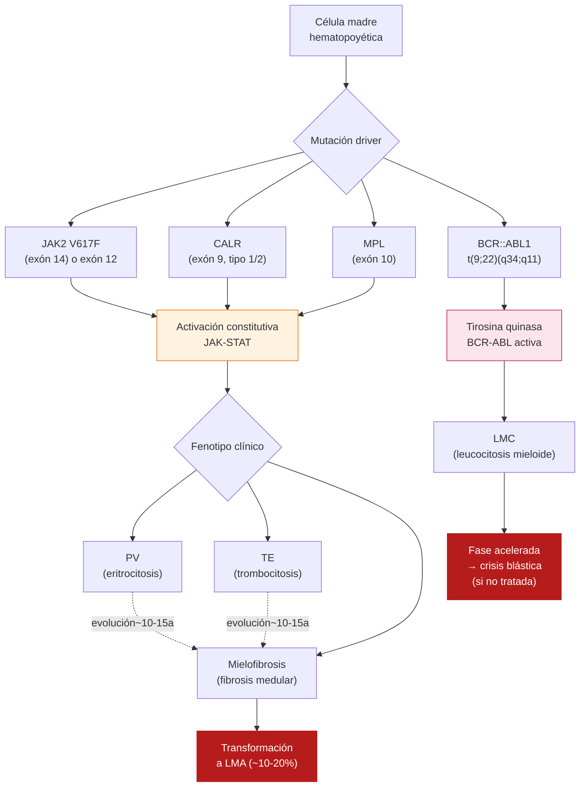
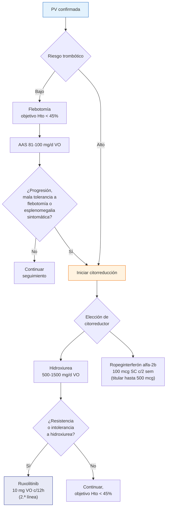
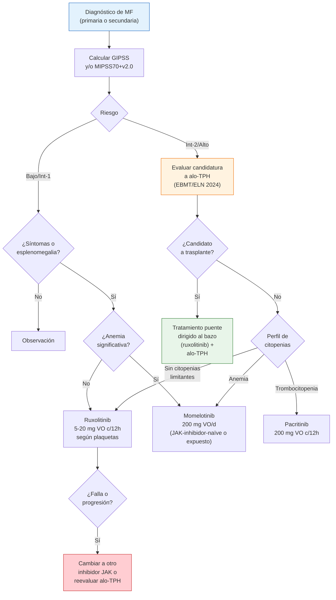
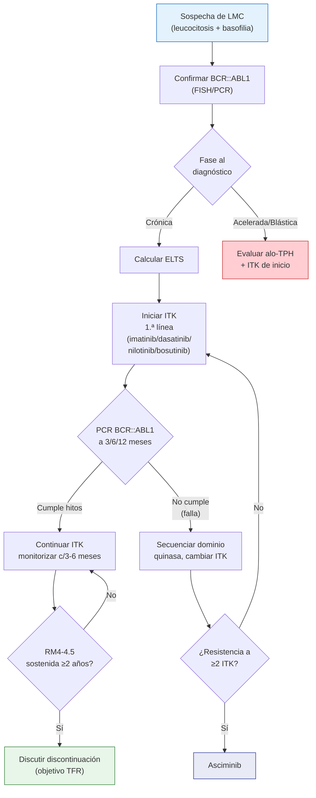

# Neoplasias mieloproliferativas clásicas BCR::ABL1-negativas y LMC

!!! info "Ficha de la página"
    **Última revisión:** 2026-11-20 · **Fuente base:** OMS 2022 [59], ICC 2022 [60], ELN CML 2025 [153] y 2020 [105], MIPSS70+v2.0/GIPSS (Tefferi) [142][143], EBMT/ELN alo-TPH en MF 2024 [150] · **Alcance:** adultos ≥ 18 años. Policitemia vera (PV), trombocitemia esencial (ET), mielofibrosis (primaria y secundaria post-PV/post-ET) y leucemia mieloide crónica (LMC).

---

## 1. Resumen rápido

1. Las **neoplasias mieloproliferativas (NMP) clásicas** son PV, TE, mielofibrosis (MF) y LMC. Las tres primeras son **BCR::ABL1-negativas** y comparten activación constitutiva de la vía **JAK-STAT**; la LMC es **BCR::ABL1-positiva** y se trata de forma completamente distinta (inhibidores de tirosina quinasa, ITK) [V-RS] [59][60].
2. El diagnóstico de PV/TE/MF se apoya en la **mutación driver** (*JAK2* V617F/exón 12, *CALR*, *MPL*) presente en > 90 % de los casos, pero el diagnóstico sigue siendo **morfológico** (biopsia de médula ósea) según OMS/ICC 2022 [V-RS] [59][60].
3. **PV**: manejo por riesgo trombótico (edad ≥ 60 años o trombosis previa = alto riesgo); flebotomía + AAS en bajo riesgo, citorreducción (hidroxiurea o ropeginterferón alfa-2b) en alto riesgo, con objetivo de **hematocrito < 45 %** [V-RS] [96].
4. **TE**: estratificación con **IPSET-trombosis** (edad, leucocitosis, trombosis previa, *JAK2*); AAS sola en muy bajo/bajo riesgo, citorreducción (hidroxiurea o anagrelida) en riesgo alto [V-RS] [140][141].
5. **Mielofibrosis**: los inhibidores de JAK (**ruxolitinib**, **fedratinib**, **pacritinib**, **momelotinib**) controlan esplenomegalia y síntomas pero no son curativos; el **alo-TPH** sigue siendo la única opción curativa en riesgo alto, según **MIPSS70+v2.0** o **GIPSS** [V-RS] [142][143][150].
6. **LMC**: el diagnóstico exige confirmar **BCR::ABL1** (FISH o PCR); el tratamiento de primera línea son los **ITK** (imatinib, dasatinib, nilotinib, bosutinib), con monitorización molecular cuantitativa y objetivo de **remisión libre de tratamiento (TFR)** en respondedores profundos y sostenidos [V-RS] [105][153].

---

## 2. Definición y clasificación

### 2.1 Qué agrupa esta página

| Entidad | Mutación driver típica | Fenotipo dominante | Clasificación OMS/ICC 2022 |
|---|---|---|---|
| **Policitemia vera (PV)** | *JAK2* V617F (~95 %) o exón 12 (~3-4 %) | Eritrocitosis | NMP clásica |
| **Trombocitemia esencial (TE)** | *JAK2* (~55-60 %), *CALR* (~25-30 %), *MPL* (~3-5 %), triple negativa (~10-15 %) | Trombocitosis | NMP clásica |
| **Mielofibrosis primaria (MFP)** | *JAK2*, *CALR*, *MPL* (90 % tienen alguna) | Fibrosis medular, citopenias/esplenomegalia | NMP clásica |
| **Mielofibrosis secundaria** (post-PV, post-TE) | La del clon original | Evolución de PV o TE (~10-20 % a 10-15 años) | NMP clásica (categoría aparte) |
| **Leucemia mieloide crónica (LMC)** | **BCR::ABL1** (t(9;22), cromosoma Filadelfia) | Leucocitosis mieloide | NMP clásica, pero **BCR::ABL1-positiva** |

!!! warning "Por qué la LMC se trata distinto"
    A diferencia de PV/TE/MF, la LMC tiene un **blanco molecular único y específico** (la proteína de fusión BCR::ABL1, una tirosina quinasa constitutivamente activa). Esto permite tratamiento dirigido con ITK desde el diagnóstico, con tasas de respuesta y supervivencia muy superiores a las NMP BCR::ABL1-negativas [V-RS] [105].

### 2.2 Cambios relevantes OMS 2022 / ICC 2022

- Ambas clasificaciones (OMS 5.ª edición [59] e ICC [60]) mantienen las **4 entidades clásicas** de NMP, pero refinan los criterios diagnósticos moleculares y los umbrales de fibrosis en MF.
- La **mielofibrosis prefibrótica** (antes considerada una fase temprana de MFP, con histología que puede confundirse con TE) se mantiene como categoría diagnóstica distinta en ambos sistemas [V-RS] [59][60].
- La LMC se reclasifica formalmente como enfermedad **bifásica** en la actualización ELN 2025, reconociendo que el antiguo esquema de 3 fases (crónica/acelerada/blástica) simplifica una biología más continua [V-RS] [153].

---

## 3. Fisiopatología

### Mutaciones driver y riesgo de trombosis

| Mutación | Frecuencia relativa | Asociación clínica |
|---|---|---|
| *JAK2* V617F | PV ~95 %, TE ~55-60 %, MFP ~55-65 % | Mayor riesgo de trombosis que *CALR*/*MPL*, independiente de otros factores [V-RS] [141] |
| *JAK2* exón 12 | PV ~3-4 % | Fenotipo de PV con eritrocitosis más aislada (menos leucocitosis/trombocitosis) |
| *CALR* (tipo 1/2) | TE ~25-30 %, MFP ~20-25 % | Menor riesgo trombótico que *JAK2*; en MFP, pronóstico algo más favorable si es la única mutación de alto riesgo |
| *MPL* | TE ~3-5 %, MFP ~5-10 % | Fenotipo intermedio |
| Triple negativa (sin driver detectable) | TE ~10-15 %, MFP ~10 % | Requiere excluir causas reactivas con más cuidado; en MFP, peor pronóstico relativo |
| **BCR::ABL1** | LMC (por definición, 100 %) | Mutación fundadora única; blanco terapéutico directo de los ITK |

---

## 4. Policitemia vera (PV)

### 4.1 Diagnóstico (criterios OMS 2022 / ICC 2022) [59][60]

| Criterio mayor | Detalle |
|---|---|
| 1 | Hemoglobina > 16,5 g/dL (hombres) / > 16,0 g/dL (mujeres), o hematocrito > 49 % (hombres) / > 48 % (mujeres), o masa eritrocitaria elevada |
| 2 | Biopsia de médula ósea: hipercelularidad para la edad con panmielosis (eritroide, granulocítica y megacariocítica), con megacariocitos maduros pleomórficos |
| 3 | Presencia de mutación *JAK2* V617F o en exón 12 |

| Criterio menor | Detalle |
|---|---|
| 1 | Eritropoyetina sérica subnormal |

**Diagnóstico:** los 3 criterios mayores, o los 2 primeros criterios mayores + el criterio menor. La biopsia de médula ósea (criterio 2) puede omitirse si Hb/Hto son muy elevados (> 18,5/18,0 g/dL o > 55,5/49,5 %) y se cumplen los criterios 1 y 3 además del menor, aunque se recomienda realizarla para detectar fibrosis temprana [V-RS] [59][60].

### 4.2 Estratificación de riesgo trombótico en PV

| Grupo de riesgo | Criterios |
|---|---|
| **Bajo riesgo** | Edad < 60 años **y** sin trombosis previa |
| **Alto riesgo** | Edad ≥ 60 años **o** trombosis previa (arterial o venosa) |

!!! note "Factores adicionales considerados en la práctica"
    Aunque el modelo clásico de 2 niveles usa solo edad y trombosis previa, leucocitosis marcada, trombocitosis extrema y alta carga alélica de *JAK2* V617F se asocian a mayor riesgo trombótico y pueden influir la decisión de citorreducción en casos límite [V-RS] [141].

### 4.3 Tratamiento de PV

### 4.4 Fármacos y dosis en PV

| Fármaco | Dosis | Indicación | Notas | Verificación |
|---|---|---|---|---|
| **Flebotomía** | 250-500 mL c/1-2 sem hasta Hto < 45 %, luego según necesidad | Todos los pacientes | Base del tratamiento en todo nivel de riesgo; objetivo validado por reducir eventos cardiovasculares | [V-RS] [96] |
| **Ácido acetilsalicílico (AAS)** | 81-100 mg/d VO | Todos los pacientes sin contraindicación | Reduce trombosis; se mantiene junto con citorreducción | [V-RS] [96] |
| **Hidroxiurea** | 500-1500 mg/d VO, ajustar por hemograma | Citorreducción de primera línea en alto riesgo | Mielosupresión, úlceras mucocutáneas con uso prolongado | [V-RS] [96] |
| **Ropeginterferón alfa-2b** | 100 mcg SC c/2 semanas, titulación hasta 500 mcg | Citorreducción de primera o segunda línea, especialmente en pacientes jóvenes | Basado en PROUD-PV/CONTINUATION-PV; puede reducir carga alélica de *JAK2* V617F a largo plazo | [V-RS] [152] |
| **Ruxolitinib** | 10 mg VO c/12 h (ajustar según hemograma) | Segunda línea tras resistencia/intolerancia a hidroxiurea | RESPONSE: control de hematocrito + reducción esplénica sostenidos a 5 años en ~74 % de respondedores iniciales | [V-RS] [151] |

---

## 5. Trombocitemia esencial (TE)

### 5.1 Diagnóstico (criterios OMS 2022 / ICC 2022) [59][60]

| Criterio mayor | Detalle |
|---|---|
| 1 | Plaquetas ≥ 450 × 10⁹/L |
| 2 | Biopsia de médula ósea: proliferación de la línea megacariocítica con megacariocitos grandes y maduros; sin aumento significativo ni izquierdización de la granulopoyesis o eritropoyesis neutrofílica; fibrosis reticulínica muy rara (grado 1 como máximo) |
| 3 | No cumple criterios OMS/ICC de LMC, PV, MF, SMD u otra neoplasia mieloide |
| 4 | Presencia de *JAK2*, *CALR* o *MPL*, o en su ausencia, sin evidencia de trombocitosis reactiva |

**Diagnóstico:** los 4 criterios mayores.

### 5.2 Estratificación de riesgo: IPSET-trombosis

| Variable | Puntos |
|---|---|
| Edad > 60 años | 1 |
| Factores de riesgo cardiovascular (tabaquismo, HTA, diabetes) | 1 |
| Trombosis previa | 2 |
| Mutación *JAK2* V617F | 2 |

| Grupo de riesgo | Puntuación | Incidencia de trombosis |
|---|---|---|
| **Muy bajo** | 0 puntos, sin *JAK2*, sin trombosis | Mínima |
| **Bajo** | 0-1 puntos con *JAK2*, sin trombosis | Baja |
| **Intermedio** | 1-2 puntos sin *JAK2* | Intermedia |
| **Alto** | ≥ 2 puntos con *JAK2* o cualquier trombosis previa | Alta |

El **IPSET-trombosis** identifica a *JAK2* V617F como factor de riesgo independiente, superando a la estratificación convencional de 2 niveles (edad + trombosis previa) [V-RS] [141].

### 5.3 Tratamiento de TE

| Grupo de riesgo | Tratamiento |
|---|---|
| **Muy bajo** | Observación; AAS solo si hay microvascular (eritromelalgia) |
| **Bajo** | AAS 81-100 mg/d VO |
| **Intermedio** | AAS 81-100 mg/d VO; considerar citorreducción si trombocitosis extrema (> 1500 × 10⁹/L, riesgo de sangrado por enfermedad de von Willebrand adquirida) |
| **Alto** | Citorreducción (hidroxiurea de primera línea) + AAS |

### 5.4 Fármacos y dosis en TE

| Fármaco | Dosis | Indicación | Notas | Verificación |
|---|---|---|---|---|
| **AAS** | 81-100 mg/d VO | Riesgo bajo/intermedio/alto | Evitar en trombocitosis extrema (> 1000-1500 × 10⁹/L) sin medir actividad de cofactor de ristocetina, por riesgo de sangrado | [V-RS] [141] |
| **Hidroxiurea** | 500-1500 mg/d VO, ajustar por hemograma | Citorreducción de primera línea en riesgo alto | Mismo perfil que en PV | [V-RS] [140] |
| **Anagrelida** | 0,5 mg VO c/12 h, titular hasta normalizar plaquetas (máx. ~10 mg/d) | Segunda línea o alternativa a hidroxiurea | Cefalea, palpitaciones; evitar en cardiopatía estructural | [V-RS] [140] |
| **Interferón pegilado / ropeginterferón** | Igual esquema que en PV | Alternativa en pacientes jóvenes o en embarazo | Preferido sobre hidroxiurea en mujeres en edad fértil que planean embarazo | [PV] |

---

## 6. Mielofibrosis (primaria y secundaria post-PV/post-TE)

### 6.1 Diagnóstico de mielofibrosis primaria (OMS 2022 / ICC 2022) [59][60]

| Criterio mayor | Detalle |
|---|---|
| 1 | Proliferación y atipia megacariocítica, acompañada de fibrosis reticulínica o colágena grado 2-3 (si no hay fibrosis significativa grado 0-1, criterios de "MF prefibrótica") |
| 2 | No cumple criterios OMS/ICC de LMC, PV, TE, SMD u otra neoplasia mieloide |
| 3 | Presencia de *JAK2*, *CALR* o *MPL*, o en su ausencia otro marcador clonal, o ausencia de fibrosis reactiva secundaria |

| Criterio menor (≥ 1 presente) | Detalle |
|---|---|
| Anemia no atribuible a otra causa | |
| Leucocitosis ≥ 11 × 10⁹/L | |
| Esplenomegalia palpable | |
| LDH elevada | |
| Leucoeritroblastosis en sangre periférica | |

**Mielofibrosis secundaria** (post-PV, post-TE): se diagnostica cuando un paciente con PV o TE previamente confirmada desarrolla fibrosis medular grado 2-3 con el cuadro clínico correspondiente (anemia progresiva, esplenomegalia creciente, síntomas constitucionales), siguiendo los criterios IWG-MRT [V-RS] [59][60].

### 6.2 Estratificación de riesgo en mielofibrosis

!!! info "Cuál score usar"
    No hay un único score "correcto": **GIPSS** es el más simple (solo genética) y útil cuando no hay datos clínicos completos; **MIPSS70+v2.0** es más completo (clínica + mutaciones + cariotipo) y es el preferido cuando se dispone de esa información, especialmente para decidir trasplante [V-RS] [142][143].

#### GIPSS (Genetically Inspired Prognostic Scoring System)

| Variable | Puntos |
|---|---|
| Cariotipo de muy alto riesgo | 2 |
| Cariotipo desfavorable (no muy alto riesgo) | 1 |
| Ausencia de mutación tipo 1/similar a tipo 1 de *CALR* | 1 |
| Mutación *ASXL1* | 1 |
| Mutación *SRSF2* | 1 |
| Mutación *U2AF1* Q157 | 1 |

| Riesgo GIPSS | Puntuación | Mediana de SG |
|---|---|---|
| Bajo | 0 | ~26 años |
| Intermedio-1 | 1 | ~8 años |
| Intermedio-2 | 2 | ~4 años |
| Alto | ≥ 3 | ~2 años |

#### MIPSS70+ versión 2.0

Integra: edad, síntomas constitucionales, hemoglobina (umbral ajustado por sexo), plaquetas, blastos circulantes, fibrosis de médula ósea, mutaciones de alto riesgo (*ASXL1*, *SRSF2*, *U2AF1* Q157, *EZH2*, *IDH1/2*), número de mutaciones de alto riesgo, y categoría citogenética (favorable/desfavorable/muy alto riesgo) en 5 grupos de riesgo [V-RS] [142]. Requiere calculadora en línea (mipss70score.it).

### 6.3 ¿Cuándo tratar y con qué objetivo?

| Objetivo terapéutico | Indicación |
|---|---|
| **Reducir esplenomegalia y síntomas** | Esplenomegalia sintomática, síntomas constitucionales (sudoración, pérdida de peso, prurito) |
| **Corregir anemia** | Anemia sintomática o dependencia transfusional |
| **Modificar la historia natural / curar** | Solo el alo-TPH; considerarlo precozmente en riesgo intermedio-2/alto por GIPSS o MIPSS70+v2.0 |

### 6.4 Algoritmo de tratamiento de mielofibrosis

### 6.5 Fármacos y dosis en mielofibrosis

| Fármaco | Dosis | Indicación | Notas | Verificación |
|---|---|---|---|---|
| **Ruxolitinib** | 5-20 mg VO c/12 h, según recuento plaquetario basal | Esplenomegalia y síntomas, riesgo intermedio/alto | COMFORT-I/II: reducción esplénica sostenida y beneficio en supervivencia vs. placebo/BAT; requiere plaquetas > 50 × 10⁹/L para dosis estándar | [V-RS] [147] |
| **Fedratinib** | 400 mg VO/d | Esplenomegalia tras falla/intolerancia a ruxolitinib, o de novo | Vigilar encefalopatía de Wernicke (suplementar tiamina); requiere plaquetas ≥ 50 × 10⁹/L | [PV] |
| **Pacritinib** | 200 mg VO c/12 h | Mielofibrosis con **trombocitopenia grave** (< 50 × 10⁹/L) | PERSIST-1/2: eficaz en reducción esplénica incluso con citopenias graves, sin necesitar ajuste por plaquetas | [V-RS] [148][149] |
| **Momelotinib** | 200 mg VO/d | Mielofibrosis con **anemia** sintomática o dependencia transfusional | MOMENTUM: mejora anemia, reduce dependencia transfusional y controla síntomas/esplenomegalia simultáneamente, vía inhibición de ACVR1/hepcidina | [V-RS] [146] |
| **Hidroxiurea** | 500-1500 mg/d VO | Alternativa de bajo costo para esplenomegalia/leucocitosis cuando no hay acceso a inhibidores de JAK | Menor eficacia que ruxolitinib en reducción esplénica | [V-RS] [144] |
| **Alo-TPH** | — | Único tratamiento potencialmente curativo; riesgo intermedio-2/alto por GIPSS, MIPSS70/MIPSS70+, o riesgo bajo/intermedio por Myelofibrosis Transplant Scoring System | Reducir esplenomegalia > 5 cm con JAK-inhibidor antes del trasplante cuando sea posible; donante HLA-idéntico emparentado preferido | [V-RS] [150] |

---

## 7. Leucemia mieloide crónica (LMC)

### 7.1 Diagnóstico y fases

El diagnóstico de LMC **requiere confirmar BCR::ABL1** (cromosoma Filadelfia por citogenética convencional, FISH, o transcrito de fusión por PCR cuantitativa) [V-RS] [59][60].

| Fase | Definición aproximada |
|---|---|
| **Crónica** | < 10 % blastos en sangre periférica/médula ósea; la gran mayoría de los diagnósticos |
| **Acelerada** | 10-19 % blastos, o basofilia ≥ 20 %, o trombocitopenia persistente no atribuible a tratamiento, o evolución citogenética clonal adicional |
| **Blástica** | ≥ 20 % blastos en sangre/médula, o infiltración extramedular blástica |

!!! note "Reclasificación ELN 2025"
    La actualización ELN 2025 reconoce formalmente a la LMC como una enfermedad **bifásica** más que estrictamente trifásica, reflejando que el límite entre fase acelerada y blástica es, en la práctica, menos determinante para el pronóstico que el conjunto de factores de riesgo al diagnóstico y la velocidad/calidad de la respuesta molecular [V-RS] [153].

### 7.2 Estratificación de riesgo: score ELTS

El **score ELTS** (EUTOS Long-Term Survival), calculado con edad, tamaño del bazo, recuento plaquetario y porcentaje de blastos en sangre periférica, es el score pronóstico recomendado actualmente por ELN (reemplazó a Sokal/Hasford para estimar mortalidad específica por LMC) [V-RS] [105][154]. Clasifica a los pacientes en riesgo bajo, intermedio y alto; el riesgo alto se asocia a mayor probabilidad de evolución a fase avanzada y a menor probabilidad de alcanzar remisión molecular profunda.

### 7.3 Tratamiento de primera línea: inhibidores de tirosina quinasa (ITK)

| ITK | Dosis estándar de primera línea | Notas |
|---|---|---|
| **Imatinib** | 400 mg VO/d | Genérico, costo-efectivo; menor tasa de respuesta molecular profunda que los ITK de 2.ª generación, pero perfil de toxicidad más manejable a largo plazo |
| **Dasatinib** | 100 mg VO/d | Mayor riesgo de derrame pleural/pericárdico e hipertensión pulmonar |
| **Nilotinib** | 300 mg VO c/12 h | Riesgo cardiovascular (enfermedad arterial oclusiva); vigilar glucemia y perfil lipídico |
| **Bosutinib** | 400 mg VO/d | Toxicidad gastrointestinal (diarrea) más frecuente al inicio |

!!! tip "Elección de primera línea"
    Las recomendaciones ELN 2025 enfatizan la elección individualizada según comorbilidades y riesgo ELTS, en lugar de recomendar un ITK de 2.ª generación por defecto en todos los pacientes de riesgo alto; el **imatinib genérico** sigue siendo la opción inicial costo-efectiva razonable para la mayoría de los pacientes de riesgo bajo/intermedio sin contraindicaciones [V-RS] [153].

### 7.4 Monitorización de la respuesta molecular

| Momento | Hito molecular esperado (BCR::ABL1 IS%) |
|---|---|
| 3 meses | ≤ 10 % (BCR::ABL1 > 10 % confirmado = falla de tratamiento) |
| 6 meses | ≤ 1 % |
| 12 meses | ≤ 0,1 % (respuesta molecular mayor, RM3) |

La PCR cuantitativa debe realizarse cada 3 meses hasta lograr respuesta molecular mayor estable, y luego cada 3-6 meses [V-RS] [105][153].

### 7.5 Líneas posteriores y remisión libre de tratamiento (TFR)

| Situación | Conducta |
|---|---|
| **Falla o intolerancia a 1.ª línea** | Cambiar de ITK según perfil de toxicidad, mutaciones de dominio quinasa (secuenciar BCR::ABL1 si falla) y comorbilidades |
| **Resistencia a ≥ 2 ITK previos** | **Asciminib** 40 mg VO c/12 h — ASCEMBL demostró mayor tasa de respuesta molecular mayor y mejor tolerancia que bosutinib en esta población | [V-RS] [155] |
| **Fase acelerada/blástica, o falla múltiple** | Evaluar alo-TPH |
| **Respuesta molecular profunda y sostenida (≥ 2 años en RM4/RM4.5)** | Discutir **discontinuación de ITK** con objetivo de TFR, con monitorización molecular estrecha post-discontinuación (riesgo de recaída molecular ~50 %, generalmente recuperable al reiniciar ITK) | [V-RS] [105][153] |

### 7.6 Algoritmo simplificado de LMC

---

## 8. Evidencia clave

| Estudio | Entidad | Población | Resultado principal | Certeza |
|---|---|---|---|---|
| **IPSET** (Passamonti, *Blood* 2012) [140] | TE | 867 pacientes OMS-TE | Score pronóstico de supervivencia (edad, leucocitos, trombosis previa) | Media (derivación + validación externa) |
| **RESPONSE 5 años** (Kiladjian, *Lancet Haematol* 2020) [151] | PV | 222 pacientes resistentes/intolerantes a hidroxiurea | Ruxolitinib: 74 % mantiene respuesta compuesta a 5 años; supervivencia similar a BAT | Alta (fase 3, seguimiento largo) |
| **COMFORT-I** (Verstovsek, *NEJM* 2012) [147] | MF | 309 pacientes riesgo int-2/alto | Ruxolitinib vs. placebo: 41,9 % vs. 0,7 % con reducción esplénica ≥ 35 %; mejoría de supervivencia | Alta (fase 3 doble ciego) |
| **MOMENTUM** (Verstovsek, *Lancet* 2023) [146] | MF con anemia | 195 pacientes JAK-expuestos | Momelotinib vs. danazol: 25 % vs. 9 % respuesta de síntomas; mejoría de anemia y reducción de dependencia transfusional | Alta (fase 3 aleatorizado) |
| **PERSIST-1/2** (Mesa 2017 [148]; Mascarenhas 2018 [149]) | MF con citopenias | 327 + 311 pacientes | Pacritinib eficaz en reducción esplénica incluso con trombocitopenia grave | Alta (fase 3) |
| **COMFORT-II** (Harrison, *Leukemia* 2016, seguimiento a largo plazo) | MF | Extensión abierta de COMFORT-II | Confirma beneficio de supervivencia de ruxolitinib sostenido a largo plazo | Alta (seguimiento de fase 3) [PV] |
| **EBMT/ELN 2024** (Kröger, *Lancet Haematol* 2024) [150] | MF | Consenso Delphi, panel de 23+ expertos | Recomendaciones actualizadas de indicación y manejo de alo-TPH en MF | Consenso de expertos (actualización de guía 2015) |
| **ASCEMBL** (Hochhaus, *Leukemia* 2023) [155] | LMC ≥ 2 ITK previos | 233 pacientes fase crónica | Asciminib vs. bosutinib: RM mayor a 96 sem 37,6 % vs. 15,8 %; mejor tolerancia | Alta (fase 3 aleatorizado) |
| **ELN CML 2025** (Apperley, *Leukemia* 2025) [153] | LMC | Consenso de expertos, 5.ª versión | Actualización de elección de ITK, manejo de toxicidad, discontinuación y trasplante | Consenso de expertos |

---

## 9. Seguridad y soporte

### Toxicidades a vigilar por fármaco

| Fármaco | Toxicidad relevante | Monitorización |
|---|---|---|
| Hidroxiurea | Mielosupresión, úlceras mucocutáneas, no-melanoma cutáneo (uso prolongado) | Hemograma c/2-4 semanas al inicio |
| Ruxolitinib | Anemia, trombocitopenia, reactivación de infecciones virales (herpes zóster), síndrome de discontinuación (rebote de citocinas si se suspende abruptamente) | Hemograma mensual; no suspender abruptamente en dosis altas |
| Fedratinib | Encefalopatía de Wernicke (rara pero grave) | Suplementar tiamina antes y durante el tratamiento; medir niveles si hay síntomas neurológicos |
| Momelotinib / Pacritinib | Diarrea, náuseas (pacritinib); menor mielosupresión relativa | Hemograma periódico |
| ITK (LMC) | Dasatinib: derrame pleural/HTP; Nilotinib: evento cardiovascular, QTc; Bosutinib/Imatinib: hepatotoxicidad, edema | ECG basal (nilotinib), perfil lipídico/glucémico, función hepática |
| Asciminib | Trombocitopenia, elevación de lipasa/amilasa, hipertensión | Hemograma, enzimas pancreáticas |

### Profilaxis antitrombótica

En PV/TE, el AAS a dosis baja es la base de la prevención de trombosis en todos los niveles de riesgo salvo contraindicación o trombocitosis extrema con riesgo de sangrado [V-RS] [96][141].

---

## 10. Seguimiento

| Entidad | Calendario sugerido |
|---|---|
| **PV** | Hemograma c/2-4 semanas hasta Hto objetivo, luego c/3 meses; evaluación de bazo y síntomas en cada visita |
| **TE** | Hemograma c/3-6 meses si estable |
| **MF** | Hemograma c/1-3 meses; evaluación de bazo (examen físico ± imagen) y escala de síntomas (MFSAF/TSS) en cada visita; médula ósea si hay sospecha de progresión/transformación |
| **LMC** | PCR cuantitativa BCR::ABL1 c/3 meses hasta RM3 estable, luego c/3-6 meses; cariotipo/FISH si hay pérdida de respuesta o sospecha de evolución clonal |

---

## 11. Puntos clave para residentes e internos

!!! abstract "Para llevar"
    1. **PV/TE/MF comparten biología (JAK-STAT), pero la LMC es una entidad aparte** (BCR::ABL1), con tratamiento dirigido desde el diagnóstico.
    2. En **PV**, el objetivo numérico que hay que recordar es **hematocrito < 45 %**; en **TE**, la decisión de citorreducción depende del **IPSET-trombosis**, no solo de la cifra de plaquetas.
    3. En **mielofibrosis**, la elección de inhibidor de JAK depende del perfil de citopenias: **ruxolitinib** (equilibrado), **pacritinib** (trombocitopenia grave), **momelotinib** (anemia).
    4. El **alo-TPH** sigue siendo la única opción curativa en mielofibrosis de riesgo intermedio-2/alto — no retrasar la derivación a un centro de trasplante una vez identificado el riesgo.
    5. En **LMC**, la confirmación de **BCR::ABL1** es obligatoria antes de iniciar tratamiento, y la respuesta se sigue con **PCR cuantitativa**, no solo con el hemograma.
    6. La **discontinuación de ITK (TFR)** es un objetivo realista en pacientes con respuesta molecular profunda y sostenida, pero requiere seguimiento molecular estricto tras suspender.
    7. **Siempre excluir causas reactivas/secundarias** (ferropenia para eritrocitosis, inflamación/infección para trombocitosis/leucocitosis) antes de atribuir el cuadro a una NMP.

---

## 12. Autoevaluación

??? question "1. ¿Cuál es el objetivo de hematocrito en el manejo de la policitemia vera?"
    **< 45 %**, mantenido con flebotomía (todos los pacientes) y, en alto riesgo, también con citorreducción (hidroxiurea o ropeginterferón alfa-2b) [96].

??? question "2. ¿Qué variables incluye el IPSET-trombosis para TE?"
    Edad > 60 años, factores de riesgo cardiovascular, trombosis previa y mutación *JAK2* V617F; clasifica en 4 grupos de riesgo trombótico [140][141].

??? question "3. Un paciente con mielofibrosis y plaquetas de 30 × 10⁹/L necesita tratamiento para esplenomegalia sintomática. ¿Qué inhibidor de JAK es más apropiado?"
    **Pacritinib**, porque PERSIST-1/2 demostraron eficacia en reducción esplénica incluso con trombocitopenia grave (< 50 × 10⁹/L), a diferencia de ruxolitinib que generalmente requiere plaquetas > 50 × 10⁹/L para dosis estándar [148][149].

??? question "4. ¿Qué score pronóstico recomienda ELN actualmente para estratificar el riesgo al diagnóstico de LMC?"
    El **score ELTS** (EUTOS Long-Term Survival), que usa edad, tamaño del bazo, plaquetas y porcentaje de blastos en sangre periférica [105][154].

??? question "5. ¿Qué hito molecular a los 3 meses de tratamiento con ITK en LMC define falla de tratamiento si se confirma?"
    **BCR::ABL1 > 10 %** (IS%) a los 3 meses, confirmado en una segunda muestra, define falla de tratamiento y debe motivar cambio de ITK o evaluación de resistencia [105][153].

---

## 13. Referencias de esta página

→ Ver numeración completa en [Referencias verificadas](../referencias.md).

| Ref. | Cita abreviada | Verificación |
|---|---|---|
| [59] | Khoury JD, et al. WHO 5.ª ed., neoplasias mieloides e histiocíticas/dendríticas. *Leukemia* 2022. | Resumen |
| [60] | Arber DA, et al. International Consensus Classification (ICC) de neoplasias mieloides y leucemias agudas. *Blood* 2022. | Resumen |
| [96] | Alberta Health Services. Guía clínica: policitemia vera, 2025. | Resumen |
| [105] | Hochhaus A, et al. ELN 2020: recomendaciones de tratamiento de LMC. *Leukemia* 2020. | Resumen |
| [140] | Passamonti F, et al. IPSET: modelo pronóstico de supervivencia en TE definida por OMS. *Blood* 2012. | Resumen |
| [141] | Barbui T, Falanga A. Biomarcadores moleculares de trombosis en NMP (incluye IPSET-trombosis). *Thromb Res* 2016. | Resumen |
| [142] | Tefferi A, et al. MIPSS70+ versión 2.0. *J Clin Oncol* 2018. | Resumen |
| [143] | Tefferi A, et al. GIPSS y algoritmo de tratamiento de mielofibrosis 2018. *Blood Cancer J* 2018. | Resumen |
| [144] | Tefferi A. Mielofibrosis primaria: actualización 2021 de diagnóstico, estratificación y manejo. *Am J Hematol* 2021. | Resumen |
| [146] | Verstovsek S, et al. MOMENTUM: momelotinib vs. danazol en mielofibrosis con anemia. *Lancet* 2023. | Resumen |
| [147] | Verstovsek S, et al. COMFORT-I: ruxolitinib vs. placebo en mielofibrosis. *N Engl J Med* 2012. | Resumen |
| [148] | Mesa RA, et al. PERSIST-1: pacritinib vs. mejor terapia disponible. *Lancet Haematol* 2017. | Resumen |
| [149] | Mascarenhas J, et al. PERSIST-2: pacritinib vs. mejor terapia disponible incluyendo ruxolitinib. *JAMA Oncol* 2018. | Resumen |
| [150] | Kröger N, et al. Recomendaciones EBMT/ELN 2024 actualizadas de alo-TPH en mielofibrosis. *Lancet Haematol* 2024. | Resumen |
| [151] | Kiladjian JJ, et al. RESPONSE, seguimiento a 5 años: ruxolitinib vs. mejor terapia disponible en PV. *Lancet Haematol* 2020. | Resumen |
| [152] | Gerds AT, et al. Costo-efectividad de ropeginterferón alfa-2b en PV (datos PROUD-PV/CONTINUATION-PV). *J Comp Eff Res* 2023. | Resumen |
| [153] | Apperley JF, et al. ELN 2025: recomendaciones de manejo de LMC (5.ª versión). *Leukemia* 2025. | Resumen |
| [154] | Lauseker M, et al. Validación del score ELTS en LMC de fase avanzada. *Am J Hematol* 2019. | Resumen |
| [155] | Hochhaus A, et al. ASCEMBL, seguimiento a más largo plazo: asciminib vs. bosutinib. *Leukemia* 2023. | Resumen |

---

## 14. Pendientes

- [ ] Confirmar disponibilidad y cobertura GES/protocolo ANACAN para ropeginterferón alfa-2b, pacritinib y momelotinib en Chile.
- [ ] Agregar criterios ELN de respuesta y fracaso específicos para mielofibrosis (IWG-MRT 2013/2023) en una futura revisión.
- [ ] Ampliar sección de LMC con manejo de fase acelerada/blástica (quimioterapia tipo LMA + ITK + alo-TPH) cuando se revise en profundidad.
- [ ] Incorporar datos de olverembatinib y otros ITK de nueva generación si se consolida su uso fuera de ensayos clínicos.
- [ ] Revisar y, si corresponde, agregar manejo de LMC en embarazo (contraindicación de ITK, uso de interferón).
