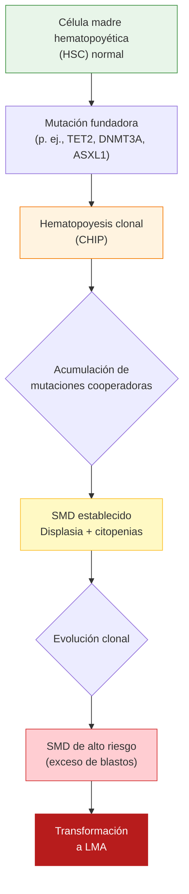
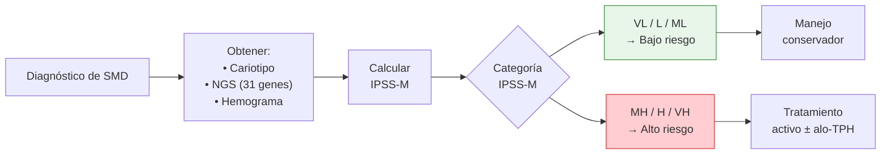
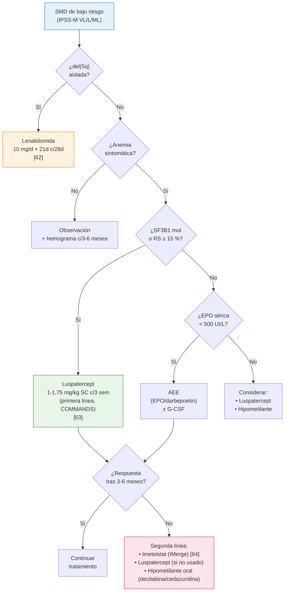
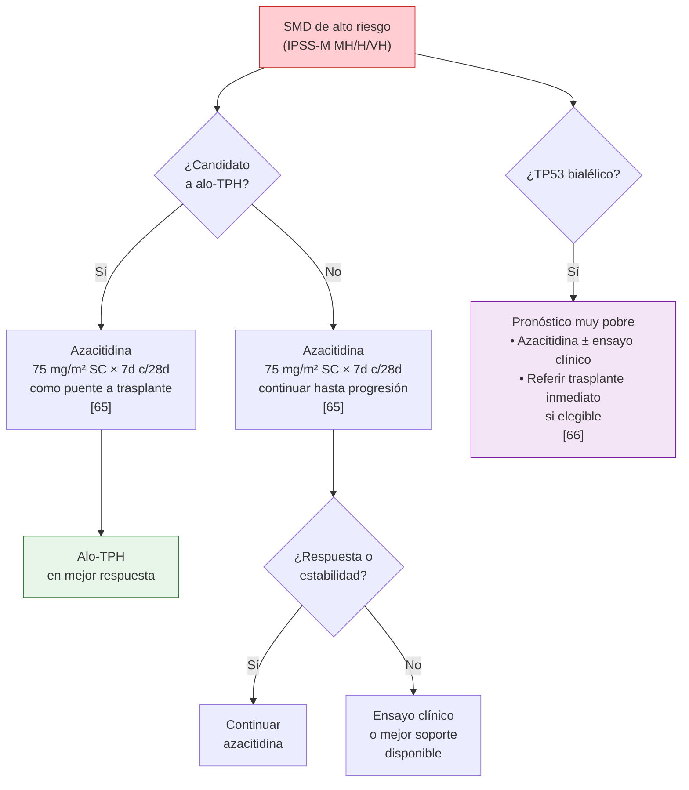

# Síndrome mielodisplásico (SMD)

!!! info "Ficha de la página"
    **Última revisión:** 2026-11-12 · **Fuente base:** OMS 2022 [59], ICC 2022 [60], IPSS-M (Bernard et al. 2022) [61], NCCN Guidelines MDS v4.2025 [PV] · **Alcance:** adultos ≥ 18 años. No cubre SMD pediátrico.

---

## 1. Resumen rápido

1. Los SMD son **neoplasias mieloides clonales** caracterizadas por displasia medular, citopenias y riesgo variable de transformación a LMA. La OMS 2022 los renombró **"neoplasias mielodisplásicas"** para reflejar su carácter neoplásico [V-RS] [59].
2. La clasificación OMS 2022 prioriza la **genética sobre la morfología**: define entidades por *del(5q)*, mutación de *SF3B1* y *TP53* bialélico, con puntos de corte de blastos adaptados [V-RS] [59][60].
3. El **IPSS-M** (Molecular International Prognostic Scoring System) integra 31 genes mutados + parámetros hematológicos y citogenéticos en 6 categorías de riesgo; restratifica al ~46 % de los pacientes respecto al IPSS-R [V-RS] [61].
4. El tratamiento se guía por riesgo: **SMD de bajo riesgo** → soporte, AEE, luspatercept (primera línea en RS+, COMMANDS [63]), imetelstat (post-AEE, IMerge [64]); **SMD de alto riesgo** → azacitidina ± alo-TPH [V-RS] [65][66].
5. El **alo-TPH** sigue siendo la **única terapia con potencial curativo**; la decisión de trasplante se apoya ahora en el IPSS-M y la puntuación DSS (Tentori, JCO 2024) [V-RS] [67].

---

## 2. Definición y epidemiología

Las **neoplasias mielodisplásicas (SMD)** son un grupo heterogéneo de neoplasias mieloides clonales de la célula madre hematopoyética, caracterizadas por:

- **Hematopoyesis ineficaz** con displasia en ≥ 1 línea mieloide.
- **Citopenias periféricas** (anemia, neutropenia, trombocitopenia).
- **Riesgo de transformación a LMA** (~30 % en el curso global).

### Epidemiología

| Parámetro | Dato |
|---|---|
| Incidencia global | ~4-5/100 000 habitantes/año [V-RS] |
| Mediana de edad al diagnóstico | 70-75 años |
| Relación hombre : mujer | ~1,5-1,8 : 1 |
| SMD relacionado con terapia | ~10-15 % de todos los SMD |
| Transformación a LMA | ~30 % acumulada |

!!! warning "Población chilena"
    Los SMD están incluidos en el GES **problema N.° 45 "Leucemia en personas de 15 años y más"**, lo que garantiza acceso a diagnóstico y tratamiento dentro de plazos establecidos [21].

---

## 3. Fisiopatología

### Mecanismos clave

| Vía | Genes frecuentes | Efecto |
|---|---|---|
| Metilación del ADN | *DNMT3A*, *TET2*, *IDH1/2* | Desregulación epigenética → diferenciación anómala |
| Splicing de ARN | *SF3B1*, *SRSF2*, *U2AF1*, *ZRSR2* | Splicing aberrante → proteínas disfuncionales |
| Remodelación de cromatina | *ASXL1*, *EZH2*, *BCOR* | Alteración de la estructura cromatínica |
| Factores de transcripción | *RUNX1*, *ETV6*, *GATA2* | Diferenciación mieloide bloqueada |
| Señalización | *NRAS*, *KRAS*, *CBL*, *JAK2* | Ventaja proliferativa |
| Respuesta al daño del ADN | *TP53* | Inestabilidad genómica, resistencia a apoptosis |
| Cohesinas | *STAG2*, *RAD21*, *SMC3* | Segregación cromosómica anómala |

La combinación de mutaciones cooperadoras, el microambiente medular alterado (inflamación estéril, disfunción inmune) y la presión selectiva explican la heterogeneidad clínica del SMD.

---

## 4. Presentación clínica

### Síntomas por citopenia

| Citopenia | Manifestación |
|---|---|
| **Anemia** (80-90 %) | Astenia, disnea de esfuerzo, palidez, taquicardia |
| **Neutropenia** (50 %) | Infecciones recurrentes (bacterianas, fúngicas) |
| **Trombocitopenia** (40-50 %) | Equimosis, petequias, sangrado mucoso |

### Hallazgos orientadores

- **Macrocitosis** (VCM elevado) sin déficit de B₁₂/folato.
- **Citopenia persistente inexplicada** ≥ 4 meses.
- Monocitosis o alteraciones morfológicas en el frotis (neutrófilos hiposegmentados tipo pseudo-Pelger-Huët, plaquetas gigantes, sideroblastos en anillo).
- 10-20 % de los pacientes se diagnostican como hallazgo incidental en hemograma de rutina.

!!! tip "Sospecha clínica"
    Todo paciente > 60 años con **citopenia inexplicada** (especialmente anemia macrocítica) debe evaluarse con **frotis de sangre periférica** y derivarse a hematología si la sospecha persiste tras excluir causas comunes.

---

## 5. Diagnóstico

### 5.1 Estudio inicial

| Examen | Objetivo |
|---|---|
| Hemograma con frotis manual | Citopenias, displasia, blastos circulantes |
| Reticulocitos | Respuesta medular (habitualmente inadecuada) |
| Perfil de hierro, B₁₂, folato | Excluir carencias |
| EPO sérica | Orienta selección terapéutica (< 500 UI/L favorece respuesta a AEE) |
| LDH, haptoglobina, bilirrubina | Evaluar hemólisis concomitante |
| Creatinina, función hepática | Comorbilidades |
| **Aspirado y biopsia de médula ósea** | Celularidad, displasia (≥ 10 % en ≥ 1 línea), blastos, sideroblastos en anillo |
| **Citogenética convencional** (cariotipo, ≥ 20 metafases) | Clasificación y pronóstico |
| **FISH** (panel SMD: -5/del5q, -7/del7q, +8, del20q) | Complementa cariotipo |
| **Panel de NGS** (≥ 31 genes para IPSS-M) | Clasificación genética (OMS 2022), pronóstico (IPSS-M), decisión terapéutica |
| Citometría de flujo | Detección de clon HPN, perfil inmunofenotípico aberrante |

### 5.2 Clasificación OMS 2022 [59]

La **5.ª edición de la clasificación OMS (2022)** renombra los SMD como **"neoplasias mielodisplásicas"** y prioriza la genética:

| Entidad OMS 2022 | Criterio definitorio clave |
|---|---|
| **MDS con deleción 5q aislada** (MDS-del5q) | del(5q) aislada o con 1 anomalía adicional (excepto -7/del7q); ≤ 5 % blastos MO |
| **MDS con mutación *SF3B1*** (MDS-SF3B1) | *SF3B1* mutado (VAF ≥ 10 %); habitualmente sideroblastos en anillo ≥ 15 %; ≤ 5 % blastos MO |
| **MDS con *TP53* bialélico** (MDS-biTP53) | 2 mutaciones *TP53* o 1 mutación + pérdida de 17p (LOH); cualquier porcentaje de blastos |
| MDS con displasia de bajo grado (MDS-LB) | Displasia < 10 % o 1 línea; blastos < 5 % MO; sin criterios genéticos anteriores |
| MDS con displasia de alto grado (MDS-h) | Displasia ≥ 10 % en ≥ 2 líneas; blastos < 5 % MO |
| MDS con exceso de blastos (MDS-EB) | MDS-EB1: 5-9 % MO; MDS-EB2: 10-19 % MO (o 5-19 % en SP, o bastones de Auer) |
| MDS hipoplásico | < 25 % celularidad en biopsia (ajustado por edad) |
| MDS con fibrosis | Fibrosis ≥ grado 2 con blastos ≥ 5 % |

### 5.3 Clasificación ICC 2022 [60]

La clasificación **ICC (International Consensus Classification) 2022** corre en paralelo con puntos comunes y diferencias:

| Aspecto | OMS 2022 | ICC 2022 |
|---|---|---|
| Nomenclatura | "Neoplasias mielodisplásicas" | Mantiene "síndromes mielodisplásicos" |
| Umbral de LMA | 20 % blastos | 10 % en presencia de alteraciones genéticas definitorias de LMA ("MDS/AML" 10-19 %) |
| Entidad TP53 | MDS-biTP53 | "Neoplasias mieloides con *TP53* mutado" (incluye SMD y LMA) |
| Sideroblastos en anillo | SF3B1 como criterio genético | Acepta ≥ 15 % SA o *SF3B1* mutado |

!!! note "En la práctica"
    Ambas clasificaciones se usan simultáneamente. Lo esencial para el clínico: **siempre solicitar NGS** (al menos los 31 genes del IPSS-M + *TP53*) y **cariotipo convencional** al diagnóstico.

---

## 6. Estratificación de riesgo

### 6.1 IPSS-R (revisado, 2012)

El **IPSS-R** (Greenberg et al., Blood 2012) utiliza:

- **Citogenética** (5 grupos de riesgo).
- **Porcentaje de blastos en MO** (0-2 %, 2-5 %, 5-10 %, > 10 %).
- **Hemoglobina**, **plaquetas**, **neutrófilos**.

→ 5 categorías: Very Low / Low / Intermediate / High / Very High.

### 6.2 IPSS-M (Molecular, 2022) [61]

El **IPSS-M** (Bernard et al., *NEJM Evidence* 2022) incorpora **31 genes** mutacionales a los parámetros del IPSS-R:

| Componente | Detalle |
|---|---|
| Genes evaluados | *TP53*, *FLT3*, *MLL/KMT2A*, *NRAS*, *CBL*, *KRAS*, *ETV6*, *IDH2*, *SF3B1*, *SRSF2*, *U2AF1*, *BCOR*, *STAG2*, *ASXL1*, *EZH2*, *RUNX1*, *DNMT3A*, *TET2*, *IDH1*, *NPM1*, *SETBP1*, *PPM1D*, *GNB1*, *BCORL1*, *PRPF8*, *CUX1*, *NF1*, *LAMB4*, *ETNK1*, *PTPN11*, *GATA2* |
| Categorías de riesgo | **6 categorías:** Very Low (VL), Low (L), Moderate Low (ML), Moderate High (MH), High (H), Very High (VH) |
| Restratificación | ~46 % de los pacientes cambian de categoría respecto al IPSS-R |
| Validación | Cohorte GenoMed4All (2 876 pacientes): concordance index 0,81 (vs. 0,74 IPSS-R) para SG [V-RS] |
| Calculadora | [mds-foundation.org/ipss-m](https://www.mds-foundation.org/ipss-m/) |

### 6.3 Implicaciones prácticas del IPSS-M

| Categoría IPSS-M | Mediana SG estimada | Conducta general |
|---|---|---|
| Very Low (VL) | > 10 años | Observación; soporte transfusional si necesario |
| Low (L) | ~7 años | AEE si anemia sintomática; considerar luspatercept |
| Moderate Low (ML) | ~4 años | Tratamiento activo según citopenias; evaluar alo-TPH en jóvenes |
| Moderate High (MH) | ~2,5 años | Azacitidina; referir a trasplante |
| High (H) | ~1,5 años | Azacitidina + evaluación inmediata de alo-TPH |
| Very High (VH) | ~0,7 años | Alo-TPH urgente si elegible; azacitidina como puente |

---

## 7. ¿Cuándo tratar?

### SMD de bajo riesgo (IPSS-M VL / L / ML)

- **Observación** si citopenia asintomática leve.
- **Iniciar tratamiento** si:
    - Anemia sintomática o dependencia transfusional.
    - Neutropenia con infecciones recurrentes.
    - Trombocitopenia clínicamente significativa (< 30 × 10⁹/L o sangrado).

### SMD de alto riesgo (IPSS-M MH / H / VH)

- **Tratar al diagnóstico** en la mayoría de los casos.
- **Referir a evaluación de alo-TPH** de forma inmediata.

---

## 8. Algoritmo de tratamiento

### 8.1 SMD de bajo riesgo

### 8.2 SMD de alto riesgo

### 8.3 Decisión de alo-TPH según IPSS-M [67]

| IPSS-M | Recomendación EBMT 2025 |
|---|---|
| VL / L | Diferir trasplante; monitorizar cada 3-6 meses |
| ML | Individualizar: si factores adversos adicionales → considerar |
| MH / H / VH | **Trasplante inmediato** (si elegible por edad/comorbilidades) |

La herramienta **DSS (Disease-Specific Score)** de Tentori et al. (JCO 2024) combina IPSS-M con comorbilidades para la decisión de trasplante, cambiando la conducta en ~17 % de pacientes < 70 años [V-RS] [67].

---

## 9. Fármacos y dosis

### 9.1 SMD de bajo riesgo

| Fármaco | Dosis | Indicación principal | Notas | Verificación |
|---|---|---|---|---|
| **Lenalidomida** | 10 mg VO/d × 21 días cada 28 días | del(5q) aislada | Respuesta eritroide ~67 %; riesgo de neutropenia, vigilar TP53 | [V-RS] [62] |
| **Luspatercept** | 1 mg/kg SC c/3 semanas → titular hasta 1,75 mg/kg | Anemia con RS+ o *SF3B1* mut (primera línea) | COMMANDS: independencia transfusional 58,5 % vs. 31,2 % con EPO | [V-RS] [63] |
| **Epoetina alfa** | 40 000-60 000 UI SC/semana | Anemia sintomática, EPO < 500 UI/L | Respuesta ~40-60 %; evaluar cada 8-12 semanas | [V-RS] |
| **Darbepoetin alfa** | 300 µg SC c/2 semanas o 500 µg SC c/3 semanas | Alternativa a epoetina | Similar eficacia, menor frecuencia de inyección | [V-RS] |
| **Imetelstat** | 7,5 mg/kg IV c/4 semanas | Post-fallo de AEE/luspatercept | IMerge fase 3: independencia transfusional 8 sem 39,8 % vs. 15 % placebo; FDA aprobado junio 2024 | [V-RS] [64] |
| **Decitabina/cedazuridina** | 35 mg decitabina + 100 mg cedazuridina VO/d × 5 días c/28 días | Alternativa oral a HMA inyectable | Equivalencia PK con decitabina IV demostrada | [V-RS] |

### 9.2 SMD de alto riesgo

| Fármaco | Dosis | Indicación | Notas | Verificación |
|---|---|---|---|---|
| **Azacitidina** | 75 mg/m² SC (o IV) × 7 días cada 28 días | Estándar de primera línea HR-MDS | Continuar hasta progresión o toxicidad inaceptable; mediana SG ~20-24 meses | [V-RS] [65] |
| **Decitabina** | 20 mg/m² IV × 5 días cada 28 días | Alternativa a azacitidina | Similar eficacia en HR-MDS | [V-RS] |
| **Venetoclax + azacitidina** | Venetoclax 400 mg VO d1-14 + azacitidina estándar | **Investigacional** en HR-MDS | VERONA: no alcanzó endpoint primario de SG (22,18 vs. 21,68 meses); mayor mORR 76,2 % vs. 57,7 %; posible beneficio en subgrupos moleculares | [V-RS] [66] |

---

## 10. Evidencia clave

| Ensayo | Población | Resultado primario | Resultado | Certeza |
|---|---|---|---|---|
| **COMMANDS** (Platzbecker 2023) [63] | LR-MDS, RS+, naive a AEE | Independencia transfusional (IT) ≥ 12 sem + ↑Hb ≥ 1,5 g/dL | Luspatercept 58,5 % vs. EPO 31,2 % (p < 0,001); FDA 1ª línea 2023 | Alta (fase 3, aleatorizado, abierto) |
| **IMerge** (Platzbecker, Lancet 2023) [64] | LR-MDS, post-AEE, transfusion-dependent | IT ≥ 8 semanas | Imetelstat 39,8 % vs. placebo 15 % (p < 0,001); FDA junio 2024 | Alta (fase 3, doble ciego) |
| **AZA-001** (Fenaux 2009) [65] | HR-MDS, IPSS Int-2/High | SG | Azacitidina 24,5 meses vs. CCR 15 meses (p = 0,0001); primer fármaco que mejoró SG en HR-MDS | Alta (fase 3) |
| **VERONA** (Wei, ASCO 2024) [66] | HR-MDS, primera línea | SG | Venetoclax + aza 22,18 m vs. placebo + aza 21,68 m (HR 0,97; NS); mORR superior (76 % vs. 58 %); posible beneficio en EB y TP53/ASXL1/RUNX1 mut | Alta (fase 3, doble ciego) — **endpoint no alcanzado** |
| **GenoMed4All** (validación IPSS-M) [61] | 2 876 pacientes SMD | Validación IPSS-M | C-index 0,81 (IPSS-M) vs. 0,74 (IPSS-R) para SG | Validación externa |
| **DSS/TPH** (Tentori, JCO 2024) [67] | < 70 años, candidatos a TPH | Puntuación de decisión de trasplante | Cambió conducta en 17 % de pacientes; mejor C-index que IPSS-R solo | Validación retrospectiva |

---

## 11. Seguridad y soporte

### Manejo de citopenias

| Problema | Manejo |
|---|---|
| **Anemia transfusion-dependiente** | Transfusión GR; quelación de hierro si ferritina > 1 000 ng/mL o > 20 unidades GR (deferasirox 14-28 mg/kg/d VO) |
| **Neutropenia grave con infección** | G-CSF terapéutico; antibióticos empíricos según protocolo de neutropenia febril |
| **Trombocitopenia grave** | Transfusión de plaquetas si < 10 × 10⁹/L o sangrado activo; antifibrinolíticos (ácido tranexámico) |

### Quelación de hierro

| Indicación | Fármaco | Dosis |
|---|---|---|
| Ferritina > 1 000 ng/mL + expectativa de vida > 1 año + LR-MDS | **Deferasirox** | 14 mg/kg/d (comprimido recubierto) VO |
| Alternativa | **Deferoxamina** | 25-50 mg/kg/d SC en infusión 8-12 h, 5-7 días/semana |

### Toxicidades específicas de fármacos

| Fármaco | Toxicidad a monitorizar |
|---|---|
| Lenalidomida | Neutropenia, trombocitopenia, rash, TVP (considerar profilaxis) |
| Luspatercept | Hipertensión, fatiga, eventos tromboembólicos (poco frecuentes) |
| Imetelstat | Citopenias (trombocitopenia grado 3-4 en ~54 %), hepatotoxicidad |
| Azacitidina | Citopenias, náuseas, reacción en sitio de inyección, fatiga |
| Venetoclax | Citopenias prolongadas, infecciones oportunistas (profilaxis anti-TLS en LMA, precaución en SMD) |

---

## 12. Seguimiento y criterios de respuesta

### Criterios de respuesta IWG 2023

| Respuesta | Definición |
|---|---|
| **Remisión completa (RC)** | Blastos MO ≤ 5 %, sin displasia significativa, recuperación de hemograma (Hb ≥ 11, ANC ≥ 1,0, plaquetas ≥ 100) |
| **RC medular** | Blastos MO ≤ 5 % sin recuperación completa de hemograma periférico |
| **Respuesta parcial** | Mejora de blastos o citopenias sin cumplir RC |
| **Mejoría hematológica (HI)** | HI-E: ↑Hb ≥ 1,5 g/dL o reducción ≥ 4 unidades GR/8 sem; HI-P: ↑plaquetas ≥ 30 × 10⁹/L; HI-N: ↑ANC ≥ 100 % y ≥ 0,5 × 10⁹/L |
| **Fallo de tratamiento** | Progresión (↑blastos, empeoramiento citopenias, transformación a LMA) |

### Calendario de seguimiento

| Período | Evaluación |
|---|---|
| Cada 1-3 meses (en tratamiento activo) | Hemograma, frotis, bioquímica |
| Cada 3-6 meses (LR-MDS en observación) | Hemograma, ferritina si transfusiones |
| Cada 3-6 meses o según indicación | Aspirado/biopsia MO (evaluar respuesta o progresión) |
| Anualmente o ante cambios clínicos | Repetir citogenética y/o NGS si sospecha de evolución clonal |

---

## 13. Situaciones especiales

### 13.1 MDS con *TP53* bialélico (MDS-biTP53) [59][66]

- **Pronóstico muy pobre**: mediana SG ~6-12 meses, resistencia a quimioterapia convencional.
- Definido por 2 mutaciones *TP53* o 1 mutación + LOH 17p.
- Azacitidina: ORR ~63 % pero RC solo ~8,7 %; duración de respuesta corta.
- **Alo-TPH inmediato** si elegible (supervivencia post-TPH sigue siendo pobre: ~20 % a 2 años).
- **Eprenetapopt (APR-246) + azacitidina**: resultados prometedores en fase 2 (RC ~50 % con eliminación de clon TP53 en algunos pacientes), pero pendiente de confirmación en fase 3 [PV].
- Ensayos clínicos son la mejor opción cuando disponibles.

### 13.2 SMD relacionado con terapia (t-MDS)

- Antecedente de quimioterapia (alquilantes, inhibidores de topoisomerasa II) o radioterapia.
- Mayor frecuencia de cariotipo complejo, mutaciones de *TP53*.
- Manejo similar al SMD *de novo* según riesgo, pero pronóstico generalmente peor.
- Considerar alo-TPH precoz si elegible.

### 13.3 SMD hipoplásico

- Celularidad medular < 25 % (ajustada por edad); diagnóstico diferencial con aplasia medular.
- Puede responder a **inmunosupresión** (ATG + ciclosporina) de forma similar a la aplasia medular [53].
- Buscar clon HPN por citometría de flujo.

---

## 14. Puntos clave para residentes e internos

!!! abstract "Para llevar"
    1. **Siempre solicitar NGS y cariotipo al diagnóstico** de SMD — sin ellos no puedes clasificar (OMS 2022) ni estratificar (IPSS-M).
    2. **IPSS-M > IPSS-R**: el IPSS-M restratifica a ~46 % de los pacientes; usar la calculadora online.
    3. **MDS-biTP53** es una entidad aparte de mal pronóstico que requiere referencia inmediata a trasplante.
    4. **Luspatercept** es primera línea en LR-MDS con RS+/*SF3B1* mut (COMMANDS); **imetelstat** es opción post-AEE (IMerge, FDA 2024).
    5. **Azacitidina** sigue siendo el estándar en HR-MDS; venetoclax + aza **no mejoró SG** (VERONA).
    6. **Alo-TPH** es la única terapia curativa; la decisión se apoya en IPSS-M y DSS.
    7. **Quelación de hierro** en pacientes con LR-MDS, ferritina > 1 000 y expectativa de vida razonable.
    8. **GES Chile**: los SMD están cubiertos como "leucemia en ≥ 15 años" (problema 45), garantizando diagnóstico y tratamiento.

---

## 15. Autoevaluación

??? question "1. ¿Cuál es la principal innovación de la clasificación OMS 2022 para los SMD?"
    Prioriza la **genética sobre la morfología**, definiendo entidades específicas por *del(5q)*, mutación de *SF3B1* y *TP53* bialélico [59].

??? question "2. Un paciente con SMD de bajo riesgo, SF3B1 mutado y anemia dependiente de transfusiones: ¿cuál es la primera línea?"
    **Luspatercept** 1 mg/kg SC cada 3 semanas (titular hasta 1,75 mg/kg). Basado en el ensayo COMMANDS, que demostró superioridad sobre EPO en independencia transfusional (58,5 % vs. 31,2 %) [63].

??? question "3. ¿Qué diferencia tiene el IPSS-M respecto al IPSS-R?"
    El IPSS-M incorpora **31 genes mutacionales** además de los parámetros hematológicos y citogenéticos. Define 6 categorías de riesgo (en vez de 5) y restratifica a ~46 % de los pacientes. C-index de 0,81 vs. 0,74 del IPSS-R [61].

??? question "4. ¿Por qué es relevante el estudio VERONA?"
    Porque venetoclax + azacitidina **no alcanzó el endpoint primario de SG** en HR-MDS (22,18 vs. 21,68 meses), a diferencia de su éxito en LMA. Esto confirma que azacitidina sola sigue siendo el estándar en HR-MDS [66].

??? question "5. ¿Cuándo se debe referir a alo-TPH según el IPSS-M?"
    En categorías **Moderate High, High y Very High** se recomienda **trasplante inmediato** si el paciente es elegible. La herramienta DSS (Tentori, JCO 2024) ayuda a integrar el IPSS-M con comorbilidades para esta decisión [67].

---

## 16. Referencias de esta página

→ Ver numeración completa en [Referencias verificadas](../referencias.md).

| Ref. | Cita abreviada | Verificación |
|---|---|---|
| [59] | Khoury JD, et al. WHO 5th ed classification of haematolymphoid tumours: myeloid and histiocytic/dendritic neoplasms. *Leukemia* 2022. | [V-RS] |
| [60] | Arber DA, et al. International Consensus Classification of myeloid neoplasms and acute leukemias. *Blood* 2022. | [V-RS] |
| [61] | Bernard E, et al. Molecular International Prognostic Scoring System for myelodysplastic syndromes. *NEJM Evid* 2022. | [V-RS] |
| [62] | List A, et al. Lenalidomide in the myelodysplastic syndrome with chromosome 5q deletion (MDS-003). *N Engl J Med* 2006. | [V-RS] |
| [63] | Platzbecker U, et al. Luspatercept for anaemia in lower-risk myelodysplastic syndromes (COMMANDS). *Lancet* 2023. | [V-RS] |
| [64] | Platzbecker U, et al. Imetelstat in transfusion-dependent lower-risk myelodysplastic syndromes (IMerge). *Lancet* 2023. | [V-RS] |
| [65] | Fenaux P, et al. Efficacy of azacitidine compared with conventional care in higher-risk MDS (AZA-001). *Lancet Oncol* 2009. | [V-RS] |
| [66] | Wei AH, et al. Venetoclax + azacitidine vs. placebo + azacitidine in higher-risk MDS (VERONA). ASCO 2024 / *Blood* 2024. | [V-RS] |
| [67] | Tentori CA, et al. / EBMT guidelines. Decision-making for allo-HSCT in MDS using IPSS-M. *JCO* 2024 / EBMT 2025. | [V-RS] |
| [21] | Minsal Chile. GES problema N.° 45 "Leucemia en personas de 15 años y más". | Lectura parcial |
| [53] | Kulasekararaj A, et al. BSH guidelines for diagnosis and management of adult aplastic anaemia. *Br J Haematol* 2024. | [V-RS] |

---

## 17. Pendientes

- [ ] Confirmar disponibilidad de imetelstat en Chile (CENABAST/ISP).
- [ ] Agregar datos de supervivencia post-TPH en MDS-biTP53 cuando se publique serie chilena.
- [ ] Actualizar con resultados de fase 3 de eprenetapopt + azacitidina en TP53-mutated MDS.
- [ ] Incorporar nuevas guías NCCN MDS 2026 cuando se publiquen.
