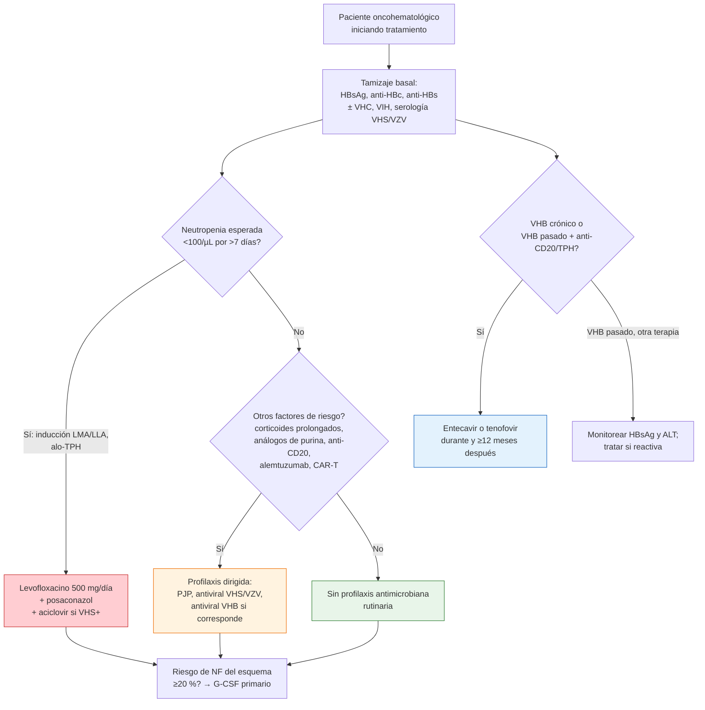

# Soporte oncohematológico

!!! info "Ficha de la página"
    **Última revisión:** 2026-11-20 · **Fuentes base:** guía ASCO/IDSA 2018 de profilaxis antimicrobiana [166], guía ASCO 2026 de factores de crecimiento leucocitario [167], opinión clínica ASCO 2020 sobre virus hepatitis B [168], guías ECIL 7 de vacunación [169], guía ASCO 2020 de antieméticos [170], y ensayos pivotales de profilaxis (levofloxacino [172], posaconazol [171]) e inmunoglobulina [173]. **Alcance:** adultos con neoplasias hematológicas en tratamiento activo, fuera del trasplante alogénico (el TPH tendrá página propia).

!!! note "Qué está en otra página"
    Las **urgencias** del paciente oncohematológico —neutropenia febril, síndrome de lisis tumoral, leucostasis, CID y hemorragia crítica— están desarrolladas en [Urgencias hematológicas](../transversal/urgencias-hematologicas.md). El **soporte transfusional** (umbrales de GR y plaquetas, reacciones, aféresis) está en [Medicina transfusional](../transversal/medicina-transfusional.md). Esta página cubre la **prevención**: lo que se indica *antes* de que aparezca la complicación.

---

## 1. Resumen rápido

1. **Profilaxis antibacteriana y antifúngica** solo en riesgo alto: neutropenia profunda y prolongada (**<100 neutrófilos/µL por >7 días**) u otros factores de riesgo; no es rutinaria en todo paciente con quimioterapia [166] **[V-RS]**.
2. **Levofloxacino 500 mg/día VO** durante la neutropenia profunda esperada >7 días reduce fiebre (65 % vs 85 %), infecciones documentadas y bacteriemias, sin cambiar la mortalidad [172] **[V-RS]**.
3. **Posaconazol** es la profilaxis antifúngica de referencia en inducción de LMA/SMD: menos infección fúngica invasora (2 % vs 8 %), menos aspergilosis y mayor supervivencia frente a fluconazol/itraconazol [171] **[V-RS]**.
4. **Antiviral (aciclovir/valaciclovir)** en pacientes VHS-seropositivos en inducción de leucemia o alo-TPH; **profilaxis de *Pneumocystis*** si el riesgo es >3,5 % (p. ej., prednisona ≥20 mg/día por ≥1 mes, análogos de purina) [166] **[V-RS]**.
5. **Tamizaje de VHB a todos** antes de terapia sistémica (HBsAg, anti-HBc, anti-HBs), sin retrasar el tratamiento; **profilaxis con entecavir o tenofovir** en VHB crónico y en VHB pasado con anti-CD20 o TPH, hasta ≥12 meses después de terminar [168] **[V-RS]**.
6. **G-CSF primario** cuando el riesgo de neutropenia febril del esquema es **≈20 % o mayor**, o <20 % si el paciente tiene factores de riesgo propios (edad, comorbilidad, enfermedad) [167] **[V-RS]**.
7. **Vacunas inactivadas sí, vivas atenuadas no** durante el tratamiento; la respuesta puede ser menor, pero la vacunación sigue indicada [169] **[V-RS]**.

---

## 2. Estratificación del riesgo infeccioso

El riesgo infeccioso no depende solo del recuento de neutrófilos: también del **tipo de inmunosupresión** (humoral, celular, barreras mucosas) que produce cada enfermedad y cada fármaco [166] **[V-RS]**.

| Nivel de riesgo | Situaciones típicas | Profilaxis a considerar |
|---|---|---|
| **Alto** | Inducción/consolidación de LMA y LLA, SMD de alto riesgo tratado intensivamente, alo-TPH, neutropenia esperada <100/µL >7 días | Antibacteriana (fluoroquinolona), antifúngica con actividad anti-mohos (posaconazol), antiviral VHS, ± PJP según esquema |
| **Intermedio** | Autotrasplante, linfomas con esquemas intensivos, análogos de purina (fludarabina), alemtuzumab, corticoides prolongados, CAR-T | Antiviral VHS/VZV, PJP, considerar antibacteriana y antifúngica (anti-*Candida*) según duración de neutropenia **[PV]** |
| **Bajo** | Esquemas estándar de tumores sólidos/linfomas con neutropenia esperada <7 días | Sin profilaxis antimicrobiana rutinaria; G-CSF según riesgo de NF |

Las situaciones de riesgo intermedio son heterogéneas y la indicación exacta depende del fármaco y la institución; se marcan **[PV]** las combinaciones específicas no detalladas en la fuente verificada.

---

## 3. Algoritmo de profilaxis antimicrobiana

---

## 4. Profilaxis antibacteriana

- **Indicación:** pacientes con neutropenia profunda (<100/µL) y prolongada (>7 días) esperada, u otros factores de alto riesgo [166] **[V-RS]**.
- **Fármaco de elección:** fluoroquinolona. En el ensayo GIMEMA (760 pacientes, neutropenia <1000/µL esperada >7 días), **levofloxacino 500 mg/día VO** desde el inicio de la quimioterapia hasta la recuperación de neutrófilos redujo la fiebre durante la neutropenia (65 % vs 85 %; RR 0,76), las infecciones microbiológicamente documentadas y las bacteriemias por gramnegativos, con tolerancia y mortalidad similares al placebo; el beneficio fue igual en leucemia aguda que en tumores sólidos/linfoma [172] **[V-RS]**.
- **Advertencia:** el propio ensayo dejó abierto el efecto a largo plazo sobre la resistencia bacteriana; en centros con alta prevalencia de gramnegativos resistentes a quinolonas, el beneficio puede ser menor y la decisión debe considerar la epidemiología local **[PV]**.

## 5. Profilaxis antifúngica

- **Indicación:** riesgo alto de infección fúngica invasora, en particular neutropenia profunda prolongada [166] **[V-RS]**.
- **Posaconazol en inducción de LMA/SMD:** en un ensayo aleatorizado de 602 pacientes, posaconazol frente a fluconazol o itraconazol redujo la infección fúngica invasora probada/probable (**2 % vs 8 %**), la aspergilosis invasora (1 % vs 7 %) y mejoró la supervivencia global (p = 0,04), a costa de más eventos adversos serios relacionados (6 % vs 2 %), principalmente gastrointestinales [171] **[V-RS]**.
- **Interacciones:** los azoles (posaconazol, voriconazol) son inhibidores potentes de CYP3A4 y aumentan los niveles de **venetoclax**, **vincristina** e inhibidores de tirosina quinasa; la dosis de venetoclax debe ajustarse cuando se combina con azoles **[PV]** (ajuste exacto: ver ficha técnica y página de [LMA](lma.md)).
- **Medidas ambientales:** evitar la exposición prolongada a ambientes con alta concentración de esporas aéreas (construcciones, demoliciones) [166] **[V-RS]**.

## 6. Profilaxis antiviral

### 6.1 Virus herpes simple y varicela-zóster

- **VHS:** pacientes seropositivos en **inducción de leucemia** o **alo-TPH** deben recibir un análogo de nucleósido (p. ej., **aciclovir**) [166] **[V-RS]**.
- **VZV:** la profilaxis con aciclovir/valaciclovir es práctica habitual con **inhibidores del proteasoma (bortezomib)**, **anti-CD38 (daratumumab)**, análogos de purina y tras CAR-T **[PV]** (indicación específica por fármaco no detallada en la guía verificada).

### 6.2 Virus hepatitis B (VHB)

| Situación serológica | Terapia oncológica | Conducta |
|---|---|---|
| **VHB crónico** (HBsAg+) | Cualquier terapia sistémica | **Profilaxis antiviral** (entecavir o tenofovir) durante y **≥12 meses después**; coordinar con hepatología |
| **VHB pasado** (HBsAg–, anti-HBc+) | **Anti-CD20** (rituximab, obinutuzumab) o **TPH** | **Profilaxis antiviral** durante y ≥12 meses después; el monitoreo estrecho es alternativa solo si se garantiza seguimiento frecuente |
| **VHB pasado** | Otras terapias sin riesgo alto claro | Monitorear **HBsAg y ALT**; iniciar antiviral si hay reactivación |
| **Solo terapia hormonal** | — | Seguir guías de VHB no oncológicas |

Fuente: [168] **[V-RS]**. El tamizaje con los 3 marcadores debe hacerse **sin retrasar** el inicio de la terapia oncológica [168] **[V-RS]**.

!!! warning "La reactivación de VHB con anti-CD20 puede ser fatal"
    En hemato-oncología, el escenario de mayor riesgo es el paciente con **VHB pasado (anti-HBc+) que recibe rituximab u otro anti-CD20** (linfomas, LLC, Waldenström): la serología "negativa para HBsAg" no basta para descartar el riesgo. Pedir siempre anti-HBc.

## 7. Profilaxis de *Pneumocystis jirovecii* (PJP)

- **Indicación:** esquemas con riesgo de neumonía por *Pneumocystis* >3,5 %, por ejemplo **prednisona ≥20 mg/día (o equivalente) por ≥1 mes** o uso de **análogos de purina** [166] **[V-RS]**.
- Otras situaciones de uso habitual: LLA (por el uso prolongado de corticoides), alemtuzumab, idelalisib, temozolomida, CAR-T **[PV]**.
- **Fármaco de elección:** trimetoprim-sulfametoxazol (cotrimoxazol); alternativas si hay alergia o mielotoxicidad: atovacuona, dapsona (descartar déficit de G6PD) o pentamidina inhalada **[PV]** (dosis exactas pendientes de verificación directa).

## 8. Factores estimulantes de colonias (G-CSF)

### 8.1 Indicaciones (ASCO 2026) [167] **[V-RS]**

| Escenario | Recomendación |
|---|---|
| **Profilaxis primaria**, riesgo de NF del esquema **≈20 % o mayor** | Indicada, si no hay un esquema igual de eficaz y seguro que no requiera G-CSF |
| **Profilaxis primaria**, riesgo de NF **<20 %** | Considerar si el paciente tiene alto riesgo propio por **edad, antecedentes médicos o características de la enfermedad** |
| **Movilización de progenitores** | G-CSF solo, tras quimioterapia, o combinado con **plerixafor o motixafortide** |

- **Profilaxis secundaria** (tras un episodio de NF o neutropenia que retrasó el ciclo previo) es práctica estándar cuando reducir la dosis comprometería el resultado del tratamiento **[PV]** (no detallada en el resumen verificado).
- **Leucemia mieloide aguda:** el G-CSF tras inducción acorta la neutropenia pero no ha demostrado mejorar la supervivencia; su uso es selectivo **[PV]**.

### 8.2 Fármacos y dosis

| Fármaco | Dosis habitual | Notas | Verificación |
|---|---|---|---|
| **Filgrastim** (y biosimilares) | 5 µg/kg/día SC, desde 24–72 h post-quimioterapia hasta recuperación de neutrófilos | Uso diario; biosimilares intercambiables | **[PV]** |
| **Pegfilgrastim** (y biosimilares) | 6 mg SC dosis única por ciclo, ≥24 h post-quimioterapia | No usar en esquemas con intervalo <14 días | **[PV]** |

La guía ASCO 2026 incluye la información de dosificación y selección de CSF, pero las dosis de la tabla corresponden a la práctica estándar y se dejan **[PV]** hasta verificación con el texto completo [167].

## 9. Hipogammaglobulinemia secundaria e inmunoglobulina

- La hipogammaglobulinemia es frecuente en **LLC**, **mieloma múltiple**, tras **anti-CD20** y especialmente tras **CAR-T anti-CD19 o anti-BCMA**, y se asocia a más infecciones graves [173] **[V-RS]**.
- **Inmunoglobulina vs antibióticos profilácticos:** en el ensayo de factibilidad RATIONAL (63 pacientes con hipogammaglobulinemia secundaria a neoplasia hematológica e infección recurrente/grave o IgG <4 g/L), **IgIV 0,4 g/kg cada 4 semanas** y **cotrimoxazol 160/800 mg diario** (o doxiciclina 100 mg) tuvieron tasas similares de permanencia en tratamiento a 12 meses (76 % vs 71 %) y de infección mayor [173] **[V-RS]**. Es un ensayo pequeño de factibilidad: **no demuestra equivalencia**, pero apoya que los antibióticos profilácticos son una alternativa razonable mientras hay ensayos fase 3.
- **Indicaciones habituales de IgIV de reemplazo:** IgG baja (<4 g/L) con infecciones bacterianas recurrentes o graves pese a profilaxis antibiótica **[PV]** (umbrales y criterios exactos varían por país y financiador).

## 10. Vacunación (ECIL 7, pacientes sin trasplante) [169] **[V-RS]**

- El riesgo infeccioso depende de la enfermedad (mieloide vs linfoide) y del tratamiento; algunas de estas infecciones son **prevenibles por vacuna** y la vacunación es un área frecuentemente descuidada por los hematólogos.
- **Vacunas vivas atenuadas:** su uso está fuertemente limitado por el riesgo de enfermedad vacunal; evitarlas durante el tratamiento activo.
- **Vacunas inactivadas:** indicadas aunque la respuesta inmune sea menor; el momento óptimo dentro de esquemas complejos es incierto.

| Vacuna | Recomendación práctica | Verificación |
|---|---|---|
| **Influenza inactivada** | Anual, idealmente al menos 2 semanas antes de la quimioterapia o entre ciclos | **[PV]** |
| **Neumococo** (conjugada ± polisacárida) | Al diagnóstico, antes de iniciar tratamiento cuando sea posible | **[PV]** |
| **COVID-19** | Según esquema vigente para inmunocomprometidos | **[PV]** |
| **Zóster recombinante** (no viva) | Considerar en mieloma, LLC y tras inhibidores del proteasoma/anti-CD38 | **[PV]** |
| **Vivas** (sarampión-rubéola-parotiditis, varicela, fiebre amarilla, zóster vivo) | **Contraindicadas** durante el tratamiento activo | [169] **[V-RS]** |

- **Anti-CD20:** la respuesta a vacunas puede estar abolida durante y hasta ~6 meses después del tratamiento; vacunar idealmente antes de iniciar **[PV]**.
- Los esquemas, intervalos y edades exactos dependen del Programa Nacional de Inmunizaciones (Chile) y se dejan como pendiente **[PV]**.

## 11. Náuseas y vómitos inducidos por quimioterapia (NVIQ)

La profilaxis se elige según el **potencial emetógeno** del esquema (alto, moderado, bajo, mínimo) [170] **[V-RS]**.

| Potencial emetógeno | Ejemplos en hematología | Profilaxis (adultos) |
|---|---|---|
| **Alto** | Ciclofosfamida ≥1500 mg/m², BEAM/acondicionamiento con melfalán dosis alta, cisplatino | Antagonista NK1 + antagonista 5-HT3 + dexametasona + olanzapina **[PV]** para la combinación por esquema |
| **Moderado** | Citarabina >200 mg/m², bendamustina, ciclofosfamida <1500 mg/m², carboplatino | Antagonista 5-HT3 + dexametasona (± NK1 según esquema) **[PV]** |
| **Bajo / mínimo** | Rituximab, bortezomib, vincristina, ITK orales, BTKi | Antagonista 5-HT3 o dexametasona de dosis única, o sin profilaxis **[PV]** |

- **TPH:** la guía ASCO 2020 incorporó la opción de **agregar olanzapina** en el contexto de trasplante de progenitores [170] **[V-RS]**.
- **Olanzapina:** se agregó la opción de **5 mg** en adultos (menos sedación que 10 mg) [170] **[V-RS]**.
- **Dexametasona:** en esquemas que ya incluyen corticoides (R-CHOP, VRd, hiper-CVAD), el corticoide del esquema suele cubrir el componente antiemético **[PV]**.

## 12. Hiperviscosidad sintomática

Desarrollo pendiente en la página de urgencias; se resume aquí por su relación directa con el soporte de las gammapatías.

- **Causas:** sobre todo **macroglobulinemia de Waldenström** (IgM, pentamérica, intravascular) y, con menos frecuencia, mieloma IgA o IgG3 con proteína M muy elevada (ver [Mieloma y gammapatías](mieloma.md), §15) [164] **[V-RS]**.
- **Clínica:** sangrado mucoso (epistaxis, gingivorragia), alteraciones visuales (fondo de ojo con venas "en salchicha", hemorragias retinianas), síntomas neurológicos (cefalea, vértigo, confusión, coma), insuficiencia cardíaca **[PV]** (tríada clásica, no detallada en la fuente verificada).
- **Tratamiento urgente:** **plasmaféresis** (ver [Medicina transfusional — aféresis](../transversal/medicina-transfusional.md), ASFA [109]) antes o en paralelo al inicio de la terapia dirigida a la enfermedad; la plasmaféresis es una medida temporal, no sustituye la citorreducción [164] **[V-RS]**.
- **Precaución:** evitar transfundir glóbulos rojos antes de reducir la viscosidad, porque el aumento del hematocrito empeora la viscosidad total **[PV]**.
- **Rituximab en WM con IgM muy elevada:** puede producir un aumento transitorio de IgM ("flare"); considerar plasmaféresis previa o diferir rituximab **[PV]**.

---

## 13. Fármacos y dosis (resumen)

| Indicación | Fármaco | Dosis | Verificación |
|---|---|---|---|
| Profilaxis antibacteriana | Levofloxacino | 500 mg/día VO durante la neutropenia | [172] **[V-RS]** |
| Profilaxis antifúngica (LMA/SMD) | Posaconazol comprimidos de liberación retardada | 300 mg c/12 h el día 1, luego 300 mg/día VO | **[PV]** (el ensayo pivotal usó suspensión oral [171]) |
| Profilaxis VHS/VZV | Aciclovir | 400–800 mg c/12 h VO | **[PV]** |
| Profilaxis VHS/VZV | Valaciclovir | 500 mg c/12 h VO | **[PV]** |
| Profilaxis PJP | Cotrimoxazol | 160/800 mg 3 veces por semana o 80/400 mg diario | **[PV]** |
| Profilaxis VHB | Entecavir / tenofovir | Dosis estándar; durante y ≥12 meses después | [168] **[V-RS]** (dosis **[PV]**) |
| G-CSF | Filgrastim / pegfilgrastim | 5 µg/kg/día / 6 mg por ciclo SC | **[PV]** |
| Reemplazo de Ig | IgIV | 0,4 g/kg cada 4 semanas | [173] **[V-RS]** |
| Alternativa a IgIV | Cotrimoxazol | 160/800 mg diario | [173] **[V-RS]** |

---

## 14. Evidencia clave

| Estudio | Población | Resultado principal | Certeza |
|---|---|---|---|
| **GIMEMA levofloxacino** (Bucaneve, *NEJM* 2005) [172] | 760 adultos con neutropenia esperada >7 días | Fiebre 65 % vs 85 %; menos bacteriemias e infecciones documentadas; mortalidad sin diferencia | Alta (ECA doble ciego) |
| **Posaconazol vs fluconazol/itraconazol** (Cornely, *NEJM* 2007) [171] | 602 pacientes en quimioterapia de LMA/SMD | IFI 2 % vs 8 %; aspergilosis 1 % vs 7 %; mejor supervivencia | Alta (ECA) |
| **RATIONAL** (McQuilten, *Blood Adv* 2024) [173] | 63 pacientes con hipogammaglobulinemia secundaria | IgIV vs antibióticos: permanencia en tratamiento 76 % vs 71 %; infecciones mayores similares | Baja (ensayo de factibilidad) |
| **ASCO/IDSA 2018** [166] | Revisión sistemática | Profilaxis antibacteriana/antifúngica solo en riesgo alto; antiviral VHS en inducción/alo-TPH; PJP si riesgo >3,5 % | Guía basada en evidencia |
| **ASCO 2020 VHB** [168] | Opinión clínica provisional | Tamizaje universal con 3 marcadores; profilaxis en VHB crónico y pasado con anti-CD20/TPH | Consenso de expertos |
| **ASCO 2026 G-CSF** [167] | 33 ECA y 16 revisiones sistemáticas | Profilaxis primaria si riesgo de NF ≈≥20 % | Guía basada en evidencia |

---

## 15. Seguridad

- **Fluoroquinolonas:** prolongación del QT (sumar con azoles, ondansetrón, ITK), tendinopatía, *Clostridioides difficile*, selección de resistencia.
- **Azoles:** hepatotoxicidad, QT prolongado e interacciones CYP3A4 (venetoclax, vincristina, ITK, ciclosporina/tacrolimus) — revisar interacciones antes de cada inicio.
- **Cotrimoxazol:** mielosupresión, hiperkalemia, rash; puede retrasar la recuperación de recuentos en mantención de LLA.
- **G-CSF:** dolor óseo; raro: rotura esplénica, síndrome de distrés respiratorio.
- **IgIV:** reacciones infusionales, trombosis, falla renal (preparados con sacarosa), meningitis aséptica.

---

## 16. Puntos clave para residentes e internos

!!! abstract "Para llevar"
    1. La **profilaxis antimicrobiana es por riesgo**, no universal: neutropenia <100/µL por >7 días es el umbral que define riesgo alto.
    2. **Levofloxacino + posaconazol + aciclovir** es el paquete típico de la inducción de leucemia aguda.
    3. **Pedir anti-HBc a todos** antes de quimioterapia; un HBsAg negativo no excluye riesgo de reactivación con rituximab.
    4. **PJP** si hay corticoides ≥20 mg/día por ≥1 mes o análogos de purina.
    5. **G-CSF primario** si el esquema tiene riesgo de NF ≈≥20 %, o menor con factores de riesgo del paciente.
    6. **Sin vacunas vivas** durante el tratamiento; sí inactivadas, idealmente antes de iniciar anti-CD20.
    7. Antes de iniciar un azol, **revisar interacciones** (venetoclax, vincristina, ITK).
    8. Hiperviscosidad sintomática = **plasmaféresis urgente** y no transfundir GR antes de reducir la viscosidad.

---

## 17. Autoevaluación

??? question "1. Paciente de 58 años inicia inducción 7+3 por LMA. ¿Qué profilaxis antimicrobiana corresponde?"
    Riesgo alto (neutropenia esperada <100/µL por >7 días): **fluoroquinolona (levofloxacino 500 mg/día)**, **posaconazol** y **aciclovir** si es VHS-seropositivo [166,171,172].

??? question "2. Paciente con linfoma difuso de células B grandes, HBsAg negativo y anti-HBc positivo, que iniciará R-CHOP. ¿Qué haces?"
    Es VHB pasado con terapia anti-CD20 (riesgo alto de reactivación): **profilaxis con entecavir o tenofovir durante el tratamiento y ≥12 meses después** [168].

??? question "3. ¿Cuándo indicar G-CSF como profilaxis primaria?"
    Cuando el riesgo de neutropenia febril del esquema es **≈20 % o mayor** (sin alternativa igual de eficaz sin G-CSF), o con riesgo <20 % si el paciente tiene alto riesgo por edad, comorbilidad o características de la enfermedad [167].

??? question "4. Paciente con LLC, IgG 3,2 g/L y tres neumonías en el último año. ¿Opciones?"
    **IgIV 0,4 g/kg cada 4 semanas** o **cotrimoxazol profiláctico diario**; el ensayo RATIONAL mostró resultados similares, aunque es un estudio de factibilidad y no demuestra equivalencia [173].

??? question "5. ¿Qué vacunas están contraindicadas durante la quimioterapia?"
    Las **vacunas vivas atenuadas** (sarampión-rubéola-parotiditis, varicela, fiebre amarilla, zóster vivo) [169].

---

## 18. Referencias de esta página

→ Ver numeración completa en [Referencias verificadas](../referencias.md).

| Ref. | Cita abreviada | Verificación |
|---|---|---|
| [109] | Connelly-Smith L, et al. Guías ASFA de aféresis terapéutica, 9.ª ed. 2023. | Resumen |
| [164] | Kastritis E, et al. Guía ESMO de macroglobulinemia de Waldenström. *Ann Oncol* 2018. | Resumen |
| [166] | Taplitz RA, et al. Profilaxis antimicrobiana en inmunosupresión por cáncer, ASCO/IDSA. *J Clin Oncol* 2018. | Resumen |
| [167] | Gyawali B, et al. Factores de crecimiento leucocitario, actualización ASCO. *J Clin Oncol* 2026. | Resumen |
| [168] | Hwang JP, et al. Tamizaje y manejo de VHB antes de terapia oncológica, ASCO. *J Clin Oncol* 2020. | Resumen |
| [169] | Mikulska M, et al. Vacunación en neoplasias hematológicas sin trasplante (ECIL 7). *Lancet Infect Dis* 2019. | Resumen |
| [170] | Hesketh PJ, et al. Antieméticos, actualización ASCO. *J Clin Oncol* 2020. | Resumen |
| [171] | Cornely OA, et al. Posaconazol vs fluconazol o itraconazol en neutropenia. *N Engl J Med* 2007. | Resumen |
| [172] | Bucaneve G, et al. Levofloxacino para prevenir infección bacteriana en neutropenia. *N Engl J Med* 2005. | Resumen |
| [173] | McQuilten ZK, et al. Inmunoglobulina vs antibióticos profilácticos en hipogammaglobulinemia secundaria (RATIONAL). *Blood Adv* 2024. | Resumen |

---

## 19. Pendientes

- [ ] Dosis exactas de profilaxis (posaconazol, aciclovir/valaciclovir, cotrimoxazol, entecavir/tenofovir) verificadas contra texto completo o ficha técnica **[PV]**.
- [ ] Esquema de vacunación alineado con el Programa Nacional de Inmunizaciones de Chile y disponibilidad local de vacuna recombinante contra zóster **[PV]**.
- [ ] Tabla de potencial emetógeno por esquema hematológico (hiper-CVAD, BEAM, FLAG-Ida, etc.) con verificación directa **[PV]**.
- [ ] Profilaxis específica post-CAR-T y en terapias biespecíficas (VZV, PJP, IgIV) — evidencia en evolución **[PV]**.
- [ ] Mover o enlazar la sección de hiperviscosidad cuando se desarrolle en [Urgencias hematológicas](../transversal/urgencias-hematologicas.md).
- [ ] Protocolos institucionales HPM / ANACAN sobre profilaxis y G-CSF **[PV]**.
