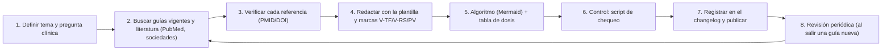

# Cómo se construye y actualiza

## Principios

1. **Fuentes jerarquizadas:** guías clínicas de la especialidad o de medicina interna → sociedades nacionales e internacionales (ASH, EHA, ESMO, iwCLL, ISTH, BSH, etc.) → revistas de hematología/medicina interna → revisiones y consensos. Se excluyen videos y fuentes no revisadas.
2. **Nada sin respaldo:** cada afirmación clínica lleva su referencia y su marca de verificación (**[V-TF]**, **[V-RS]**, **[PV]**). Lo no verificado se declara.
3. **Dosis solo con fuente:** las dosis entran como verificadas únicamente si figuran en la fuente revisada; el resto queda **[PV]** hasta contrastarlo con ficha técnica local.
4. **Una versión por página:** cada página indica fecha de revisión, fuente base y pendientes.

## Flujo de trabajo para agregar o actualizar una página

## Cuándo revisar una página

| Disparador | Acción |
|---|---|
| Publicación de una **guía nueva o actualización** de la sociedad usada como base | Revisar la página completa y actualizar fecha y changelog |
| **Ensayo pivotal** nuevo en el tema | Evaluar si cambia recomendación; si sí, actualizar algoritmo |
| **Aprobación o retiro** de un fármaco | Actualizar tabla de dosis y disponibilidad |
| Revisión semestral | Chequear que las referencias sigan vigentes y completar pendientes **[PV]** |

## Chequeo automático

El script `scripts/check_wiki.py` revisa que:

- cada página clínica tenga fecha de revisión;
- toda cita `[n]` exista en [Referencias verificadas](referencias.md);
- los enlaces internos no estén rotos;
- se informe cuántos ítems **[PV]** quedan pendientes por página.

Ejecutar desde la raíz del proyecto: `python3 scripts/check_wiki.py`.

## Uso docente

- Cada página incluye **puntos clave** y, cuando corresponde, **autoevaluación**.
- La sección *Transversal → Competencias docentes* mapeará temas a CanMEDS y objetivos de residentes e internos.
