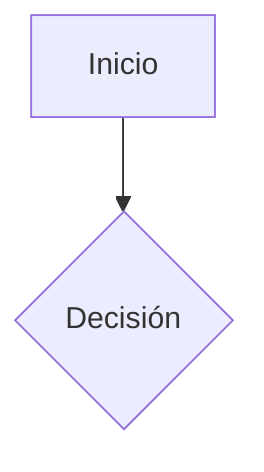

# Plantilla de página

Copia este esqueleto para cada tema nuevo (`docs/<bloque>/<tema>.md`) y agrégalo al `nav` de `mkdocs.yml`.

````markdown
# Nombre del tema

!!! info "Ficha de la página"
    **Última revisión:** AAAA-MM-DD · **Fuente base:** guía/sociedad [n] · **Alcance:** ...

## 1. Resumen rápido
- 3–5 ideas que el residente debe llevarse. Cada una con cita y marca [V-TF]/[V-RS]/[PV].

## 2. Definición y epidemiología
## 3. Fisiopatología
## 4. Presentación clínica
## 5. Diagnóstico (criterios y clasificación vigentes, indicando la versión)
## 6. Estratificación de riesgo
## 7. ¿Cuándo tratar?
## 8. Algoritmo de tratamiento

## 9. Fármacos y dosis (tabla: fármaco · dosis · notas · verificación)
## 10. Evidencia clave (tabla con ensayo, población, resultado, certeza)
## 11. Seguridad y soporte
## 12. Seguimiento y criterios de respuesta
## 13. Puntos clave para residentes e internos
## 14. Autoevaluación (opcional)
## 15. Referencias de esta página
## 16. Pendientes
- [ ] ...
````

## Marcas de verificación

| Marca | Cuándo usarla |
|---|---|
| **[V-TF]** | Se leyó el texto completo de la fuente y el dato está en él |
| **[V-RS]** | Solo se verificó resumen o metadatos |
| **[PV]** | Dato no respaldado por una fuente revisada: completar o contrastar |

## Reglas de redacción

- Parafrasea: no copies párrafos de las guías.
- Cita siempre con número `[n]` que exista en la lista de referencias.
- Escribe **ASH/EHA/ESMO** con el año de la guía.
- Distingue **recomendación fuerte** de **condicional** y la **certeza** de la evidencia.
