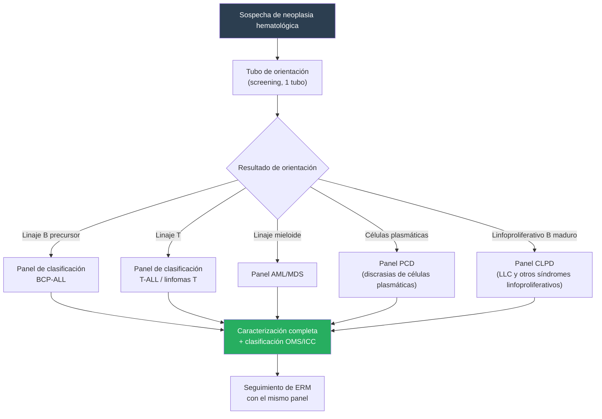
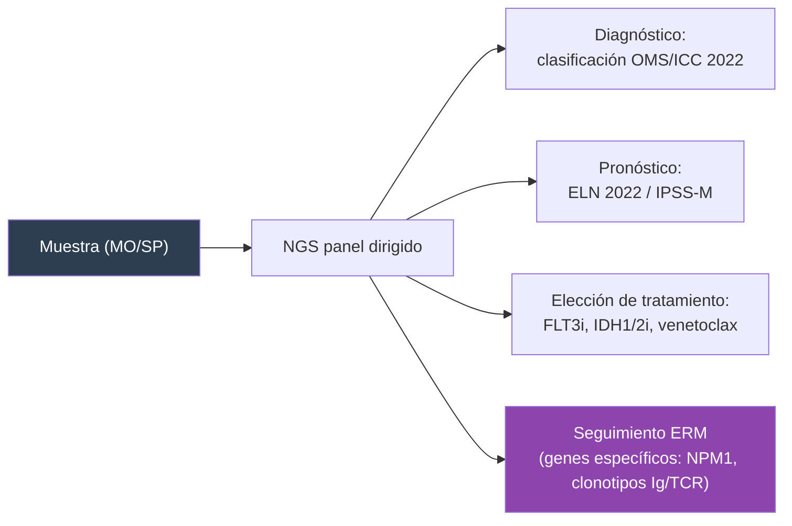
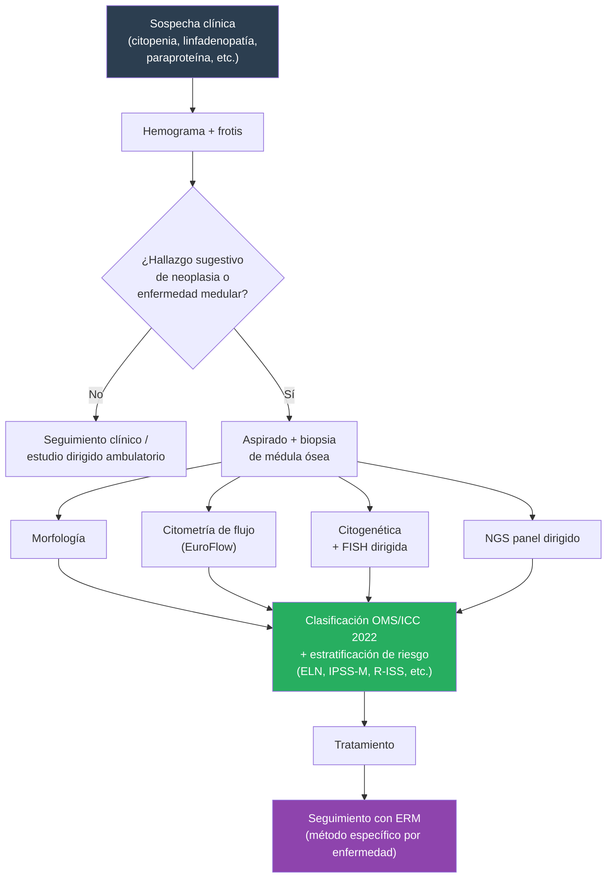

# Laboratorio y diagnóstico

!!! info "Ficha de la página"
    **Última revisión:** 2026-11-12 · **Fuente base:** ICSH 2015 (frotis) [97], ICSH 2008 (médula ósea) [98], EuroFlow (citometría) [99][100], Balciuniene et al. Blood Rev 2024 (citogenética) [101], Cho, Blood Res 2024 (NGS) [102], ELN MRD AML 2018 [103], Munshi et al. JAMA Oncol 2017 (MRD mieloma) [104], ELN CML 2020 [105] · **Alcance:** fundamentos y uso clínico del hemograma, el frotis, el estudio de médula ósea, la citometría de flujo, la citogenética/FISH, la biología molecular/NGS y la enfermedad residual medible (ERM/MRD). Página transversal de referencia rápida; el detalle clínico de cada enfermedad está en su página dedicada.

---

## 1 · Resumen rápido

1. El **hemograma automatizado** da la primera orientación; los *flags* del equipo y los índices (VCM, HCM, ADE, IRF, IRP) determinan si se necesita **revisión de frotis** [97].
2. El **frotis de sangre periférica** sigue siendo insustituible: blastos, esquistocitos, dacriocitos o plaquetas gigantes cambian el manejo en minutos, antes de cualquier resultado de laboratorio especializado [97].
3. El **aspirado y la biopsia de médula ósea son complementarios**: el aspirado da citología fina (morfología, citometría, citogenética, molecular) y la biopsia da arquitectura, celularidad y fibrosis [98].
4. La **citometría de flujo** (EuroFlow) clasifica el linaje y detecta fenotipos aberrantes en minutos-horas; es el método más usado para enfermedad residual medible (ERM) en leucemias agudas [99][100].
5. **Cariotipo y FISH siguen siendo complementarios a la NGS**, no reemplazados: el cariotipo detecta alteraciones genómicas globales (cariotipo complejo, monosómico) que la NGS dirigida no cubre [101].
6. La **NGS dirigida (panel mieloide)** es hoy estándar de cuidado en LMA y aporta datos de clasificación OMS/ICC 2022, pronóstico ELN y, en algunos genes, seguimiento de ERM [102].
7. La **ERM tiene un método de referencia distinto por enfermedad**: citometría de flujo multiparamétrica en LMA/LLA, NGS de clonotipo o citometría EuroFlow en mieloma, PCR cuantitativa de BCR-ABL1 en escala internacional en LMC [103][104][105].

---

## 2 · Hemograma e índices hematimétricos

### 2.1 Parámetros básicos y su interpretación

| Parámetro | Qué mide | Pistas diagnósticas |
|---|---|---|
| Hb / Hto | Masa eritrocitaria | Anemia / eritrocitosis — ver [Citopenias y estudio inicial](../benigna/citopenias-estudio-inicial.md) |
| VCM | Volumen corpuscular medio | Micro (< 80 fL), normo, macrocitosis (> 100 fL) — orienta etiología de anemia |
| HCM / CHCM | Hemoglobina por eritrocito / concentración | Hipocromía (ferropenia, talasemia) |
| ADE (RDW) | Amplitud de distribución eritrocitaria | ADE alto + VCM bajo → ferropenia; ADE normal + VCM bajo → talasemia/rasgo |
| Reticulocitos (absolutos) | Producción eritroide activa | Normal adulto: **25–100 × 10⁹/L** (umbral ampliamente citado; varía según método y laboratorio) [97] |
| IRF (fracción de reticulocitos inmaduros) | Reticulocitos más jóvenes | Primer marcador de recuperación medular post-QT/TPH, antes del alza del recuento absoluto |
| Leucocitos + diferencial | Serie blanca | Neutrofilia/neutropenia, linfocitosis, eosinofilia — ver página de citopenias |
| Plaquetas + VPM | Serie plaquetaria | VPM alto en destrucción periférica; VPM bajo/normal en fallo de producción |

!!! tip "Índice de producción reticulocitaria (IPR)"
    En anemia, el recuento de reticulocitos "crudo" sobreestima la respuesta medular porque los reticulocitos circulan más tiempo cuando el hematocrito es bajo. El **IPR** corrige por el grado de anemia y por el tiempo de maduración, y es el parámetro que realmente distingue producción adecuada de inadecuada frente a una anemia dada.

### 2.2 Cuándo el equipo automatizado no basta

Los analizadores hematológicos generan **alertas (*flags*) cualitativas y cuantitativas** que disparan la revisión manual del frotis: presencia de blastos sospechados, células inmaduras, agregados plaquetarios, o discrepancias entre parámetros [97]. Las políticas de revisión de frotis (criterios de acción tipo Barnes/ICSH) son responsabilidad de cada laboratorio, pero deben garantizar que ninguna alteración morfológicamente significativa pase inadvertida.

---

## 3 · Frotis de sangre periférica

### 3.1 Por qué sigue siendo central

El frotis de sangre periférica, bien confeccionado y teñido, junto con los datos del hemograma y la experiencia del observador, **añade información que ningún parámetro automatizado reemplaza** [97]. Las guías ICSH 2015 estandarizaron la nomenclatura y los grados de severidad para hallazgos de glóbulos rojos, blancos y plaquetas, con el objetivo de reducir la variabilidad entre laboratorios [97].

### 3.2 Hallazgos de alta relevancia clínica inmediata

| Hallazgo | Significado | Urgencia |
|---|---|---|
| Blastos circulantes / bastones de Auer | Leucemia aguda, LPMA si promielocitos anómalos | 🚨 Inmediata |
| Esquistocitos (> 1 %) | Microangiopatía trombótica (PTT, SHU, CID, HELLP, válvula mecánica) | 🚨 Inmediata |
| Dacriocitos + eritroblastos circulantes | Cuadro leucoeritroblástico → infiltración/fibrosis medular | Urgente |
| Rouleaux / fondo basófilo | Paraproteína (mieloma, Waldenström) | Preferente |
| Hipersegmentación de neutrófilos + macrocitosis | Megaloblástica (B12/folato) | Preferente |
| Plaquetas gigantes | Trastorno congénito (Bernard-Soulier, MYH9) o destrucción periférica acelerada | Según contexto |
| Células en diana (target cells) | Hepatopatía, talasemia, déficit de LCAT | Según contexto |
| Esferocitos | Esferocitosis hereditaria, AHAI | Según contexto |

### 3.3 Reglas prácticas de redacción del informe

- Usar la nomenclatura estandarizada (ICSH) para los grados de severidad: ausente / leve / moderado / marcado, en lugar de porcentajes idiosincrásicos [97].
- Correlacionar siempre con el hemograma automatizado: un hallazgo morfológico sin alteración numérica concordante obliga a repetir o verificar.
- Documentar el contexto clínico cuando esté disponible (p. ej. "esquistocitos + plaquetopenia en paciente con anemia hemolítica aguda" apunta a MAT).

---

## 4 · Aspirado y biopsia de médula ósea

### 4.1 Indicaciones

| Indicación | Comentario |
|---|---|
| Citopenia(s) inexplicada(s) | Especialmente si hay blastos, cuadro leucoeritroblástico o pancitopenia persistente — ver [Citopenias y estudio inicial](../benigna/citopenias-estudio-inicial.md) |
| Sospecha de leucemia aguda o síndrome mielodisplásico | Diagnóstico y clasificación OMS/ICC |
| Estadificación de linfoma | Infiltración medular |
| Estudio de gammapatía monoclonal / mieloma | Porcentaje de células plasmáticas clonales |
| Fiebre de origen desconocido en inmunosuprimido | Cultivo, histopatología (granulomas, hemofagocitosis) |
| Evaluación de respuesta/ERM post-tratamiento | Leucemias agudas, SMD, mieloma |
| Sospecha de aplasia medular | Celularidad, descartar infiltración |

### 4.2 Aspirado vs. biopsia (trefina): complementarios, no intercambiables

El aspirado y la biopsia trefina **son complementarios**; cuando ambos se obtienen, proporcionan una evaluación integral de la médula ósea, y la interpretación final requiere integrar ambos hallazgos junto con la sangre periférica y los estudios complementarios (inmunofenotipo, citogenética, molecular) [98].

| | Aspirado | Biopsia (trefina) |
|---|---|---|
| **Qué evalúa** | Citología fina, morfología celular individual | Arquitectura, celularidad global, fibrosis, infiltración focal |
| **Indicación obligatoria** | Siempre que sea posible | **Obligatoria** si aspirado seco ("dry tap"), para descartar fibrosis/infiltración |
| **Longitud mínima recomendada (OMS)** | — | ≥ 1,5 cm con ≥ 10 áreas intertrabeculares preservadas |
| **Permite** | Citometría de flujo, citogenética, molecular, tinción de hierro medular | Inmunohistoquímica, evaluación de celularidad y fibrosis (reticulina) |
| **Sitio preferido** | Cresta ilíaca posterior (anterior si el paciente no puede movilizarse) | Cresta ilíaca posterior |

!!! warning "Precauciones técnicas"
    - El **orden de obtención es relevante**: tomar primero la biopsia libera elementos tromboplásticos que pueden coagular la muestra y comprometer la calidad del aspirado subsiguiente.
    - El **aspirado esternal** solo debe realizarlo un operador experimentado por el riesgo de taponamiento cardíaco; no se recomienda para biopsia trefina [98].
    - En **aspirado seco**, se debe realizar un "roll" (impronta) de la biopsia trefina antes de fijarla, para maximizar el rendimiento citológico [98].

### 4.3 Qué incluir en el informe integrado

Según los lineamientos ICSH, el informe combinado de aspirado + biopsia debe integrar: celularidad relativa a la edad, relación mieloide:eritroide, morfología y maduración de cada serie, presencia de blastos (recuento y localización), fibrosis (grado de reticulina), hierro de depósito, y los hallazgos de inmunofenotipo/citogenética/molecular cuando estén disponibles [98].

---

## 5 · Citometría de flujo

### 5.1 Principio y utilidad

La citometría de flujo multiparamétrica permite identificar el linaje de las células leucémicas y caracterizar fenotipos aberrantes mediante paneles de anticuerpos monoclonales fluorescentes. Junto con la cito/histomorfología y la citogenética molecular, es esencial para la identificación, cuantificación y caracterización de células leucémicas y linfomatosas [99].

### 5.2 Estrategia EuroFlow

El consorcio **EuroFlow** desarrolló y validó paneles de 8 colores completamente estandarizados —procedimientos de laboratorio, ajuste de instrumento y combinaciones de fluorocromos— para lograr resultados comparables entre laboratorios [100]:

El **ALOT (Acute Leukemia Orientation Tube)** es el tubo de orientación estandarizado de EuroFlow para leucemia aguda: con solo 8 marcadores (MPO, cyCD79a, CD34, CD19, CD3, cyCD3, CD7, CD45) dirige hacia LLA-B precursora, LLA-T o LMA antes de aplicar el panel de clasificación extendido correspondiente.

### 5.3 Usos clínicos principales

| Escenario | Panel / enfoque |
|---|---|
| Leucemia aguda al diagnóstico | ALOT → panel de clasificación según linaje |
| LLC y síndromes linfoproliferativos B maduros | Panel CLPD (CD5, CD23, CD10, FMC7, kappa/lambda, etc.) |
| Discrasias de células plasmáticas (mieloma) | Panel PCD (CD38, CD138, CD56, CD19, CD45, citoplasma de cadenas ligeras) |
| ERM en LLA-B | Sensibilidad ≤ 10⁻⁵ con EuroFlow estandarizado si se adquieren ≥ 4 millones de células [100] |
| Hemoglobinuria paroxística nocturna | Panel específico GPI-AP (CD55, CD59, FLAER) — ver [Anemias hemolíticas](../benigna/anemias-hemoliticas.md) |

### 5.4 Fortalezas y limitaciones

- **Fortalezas**: rápida (horas), alta sensibilidad para ERM, permite inmunofenotipos complejos y cuantificación precisa de poblaciones aberrantes.
- **Limitaciones**: requiere laboratorio especializado y muestra viable (fresca); el fenotipo puede desviar (*shift*) entre diagnóstico y recaída, lo que puede generar falsos negativos si solo se busca el inmunofenotipo original.

---

## 6 · Citogenética y FISH

### 6.1 Cariotipo convencional

El cariotipo con bandeo G sigue siendo el método de referencia histórico para detectar la mayoría de estas aberraciones; su capacidad de examinar el genoma completo permite detectar deleciones, duplicaciones y reordenamientos estructurales en cualquier cromosoma [101]. Su nomenclatura se rige por el **ISCN** (International System for Human Cytogenomic Nomenclature), que establece reglas uniformes para describir los hallazgos: por ejemplo, un cariotipo normal masculino se escribe 46,XY, y una t(9;22) se describe como 46,XY,t(9;22)(q34.1;q11.2) [101].

**Limitaciones del cariotipo**: requiere células en división (cultivo), tiene menor resolución (~5–10 Mb) y puede fallar por falta de metafases o cultivo fallido.

### 6.2 FISH (hibridación in situ fluorescente)

La FISH es un complemento importante a la citogenética convencional y a los estudios moleculares para evaluar alteraciones cromosómicas asociadas a neoplasias hematológicas; en varios escenarios ofrece una de las estrategias más sensibles, específicas y confiables para identificar cambios cromosómicos adquiridos [103, en el sentido amplio de biomarcadores — ver también 101].

**Indicaciones principales de FISH** (no exhaustivo):

- Confirmación dirigida cuando el contexto clínico/hematológico/patológico sugiere una anomalía específica.
- Anomalías con alta tasa de "falsos negativos" por cariotipo convencional (p. ej. deleciones crípticas).
- Análisis en núcleos en interfase cuando el cariotipo convencional falla o no es posible (p. ej. tejido fijado).
- Aclarar hallazgos cariotípicos complejos o ambiguos.
- Como marcador sustituto de un evento genético primario conocido (p. ej. BCR-ABL1, PML-RARA).

| Sonda / alteración | Enfermedad típica |
|---|---|
| BCR-ABL1 (t(9;22)) | LMC, LLA Ph+ |
| PML-RARA (t(15;17)) | LPMA |
| CBFB-MYH11 (inv(16)) / RUNX1-RUNX1T1 (t(8;21)) | LMA con alteraciones CBF |
| KMT2A (11q23) | LMA/LLA con reordenamiento KMT2A |
| del(17p) / TP53 | Peor pronóstico transversal (LLC, LMA, SMD) |
| del(13q14), del(11q22) (ATM), trisomía 12 | LLC — estratificación pronóstica |
| t(11;14), t(4;14), t(14;16), del(17p), 1q+ | Mieloma múltiple — estratificación de riesgo |
| del(5q), del(7q), del(20q), +8 | SMD — clasificación OMS e IPSS-R |

### 6.3 Cariotipo vs. FISH: rendimiento comparativo

La concordancia global entre FISH y cariotipo convencional en series de neoplasias hematológicas es moderada; el cariotipo puede detectar anomalías secundarias no cubiertas por el panel de sondas FISH, mientras que la FISH detecta alteraciones en casos con cultivo fallido o cariotipo normal [101]. Por eso ambos estudios se solicitan de forma complementaria, no sustitutiva, en el estudio diagnóstico inicial de la mayoría de neoplasias hematológicas agudas.

### 6.4 Más allá de FISH: microarreglos cromosómicos (CMA) y genómica

Los microarreglos cromosómicos (CMA) detectan alteraciones de número de copias y pérdida de heterocigosidad copy-neutral en todo el genoma, con mayor resolución que el cariotipo y la FISH, siendo especialmente útiles cuando el cultivo para cariotipo falla y como complemento en LLA, SMD y mieloma [101]. La secuenciación de nueva generación amplía aún más esta capacidad, incorporando dimensiones moleculares que el cariotipo y la FISH no cubren por sí solos [101].

---

## 7 · Biología molecular y secuenciación de nueva generación (NGS)

### 7.1 Rol de la NGS en hematología

La NGS permite detectar simultáneamente múltiples alteraciones genéticas dominantes y subclonales, lo que la ha convertido en un componente central del laboratorio clínico en los últimos 15 años [102]. Las clasificaciones OMS 2022 e ICC 2022 priorizan las anomalías genéticas para el diagnóstico, pronóstico, seguimiento de ERM y elección de tratamiento en neoplasias mieloides [102].

### 7.2 Paneles mieloides dirigidos (NGS)

Los paneles comerciales y de laboratorio actuales cubren típicamente 30–150 genes relevantes en neoplasias mieloides. Las recomendaciones ELN 2022 identifican genes/fusiones objetivo que deben secuenciarse al diagnóstico para una decisión terapéutica óptima en LMA [consultar tabla de genes en la página de LMA].

| Enfermedad | Genes/alteraciones clave detectadas por NGS |
|---|---|
| LMA | FLT3-ITD/TKD, NPM1, CEBPA, IDH1/2, TP53, RUNX1, ASXL1, ELN 2022 (panel completo) |
| SMD | SF3B1, TET2, ASXL1, SRSF2, TP53, DNMT3A, U2AF1, RUNX1 — ver [SMD](../hemato-onco/sindrome-mielodisplasico.md) e IPSS-M |
| LMMC | TET2, SRSF2, ASXL1, mutaciones RAS — ver [LMMC](../hemato-onco/lmmc.md) |
| NMP Ph-negativas (PV/TE/MFP) | JAK2 V617F / exón 12, CALR, MPL; permite confirmar "triple negativos" en algunos casos — ver [Citopenias y estudio inicial](../benigna/citopenias-estudio-inicial.md) § eritrocitosis |
| Predisposición germinal | DDX41 (la mutación germinal más frecuente identificada en LMA/SMD), requiere interpretación cuidadosa variante germinal vs. somática |

!!! note "Limitación importante"
    El diagnóstico de LMC **no es posible con NGS**: depende de la demostración de BCR-ABL1 por citogenética/FISH/PCR, no de un panel mutacional.

### 7.3 NGS como herramienta diagnóstica, pronóstica y de seguimiento

La concordancia entre NGS y FISH para la detección de fusiones génicas es alta en estudios comparativos directos, aunque pueden existir discordancias puntuales (fusiones detectadas por una técnica y no por la otra), lo que refuerza el uso complementario de ambas [información general de validaciones de panel — ver referencias de la sección 6].

---

## 8 · Enfermedad residual medible (ERM / MRD)

### 8.1 Concepto general

La enfermedad residual medible (ERM, anteriormente llamada "enfermedad mínima residual") denota la presencia de células leucémicas en niveles de 1:10⁴ a 1:10⁶ leucocitos, muy por debajo del umbral morfológico de 5 % de blastos usado para definir remisión completa clásica [103]. Es un indicador pronóstico independiente, post-diagnóstico, relevante para la estratificación de riesgo y la planificación del tratamiento [103].

### 8.2 Métodos según enfermedad — tabla comparativa

| Enfermedad | Método de referencia | Sensibilidad típica | Fuente |
|---|---|---|---|
| **LMA** | Citometría de flujo multiparamétrica (MFC); NGS no recomendada como prueba única por datos insuficientes | 10⁻⁴ a 10⁻⁵ | ELN MRD AML 2018 [103] |
| **LLA-B** | Citometría de flujo EuroFlow estandarizada o PCR cuantitativa de reordenamientos Ig/TCR | ≤ 10⁻⁵ (con ≥ 4 × 10⁶ células) | EuroFlow [100] |
| **LMC** | PCR cuantitativa de BCR-ABL1 en escala internacional (IS) | Hasta MR5 (BCR-ABL1 ≤ 0,001 % IS) | ELN CML 2020 [105] |
| **Mieloma múltiple** | Citometría de flujo de nueva generación (NGF, EuroFlow) o NGS de clonotipo (p. ej. clonoSEQ) | ≥ 10⁻⁵ a 10⁻⁶ | IMWG / Munshi et al. [104] |
| **LLC** | Citometría de flujo multiparamétrica | 10⁻⁴ a 10⁻⁶ según panel | ERIC/EuroFlow (concepto análogo a EuroFlow) |

### 8.3 LMA: recomendaciones ELN 2018

El panel de trabajo ELN-MRD subdividió sus recomendaciones en tres partes: citometría de flujo, métodos moleculares, y aplicación clínica [103]. Puntos clave:

- La **citometría de flujo** detecta blastos aberrantes (p. ej. CD34+ con inmunofenotipo anómalo) tanto en sangre (sensibilidad algo menor) como en médula [datos generales de validación clínica].
- Los **métodos moleculares** (qPCR) se recomiendan especialmente para mutaciones con buena correlación cuantitativa, como NPM1 mutado.
- La **NGS no está recomendada como prueba única** para ERM en LMA por datos insuficientes sobre sensibilidad y especificidad comparadas con MFC/qPCR, aunque se usa ampliamente en el panel diagnóstico inicial [103].
- El **momento de evaluación** (post-inducción, pre-trasplante, durante seguimiento) y el compartimento (sangre vs. médula) modifican la interpretación: la ERM positiva pre-trasplante se asocia a mayor riesgo de recaída.

### 8.4 Mieloma múltiple: criterios IMWG

La negatividad de ERM se asocia consistentemente a mejor supervivencia libre de progresión y supervivencia global en mieloma múltiple, tanto en el contexto de trasplante autólogo como en regímenes sin trasplante, según el metaanálisis de Munshi et al. [104]. El IMWG define la **ERM-negatividad por citometría de flujo** como la ausencia de células plasmáticas clonales aberrantes mediante citometría de flujo de nueva generación (EuroFlow o equivalente validado) sobre aspirado de médula ósea, con una sensibilidad mínima especificada; la **ERM-negatividad molecular** se define mediante NGS de secuencias clonotípicas de inmunoglobulina.

### 8.5 LMC: escala internacional (IS)

El monitoreo molecular de BCR-ABL1 mediante PCR cuantitativa en tiempo real, estandarizado a la escala internacional de reporte, es la estrategia de monitoreo principal recomendada para pacientes con LMC [105]. Los hitos de respuesta molecular según ELN 2020:

| Hito temporal | Respuesta óptima (ELN) |
|---|---|
| 3 meses | BCR-ABL1 ≤ 10 % IS |
| 6 meses | BCR-ABL1 < 1 % IS |
| 12 meses | BCR-ABL1 ≤ 0,1 % IS (= RMM, respuesta molecular mayor) |
| Cualquier momento, para optar a TFR | BCR-ABL1 ≤ 0,01 % IS (= RM4) de forma sostenida |

La citogenética ya no se recomienda para el monitoreo de rutina una vez alcanzada la respuesta citogenética completa; el monitoreo pasa a ser exclusivamente molecular [105].

### 8.6 Interpretación práctica para el residente

!!! tip "Claves de interpretación de ERM"
    - La ERM **no sustituye** el juicio clínico ni la morfología; es un dato cuantitativo adicional que modifica probabilidades, no un veredicto binario aislado.
    - El **compartimento de muestra** (sangre vs. médula) y el **momento de la medición** deben indicarse siempre: la misma "positividad" tiene distinto peso pronóstico según el contexto.
    - Un **resultado negativo no excluye recaída futura**: la sensibilidad de cada método tiene un límite de detección, y la ERM puede reaparecer en controles posteriores.
    - Ante **discordancia entre métodos** (p. ej. flujo negativo pero PCR positiva), prevalece el método con mayor sensibilidad validada para esa enfermedad específica.

---

## 9 · Algoritmo integrado: de la sospecha clínica al diagnóstico de precisión

---

## 10 · Evidencia clave

| Fuente | Aporte principal | Ref |
|---|---|---|
| Palmer et al. ICSH 2015 | Nomenclatura y gradación estandarizada de hallazgos morfológicos en frotis de sangre periférica | [97] |
| Lee et al. ICSH 2008 | Estandarización internacional de especímenes e informes de médula ósea (aspirado + trefina) | [98] |
| Palmer... / consenso ICSH (frotis, acción post-CBC) | Criterios de revisión de frotis tras hemograma automatizado alterado | [97] |
| Kalina et al. (EuroFlow) Leukemia 2012 | Estandarización de ajustes de citómetro y protocolos de inmunofenotipaje de 8 colores | [99] |
| van Dongen et al. (EuroFlow) | Paneles de anticuerpos de 8 colores validados para diagnóstico y clasificación de neoplasias hematológicas | [100] |
| Balciuniene et al. Blood Rev 2024 | Rol continuo de citogenética convencional y FISH frente a NGS/CMA/OGM en la era genómica | [101] |
| Cho, Blood Res 2024 | Revisión del rol de la NGS en diagnóstico, pronóstico y seguimiento de neoplasias hematológicas | [102] |
| Schuurhuis et al. (ELN MRD) Blood 2018 | Consenso internacional de ERM en LMA: citometría, métodos moleculares y aplicación clínica | [103] |
| Munshi et al. JAMA Oncol 2017 | Metaanálisis: ERM-negatividad se asocia a mejor SLP y SG en mieloma múltiple | [104] |
| Hochhaus et al. (ELN) Leukemia 2020 | Recomendaciones ELN 2020 para LMC, incluido monitoreo molecular en escala internacional | [105] |

---

## 11 · Seguridad y consideraciones prácticas

- **Médula ósea**: analgesia local adecuada, considerar sedación/analgesia complementaria según tolerancia del paciente; vigilar sangrado en pacientes trombocitopénicos o anticoagulados (suspender anticoagulación según riesgo-beneficio).
- **Citometría/molecular**: la viabilidad celular es crítica — procesar la muestra idealmente dentro de las 24–48 horas de la extracción; el retraso o la mala conservación pueden generar falsos negativos.
- **Interpretación conjunta**: ningún resultado aislado (morfología, citometría, citogenética o molecular) debe interpretarse fuera del contexto clínico e integrado con los demás estudios — el informe final combinado es responsabilidad del hematólogo/patólogo tratante [98].

---

## 12 · Puntos clave para el residente

!!! success "Lo esencial"

    1. El hemograma automatizado **orienta**, pero el frotis **confirma o descarta** urgencias (blastos, esquistocitos) — nunca te saltes la revisión manual ante una alerta.
    2. Aspirado y biopsia de médula son **complementarios**: pide ambos cuando sea posible, y recuerda que la biopsia es obligatoria ante aspirado seco [98].
    3. EuroFlow estandarizó la citometría de flujo: el ALOT orienta el linaje en minutos, y el mismo marco se usa para ERM.
    4. **Cariotipo y FISH no son redundantes con NGS**: cada uno detecta alteraciones que el otro puede pasar por alto; se piden de forma complementaria [101].
    5. La NGS es hoy estándar en LMA/SMD pero **no diagnostica LMC** (eso depende de BCR-ABL1 por citogenética/FISH/PCR).
    6. La ERM **no es un concepto único**: el método de referencia, la sensibilidad y el umbral de positividad cambian según la enfermedad — no extrapoles criterios de una enfermedad a otra.
    7. Siempre que solicites un estudio de laboratorio especializado, pregúntate: *¿qué decisión clínica cambia este resultado?* — eso evita solicitudes innecesarias y orienta la interpretación.

---

## 13 · Autoevaluación

??? question "Caso 1 — Alerta del hemograma"
    Paciente hospitalizado, hemograma automatizado marca "blast flag" con leucocitos 15 × 10⁹/L. ¿Cuál es tu siguiente paso inmediato?

    **Respuesta**: Revisión manual del frotis de sangre periférica sin demora. La alerta de blastos del equipo automatizado debe confirmarse morfológicamente antes de cualquier otra acción; si se confirman blastos con bastones de Auer, esto constituye una urgencia hematológica (posible LPMA) [97].

??? question "Caso 2 — Aspirado seco"
    Al intentar aspirado de médula ósea en cresta ilíaca posterior, no se obtiene material líquido ("dry tap"). ¿Qué debes hacer?

    **Respuesta**: Proceder a biopsia trefina (si no se había planificado) y realizar una impronta ("roll") de la biopsia antes de fijarla, para maximizar el rendimiento citológico pese al aspirado seco [98]. El aspirado seco es también, en sí mismo, un dato: sugiere fibrosis medular o infiltración extensa.

??? question "Caso 3 — Discordancia cariotipo/FISH"
    En un paciente con LMA, el cariotipo muestra alteraciones complejas, pero la FISH dirigida para PML-RARA es negativa. ¿Esto descarta razonablemente una alteración relevante no cubierta por la sonda?

    **Respuesta**: No. La FISH solo informa sobre lo que la sonda específica busca; un cariotipo complejo puede contener alteraciones adicionales no cubiertas por el panel de sondas FISH empleado [101]. Ambos estudios son complementarios: el cariotipo ofrece una visión genómica global (aunque de menor resolución), mientras que la FISH es más sensible para la alteración específica que investiga.

??? question "Caso 4 — Interpretación de ERM en LMC"
    Paciente con LMC en tratamiento con imatinib, PCR BCR-ABL1 a los 12 meses = 0,05 % IS. ¿Cómo interpretas este resultado y qué sigue?

    **Respuesta**: BCR-ABL1 ≤ 0,1 % IS a los 12 meses corresponde a respuesta molecular mayor (RMM), la respuesta óptima según ELN 2020 [105]. El paciente continúa el mismo TKI con monitoreo molecular periódico; no se requiere cambio de tratamiento. Si en el futuro mantiene BCR-ABL1 ≤ 0,01 % IS (RM4) de forma sostenida, podría eventualmente evaluarse para un intento de remisión libre de tratamiento (TFR).

---

## 14 · Referencias

Las referencias [97]–[105] se encuentran en la [lista de referencias](../referencias.md) de la wiki.

| Cita | Descripción breve |
|---|---|
| [97] | Palmer et al. — nomenclatura y gradación ICSH de morfología de frotis (Int J Lab Hematol 2015) |
| [98] | Lee et al. — guías ICSH de estandarización de especímenes e informes de médula ósea (Int J Lab Hematol 2008) |
| [99] | Kalina et al. — estandarización EuroFlow de instrumento y protocolos de inmunofenotipaje (Leukemia 2012) |
| [100] | van Dongen et al. — paneles de anticuerpos EuroFlow de 8 colores (Leukemia 2012) |
| [101] | Balciuniene et al. — citogenética del cáncer en la era genómica (Blood Rev 2024) |
| [102] | Cho — rol de la NGS en neoplasias hematológicas (Blood Res 2024) |
| [103] | Schuurhuis et al. — consenso ELN MRD Working Party en LMA (Blood 2018) |
| [104] | Munshi et al. — metaanálisis de ERM y supervivencia en mieloma (JAMA Oncol 2017) |
| [105] | Hochhaus et al. — recomendaciones ELN 2020 para LMC (Leukemia 2020) |

---

## 15 · Pendientes

- [ ] Ampliar sección de medicina transfusional (umbrales de transfusión, pruebas pretransfusionales) — ver también *Transversal → Medicina transfusional* (pendiente de desarrollo)
- [ ] Agregar tabla de interpretación de electroforesis de proteínas e inmunofijación (contexto de gammapatías)
- [ ] Desarrollar sección de pruebas de coagulación básicas (TP, TTPA, fibrinógeno, dímero-D) — actualmente cubiertas parcialmente en [Hemostasia y trombosis](../benigna/hemostasia-trombosis.md)
- [ ] Incluir panel de citometría de flujo específico para HPN (ya mencionado, pendiente de tabla detallada de marcadores)
- [ ] Agregar referencias locales (Chile) sobre disponibilidad de NGS y FISH en la red pública de salud
- [ ] Verificar PMID/DOI de Kalina et al. 2012 y van Dongen et al. 2012 contra texto completo (actualmente verificado por metadatos/resumen)
