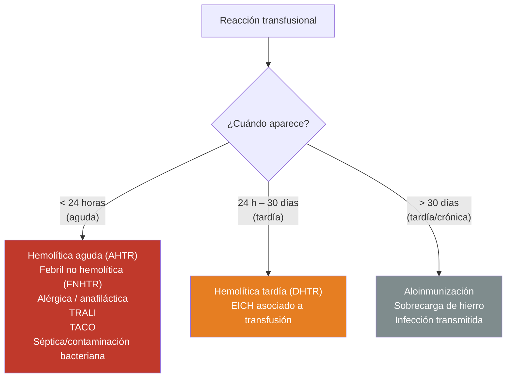
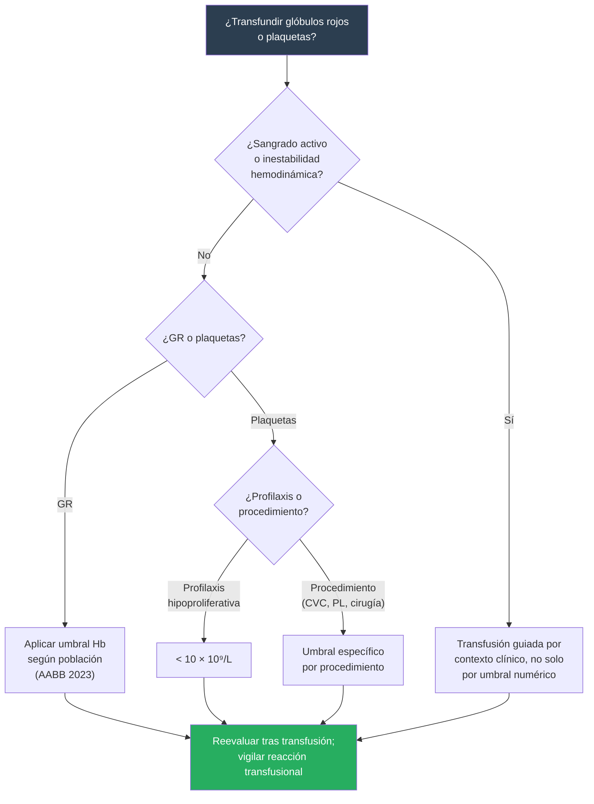

# Medicina transfusional

!!! info "Ficha de la página"
    **Última revisión:** 2026-11-12 · **Fuente base:** Carson et al. AABB 2023 (umbral GR) [106], Kaufman et al. AABB 2015 (plaquetas, procedimientos) [107], Schiffer et al. ASCO 2018 (plaquetas, oncología) [108], Connelly-Smith et al. ASFA 9.ª edición 2023 (aféresis) [109], Delaney et al. Lancet 2016 (reacciones transfusionales) [110] · **Alcance:** indicaciones y umbrales de transfusión de glóbulos rojos y plaquetas, clasificación y manejo de reacciones transfusionales, y categorías de aféresis terapéutica. La transfusión masiva en el contexto de hemorragia crítica se desarrolla en [Urgencias hematológicas](urgencias-hematologicas.md).

---

## 1 · Resumen rápido

1. Para adultos hospitalizados hemodinámicamente estables, la **estrategia restrictiva** (transfundir con Hb < 7 g/dL) es tan segura como la liberal y evita exposición innecesaria — incluida la mayoría de los pacientes hemato-oncológicos [106].
2. Los umbrales de GR se ajustan por contexto: 7,5 g/dL en cirugía cardíaca, 8 g/dL en cirugía ortopédica o enfermedad cardiovascular preexistente; en cardiopatía congénita pediátrica el umbral depende de la lesión y el estado de corrección [106].
3. El umbral plaquetario profiláctico estándar es **< 10 × 10⁹/L** en trombocitopenia hipoproliferativa inducida por quimioterapia o trasplante [107][108]. Los umbrales procedimentales (CVC, punción lumbar, cirugía mayor) son distintos y están basados en evidencia de baja calidad [107].
4. En trasplante autólogo de precursores hematopoyéticos en centros con experiencia, es razonable **transfundir plaquetas recién al primer signo de sangrado** en lugar de profilaxis por umbral — el cambio más relevante de la actualización ASCO 2018 [108].
5. Las reacciones transfusionales se clasifican por **tiempo de aparición** (agudas < 24 h vs. tardías) y la distinción clínica más relevante en agudas graves es **TRALI vs. TACO**, que comparten disnea pero difieren en mecanismo y respuesta a diuréticos [110].
6. La aféresis terapéutica se guía por el sistema de **categorías ASFA** (I a IV) y grados de recomendación (1A–2C); el recambio plasmático es de primera línea en PTT y la trombocitaféresis es categoría I en trombocitosis sintomática [109].

---

## 2 · Transfusión de glóbulos rojos (GR)

### 2.1 Umbrales según población — AABB 2023

Las guías AABB 2023 se basan en 45 ensayos aleatorizados en adultos (20.599 participantes) y 7 en pediatría (2.730 participantes), comparando umbrales restrictivos (7–8 g/dL) con liberales (9–10 g/dL) [106].

| Población | Umbral recomendado | Fuerza / certeza |
|---|---|---|
| Adultos hospitalizados, hemodinámicamente estables | Hb < 7 g/dL (estrategia restrictiva) | Fuerte, certeza moderada [106] |
| Pacientes hemato-oncológicos hospitalizados | Hb < 7 g/dL (estrategia restrictiva) | Condicional, certeza baja [106] |
| Niños críticamente enfermos, estables, sin hemoglobinopatía/cardiopatía cianótica/hipoxemia severa | Hb < 7 g/dL | Fuerte, certeza moderada [106] |
| Cardiopatía congénita — reparación biventricular | Hb < 7 g/dL | Condicional, certeza baja [106] |
| Cardiopatía congénita — paliación univentricular | Hb < 9 g/dL | Condicional, certeza baja [106] |
| Cardiopatía congénita no corregida | Hb 7–9 g/dL | Condicional, certeza baja [106] |
| Cirugía cardíaca (subgrupo) | Hb < 7,5 g/dL | Según umbral usado en ensayos [106] |
| Cirugía ortopédica / enfermedad cardiovascular preexistente | Hb < 8,0 g/dL | Según umbral usado en ensayos [106] |

!!! note "IAM agudo"
    AABB 2023 **no emite recomendación** a favor ni en contra de un umbral específico en infarto agudo de miocardio — evidencia insuficiente [106].

### 2.2 Principio general

La transfusión de GR debe considerar siempre el **contexto clínico global** y las alternativas terapéuticas disponibles antes de decidir por un paciente individual — el umbral numérico orienta, no sustituye el juicio clínico [106].

---

## 3 · Transfusión de plaquetas

### 3.1 Umbrales profilácticos — hipoproliferación y oncología

| Indicación | Umbral | Fuente |
|---|---|---|
| Trombocitopenia hipoproliferativa en hospitalizados (profilaxis general) | ≤ 10 × 10⁹/L | AABB 2015 [107] |
| Quimioterapia (tumores sólidos y neoplasias hematológicas) | < 10 × 10⁹/L | ASCO 2018 [108] |
| Trasplante alogénico de precursores hematopoyéticos | < 10 × 10⁹/L (profilaxis por umbral) | ASCO 2018 [108] |
| Trasplante autólogo en adultos, centros con experiencia | **Alternativa**: transfundir al primer signo de sangrado en vez de por umbral | ASCO 2018 [108] |
| Trasplante autólogo pediátrico | Profilaxis por umbral definido | ASCO 2018 [108] |
| Dosis por transfusión | Hasta 1 unidad de aféresis o equivalente; dosis mayores no son más eficaces y media unidad es igualmente eficaz | AABB 2015, fuerte/calidad moderada [107] |

### 3.2 Umbrales procedimentales

| Procedimiento | Umbral sugerido | Grado |
|---|---|---|
| Colocación electiva de catéter venoso central | < 20 × 10⁹/L | Débil, calidad baja [107] |
| Punción lumbar diagnóstica electiva | < 50 × 10⁹/L | Débil, calidad muy baja [107] |
| Cirugía mayor electiva no neuroaxial | < 50 × 10⁹/L | Débil, calidad muy baja [107] |
| Cirugía cardíaca con circulación extracorpórea, sin trombocitopenia | **En contra** de profilaxis de rutina; transfundir solo si hay sangrado perioperatorio con trombocitopenia o disfunción plaquetaria | Débil, calidad muy baja [107] |
| Hemorragia intracraneal (traumática o espontánea) en terapia antiplaquetaria | Sin recomendación a favor ni en contra | Incierto, calidad muy baja [107] |

!!! warning "No extrapolar umbrales entre contextos"
    El umbral de < 10 × 10⁹/L para profilaxis hipoproliferativa **no aplica** a procedimientos invasivos, y viceversa — cada contexto tiene su propia evidencia (y en general, de menor calidad para los procedimientos) [107].

---

## 4 · Plasma fresco congelado y crioprecipitado

El plasma fresco congelado (PFC) y el crioprecipitado se usan principalmente para reposición de factores de coagulación y fibrinógeno en sangrado activo o coagulopatía documentada, no de forma profiláctica por alteraciones leves de TP/TTPA aisladas. Su uso en el contexto de **hemorragia crítica y transfusión masiva** (razones GR:PFC:plaquetas, umbral de fibrinógeno) se desarrolla en [Urgencias hematológicas § Hemorragia crítica](urgencias-hematologicas.md#6-hemorragia-critica-y-protocolo-de-transfusion-masiva). El manejo de la coagulopatía de la CID se describe en [Hemostasia y trombosis § 5.3 y § 8.2](../benigna/hemostasia-trombosis.md).

---

## 5 · Reacciones transfusionales

### 5.1 Clasificación por tiempo de aparición

### 5.2 Reacciones agudas — resumen por mecanismo

| Reacción | Mecanismo | Incidencia aproximada | Manejo inicial |
|---|---|---|---|
| **Hemolítica aguda (AHTR)** | Incompatibilidad ABO; hemólisis intravascular | ~1:76.000; fatal ~1:1.800.000 | Detener transfusión; hidratación; vigilar hemoglobinuria, IRA, CID [110] |
| **Febril no hemolítica (FNHTR)** | Anticuerpos anti-HLA del receptor vs. leucocitos del donante; citoquinas acumuladas | La más frecuente (0,1–1 % con leucorreducción universal) | Antipiréticos (paracetamol); descartar hemólisis/sepsis antes de reiniciar [110] |
| **Alérgica / anafiláctica** | Hipersensibilidad tipo I (IgE) a proteínas plasmáticas del donante | Leve 1–3 % de componentes con plasma; anafilaxia grave 1:20.000–1:50.000 | Antihistamínicos (leve); adrenalina, soporte vital (anafilaxia) [110] |
| **TRALI** | Anticuerpos del donante contra neutrófilos/monocitos/endotelio pulmonar del receptor → edema pulmonar no cardiogénico | 1:1.200–1:190.000 | Oxígeno, ventilación de soporte, vasopresores si hay shock; **no responde a diuréticos** [110] |
| **TACO** | Sobrecarga de volumen circulante | 1–2,7 %; causa principal de muerte relacionada a transfusión según notificación FDA | Diuréticos, oxígeno; profilaxis con diuréticos en pacientes de alto riesgo (ICC, IRC) [110] |
| **Séptica/contaminación bacteriana** | Contaminación del componente (más frecuente en plaquetas, por almacenamiento a temperatura ambiente) | Infrecuente pero potencialmente fatal | Detener transfusión; cultivos del componente y del paciente; antibióticos empíricos de amplio espectro |

### 5.3 TRALI vs. TACO — la distinción clínica clave

Ambas cursan con disnea aguda durante o después de la transfusión, pero: **TACO** se asocia a signos de sobrecarga circulatoria (hipertensión, galope S3, respuesta a diuréticos) y a factores de riesgo cardiorrenales previos; **TRALI** no mejora con diuréticos y se asocia a edema pulmonar no cardiogénico con presión de enclavamiento normal [110].

### 5.4 Reacciones tardías

La **hemólisis tardía (DHTR)** ocurre por incompatibilidad de antígenos menores (p. ej. sistema Kidd) no detectada en el estudio pretransfusional, con hemólisis extravascular que se presenta días a meses después [110]. El **EICH asociado a transfusión** es infrecuente pero grave; el riesgo aumenta con inmunosupresión severa del receptor y componentes no irradiados.

---

## 6 · Aféresis terapéutica

### 6.1 Sistema de categorías ASFA (9.ª edición, 2023)

La 9.ª edición de las guías ASFA incorpora 166 indicaciones graduadas y categorizadas (118 relacionadas con recambio plasmático) en 91 fichas, incluidas 7 fichas nuevas desde la edición previa [109].

| Categoría | Significado |
|---|---|
| **I** | Aféresis como tratamiento de primera línea, sola o combinada |
| **II** | Aféresis como tratamiento de segunda línea, sola o combinada |
| **III** | Rol óptimo no establecido; decisión individualizada |
| **IV** | Evidencia sugiere que la aféresis es inefectiva o dañina |

La fuerza de la recomendación (1 = fuerte, 2 = débil) se combina con la calidad de la evidencia (A/B/C); el grado **2C** es el más prevalente en el conjunto de indicaciones [109].

### 6.2 Ejemplos relevantes para hematología

| Indicación | Categoría / grado | Comentario |
|---|---|---|
| Trombocitaféresis en trombocitosis sintomática | I | Reduce rápidamente el recuento plaquetario en crisis sintomáticas [109] |
| Púrpura trombocitopénica trombótica (PTT) | I (recambio plasmático) | Tratamiento de primera línea; ver [Hemostasia y trombosis § 8.1](../benigna/hemostasia-trombosis.md) |
| Leucaféresis en hiperleucocitosis/leucostasis | III | Rol individualizado; no debe retrasar el inicio de quimioterapia definitiva — ver [Urgencias hematológicas § 3](urgencias-hematologicas.md) |
| Recambio de GR en babesiosis grave | III, grado 2C | — |
| Recambio plasmático en resucitación de shock por quemadura | III, grado 2B | — |

### 6.3 Mecanismo y complicaciones

El recambio plasmático (TPE) remueve componentes plasmáticos patogénicos (autoanticuerpos, complejos inmunes, paraproteínas, toxinas); un recambio de un volumen plasmático elimina aproximadamente 65 % de dichos componentes, reponiendo con plasma de donante o albúmina [109]. Las complicaciones incluyen fiebre, escalofríos, hipotensión, **hipocalcemia por toxicidad por citrato**, reacciones alérgicas (si se usa plasma de donante como reposición), infección y complicaciones del catéter. ASFA recomienda medir INR/TTPA/fibrinógeno antes del primer TPE y periódicamente durante el curso de tratamiento [109]. La citaféresis (p. ej. leucaféresis, trombocitaféresis) evita las complicaciones relacionadas con el líquido de reposición, ya que el plasma propio del paciente se retorna.

---

## 7 · Algoritmo integrado: decisión de transfundir

---

## 8 · Evidencia clave

| Fuente | Aporte principal | Ref |
|---|---|---|
| Carson et al. AABB 2023 (JAMA) | Umbrales de transfusión de GR en adultos y niños, restrictivo vs. liberal | [106] |
| Kaufman et al. AABB 2015 (Ann Intern Med) | Guía de transfusión de plaquetas: umbrales profilácticos y procedimentales | [107] |
| Schiffer et al. ASCO 2018 (JCO) | Actualización de transfusión de plaquetas en cáncer; alternativa de transfusión al primer sangrado en TAPH autólogo | [108] |
| Connelly-Smith et al. ASFA 2023, 9.ª edición (J Clin Apher) | Sistema de categorías y grados para 166 indicaciones de aféresis terapéutica | [109] |
| Delaney et al. 2016 (Lancet) | Revisión internacional de fisiopatología, diagnóstico y manejo de reacciones transfusionales | [110] |

---

## 9 · Seguridad

- **Umbral no es sustituto de juicio clínico**: considerar siempre síntomas de anemia (angina, disnea, taquicardia), comorbilidad cardiovascular y trayectoria clínica, no solo la cifra de Hb [106].
- **Reevaluación tras cada unidad**: en adultos, reevaluar clínicamente antes de transfundir la siguiente unidad; evitar transfusión "por protocolo" sin reevaluación.
- **TRALI y sepsis por contaminación** son las reacciones agudas con mayor letalidad relativa pese a su baja frecuencia — mantener un umbral de sospecha bajo ante disnea aguda o fiebre alta con hipotensión durante la transfusión [110].
- **Aféresis**: vigilar signos de hipocalcemia (parestesias periorales, tetania) durante TPE por toxicidad por citrato; disponer de calcio IV en la sala [109].

---

## 10 · Puntos clave para el residente

!!! success "Lo esencial"

    1. Para la mayoría de los adultos hospitalizados estables, incluidos los hemato-oncológicos, el umbral de GR es **Hb < 7 g/dL** — no transfundas "para que se vea mejor el hemograma" [106].
    2. El umbral plaquetario profiláctico estándar es **< 10 × 10⁹/L**, pero los umbrales de procedimiento (CVC < 20, PL y cirugía mayor < 50) son distintos y se basan en evidencia más débil [107].
    3. En TAPH autólogo en centros con experiencia, **esperar al primer sangrado** en vez de transfundir profilácticamente por umbral es una alternativa válida — no la única opción, pero sí la novedad principal de ASCO 2018 [108].
    4. Ante disnea aguda durante o después de una transfusión, distingue **TRALI de TACO**: la respuesta a diuréticos y los factores de riesgo cardiorrenales apuntan a TACO; su ausencia, a TRALI [110].
    5. La aféresis terapéutica no es un tratamiento único — su indicación, categoría ASFA y grado de evidencia cambian completamente según la enfermedad; el recambio plasmático en PTT es categoría I, la leucaféresis en leucostasis es categoría III [109].
    6. La transfusión masiva en hemorragia crítica tiene sus propias reglas (razones de componentes, umbral de fibrinógeno) — ver [Urgencias hematológicas](urgencias-hematologicas.md).

---

## 11 · Autoevaluación

??? question "Caso 1 — Umbral de GR en paciente oncológico"
    Paciente con linfoma en quimioterapia, hospitalizado, hemodinámicamente estable, Hb 7,8 g/dL, sin síntomas de anemia. ¿Transfundes?

    **Respuesta**: No, en principio. El umbral restrictivo recomendado para pacientes hemato-oncológicos hospitalizados estables es Hb < 7 g/dL (recomendación condicional, certeza baja) [106]. Con Hb 7,8 g/dL y sin síntomas, se prefiere observación y reevaluación clínica antes que transfusión.

??? question "Caso 2 — Plaquetas antes de punción lumbar"
    Paciente con LLA, plaquetas 35 × 10⁹/L, se programa punción lumbar diagnóstica electiva. ¿Transfundes plaquetas antes del procedimiento?

    **Respuesta**: Sí, es razonable. El umbral sugerido para punción lumbar diagnóstica electiva es plaquetas < 50 × 10⁹/L (recomendación débil, evidencia de muy baja calidad) [107]. Con 35 × 10⁹/L, está por debajo del umbral.

??? question "Caso 3 — Disnea durante transfusión"
    Durante transfusión de 2 unidades de GR, paciente con antecedente de insuficiencia cardíaca desarrolla disnea, hipertensión y crépitos bibasales a los 90 minutos. ¿TRALI o TACO, y por qué?

    **Respuesta**: Más compatible con **TACO**: la combinación de antecedente de insuficiencia cardíaca, hipertensión (en vez de hipotensión) y crépitos sugiere sobrecarga de volumen, que típicamente responde a diuréticos. TRALI no se asocia a hipertensión ni a respuesta diurética, y cursa con presión de enclavamiento pulmonar normal [110].

??? question "Caso 4 — Indicación de aféresis en PTT"
    Paciente con PTT confirmada por PLASMIC score alto y ADAMTS13 < 10 %. ¿Qué categoría ASFA tiene el recambio plasmático en esta indicación y qué implica?

    **Respuesta**: Categoría I — tratamiento de primera línea, solo o combinado con otras terapias (p. ej. corticoides, caplacizumab). Debe iniciarse sin demora una vez establecida la sospecha clínica alta, sin esperar confirmación de ADAMTS13 [109]. Ver también el algoritmo de manejo urgente de PTT en [Hemostasia y trombosis § 8.1](../benigna/hemostasia-trombosis.md).

---

## 12 · Referencias

Las referencias [106]–[110] se encuentran en la [lista de referencias](../referencias.md) de la wiki.

| Cita | Descripción breve |
|---|---|
| [106] | Carson et al. — guías internacionales AABB 2023 de transfusión de GR (JAMA) |
| [107] | Kaufman et al. — guía AABB 2015 de transfusión de plaquetas (Ann Intern Med) |
| [108] | Schiffer et al. — actualización ASCO 2018 de transfusión de plaquetas en cáncer (JCO) |
| [109] | Connelly-Smith et al. — guías ASFA 9.ª edición 2023 de aféresis terapéutica (J Clin Apher) |
| [110] | Delaney et al. — revisión de reacciones transfusionales (Lancet 2016) |

---

## 13 · Pendientes

- [ ] Agregar sección de pruebas pretransfusionales (grupo ABO/Rh, escrutinio de anticuerpos, prueba cruzada) y su interpretación práctica
- [ ] Desarrollar tabla de componentes sanguíneos especiales (irradiados, lavados, CMV-negativos, fenotipados extendidos) y sus indicaciones específicas
- [ ] Incluir manejo de refractariedad plaquetaria y aloinmunización HLA/HPA
- [ ] Ampliar sección de aféresis con fichas adicionales relevantes a hematología benigna (PTT atípica, enfermedad de cadenas ligeras, hiperviscosidad en macroglobulinemia de Waldenström)
- [ ] Agregar protocolo local (Hospital Puerto Montt / red pública Chile) de solicitud y disponibilidad de componentes y aféresis
- [ ] Verificar PMID/DOI de todas las referencias contra texto completo (actualmente verificadas por metadatos/resumen vía PubMed)
