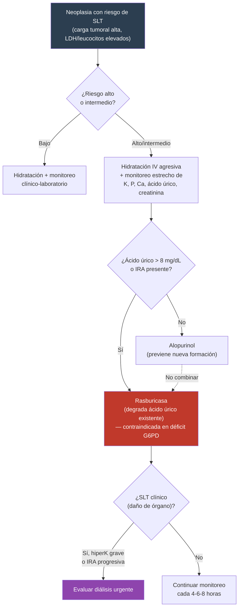
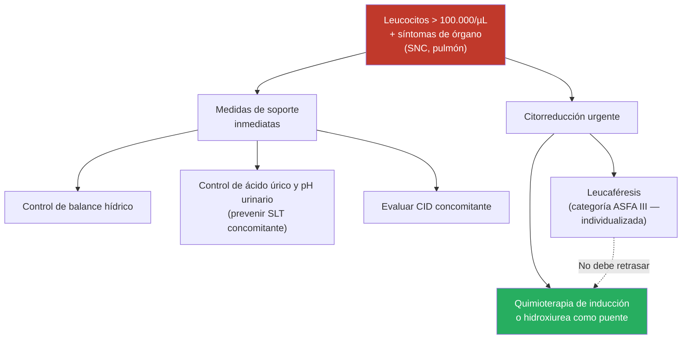
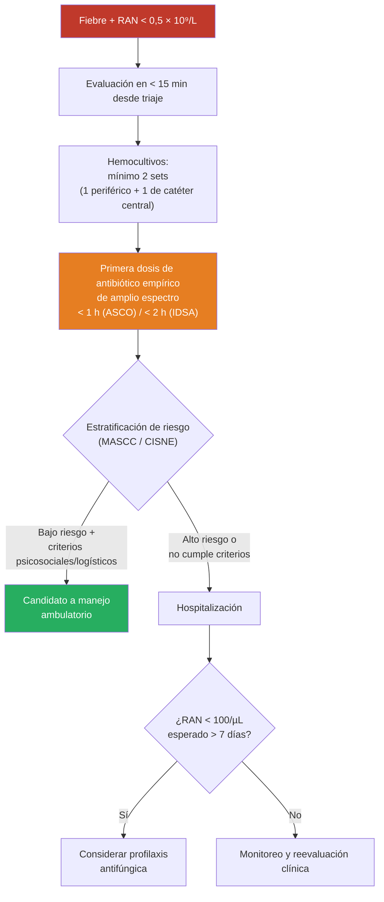
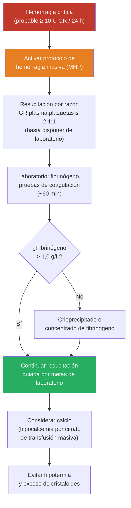
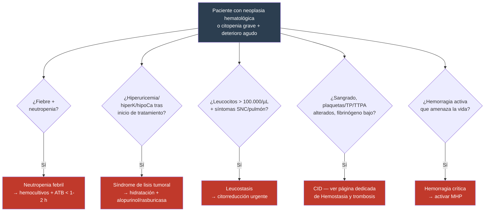

# Urgencias hematológicas

!!! info "Ficha de la página"
    **Última revisión:** 2026-11-12 · **Fuente base:** Cairo & Bishop 2004 (clasificación lisis tumoral) [111], Howard, Jones & Pui, NEJM 2011 (lisis tumoral) [112], Giammarco et al. 2017 (leucostasis) [113], Taplitz et al. ASCO/IDSA 2018 (neutropenia febril) [114], Holcomb et al. PROPPR 2015 (transfusión masiva) [115], Cannon, NEJM 2018 (shock hemorrágico) [116] · **Alcance:** reconocimiento y manejo inicial de las urgencias hematológicas más frecuentes: neutropenia febril, síndrome de lisis tumoral, leucostasis/hiperleucocitosis y hemorragia crítica/transfusión masiva. La CID se desarrolla en detalle en [Hemostasia y trombosis](../benigna/hemostasia-trombosis.md) y no se repite aquí.

---

## 1 · Resumen rápido

1. La **neutropenia febril** (RAN < 0,5 × 10⁹/L + fiebre) requiere hemocultivos y antibióticos empíricos de amplio espectro dentro de **1 hora** (ASCO) a **2 horas** (IDSA) desde el triaje; la estratificación de riesgo (MASCC, CISNE) decide manejo ambulatorio vs. hospitalario [114].
2. El **síndrome de lisis tumoral (SLT)** se define por criterios de laboratorio (Cairo-Bishop: ≥ 2 de hiperK, hiperfosfatemia, hipocalcemia, hiperuricemia) y se vuelve "clínico" si se agrega daño de órgano (IRA, arritmia, convulsión, muerte súbita) [111][112].
3. **Rasburicasa** degrada el ácido úrico existente y actúa en minutos a horas; **alopurinol** solo previene la formación de ácido úrico nuevo — no deben combinarse porque alopurinol reduce la eficacia de rasburicasa, y rasburicasa está contraindicada en déficit de G6PD [112].
4. La **hiperleucocitosis** (leucocitos > 100.000/µL) se vuelve **leucostasis** cuando hay daño de órgano sintomático (más frecuente cerebro y pulmón); es más común y grave en LMA que en LLA, y constituye una emergencia médica que requiere citorreducción urgente [113].
5. La leucaféresis en leucostasis tiene rol **individualizado (categoría ASFA III)** y **nunca debe retrasar** el inicio de la quimioterapia definitiva [113] — ver también [Medicina transfusional § 6](medicina-transfusional.md#6-aferesis-terapeutica).
6. En hemorragia crítica, la evidencia actual **no respalda** la razón fija 1:1:1 (GR:plasma:plaquetas) sobre 2:1:1; el consenso vigente es resucitación por razón (≤ 2:1:1) hasta disponer de laboratorio, luego transición a resucitación hemostática guiada por metas (fibrinógeno > 1,0 g/L) [115][116].
7. La **CID** se trata siempre de la causa subyacente, con score ISTH 2025 para estratificar fase — contenido completo en [Hemostasia y trombosis § 5.3 y § 8.2](../benigna/hemostasia-trombosis.md).

---

## 2 · Síndrome de lisis tumoral (SLT)

### 2.1 Definición y criterios de Cairo-Bishop

El SLT describe las alteraciones metabólicas que ocurren por la destrucción rápida de células tumorales tras iniciar terapia citotóxica, con liberación abrupta de iones intracelulares, ácidos nucleicos y proteínas al espacio extracelular [111].

**SLT de laboratorio** = neoplasia + ≥ 2 de los siguientes, dentro de 3 días antes o 7 días después de iniciar tratamiento [111][112]:

| Parámetro | Criterio |
|---|---|
| Potasio | ≥ 6,0 mmol/L, o aumento ≥ 25 % desde basal |
| Fósforo | ≥ 1,45 mmol/L (≥ 4,5 mg/dL; ≥ 6,5 mg/dL en niños), o aumento ≥ 25 % |
| Calcio | ≤ 1,75 mmol/L (≤ 7 mg/dL), o disminución ≥ 25 % |
| Ácido úrico | > 8 mg/dL (> 476 µmol/L), o aumento ≥ 25 % |

**SLT clínico** = SLT de laboratorio + ≥ 1 de: creatinina ≥ 1,5 × LSN, arritmia cardíaca, muerte súbita, convulsión [111][112].

### 2.2 Factores de riesgo

- Alta carga tumoral: LDH > 1.500 UI/L, leucocitos ≥ 50 × 10⁹/L, enfermedad voluminosa (> 10 cm)
- Infiltración de médula ósea, bazo o hígado
- Tumores altamente quimiosensibles: **leucemia aguda, linfoma de Burkitt, LNH de alto grado** — más frecuente en estas entidades; raro en tumores sólidos [112]
- Disfunción renal basal o uso de nefrotóxicos

### 2.3 Algoritmo de prevención y tratamiento

!!! warning "Calcio solo si hay inestabilidad"
    El calcio IV se reserva para **inestabilidad cardiovascular** (arritmias, QRS ensanchado) — administrarlo de forma rutinaria para corregir hipocalcemia asintomática **empeora** el depósito de fosfato de calcio y el daño renal [112].

### 2.4 Hidratación

Hidratación intravenosa agresiva, evitando típicamente superar 3.000 mL/m²/día si el paciente no tolera ese volumen (riesgo de sobrecarga, especialmente con función cardíaca o renal limitada) [112].

---

## 3 · Leucostasis e hiperleucocitosis

### 3.1 Definiciones

- **Hiperleucocitosis**: leucocitos > 100.000/µL en sangre periférica; ocurre en ~10 % de los pacientes con LMA [113].
- **Leucostasis**: hiperleucocitosis sintomática con daño de órgano — más frecuentemente cerebro (hemorragia intracraneal) y pulmón (insuficiencia respiratoria). Es una **emergencia médica** [113].

Es más frecuente y grave en **LMA** que en LLA, y rara en leucemias crónicas. Sin reconocimiento y tratamiento oportuno, la mortalidad precoz puede llegar a 40 % [113].

### 3.2 Manejo

El rol de la leucaféresis es **controvertido** y no está definitivamente establecido; ASFA 2023 la categoriza como individualizada (categoría III) [109][113]. Debe evaluarse concurrentemente la presencia de **SLT y CID**, complicaciones frecuentemente asociadas a hiperleucocitosis [113].

---

## 4 · Neutropenia febril

### 4.1 Definición y contexto

Esta sección complementa el contenido ya disponible en [Citopenias y estudio inicial § 5.3](../benigna/citopenias-estudio-inicial.md#53-enfoque-de-neutropenia), que resume la urgencia de reconocimiento; aquí se detalla la estratificación de riesgo y el flujo de manejo según la guía conjunta ASCO/IDSA 2018 [114].

**Definición de fiebre**: temperatura oral única ≥ 38,3 °C, o ≥ 38,0 °C sostenida por más de 1 hora, en paciente con RAN < 0,5 × 10⁹/L [114].

### 4.2 Estratificación de riesgo

| Herramienta | Uso | Interpretación |
|---|---|---|
| **MASCC** (Multinational Association for Supportive Care in Cancer) | Puntaje máximo 26 | ≥ 21 = bajo riesgo (candidato a manejo ambulatorio) |
| **CISNE** (Clinical Index of Stable Febrile Neutropenia) | Para pacientes clínicamente estables al ingreso | 0 = bajo riesgo; 1–2 = intermedio; ≥ 3 = alto riesgo |

Criterios adicionales de alto riesgo: comorbilidad o inestabilidad clínica, neutropenia profunda prolongada esperada (RAN ≤ 100/µL por ≥ 7 días) [114].

### 4.3 Flujo de manejo inicial

### 4.4 Manejo ambulatorio de bajo riesgo

Requiere, además del puntaje de riesgo favorable, criterios psicosociales y logísticos (p. ej. residencia a ≤ 1 hora/≤ 30 millas del centro, acceso a cuidador y a atención de urgencia) [114]. Los pacientes que no defervescen tras 2–3 días de antibiótico empírico de amplio espectro deben reevaluarse como candidatos a manejo hospitalario [114].

---

## 5 · Coagulación intravascular diseminada (CID)

La CID se desarrolla en profundidad —incluido el score ISTH 2025, la clasificación por fases (pre-CID, fase temprana/SIC, CID abierta) y el algoritmo de tratamiento por fase— en [Hemostasia y trombosis § 5.3 (diagnóstico) y § 8.2 (algoritmo de tratamiento)](../benigna/hemostasia-trombosis.md). Como regla general en el contexto de urgencia: el tratamiento de la CID es **siempre el de la causa subyacente** (sepsis, leucemia promielocítica aguda, trauma, complicación obstétrica), con soporte hemostático dirigido por laboratorio en caso de sangrado activo.

---

## 6 · Hemorragia crítica y protocolo de transfusión masiva

### 6.1 Terminología y contexto

El término está evolucionando de "protocolo de transfusión masiva" (MTP) a **"protocolo de hemorragia masiva" (MHP)**, para enfatizar aspectos de control de la hemorragia más allá de la sola transfusión [115][116]. La hemorragia mayor suele definirse localmente como sangrado que probablemente requerirá ≥ 10 unidades de GR en 24 horas.

### 6.2 Evidencia sobre razones de componentes — PROPPR

El ensayo PROPPR (680 pacientes con trauma grave) comparó razones de GR:plasma:plaquetas de 1:1:1 vs. 1:1:2 y **no encontró diferencias significativas** en mortalidad a 24 horas (12,7 % vs. 17,0 %) ni a 30 días (22,4 % vs. 26,1 %). El grupo 1:1:1 tuvo menor muerte por exanguinación (9,2 % vs. 14,6 %) y mayor logro de hemostasia (86 % vs. 78 %), sin aumento de complicaciones a pesar de recibir más plasma y plaquetas [115].

**Interpretación práctica**: no hay evidencia de que 1:1:1 sea superior a 2:1:1 en mortalidad global, pero una razón más rica en plasma/plaquetas puede favorecer el logro de hemostasia y reducir muertes por exanguinación temprana — de ahí que el consenso actual recomiende una razón ≤ 2:1:1 como punto de partida, no necesariamente 1:1:1 estricto [115][116].

### 6.3 Flujo de activación y transición a resucitación guiada

**Mnemotecnia "ABC tras 3"**: **A**ctivar el MHP, **B**alancear componentes, **C**onsiderar calcio y concentrados (fibrinógeno) [116].

### 6.4 Consideraciones por escenario clínico

- **Trauma**: escenario de la mayoría de la evidencia (PROPPR); fisiología de shock hemorrágico agudo con coagulopatía traumática [115][116].
- **Hemorragia digestiva**: fisiología distinta al trauma; rara vez requiere activación de un MHP completo — resucitación más conservadora y dirigida por volumen/hemoglobina.
- **Hemorragia variceal**: el consenso Baveno VII sugiere que un fibrinógeno de 70–80 mg/dL es adecuado para la mayoría de los pacientes, un umbral distinto al usado en trauma.
- **Hemorragia posparto**: fisiología obstétrica propia; umbrales de activación y de fibrinógeno pueden diferir de los protocolos de trauma.

!!! warning "Evitar errores comunes"
    No sobrecargar con cristaloides (dilución de factores de coagulación y empeoramiento de la coagulopatía), evitar y corregir la hipotermia activamente, y no esperar el resultado completo de laboratorio para iniciar la resucitación por razón en el paciente que sangra activamente [116].

---

## 7 · Algoritmo integrado: reconocimiento de la urgencia hematológica

---

## 8 · Evidencia clave

| Fuente | Aporte principal | Ref |
|---|---|---|
| Cairo & Bishop, Br J Haematol 2004 | Clasificación y sistema de recomendaciones del síndrome de lisis tumoral | [111] |
| Howard, Jones & Pui, NEJM 2011 | Revisión integral de fisiopatología, riesgo y manejo del SLT | [112] |
| Giammarco et al., Expert Rev Hematol 2017 | Manejo de hiperleucocitosis y leucostasis como emergencia médica | [113] |
| Taplitz et al., ASCO/IDSA 2018 (JCO) | Estratificación de riesgo y manejo ambulatorio/hospitalario de neutropenia febril | [114] |
| Holcomb et al., PROPPR, JAMA 2015 | Ensayo aleatorizado: razón 1:1:1 vs. 1:1:2 de componentes en trauma grave | [115] |
| Cannon, NEJM 2018 | Revisión de shock hemorrágico y resucitación con control de daño | [116] |

---

## 9 · Seguridad

- **SLT**: no combinar alopurinol y rasburicasa (reduce eficacia de rasburicasa); confirmar estado de G6PD antes de rasburicasa cuando sea posible, dado el riesgo de hemólisis [112].
- **Leucostasis**: la leucaféresis no debe retrasar el inicio de quimioterapia definitiva — es una medida puente, no el tratamiento principal [113].
- **Neutropenia febril**: el retraso en la primera dosis de antibiótico es la variable más modificable y de mayor impacto en mortalidad — priorizar siempre sobre estudios diagnósticos no urgentes [114].
- **Hemorragia crítica**: evitar hipotermia, acidosis y exceso de cristaloides (la "tríada letal" junto con la coagulopatía); vigilar calcio ionizado durante transfusión masiva por quelación con citrato [116].

---

## 10 · Puntos clave para el residente

!!! success "Lo esencial"

    1. En fiebre + RAN < 0,5 × 10⁹/L, el tiempo hasta antibiótico es la variable que más impacta el desenlace — no esperes resultados de laboratorio para iniciar [114].
    2. El SLT se diagnostica con criterios objetivos (Cairo-Bishop) y su prevención (hidratación + alopurinol o rasburicasa según riesgo) es más efectiva que su tratamiento una vez establecido el daño renal [111][112].
    3. Rasburicasa y alopurinol **no se combinan**; rasburicasa está contraindicada en déficit de G6PD [112].
    4. Hiperleucocitosis ≠ leucostasis: la segunda requiere síntomas de daño de órgano y es la que define la urgencia — actúa con citorreducción urgente, no solo con leucaféresis [113].
    5. En hemorragia crítica, no existe evidencia sólida de que 1:1:1 sea superior a 2:1:1; lo esencial es activar el protocolo temprano, no demorar por esperar razones "perfectas" [115][116].
    6. La CID no se repite aquí: revisa el score ISTH 2025 y el algoritmo de tratamiento por fase en [Hemostasia y trombosis](../benigna/hemostasia-trombosis.md).

---

## 11 · Autoevaluación

??? question "Caso 1 — SLT en linfoma de Burkitt"
    Paciente con linfoma de Burkitt, LDH 2.200 UI/L, inicia quimioterapia de inducción. A las 24 horas: K 6,2 mmol/L, ácido úrico 9,5 mg/dL, creatinina 1,8 × basal. ¿Es SLT de laboratorio o clínico?

    **Respuesta**: SLT **clínico**. Cumple ≥ 2 criterios de laboratorio (K ≥ 6,0 y ácido úrico > 8 mg/dL) y además creatinina ≥ 1,5 × LSN, lo que lo clasifica como SLT clínico según Cairo-Bishop [111][112]. Requiere manejo urgente: hidratación, rasburicasa (ácido úrico ya elevado con IRA) y evaluación de necesidad de diálisis si progresa la hiperkalemia.

??? question "Caso 2 — Leucostasis en LMA"
    Paciente con LMA recién diagnosticada, leucocitos 180.000/µL, cefalea y confusión progresiva. ¿Cuál es el diagnóstico y el siguiente paso?

    **Respuesta**: Leucostasis (hiperleucocitosis sintomática con compromiso del SNC) — emergencia médica. Siguiente paso: medidas de soporte inmediatas (balance hídrico, control de ácido úrico) e inicio urgente de citorreducción (quimioterapia de inducción, con o sin hidroxiurea como puente); la leucaféresis es una opción individualizada que no debe retrasar la quimioterapia [113].

??? question "Caso 3 — Neutropenia febril, ¿ambulatorio u hospitalizado?"
    Paciente con cáncer de mama en quimioterapia, fiebre 38,4 °C, RAN 0,3 × 10⁹/L, clínicamente estable, MASCC 23, vive a 20 minutos del hospital con cuidador disponible. ¿Es candidata a manejo ambulatorio?

    **Respuesta**: Potencialmente sí. MASCC ≥ 21 indica bajo riesgo, y cumple criterios psicosociales/logísticos razonables (cercanía, cuidador) [114]. La decisión final requiere juicio clínico integrando estos elementos; debe recibir la primera dosis de antibiótico empírico antes de considerar el alta, y tener seguimiento cercano garantizado.

??? question "Caso 4 — Razón de transfusión en trauma"
    Paciente politraumatizado con hemorragia masiva activa. El equipo discute si usar razón 1:1:1 o 2:1:1 de GR:plasma:plaquetas. ¿Qué dice la evidencia?

    **Respuesta**: El ensayo PROPPR no mostró diferencia significativa en mortalidad a 24 horas ni 30 días entre 1:1:1 y 1:1:2, aunque 1:1:1 se asoció a menor muerte por exanguinación y mayor logro de hemostasia, sin más complicaciones [115]. El consenso actual es usar una razón ≤ 2:1:1 como punto de partida y transicionar a resucitación guiada por laboratorio (fibrinógeno, pruebas de coagulación) en cuanto estén disponibles [116]. Lo más importante es activar el protocolo sin demora, no la razón exacta inicial.

---

## 12 · Referencias

Las referencias [111]–[116] se encuentran en la [lista de referencias](../referencias.md) de la wiki. Las referencias [79], [90] y [92], usadas por remisión a otras páginas, también se listan allí.

| Cita | Descripción breve |
|---|---|
| [111] | Cairo & Bishop — clasificación y estrategias terapéuticas del SLT (Br J Haematol 2004) |
| [112] | Howard, Jones & Pui — revisión del síndrome de lisis tumoral (NEJM 2011) |
| [113] | Giammarco et al. — manejo de hiperleucocitosis y leucostasis (Expert Rev Hematol 2017) |
| [114] | Taplitz et al. — guía ASCO/IDSA de manejo de neutropenia febril (JCO 2018) |
| [115] | Holcomb et al. — ensayo PROPPR de razones de transfusión en trauma (JAMA 2015) |
| [116] | Cannon — revisión de shock hemorrágico (NEJM 2018) |

---

## 13 · Pendientes

- [ ] Agregar sección específica de síndrome de activación macrofágica/linfohistiocitosis hemofagocítica (HLH) como urgencia hematológica
- [ ] Desarrollar hiperviscosidad sintomática (macroglobulinemia de Waldenström, mieloma IgA/IgG) como urgencia relacionada, con cross-referencia a aféresis
- [ ] Incluir manejo específico de hemorragia crítica en paciente anticoagulado (reversión de AVK, anticoagulantes directos)
- [ ] Ampliar sección de hemorragia variceal y posparto con algoritmos propios (actualmente solo mencionados como contexto distinto al trauma)
- [ ] Agregar protocolo local de activación de MHP del Hospital Puerto Montt si existe documento institucional
- [ ] Verificar PMID/DOI de todas las referencias contra texto completo (actualmente verificadas por metadatos/resumen vía PubMed)
